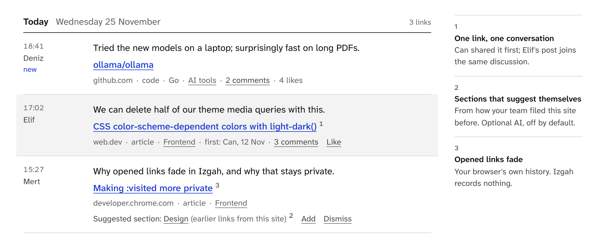

# Izgah

**Your team's shared link library.** Izgah is a small, self-hosted feed where a team shares the links it finds — articles, videos, repositories, social posts — each with a note, filed in sections, with one discussion per link. Nothing gets lost in a chat scroll again.

[](https://github.com/gorkemio/izgah/actions/workflows/ci.yml)
[](./LICENSE)

[Website](https://izgah.com) · [Self-hosting](#self-hosting) · [Browser extensions](#browser-extensions) · [Development](#development) · [Türkçe](./README.tr.md)

<picture>
  <source media="(prefers-color-scheme: dark)" srcset="./docs/images/feed-dark.png">
  
</picture>

> [izgah.com](https://izgah.com) only describes the project; it does not host an instance. Every team runs Izgah on its own server and domain.

## Features

- **Feed** — a reverse-chronological register of shared links. The member's note comes first; the link follows with one line of facts (site, type, language, sections, comments, likes). New posts are announced, never pushed in under your cursor.
- **One link, one conversation** — links are deduplicated by their canonical URL, so a second share joins the existing discussion instead of starting a new one.
- **Sections** — admin-managed topics. A link can live in several sections, and admins can file "silent" reference links without posting them to the feed.
- **Search** — full-text search over titles, descriptions, notes and URL fragments in English and Turkish, plus a `⌘K` / `Ctrl+K` command palette and `j` / `k` keyboard navigation.
- **Smart capture** — `#section` in a note files the link, and sections are suggested from your team's history. Admins can optionally connect OpenRouter, Anthropic, OpenAI, Gemini or a local OpenAI-compatible model for short summaries, search keywords and section suggestions. AI is off until configured.
- **Link previews** — an in-process worker fetches titles, descriptions and cover images behind SSRF guards and stores resized WebP thumbnails locally.
- **Browser extensions** — Chrome, Firefox and Safari extensions share the current tab or a right-clicked link with a personal API key.
- **Works without JavaScript** — sharing, navigation, search, discussion, themes and admin are plain forms and links first; JavaScript only enhances them.
- **Accessible by default** — light and dark themes, each with a standard and a high-contrast palette, all meeting WCAG 2.2 AA (AAA in high contrast). Links you have opened fade through the browser's own `:visited` history; the server records nothing.
- **English and Turkish** — each member picks a language; the instance sets the default.
- **Small footprint** — one Node.js container and PostgreSQL. No external e-mail, queue or cache service.

## Self-hosting

Izgah ships as a single Docker image. A production setup is the app container, PostgreSQL 16 and a persistent volume for thumbnails, behind a reverse proxy that terminates HTTPS.

```sh
git clone https://github.com/gorkemio/izgah.git && cd izgah
export POSTGRES_PASSWORD='…' BETTER_AUTH_SECRET="$(openssl rand -hex 32)" ORIGIN='https://links.example.com'
docker compose -f docker-compose.prod.yml up -d --build
docker compose -f docker-compose.prod.yml exec app node build/cli.js create-admin --email you@example.com --name "Admin"
```

Open the invite link the last command prints, set a password, then invite your team from **Admin → Members**. Izgah sends no e-mail: invites and password resets are one-time links that an admin passes on.

The app port binds to `127.0.0.1` only. Always put a reverse proxy (Caddy, Traefik, Nginx) in front of it; otherwise clients could forge `X-Forwarded-For` and bypass per-IP rate limits.

Step-by-step guides:

- [Docker Compose + Caddy](./docs/deploy/docker-compose.md)
- [Dokploy](./docs/deploy/dokploy.md)

### Environment variables

| Name                    | Required           | Default            | Description                                                                                              |
| :---------------------- | :----------------- | :----------------- | :------------------------------------------------------------------------------------------------------- |
| `DATABASE_URL`          | yes                | —                  | PostgreSQL connection URI.                                                                               |
| `BETTER_AUTH_SECRET`    | yes                | —                  | Session signing secret (at least 32 characters).                                                         |
| `ORIGIN`                | yes, in production | —                  | Public HTTPS origin of your instance (e.g. `https://links.example.com`); used for CSRF and invite links. |
| `DEFAULT_LOCALE`        | no                 | `en`               | Language for members who have not picked one (`en` or `tr`).                                             |
| `APP_TIME_ZONE`         | no                 | `UTC`              | IANA time zone used for dates and "today" (e.g. `Europe/Istanbul`).                                      |
| `INSTANCE_NAME`         | no                 | `Izgah`            | Name shown in the sidebar, sign-in page and browser tab titles.                                          |
| `SOURCE_URL`            | no                 | this repository    | Link to the source code shown in Settings (AGPL-3.0 §13). Point it at your fork if you modify Izgah.     |
| `ADMIN_BOOTSTRAP_EMAIL` | no                 | —                  | When no active admin exists, logs a one-time setup link for this address on startup.                     |
| `GITHUB_TOKEN`          | no                 | —                  | Read-only token that raises GitHub API limits for repository previews.                                   |
| `DATABASE_POOL_MAX`     | no                 | `12`               | PostgreSQL pool size.                                                                                    |
| `HOST` / `PORT`         | no                 | `0.0.0.0` / `3000` | HTTP listen address.                                                                                     |
| `ADDRESS_HEADER`        | no                 | `x-forwarded-for`  | Header that carries the real client IP behind your proxy.                                                |
| `XFF_DEPTH`             | no                 | `1`                | Number of trusted proxies in front of the app.                                                           |
| `MEDIA_STORAGE_DIR`     | no                 | `/data/thumbnails` | Persistent directory for WebP thumbnails.                                                                |
| `MEDIA_MIN_FREE_BYTES`  | no                 | `536870912`        | Stop writing thumbnails below this much free disk space.                                                 |
| `MEDIA_MIN_FREE_RATIO`  | no                 | `0.15`             | Stop writing thumbnails below this free-space ratio.                                                     |
| `UNFURL_CONCURRENCY`    | no                 | `3`                | Parallel link-preview jobs.                                                                              |
| `LOG_LEVEL`             | no                 | `info`             | JSON log level (`debug`, `info`, `warn`, `error`).                                                       |
| `AI_FEATURES`           | no                 | `on`               | `off` hides the optional AI settings (Admin → Smart capture) and stops all AI calls.                     |
| `AI_CONCURRENCY`        | no                 | `1`                | Parallel enrichment jobs (1–4).                                                                          |

### Admin recovery

```sh
# Create another admin (prints a one-time invite link):
docker exec -it <app-container> node build/cli.js create-admin --email admin@example.com --name "Admin"
# 24-hour password reset link for an existing admin:
docker exec -it <app-container> node build/cli.js reset-admin --email admin@example.com
```

Both commands are written to the audit log and revoke the account's sessions and API keys.

### Backups

[`scripts/offbox-backup.sh`](./scripts/offbox-backup.sh) (a daily `pg_dump` plus thumbnails, to S3-compatible storage) and [`scripts/pre-deploy-backup.sh`](./scripts/pre-deploy-backup.sh) (a manual dump before releases with migrations) run on the host. See [docs/deploy/dokploy.md](./docs/deploy/dokploy.md#backups) for cron examples and a restore drill.

## Browser extensions

The extensions live in [`extensions/`](./extensions). A member installs the extension, opens its options, enters **their instance's address** and pastes a personal API key from **Settings → API keys**. No address is built in, so one published extension works with every Izgah instance; teams can also build a private copy with a fixed address. See [extensions/README.md](./extensions/README.md).

## Development

Requirements: Node.js ≥ 22, pnpm and Docker (for PostgreSQL).

```sh
pnpm install
cp .env.example .env          # then set BETTER_AUTH_SECRET to a random value of 32+ characters
docker compose up -d          # local PostgreSQL with the izgah and izgah_test databases
pnpm db:migrate
pnpm cli create-admin --email admin@example.com --name "First Admin"   # prints a one-time invite link
pnpm dev
```

A change is done when these pass:

```sh
pnpm lint
pnpm check
pnpm test        # unit and PostgreSQL integration tests
pnpm test:e2e    # Playwright: Chromium, Firefox, WebKit and mobile
```

Built with SvelteKit 3 (Svelte 5) on Node.js 22, PostgreSQL 16 (`unaccent`, `pg_trgm`), Drizzle ORM and Better Auth; the extensions use WXT. No UI framework: native `<dialog>`, `popover`, View Transitions and container queries.

## Documentation

- [ARCHITECTURE.md](./ARCHITECTURE.md) — how the pieces fit together.
- [docs/designs/](./docs/designs) — the approved design documents, indexed in [SITEMAP.md](./docs/designs/SITEMAP.md).
- [CONTRIBUTING.md](./CONTRIBUTING.md) — development workflow, translations and pull requests.
- [SECURITY.md](./SECURITY.md) — how to report a vulnerability.

## Contributing

Bug reports, translations and pull requests are welcome. For anything larger than a bug fix, please open an issue first so we can agree on the approach. See [CONTRIBUTING.md](./CONTRIBUTING.md) and the [Code of Conduct](./CODE_OF_CONDUCT.md).

## License

Izgah is free software under the [GNU Affero General Public License v3.0](./LICENSE). If you run a modified version for others over a network, you must offer them its source code. The bundled font, Atkinson Hyperlegible Next, is under the SIL Open Font License; see [THIRD_PARTY_NOTICES.md](./THIRD_PARTY_NOTICES.md).
