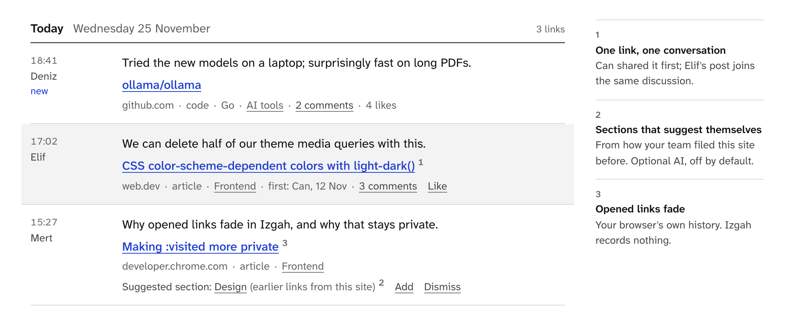

# İzgah

**Ekibinizin ortak bağlantı arşivi.** İzgah; bir ekibin internette bulduğu bağlantıları — makaleler, videolar, kod depoları, sosyal medya gönderileri — birer notla paylaştığı, bölümlere ayırdığı ve her bağlantıyı tek bir tartışmada konuştuğu, kendi sunucunuzda çalışan küçük bir akıştır. Bağlantılar artık sohbet geçmişinde kaybolmaz.

[](https://github.com/gorkemio/izgah/actions/workflows/ci.yml)
[](./LICENSE)

[Web sitesi](https://izgah.com/tr/) · [Kendi sunucunuza kurulum](#kendi-sunucunuza-kurulum) · [Tarayıcı eklentileri](#tarayıcı-eklentileri) · [Geliştirme](#geliştirme) · [English](./README.md)

<picture>
  <source media="(prefers-color-scheme: dark)" srcset="./docs/images/feed-dark.png">
  
</picture>

> [izgah.com](https://izgah.com/tr/) yalnızca projeyi tanıtır; orada bir İzgah örneği **çalışmaz**. Her ekip İzgah'ı kendi sunucusunda ve alan adında çalıştırır.

## Özellikler

- **Akış** — paylaşılan bağlantıların ters kronolojik kaydı. Önce üyenin notu gelir; ardından bağlantı ve tek satırlık künyesi (site, tür, dil, bölümler, yorumlar, beğeniler). Yeni paylaşımlar duyurulur, imlecinizin altına kendiliğinden eklenmez.
- **Bir bağlantı, bir tartışma** — bağlantılar kanonik adreslerine göre tekilleştirilir; aynı bağlantı ikinci kez paylaşıldığında yeni bir tartışma açılmaz, mevcut tartışmaya katılır.
- **Bölümler** — yöneticilerin yönettiği konular. Bir bağlantı birden fazla bölümde olabilir; yöneticiler akışa düşürmeden "sessiz" başvuru bağlantıları ekleyebilir.
- **Arama** — başlık, açıklama, not ve URL parçalarında Türkçe ve İngilizce tam metin arama, `⌘K` / `Ctrl+K` komut paleti ve `j` / `k` ile klavyeden gezinme.
- **Akıllı ekleme** — notta `#bölüm` yazmak bağlantıyı o bölüme koyar; bölümler ekibin geçmişine göre önerilir. Yöneticiler isteğe bağlı olarak OpenRouter, Anthropic, OpenAI, Gemini ya da yerel, OpenAI uyumlu bir modeli bağlayıp kısa özet, arama anahtar kelimesi ve bölüm önerisi alabilir. Yapay zekâ, yapılandırılana kadar kapalıdır.
- **Bağlantı önizlemeleri** — SSRF korumalı, süreç içi bir işçi başlık, açıklama ve kapak görsellerini çeker; küçültülmüş WebP görselleri yerelde saklar.
- **Tarayıcı eklentileri** — Chrome, Firefox ve Safari eklentileri açık sekmeyi ya da sağ tıklanan bağlantıyı kişisel API anahtarıyla paylaşır.
- **JavaScript olmadan çalışır** — paylaşım, gezinme, arama, tartışma, tema ve yönetim önce düz form ve bağlantıdır; JavaScript yalnızca iyileştirir.
- **Baştan erişilebilir** — açık ve koyu tema, her biri standart ve yüksek kontrast paletle; hepsi WCAG 2.2 AA (yüksek kontrastta AAA). Açtığınız bağlantılar tarayıcının kendi `:visited` geçmişiyle solar; sunucu hiçbir şey kaydetmez.
- **İngilizce ve Türkçe** — her üye dilini seçer; varsayılanı örnek belirler.
- **Küçük ayak izi** — tek Node.js konteyneri ve PostgreSQL. Harici e-posta, kuyruk veya önbellek servisi yok.

## Kendi sunucunuza kurulum

İzgah tek bir Docker imajıdır. Üretim kurulumu; uygulama konteyneri, PostgreSQL 16 ve kapak görselleri için kalıcı bir hacimden oluşur ve HTTPS'i sonlandıran bir ters vekilin (reverse proxy) arkasında çalışır.

```sh
git clone https://github.com/gorkemio/izgah.git && cd izgah
export POSTGRES_PASSWORD='…' BETTER_AUTH_SECRET="$(openssl rand -hex 32)" ORIGIN='https://links.example.com'
docker compose -f docker-compose.prod.yml up -d --build
docker compose -f docker-compose.prod.yml exec app node build/cli.js create-admin --email siz@example.com --name "Yönetici"
```

Son komutun yazdırdığı davet bağlantısını açıp parolanızı belirleyin, ardından ekibinizi **Yönetim → Üyeler** ekranından davet edin. İzgah e-posta göndermez: davetler ve parola sıfırlamaları, bir yöneticinin ilettiği tek kullanımlık bağlantılardır.

Uygulama portu yalnızca `127.0.0.1` üzerinde dinler. Önüne mutlaka bir ters vekil (Caddy, Traefik, Nginx) koyun; aksi halde istemciler `X-Forwarded-For` başlığını taklit ederek IP başına hız sınırlarını aşabilir.

Adım adım kılavuzlar (İngilizce):

- [Docker Compose + Caddy](./docs/deploy/docker-compose.md)
- [Dokploy](./docs/deploy/dokploy.md)

### Türkçe bir ekip için örnek ayarlar

```sh
ORIGIN=https://links.example.com
DEFAULT_LOCALE=tr
APP_TIME_ZONE=Europe/Istanbul
INSTANCE_NAME=İzgah
```

### Ortam değişkenleri

| Ad                      | Zorunlu       | Varsayılan         | Açıklama                                                                                                   |
| :---------------------- | :------------ | :----------------- | :--------------------------------------------------------------------------------------------------------- |
| `DATABASE_URL`          | evet          | —                  | PostgreSQL bağlantı URI'si.                                                                                |
| `BETTER_AUTH_SECRET`    | evet          | —                  | Oturum imzalama anahtarı (en az 32 karakter).                                                              |
| `ORIGIN`                | üretimde evet | —                  | Örneğinizin herkese açık HTTPS kökü; CSRF ve davet bağlantıları için kullanılır.                           |
| `DEFAULT_LOCALE`        | hayır         | `en`               | Dil seçmemiş üyeler için arayüz dili (`en` veya `tr`).                                                     |
| `APP_TIME_ZONE`         | hayır         | `UTC`              | Tarihler ve "bugün" sınırı için IANA saat dilimi (ör. `Europe/Istanbul`).                                  |
| `INSTANCE_NAME`         | hayır         | `Izgah`            | Kenar çubuğu, giriş ekranı ve sekme başlıklarında görünen ad.                                              |
| `SOURCE_URL`            | hayır         | bu depo            | Ayarlar'daki kaynak kodu bağlantısı (AGPL-3.0 §13). Değiştirdiyseniz kendi fork'unuzu verin.               |
| `ADMIN_BOOTSTRAP_EMAIL` | hayır         | —                  | Aktif yönetici yokken açılışta bu adres için tek kullanımlık kurulum bağlantısı loglanır.                  |
| `GITHUB_TOKEN`          | hayır         | —                  | Repo önizlemelerinde GitHub API sınırını yükselten salt okunur jeton.                                      |
| `DATABASE_POOL_MAX`     | hayır         | `12`               | PostgreSQL bağlantı havuzu boyutu.                                                                         |
| `HOST` / `PORT`         | hayır         | `0.0.0.0` / `3000` | HTTP dinleme adresi.                                                                                       |
| `ADDRESS_HEADER`        | hayır         | `x-forwarded-for`  | Vekil arkasında gerçek istemci IP'sini taşıyan başlık.                                                     |
| `XFF_DEPTH`             | hayır         | `1`                | Uygulamanın önündeki güvenilir vekil sayısı.                                                               |
| `MEDIA_STORAGE_DIR`     | hayır         | `/data/thumbnails` | WebP kapak görselleri için kalıcı dizin.                                                                   |
| `MEDIA_MIN_FREE_BYTES`  | hayır         | `536870912`        | Bu kadar boş alanın altında görsel yazımı durur.                                                           |
| `MEDIA_MIN_FREE_RATIO`  | hayır         | `0.15`             | Bu boş alan oranının altında görsel yazımı durur.                                                          |
| `UNFURL_CONCURRENCY`    | hayır         | `3`                | Eşzamanlı önizleme işi sayısı.                                                                             |
| `LOG_LEVEL`             | hayır         | `info`             | JSON log düzeyi (`debug`, `info`, `warn`, `error`).                                                        |
| `AI_FEATURES`           | hayır         | `on`               | `off`, isteğe bağlı yapay zekâ ayarlarını (Yönetim → Akıllı ekleme) gizler ve tüm YZ çağrılarını durdurur. |
| `AI_CONCURRENCY`        | hayır         | `1`                | Paralel zenginleştirme işi sayısı (1–4).                                                                   |

### Yönetici kurtarma

```sh
# Yeni yönetici (tek kullanımlık davet bağlantısı yazdırır):
docker exec -it <uygulama-konteyneri> node build/cli.js create-admin --email admin@example.com --name "Yönetici"
# Mevcut yönetici için 24 saat geçerli parola sıfırlama bağlantısı:
docker exec -it <uygulama-konteyneri> node build/cli.js reset-admin --email admin@example.com
```

Her iki komut denetim kaydına yazılır ve hesabın oturumlarını ve API anahtarlarını iptal eder.

### Yedekleme

[`scripts/offbox-backup.sh`](./scripts/offbox-backup.sh) (günlük `pg_dump` ve kapak görselleri, S3 uyumlu depolamaya) ve [`scripts/pre-deploy-backup.sh`](./scripts/pre-deploy-backup.sh) (göç içeren sürümlerden önce elle alınan döküm) sunucu üzerinde çalışır. Cron örnekleri ve geri yükleme denemesi için bkz. [docs/deploy/dokploy.md](./docs/deploy/dokploy.md#backups).

## Tarayıcı eklentileri

Eklentiler [`extensions/`](./extensions) altındadır. Üye eklentiyi kurar, ayarlarını açar, **kendi örneğinin adresini** girer ve **Ayarlar → API anahtarları** ekranından aldığı kişisel anahtarı yapıştırır. Gömülü bir adres yoktur; yayımlanan tek eklenti her İzgah örneğiyle çalışır. Ekipler dilerlerse adresleri gömülü özel bir kopya da derleyebilir. Ayrıntılar: [extensions/README.md](./extensions/README.md).

## Geliştirme

Gereksinimler: Node.js ≥ 22, pnpm ve Docker (PostgreSQL için).

```sh
pnpm install
cp .env.example .env          # ardından BETTER_AUTH_SECRET için en az 32 karakterlik rastgele bir değer girin
docker compose up -d          # izgah ve izgah_test veritabanlarıyla yerel PostgreSQL
pnpm db:migrate
pnpm cli create-admin --email admin@example.com --name "İlk Yönetici"   # tek kullanımlık davet bağlantısı yazdırır
pnpm dev
```

Bir değişiklik şunlar geçince biter:

```sh
pnpm lint
pnpm check
pnpm test        # birim ve PostgreSQL entegrasyon testleri
pnpm test:e2e    # Playwright: Chromium, Firefox, WebKit ve mobil
```

SvelteKit 3 (Svelte 5), Node.js 22, PostgreSQL 16 (`unaccent`, `pg_trgm`), Drizzle ORM ve Better Auth ile yazılmıştır; eklentiler WXT kullanır. Arayüz çatısı yoktur: yerel `<dialog>`, `popover`, View Transitions ve container query'ler.

## Belgeler

Belgeler İngilizcedir.

- [ARCHITECTURE.md](./ARCHITECTURE.md) — parçaların nasıl birleştiği.
- [docs/designs/](./docs/designs) — onaylı tasarım dokümanları; dizini [SITEMAP.md](./docs/designs/SITEMAP.md).
- [CONTRIBUTING.md](./CONTRIBUTING.md) — geliştirme akışı, çeviriler ve pull request'ler.
- [SECURITY.md](./SECURITY.md) — güvenlik açığı bildirimi.

## Katkı

Hata bildirimleri, çeviriler ve pull request'ler memnuniyetle karşılanır. Hata düzeltmesinden büyük işler için lütfen önce bir issue açın. Bkz. [CONTRIBUTING.md](./CONTRIBUTING.md) ve [Davranış Kuralları](./CODE_OF_CONDUCT.md).

## Lisans

İzgah, [GNU Affero Genel Kamu Lisansı v3.0](./LICENSE) ile lisanslanmış özgür bir yazılımdır. Değiştirilmiş bir sürümü ağ üzerinden başkalarına sunarsanız kaynak kodunu da sunmanız gerekir. Paketlenen yazı tipi Atkinson Hyperlegible Next, SIL Open Font License ile lisanslıdır; bkz. [THIRD_PARTY_NOTICES.md](./THIRD_PARTY_NOTICES.md).
