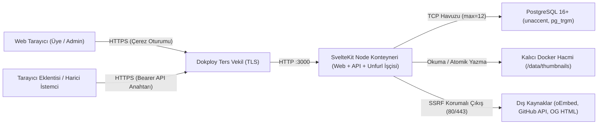
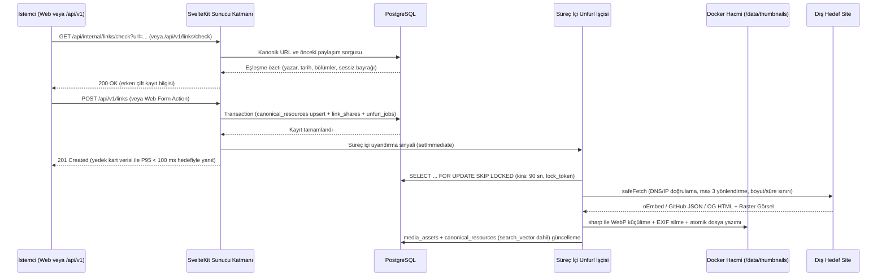

# İzgah Çekirdek Platformu (Core)

*   **Author:** Gorkem Inanc Ozdemir
*   **Status:** Approved
*   **Date:** 2026-11-14

--------------------------------------------------------------------------------

## Overview

İzgah, 10–15 kişilik kapalı bir ekibin internette karşılaştığı yararlı bağlantıları (sosyal medya gönderileri, videolar, kod depoları, makaleler ve genel web sayfaları) tek merkezde paylaştığı, tartıştığı ve geriye dönük aradığı Türkçe (`tr-TR`) bir web platformudur. Uygulama, yazarın kendi sunucusundaki PostgreSQL veritabanı ve yerel kapak görseli önbelleği için ayrılmış kalıcı bir Docker hacmi ile tek uygulama konteyneri olarak, yazarın sunucusunda çalışan Docker tabanlı uygulama yayın ve yönetim paneli ([Dokploy](https://dokploy.com)) üzerinden yayınlanır.

Bu tasarım dokümanı İzgah'ın çekirdek sistemini tanımlar: veri modeli, kimlik doğrulama ve rol yönetimi, bağlantı ekleme ve arka plan önizleme (unfurl) servisi, ters kronolojik ana akış, konu bölümleri, sessiz admin kaynakları, ortak beğeni/yorum/bildirim etkileşimleri, iki dilli arama, admin paneli, tarayıcı eklentilerinin kullanacağı `/api/v1/*` HTTP sözleşmesi ile kişisel API anahtarları ve Docker/Dokploy yayın hattı. Tarayıcı eklentilerinin kendi istemci paketleri bu dokümanın kapsamı dışındadır ve ayrı bir tasarım dokümanında ele alınacaktır.

#### Temel Kavramlar

*   **Kanonik Kaynak (`Canonical Resource`):** İzleme parametrelerinden arındırılmış ve platform kurallarına göre tekilleştirilmiş hedef web adresi. Başlık, açıklama, küçültülmüş kapak görseli, arama dizini ile ortak beğeni ve yorum dizisi bu tekil kayıt üzerinde tutulur.
*   **Paylaşım Kaydı (`Link Share`):** Bir üyenin belirli bir anda kendi notu ve isteğe bağlı konu bölümü seçimleriyle yaptığı paylaşım olayı. Aynı kaynak ikinci kez paylaşıldığında tartışma bölünmez, ancak akışta güncel paylaşım notuyla yeni bir kart oluşur ve ilk paylaşıma bağlantı verilir.
*   **Konu Bölümü (`Section`):** Admin tarafından oluşturulan ve sıralanan kategori alanı (ör. "Yapay Zeka", "Arayüz Tasarımı"). Bir paylaşım birden fazla konu bölümüne bağlanabilir veya bölümsüz bırakılabilir.
*   **Sessiz Kaynak (`Silent Resource`):** Admin'in ana akışa düşürmeden doğrudan bir veya daha fazla konu bölümüne eklediği başvuru bağlantısı.
*   **Önizleme Çekimi (`Unfurl`):** Paylaşılan bağlantının başlık, açıklama ve kapak görselinin sunucu tarafından arka planda dış kaynaktan okunması, görselin küçültülerek yerel kalıcı hacme yazılması ve kartın güncellenmesi işlemi.

## The Problem

Ekip üyeleri bugün yararlı bağlantıları ağırlıklı olarak masaüstü WhatsApp grubunda paylaşmaktadır. Bu çalışma düzeni aşağıdaki dört soruna yol açmaktadır:

1.  **Bilgi Kaybı ve Aranamama:** Bağlantılar günlük sohbet mesajları arasında kısa sürede yukarı kaybolmakta; Türkçe ve İngilizce terimler veya URL parçaları üzerinden geçmiş araması yapılamamaktadır.
2.  **Konu Ayrımının Olmaması:** Günlük hızlı paylaşımlar ile kalıcı başvuru kaynakları aynı sohbet akışına karışmakta; konuya göre süzme yapılamadığı gibi referans bağlantıları ana akışta göstermeden saklamak da mümkün olmamaktadır.
3.  **Mükerrer Paylaşımlarda Bağlam Kopukluğu:** Aynı bağlantı farklı zamanlarda tekrar paylaşıldığında önceki paylaşım ve üzerindeki yorumlar görülmemekte, geri bildirimler parçalanmaktadır.
4.  **Veri ve Altyapı Kontrolü:** Üçüncü parti hazır SaaS araçları ekip verisini dış sunucularda tutmakta veya kapalı ekip, Türkçe arayüz, sessiz admin kürasyonu ve kendi sunucusunda tek konteynerli işletim gereksinimlerini bir arada karşılamamaktadır.

İzgah bu sorunu; dış ağ çağrısı beklemeden veritabanına yazılan ters kronolojik bir akışı, admin yönetimli konu bölümlerini, tekil kaynak üzerinde birleşen beğeni/yorum yapısını, arka planda çalışan SSRF korumalı önizleme ve yerel görsel önbelleğini ve eklentiler için kişisel API anahtarlı HTTP sözleşmesini tek bir kendi kendine barındırılan (self-hosted) uygulamada birleştirerek çözer.

## Goals

*   **SMTP'siz Kapalı Ekip Erişimi ve Hesap Güvenliği:** Harici e-posta servisi veya OAuth sağlayıcısı kullanmadan, admin tarafından üretilen 24 saat geçerli tek kullanımlık davet ve parola sıfırlama bağlantılarıyla üyelerin kendi parolalarını belirlemesi; ayrılan üyelerin geçmiş paylaşım ve yorumları silinmeden pasifleştirilmesi; parola sıfırlama veya pasifleştirme anında kullanıcının açık web oturumlarının ve kişisel API anahtarlarının geçersiz kılınması; tek admin kilitlenmesine karşı sunucu komut satırı (`reset-admin`) kurtarma yolunun sunulması.
*   **Hızlı Bağlantı Kaydı ve Çift Paylaşım Kontrolü:** Bağlantı ekleme isteğinin dış ağ önizleme çağrılarını beklemeden `P95 < 100 ms` hedefiyle veritabanına yazılıp dönmesi; URL girildiğinde ön kontrol tamamlanarak daha önce kimin, ne zaman ve hangi bölümlerde (sessiz kayıtlar dahil) paylaştığının kullanıcıya gösterilmesi.
*   **SSRF Korumalı Sunucu Taraflı Önizleme ve Yerel Görsel Önbelleği:** YouTube ve X için oEmbed, GitHub depoları için GitHub REST API (isteğe bağlı erişim jetonu ve Open Graph geri dönüşü ile), diğer sayfalar için Open Graph / Twitter Card etiketlerinin arka plan kuyruğunda çekilmesi; özel ağ adreslerine karşı SSRF koruması, zaman aşımı, yönlendirme ve boyut sınırlarının uygulanması; yalnızca doğrulanmış raster görsellerin küçültülerek kalıcı Docker hacminde (günde ~15–30 görselli bağlantı varsayımıyla yıllık ~0,5–1,5 GB bütçe hedefiyle) saklanması.
*   **Akış, Konu Bölümleri ve Sessiz Admin Kürasyonu:** Ters kronolojik ana akış, çoklu konu bölümü ataması, normal paylaşımlarda isteğe bağlı bölüm seçimi, admin için "Bölümsüz" filtresi ve en az bir bölüme bağlı kalma kuralına sahip sessiz admin kaynaklarının desteklenmesi; bir üye daha önce sessiz eklenmiş bir bağlantıyı paylaştığında kaydın ana akışta da görünür olması.
*   **Ortak Etkileşim ve İki Dilli Arama:** Tekil kaynak üzerinde ortak beğeni, düz yorum dizisi ve yalnızca kullanıcının paylaştığı veya yorum yaptığı kaynaklara gelen etkileşimleri bildiren hedefli bildirim rozetinin (yalnızca görünür sekmede en az 60 saniye aralıkla kontrol) sağlanması; Türkçe, İngilizce ve URL alt parçalarını eşleyen arama ve 5 içerik türü (`video`, `repo`, `social`, `article`, `web`) filtresinin sunulması.
*   **Eklenti API Sözleşmesi ve Kişisel API Anahtarları:** Tarayıcı eklentilerinin ve harici istemcilerin kullanabilmesi için sürüm kontrollü (`/api/v1/*`) bağlantı ön kontrolü, bağlantı ekleme ve konu bölümü listeleme uçlarının; hesap ayarlarından üretilip iptal edilebilen, veritabanında yalnızca özet (hash) olarak tutulan kişisel API anahtarlarıyla korunması.
*   **Tek Konteyner Yayın ve Ölçülebilirlik:** GitHub deposuna yapılan gönderimlerde Dokploy üzerinden Dockerfile ile otomatik derleme ve yayın, sağlık/hazırlık uçları (`/healthz`, `/readyz`), geriye dönük uyumlu veritabanı göçleri, admin işlem kayıtları ve 1. ay başarı ölçütlerini (kayan 7 ve 30 günlük pencerelerde aktif paylaşan/arayan üye sayısı) harici analiz aracı olmadan PostgreSQL üzerinden izleme.

## Non-Goals

*   **Tarayıcı Eklentilerinin İstemci Kodları:** Chrome, Firefox ve Safari eklentilerinin geliştirilmesi, paketlenmesi ve dağıtımı bu dokümanın kapsamı dışındadır; burada yalnızca eklentilerin tüketeceği sunucu API sözleşmesi ve kimlik doğrulama mekanizması tanımlanır.
*   **Serbest Kullanıcı Etiketleri (`Freeform Tags`):** Etiket parçalanmasını ve paylaşım anındaki sürtünmeyi önlemek için v1'de yalnızca admin yönetimli konu bölümleri, içerik türü filtresi ve metin araması bulunur.
*   **Okudum / Okumadım Takibi:** Üye bazlı okuma durumu veya kişisel yer imi listesi tutulmaz.
*   **Harici E-posta (SMTP) ve Sosyal Giriş (OAuth):** E-posta gönderimi, doğrulama postası veya Google ile giriş v1 kapsamına dahil değildir (yalnızca Better Auth Drizzle şema uyumluluğu için `accounts` tablosunda standart OAuth sütunları boş (`NULL`) bırakılarak yer alır).
*   **Başsız Tarayıcı, Ücretli Kazıma Servisleri ve İstemci Meta Veri İpucu:** Tek konteynerin bellek sınırını korumak ve API yüzeyini sade tutmak için sunucuda Playwright/Puppeteer çalıştırılmaz, ücretli kazıma API'leri kullanılmaz ve istemciden `og:*` yedek ipucu kabul edilmez; giriş duvarı olan sitelerde (ör. Instagram) önizleme alınamazsa sade alan adı kartı gösterilir.
*   **Yapay Zeka Destekli Özetleme veya Otomatik Bölümleme:** Harici dil modeli çağrısı yapılmaz; içerik türü URL yapısından kural tabanlı belirlenir ve yazar ya da admin tarafından değiştirilebilir.
*   **Mobil Paylaşım Menüsü (`iOS/Android Share Sheet`):** Yerel mobil uygulama veya işletim sistemi paylaşım hedefi kapsam dışıdır; mobil tarayıcıdan standart duyarlı web arayüzü kullanılır.

## Open Questions

Açık mimari veya kapsam sorusu bulunmamaktadır. Kimlik doğrulama modeli, eklenti API anahtarı sınırı, sunucu taraflı önizleme kapsamı ve ortak etkileşim katmanı taslak öncesinde karara bağlanmıştır.

## Critical User Journeys (CUJs)

### CUJ 1: Davet Bağlantısı ile Üye Katılımı ve Kişisel API Anahtarı Üretimi

*   **Given**: Sistemde en az bir aktif admin bulunmaktadır; yeni ekip üyesinin henüz hesabı yoktur ve harici e-posta sunucusu tanımlı değildir.
*   **When**: Admin yönetim panelinden ad (`name`), e-posta ve rol bilgilerini girerek yeni üye kaydı oluşturup 24 saat geçerli tek kullanımlık davet bağlantısını kopyalayarak üyeye iletir; üye bağlantıyı açıp görünen adını (`name`) isteğe bağlı güncelleyerek kendi parolasını belirler ve ardından hesap ayarlarından tarayıcı eklentisi için yeni bir kişisel API anahtarı üretir.
*   **Then**: Üye oturumu açılmış olarak ana akışa yönlendirilir, davet bağlantısı tek kullanım sonrası geçersizleşir ve üretilen API anahtarı düz metin olarak yalnızca bir kez ekranda gösterilip veritabanına özet (hash) olarak kaydedilir.

### CUJ 2: Web Arayüzünden Bağlantı Paylaşımı, Erken Çift Kontrolü ve Arka Plan Önizleme

*   **Given**: Oturum açmış bir üye ana akış ekranındadır ve paylaşmak istediği URL'yi panoya kopyalamıştır.
*   **When**: Üye paylaşım penceresini açıp URL'yi yapıştırır; sistem kanonik adresi hesaplayarak önceki paylaşım bilgisini ön kontrol tamamlandığında gösterir; üye isteğe bağlı notunu yazıp konu bölümlerini seçerek formu gönderir.
*   **Then**: Paylaşım kaydı dış ağ isteği beklemeden veritabanına yazılır ve akışta dış ağ isteği beklemeden yedek alan adı/URL kartı olarak görünür (daha önce paylaşılmışsa ilk paylaşıma dinamik referans içerir); arka plan işçisi meta veriyi ve küçültülmüş kapak görselini kalıcı hacme yazdığında görünür sekmedeki kısa süreli yenilemeyle kart kapak görseli ve meta veriyle güncellenir.

### CUJ 3: Kişisel API Anahtarı ile Harici İstemci / Eklenti Üzerinden Paylaşım

*   **Given**: Aktif bir üyenin geçerli bir kişisel API anahtarı vardır.
*   **When**: Eklenti veya harici HTTP istemcisi `Authorization: Bearer <api_key>` başlığıyla önce `/api/v1/sections` ve `/api/v1/links/check?url=...` uçlarını sorgular, ardından URL, not ve seçili bölüm kimlikleriyle `POST /api/v1/links` isteği gönderir.
*   **Then**: Sunucu API anahtarını doğrular, web arayüzüyle aynı kanonikleştirme ve iş kurallarını uygulayarak kaydı oluşturur, önizleme işini arka plan kuyruğuna ekler ve `201 Created` ile oluşturulan paylaşım kaydını döndürür.

### CUJ 4: Admin Tarafından Sessiz Kaynak Ekleme ve Üye Paylaşımıyla Ana Akışa Terfi

*   **Given**: Admin, ana akışı meşgul etmeden belirli bir konu bölümüne başvuru bağlantısı eklemek istemektedir.
*   **When**: Admin paylaşım formunda "Ana akışta yayınlama (yalnızca seçili bölümlere sessiz ekle)" seçeneğini işaretleyip en az bir konu bölümü seçerek bağlantıyı kaydeder; daha sonraki bir tarihte normal bir üye aynı URL'yi kendi notuyla paylaşmak ister.
*   **Then**: İlk aşamada kayıt ana akışta görünmez, yalnızca seçili konu bölümünde ve aramalarda "Sessiz kaynak" etiketiyle listelenir; üye aynı URL'yi yapıştırdığında erken uyarı kaydın ilgili bölümde sessiz olarak bulunduğunu bildirir ve üye paylaşımı tamamladığında yeni paylaşım kartı ana akışta yayınlanır.

*(Not, 2026-11-20: Yukarıdaki seçenek etiketi normatiftir. Web arayüzündeki paylaşım ve düzenleme formları (`ShareComposerDialog.svelte`, `ShareCard.svelte`) bu metinden sapmıştır; eklenti doğru metni kullanır. Sapma [izgah-ui-v2.md](./izgah-ui-v2.md) uygulamasının `B4` adımında bu metne hizalanır.)*

### CUJ 5: Ortak Beğeni, Yorum, Bildirim Rozeti ve İki Dilli Arama

*   **Given**: Bir üyenin paylaştığı bağlantı akışta yer almakta ve farklı bir üye tarafından ikinci kez başka bir notla da paylaşılmış durumdadır.
*   **When**: Üçüncü bir üye Türkçe/İngilizce anahtar kelime veya `sahip/depo` URL parçasıyla arama yaparak kaydı bulur, beğenir ve yorum yazar; ilk paylaşımı yapan üyenin tarayıcı sekmesi görünür durumdadır.
*   **Then**: Beğeni sayısı ve yorum dizisi aynı kanonik kaynağa bağlı her iki paylaşım kartında da ortak olarak güncellenir; ilk paylaşımcının bildirim rozeti bir sonraki görünür sekme kontrolünde artar ve bildirime (`like`, `comment`, `reshare`) tıklandığında ilgili `/resources/[id]` sayfası açılır.

### CUJ 6: Üye Pasifleştirme ve Yetki İptali

*   **Given**: Ekipten ayrılan bir üyenin geçmiş paylaşımları, yorumları, açık web oturumu ve tanımlı kişisel API anahtarları bulunmaktadır.
*   **When**: Admin yönetim panelinden ilgili üyeyi pasif duruma alır.
*   **Then**: Üyenin geçmiş paylaşımları ve yorumları ekip arşivinde korunur; açık web oturumları ve kişisel API anahtarları geçersizleştirilir; sonraki tüm web ve `/api/v1/*` istekleri `401 Unauthorized` yanıtıyla reddedilir ve işlem denetim kaydına (`audit_logs`) yazılır.

## Technical Plan (Architecture)

### 1. Sistem Mimarisi ve Bileşen Sınırları

İzgah çekirdeği, Dokploy ters vekili (reverse proxy) arkasında tek bir Node.js konteyneri (`SvelteKit` + `@sveltejs/adapter-node`) olarak çalışır. Aynı süreç hem sunucu taraflı HTML üretimini (SSR) ve web form aksiyonlarını, hem eklentilerin kullandığı `/api/v1/*` JSON uçlarını, hem geçerli oturum çerezi veya Bearer API anahtarıyla doğrulanan yerel görsel sunumunu (`/media/thumbnails/[assetKey]`), hem de eşzamanlılığı sınırlandırılmış arka plan önizleme (unfurl) işçisini barındırır. Harici kuyruk sunucusu (Redis vb.) kurulmaz; kuyruk durumu ve kilitleri doğrudan mevcut PostgreSQL örneği üzerinde yürütülür.



#### Bağlantı Kaydı ve Arka Plan Önizleme Akışı



### 2. Teknoloji Yığını Değerlendirmesi

Önerilen teknoloji yığını, 10–15 kişilik kapalı ekip ölçeği (tahmini okuma ~1–5 QPS, yazma <0,1 QPS) ve tek konteyner kısıtı açısından aşağıdaki mühendislik ödünleşimleriyle seçilmiştir:

*   **SvelteKit (`@sveltejs/adapter-node`) + TypeScript:** Sunucu taraflı ilk yükleme (SSR), aşamalı geliştirme (`use:enhance` form aksiyonları) ve JSON API rotalarını tek derleme çıktısında birleştirir. Sanal DOM sarmalayıcıları olmadan yerel HTML/CSS özelliklerini (`<dialog>`, `popover`, `@container`, View Transitions) doğrudan üretir.
    *   *Operasyonel Risk ve Önlem:* Ters vekil arkasında `ORIGIN` ortam değişkeni (veya `PROTOCOL_HEADER=x-forwarded-proto` / `HOST_HEADER=x-forwarded-host`) tanımlanmazsa SvelteKit CSRF kontrolü form gönderimlerini `403` ile reddeder; gerçek istemci IP'si için `ADDRESS_HEADER=x-forwarded-for` ve `XFF_DEPTH=1` tanımlanmazsa giriş hız sınırı tüm ekibi vekil IP'sinde toplar. Konteyner açılış doğrulaması `ORIGIN` değerini zorunlu tutar.
*   **Drizzle ORM + `drizzle-kit` + `postgres` (`postgres.js`):** Çalışma zamanında ek ikili motor (Prisma Rust motoru gibi) taşımadığı için konteyner imajını ve bellek kullanımını küçük tutar; PostgreSQL'e özgü `FOR UPDATE SKIP LOCKED`, GIN indeksleri ve `tsvector` ifadelerini SQL düzeyinde doğrudan destekler.
    *   *Operasyonel Risk ve Önlem:* Karmaşık `CHECK` kısıtları, ertelenebilir (`DEFERRABLE`) tetikleyiciler ve `unaccent`/`pg_trgm` eklenti kurulumları saf TypeScript şema oluşturucusuyla tam ifade edilemediğinden `drizzle-kit generate` çıktısına SQL göç adımları eklenir ve yerel Docker PostgreSQL üzerindeki entegrasyon testlerinde doğrulanır.
*   **Better Auth + Özel Tek Kullanımlık Jeton ve API Anahtarı Katmanı:** `scrypt` parola özetleme, `session.cookieCache` kapalı `HttpOnly; SameSite=Lax; Secure` oturum çerezleri ve rol alanlarını yönetir.
    *   *Operasyonel Risk ve Önlem:* Better Auth'un varsayılan davet/parola sıfırlama akışı harici SMTP varsayar ve tek bir sayaçla (`auth_version`) hem web oturumlarını hem API anahtarlarını aynı anda düşürmez. Bu nedenle [`src/hooks.server.ts`](../../src/hooks.server.ts) `/api/auth/*` yüzeyini yalnızca onaylı üç uçla (`POST /api/auth/sign-in/email`, `POST /api/auth/sign-out`, doğrulanmış `GET /api/auth/get-session`) sınırlar ve her korumalı istekte veritabanından doğrudan `users.is_active = true` ve `auth_version` eşleşmesini denetler; 24 saatlik tek kullanımlık davet/sıfırlama jetonları (`invite_tokens`) ve kişisel API anahtarları (`api_keys`) doğrudan uygulama şemasında SHA-256 özetli olarak tutulur.
*   **Görsel İşleme (`sharp`):** Akış halindeki raster görselleri bellek üst sınırıyla yeniden boyutlandırır, EXIF verilerini temizler ve WebP çıktısı üretir.
    *   *Operasyonel Risk ve Önlem:* Alpine Linux (`musl`) üzerindeki yerel kütüphane uyumsuzluklarını ve bellek parçalanmasını önlemek için Docker imajı `node:22-bookworm-slim` tabanı üzerine kurulur; `sharp.cache(false)` ile `sharp.concurrency(2)` sınırları görsel depolama modülü ([`src/lib/server/media/storage.ts`](../../src/lib/server/media/storage.ts)) yüklenirken uygulanır.
*   **Paket Yöneticisi ve Doğrulama Araçları (`pnpm`, `Vitest`, `Playwright`, `docker compose`):** `pnpm` kilit dosyasıyla tekrarlanabilir kurulum sağlar; `Vitest` kanonikleştirme, SSRF doğrulaması, iş kuralları ve `/api/v1/*` uçlarını gerçek PostgreSQL konteynerine karşı sınar; `Playwright` kritik kullanıcı yolculuklarını ve yerel tarayıcı bileşenlerini uçtan uca doğrular.
    *   *Operasyonel Risk ve Önlem:* Entegrasyon testlerinin yerel geliştirme veritabanını silmesini ve paralel test dosyalarının aynı tabloları eşzamanlı temizlemesini önlemek için testler ayrı `TEST_DATABASE_URL` veritabanında `fileParallelism: false` ile çalıştırılır.

### 3. Veri Modeli ve Şema Değişmezleri

Veritabanı `UTF8` kodlamasıyla çalışır; `unaccent` ile `pg_trgm` eklentileri ilk göçte (kısıtlı uygulama rolü kullanılıyorsa veritabanı hazırlanırken yönetici rolüyle bir kez) etkinleştirilir. Bileşik anahtarlı ilişki tabloları ve içerik özetli `media_assets` dışındaki tüm tekil birincil anahtarlar Better Auth ile uyumlu `text` (`crypto.randomUUID()`) tipindedir. Tek uygulama konteynerinde PostgreSQL bağlantı havuzu `max = 12` ile sınırlandırılır.

| Tablo | Birincil Anahtar / Tekil Kısıtlar | Temel Sütunlar ve Sorumluluk | Kritik Değişmezler ve İndeksler |
| :--- | :--- | :--- | :--- |
| `users` | `id` (`text` PK), `email` (tekil, küçük harf) | `name`, `email_verified` (`bool`, varsayılan `false`), `image` (`text`, nullable), `role` (`member` \| `admin`), `is_active`, `disabled_at`, `auth_version` (`int`, varsayılan `1`), `created_at`, `updated_at` | Kullanıcı silinmez (`ON DELETE RESTRICT`); parola sıfırlama, değişim veya pasifleştirmede `auth_version` atomik olarak `+1` artar. `email_verified` ve `image` Better Auth şema uyumluluğu içindir. |
| `sessions` | `id` (`text` PK), `token` (tekil) | `user_id` (FK), `expires_at`, `user_auth_version`, `ip_address`, `user_agent`, `created_at`, `updated_at` | `users.is_active = false` olduğunda veya `user_auth_version != users.auth_version` ise oturum sonraki ilk istekten itibaren reddedilir. |
| `accounts` | `id` (`text` PK), `(provider_id, account_id)` | `user_id` (FK), `provider_id` (`'credential'`), `password` (`scrypt` özeti), `access_token`, `refresh_token`, `id_token`, `access_token_expires_at`, `refresh_token_expires_at`, `scope`, `created_at`, `updated_at` | Davet kabulü ve parola değişiminde Better Auth `scrypt` özeti bu tabloda güncellenir; OAuth kapsam dışı olduğundan belirteç/kapsam sütunları şema uyumluluğu için `NULL` kalır. |
| `verifications` | `id` (`text` PK) | `identifier`, `value`, `expires_at`, `created_at`, `updated_at` | Better Auth şema sözleşmesi için çekirdek doğrulama tablosu olarak yer alır. |
| `invite_tokens` | `id` (`text` PK), `token_hash` (tekil SHA-256) | `user_id` (FK), `purpose` (`invite` \| `password_reset`), `created_by_id` (FK, ilk kurulum ve CLI `reset-admin` için `NULL` olabilir), `expires_at` (+24 saat), `consumed_at`, `revoked_at`, `created_at` | Düz metin jeton saklanmaz; aynı `(user_id, purpose)` çifti için yeni jeton üretildiğinde önceki açık jetonlar iptal edilir. |
| `api_keys` | `id` (`text` PK), `key_hash` (tekil SHA-256) | `user_id` (FK), `name`, `key_prefix` (`izk_...` ilk 12 karakter; ham anahtar `izk_` + 30 bayt `base64url` toplam 44 karakter), `auth_version_at_creation`, `last_used_at`, `revoked_at`, `created_at` | `revoked_at IS NULL`, `users.is_active = true` ve `auth_version_at_creation = users.auth_version` koşulları birlikte sağlanmalıdır. |
| `media_assets` | `asset_key` (`text` PK, 64-hex SHA-256) | `mime_type` (`'image/webp'`), `byte_size`, `width`, `height`, `ref_count` (`int >= 0`), `orphaned_at` (`timestamptz`, nullable), `created_at` | Dosya yolu tutulmaz; disk konumu `MEDIA_STORAGE_DIR/<ilk-2-hex>/<asset_key>.webp` kuralından türetilir (`ref_count = 0` olduğunda `orphaned_at = now()` yazılır). |
| `canonical_resources` | `id` (`text` PK), `canonical_url` (`<= 2048` krk, tekil B-tree) | `canonicalizer_version` (`int`, varsayılan `1`), `domain`, `content_type` (`video` \| `repo` \| `social` \| `article` \| `web`), `content_type_locked` (`bool`, varsayılan `false`), `unfurl_status` (`queued` \| `running` \| `ready` \| `failed`), `title`, `description`, `site_name`, `provider_meta` (`jsonb`: `{ stars?, language?, authorName? }`), `thumbnail_asset_key` (FK), `like_count`, `comment_count`, `search_vector` (`tsvector`), `created_at`, `updated_at` | `canonical_resources_search_vector_update()` tetikleyicisi `unaccent` ile 5 ağırlıklı bileşen üretir: `'simple'` başlık (`A`), `'simple'` `domain + canonical_url + regexp_split url_tokens` (`B`), `'turkish'` başlık (`B`), `'turkish'` açıklama/site adı (`C`) ve `'simple'` açıklama/site adı (`C`); ek olarak `canonical_url` ve `title` için `pg_trgm` GIN indeksleri bulunur. |
| `link_shares` | `id` (`text` PK) | `resource_id` (FK), `author_id` (FK), `raw_url`, `note` (`<= 1000` krk), `note_search_vector` (`tsvector`), `is_feed_visible` (`bool`), `source_channel` (`web` \| `api`), `deleted_at`, `created_at`, `updated_at` | Ana akış imleci için `WHERE deleted_at IS NULL` kısmi indeksi `(is_feed_visible, created_at DESC, id DESC)`; kaynak bazlı geçmiş için `(resource_id, created_at ASC)`; not araması için `unaccent` üzerinden `'simple'` + `'turkish'` birleşimli `note_search_vector` GIN indeksi ekleme/düzenleme/silmede tetikleyiciyle otomatik güncellenir. |
| `sections` | `id` (`text` PK), `slug` (tekil), `name` (tekil) | `description`, `sort_order` (`int`), `created_by_id` (FK), `created_at`, `updated_at` | Konu menüsü `sort_order ASC, name ASC` sırasıyla listelenir; normal paylaşımlı bölüm silindiğinde `link_share_sections` bağları `ON DELETE CASCADE` ile kalkar. |
| `link_share_sections` | `(share_id, section_id)` (bileşik PK) | Paylaşım ile konu bölümleri arasındaki çoktan-çoğa ilişki | Bölüm akışı için `(section_id, share_id)` indeksi bulunur. |
| `unfurl_jobs` | `id` (`text` PK), `resource_id` (tekil FK) | `target_url`, `status` (`queued` \| `running` \| `completed` \| `dead`), `attempts` (en fazla `3` toplam deneme; hata sonrası `30 sn` ve `2 dk` geri çekilme, `3.` hatada `dead`), `next_run_at`, `locked_until` (`90 sn`), `lock_token` (`text`), `last_error_code`, `last_error_message`, `created_at`, `updated_at` | Kuyruk çekimi için `(status, next_run_at)` ve süresi dolmuş iş kurtarması için `(status, locked_until)` kısmi indeksleri kullanılır. |
| `resource_likes` | `(resource_id, user_id)` (bileşik PK) | `created_at` | Ekleme/çıkarma işlemi aynı transaction içinde `canonical_resources.like_count` alanını günceller. |
| `resource_comments` | `id` (`text` PK) | `resource_id` (FK), `author_id` (FK), `body` (1–2000 krk), `deleted_at`, `created_at`, `updated_at` | Yorum dizisi `(resource_id, created_at ASC)` sırasıyla okunur; yumuşak silmede aynı transaction'da `comment_count` `-1` azaltılır. |
| `notifications` | `id` (`text` PK) | `recipient_user_id`, `actor_user_id`, `resource_id`, `comment_id`, `kind` (`like` \| `comment` \| `reshare`), `read_at`, `created_at` | Rozet sorgusu için `(recipient_user_id, created_at DESC) WHERE read_at IS NULL`; beğeni tekrarına karşı `UNIQUE (recipient_user_id, actor_user_id, resource_id) WHERE kind = 'like'` kısmi indeksi bulunur; sessiz admin kayıtları `reshare` bildirimi üretmez. |
| `audit_logs` | `id` (`text` PK) | `actor_user_id` (FK `ON DELETE RESTRICT`, CLI ve bootstrap için `NULL` olabilir), `action`, `target_type`, `target_id`, `metadata`, `request_id`, `created_at` | Yıkıcı admin işlemleri, ilk kurulum, rol değişimi, davet/sıfırlama, kuyruk yeniden başlatma, API anahtarı ve kullanıcı parola/CLI eylemleri `audit_logs_immutable_trigger` (`BEFORE UPDATE OR DELETE`) tetikleyicisi ve `audit_logs_action_known_check` kısıtı altında sabit eylem kümesiyle değiştirilemez günlük olarak kaydedilir. |
| `search_logs` | `id` (`text` PK) | `user_id` (`NOT NULL` FK `ON DELETE RESTRICT`), `section_id` (FK, `ON DELETE SET NULL`), `result_count`, `created_at` | Ham sorgu metnini ve boş arama çağrılarını kaydetmez; kayan 7/30 gün aktif arayan üye ve sıfır sonuç oranı ölçümü için kullanılır. |

#### Sessiz Kaynak ve Çift Paylaşım İş Kuralları

1.  **Sessiz Kaynak Bölüm Zorunluluğu:** `is_feed_visible = false` ve `deleted_at IS NULL` olan her `link_shares` kaydı en az bir `link_share_sections` satırına sahip olmalıdır. Bu değişmez hem servis katmanında hem `link_shares` (`AFTER INSERT OR UPDATE OF is_feed_visible, deleted_at`) ile `link_share_sections` (`AFTER UPDATE OR DELETE`) olaylarında çalışan PostgreSQL `DEFERRABLE INITIALLY DEFERRED` kısıt tetikleyicisiyle zorlanır. Bir bölüm silinirken yalnızca o bölüme bağlı sessiz kayıt varsa işlem `409 Conflict` ile durdurulur; admin önce kayıtları başka bölüme taşır veya ana akışa açar. Yalnızca normal paylaşımlara bağlı bir bölüm silindiğinde `link_share_sections` kayıtları `ON DELETE CASCADE` ile kaldırılır, paylaşımlar silinmez.
2.  **Kırılmayan İlk Paylaşım Referansı ve Silinmiş Kaynak Kuralı:** Aynı `canonical_resources` kaydına bağlı aktif `link_shares` kayıtları için kart bileşeni en eski paylaşımı sorgular (sonraki kartlar `"/resources/<id>#share-<ilk_paylaşım_id>"` bağlantısıyla ilk paylaşıma bağlanır; ilk paylaşımın kendi kartında referans etiketi gösterilmez). İlk paylaşım yumuşak silinmiş (`deleted_at IS NOT NULL`) ve en az bir aktif paylaşım kalmışsa sonraki kartlarda `"Orijinal gönderi silindi"` bilgisi gösterilir; bir kaynağa bağlı tüm `link_shares` kayıtları yumuşak silinmişse kaynak akışta, aramada ve çift kontrolünde gizlenir (`EXISTS (... deleted_at IS NULL)`) ve daha sonra aynı URL yeniden paylaşıldığında gerekirse önizleme yeniden kuyruğa alınıp yeni açık tür kilidi uygulanabilir. Aynı üye aynı URL'yi farklı bir notla yeniden paylaşabilir.
3.  **Sessiz Kaydın Üye Paylaşımıyla Görünür Olması:** Daha önce admin tarafından yalnızca sessiz (`is_feed_visible = false`) eklenmiş bir URL'yi normal bir üye paylaştığında, üyenin yeni `link_shares` kaydı `is_feed_visible = true` ile oluşturulduğu için kaynak ana akışa çıkar; `/sections/[slug]` sayfası ise o bölüme bağlı tüm aktif `link_shares` kartlarını listeler.

### 4. Giriş, Roller ve Yetki İptali

*   **Roller:** `member` (akış okuma, bağlantı paylaşma, kendi paylaşımının `content_type`/bölüm/not alanlarını veya yorumunu düzenleyip silme, beğeni/yorum, kendi API anahtarlarını ve parolasını yönetme) ve `admin` (`member` yetkilerine ek olarak sessiz kaynak ekleme, herhangi bir paylaşımın içerik türünü/bölümlerini düzenleme veya silme, konu bölümü yönetimi, üye davet/sıfırlama/pasifleştirme, kuyruk ve denetim kayıtlarını görüntüleme). Son aktif `admin` hesabının pasifleştirilmesi veya rolünün `member` yapılması `409 Conflict` ile reddedilir. `/admin/*` rotaları hem [`src/hooks.server.ts`](../../src/hooks.server.ts) hem `requireAdmin(locals)` katmanlarında çift katmanlı `403` yetki denetimiyle korunur.
*   **İlk Kurulum ve Kurtarma:** Veritabanında hiç aktif `admin` yokken konteyner başlatıldığında (`pg_advisory_xact_lock(74829105)` altında) `ADMIN_BOOTSTRAP_EMAIL` tanımlıysa varsayılan `'Yönetici'` adıyla ilk admin kaydı oluşturulur (mevcut üye yükseltiliyorsa `auth_version` artırılıp açık `api_keys` kayıtları iptal edilir) ve tek kullanımlık kurulum bağlantısı yapısal başlangıç loguna bir kez yazılır. `ADMIN_BOOTSTRAP_EMAIL` tanımlı değilse boş veritabanında ilk admin sunucu CLI komutu üzerinden açılır. Tüm admin hesaplarının parolası unutulursa sunucu üzerinde `node build/cli.js reset-admin --email <eposta>` komutu çalıştırılarak yeni 24 saatlik sıfırlama bağlantısı üretilir (CLI kipinde `ORIGIN` tanımlı değilse hata vermeden göreli `/auth/reset-password?token=...` yolu basılır) ve `audit_logs` tablosuna işlenir. Yerel geliştirmede `pnpm dev`, `pnpm db:migrate` ve CLI Node 22 yerel `process.loadEnvFile('.env')` ile `.env` dosyasını okur.
*   **Tek Kullanımlık Bağlantı Akışı:** Parola uzunluğu `10–128`, görünen ad (`name`) uzunluğu `2–120` karakterdir. Admin panelinden üretilen davet (`/auth/accept-invite?token=...`, `env.ORIGIN || url.origin` köküyle) ve parola sıfırlama (`/auth/reset-password?token=...`) bağlantıları 256-bit kriptografik rastgele jeton içerir; veritabanında yalnızca SHA-256 özeti tutulur, `?token=` ekranları `Referrer-Policy: no-referrer` ve `Cache-Control: no-store` başlıklarını döndürür ve jeton tüketimi tek sorguda atomik (`WHERE consumed_at IS NULL AND revoked_at IS NULL AND expires_at > now() RETURNING *`) olarak gerçekleştirilir (davet kabulünde otomatik oturum açma geçici bir hatayla düşerse tek kullanımlık jetonun kalıcı yanmasını önlemek için `consumed_at` geri alınır).
*   **Atomik Yetki İptali (`auth_version`) ve Çıkış:** `/api/auth/*` yüzeyinde kayıt uçları (`/api/auth/sign-up*`) ve onaylanmamış hesap mutasyonları (`/api/auth/change-password`, `/api/auth/update-user`, `/api/auth/list-sessions`, `/api/auth/revoke-sessions`) `403` ile kapalıdır; `GET /api/auth/get-session` dahil her korumalı uç `is_active` + `auth_version` kontrolünden geçer. Admin tarafından parola sıfırlandığında veya `is_active = false` yapıldığında aynı veritabanı işlemi içinde `users.auth_version` artırılır ve kullanıcının açık `api_keys` kayıtlarına `revoked_at = now()` yazılır; böylece sonraki ilk istekten itibaren hem tarayıcı çerez oturumları hem eklenti API anahtarları `401` ile reddedilir. Üye `/settings` üzerinden mevcut parolasını doğrulayarak kendi parolasını değiştirdiğinde (`changeUserPassword`) `auth_version` `+1` artar, açık `api_keys` ile açık `password_reset` jetonları ve diğer tarayıcı oturumları düşürülürken işlemi yapan tarayıcı oturumu yeni `auth_version` değeriyle güncellenerek korunur. `POST /logout` isteği tarayıcı oturum önbelleğini temizlemek için `Clear-Site-Data: "cookies", "storage", "cache"` başlığını gönderir.

### 5. URL Kanonikleştirme, Tür Sınıflandırması ve Önizleme (Unfurl) Servisi

#### URL Normalleştirme ve Kanonikleştirme

*   Yalnızca `http:` ve `https:` şemaları kabul edilir ve giriş URL uzunluğu en fazla `2048` karakter olabilir (aşımında `422`); kullanıcı bilgisi (`user:pass@`) içeren URL'ler reddedilir. Türkçe yerel ayar kaynaklı `İ`/`ı` hatasını önlemek için alan adı ve şema dönüşümleri ASCII/Punycode kurallarıyla locale-bağımsız yürütülür.
*   WhatsApp gibi kaynaklardan kopyalanan metin+URL dizgileri yapıştırıldığında ilk geçerli `http(s)://` adresi ayrıştırılır, kalan metin boş değilse not alanına önerilir.
*   Küresel izleme parametreleri (`utm_*`, `fbclid`, `gclid`, `igshid`, `mc_cid`, `mc_eid`, `ref_src`, `ref_url`), yalnızca `youtube.com`/`youtu.be`/`open.spotify.com` üzerinde `si` ve yalnızca `x.com`/`twitter.com` üzerindeki `s` ile `t` parametreleri hem `raw_url` hem `canonical_url` üzerinden temizlenir.
*   Kanonikleştirmede varsayılan portlar (`:80`, `:443`) ve kök dışındaki sondaki tek `/` kaldırılır, genel alan adlarında `www.` alt alan adı korunur. `raw_url` üzerinde YouTube saniye bilgisi (`?t=120`) ve sayfa içi çapa (`#bolum`) korunur; `canonical_url` üzerinde ise `#` çapası kaldırılır, `youtu.be/<id>`, `youtube.com/shorts/<id>` ve `youtube.com/watch?v=<id>` (`m.youtube.com` dahil) standart `https://www.youtube.com/watch?v=<id>` yapısına çevrilip `?t=`/`?start=` çıkarılır, `twitter.com` / `www.twitter.com` / `mobile.twitter.com` / `www.x.com` / `mobile.x.com` alan adları `x.com` yapılır, `x.com/*/status/<id>/photo/*` ile `/video/*` sonekleri ana gönderi adresine indirgenir, `www.github.com` alan adı `github.com` yapılır ve `github.com/{owner}/{repo}.git` sonundaki `.git` silinir, kalan sorgu parametreleri anahtar adına göre sıralanır.
*   Bilinen kısaltma servisleri (`t.co`, `bit.ly`, `lnkd.in`, `tinyurl.com`) ön kontrol ve kayıt anında paylaşım servisine enjekte edilen `ShortUrlResolver` arayüzü (`M4` içinde `safeFetch` ile bağlanır) üzerinden en fazla 3 yönlendirme ve `1,5 sn` bütçeyle çözülür; zaman aşımı, hata veya henüz dış ağ çözücüsü bağlı olmayan birim bağlamlarında kısa URL kanonikleştirilmiş haliyle kaydedilir ve `POST` sonrasında `canonical_url` değiştirilmez (arka plan işçisi yönlendirmeleri yalnızca başlık ve görsel çekimi için izler).

#### Kural Tabanlı 5 İçerik Türü

*   `video`: `youtube.com/watch`, `youtube.com/shorts`, `youtu.be`, `vimeo.com`, `instagram.com/reel/*`
*   `repo`: `github.com/{owner}/{repo}` ve `gitlab.com/{owner}/{repo}` (yalnızca iki segmentli depo kökleri; `/issues`, `/pull`, `/releases` yolları hariç)
*   `social`: `x.com/*/status/*`, `instagram.com/p/*`, `bsky.app/profile/*/post/*`, `linkedin.com/posts/*`
*   `article`: `medium.com` (`*.medium.com` dahil), `substack.com` (`*.substack.com` dahil), `dev.to`, `hashnode.dev` (`*.hashnode.dev` dahil) alan adları, `/blog/`, `/post/`, `/posts/`, `/article/`, `/articles/`, `/news/`, `/writing/` yol segmentleri veya önizleme sonrasında `og:type = article` dönen sayfalar (`content_type_locked = false` ise güncellenir)
*   `web`: Yukarıdakilerin dışında kalan dokümantasyon, araç, tartışma sayfası ve genel web adresleri (varsayılan)

#### SSRF Korumalı Çekim (`safeFetch`) ve Sınırlar

*   **Ağ Koruması:** [`src/lib/server/unfurl/safe-fetch.ts`](../../src/lib/server/unfurl/safe-fetch.ts) (`safeFetch` ve tipli `safeFetchStream`, `safeFetchBytes`, `safeFetchText`, `safeFetchDiscardBody` yardımcıları) yalnızca `80` ve `443` portlarına izin verir ve `HTTP_PROXY` / `HTTPS_PROXY` ortam vekil değişkenleri yoksayılır. Orijinal `https://hostname` adresi, TLS SNI (`servername`) ve standart sertifika doğrulaması korunur; DNS rebinding saldırısını önlemek için `dns.lookup(hostname, { all: true })` çıktıları özel ve ayrılmış 15 IPv4 ve 14 IPv6 bloğuna (`0.0.0.0/8`, `10.0.0.0/8`, `100.64.0.0/10`, `127.0.0.0/8`, `169.254.0.0/16`, `172.16.0.0/12`, `192.0.0.0/24`, `192.0.2.0/24`, `192.168.0.0/16`, `198.18.0.0/15`, `198.51.100.0/24`, `203.0.113.0/24`, `224.0.0.0/4`, `240.0.0.0/4`, `255.255.255.255/32`, `::/128`, `::1/128`, `::/96`, `::ffff:0:0/96`, `64:ff9b::/96`, `64:ff9b:1::/48`, `100::/64`, `2001::/32`, `2001:db8::/32`, `2002::/16`, `fc00::/7`, `fec0::/10`, `fe80::/10`, `ff00::/8`) karşı doğrulanır ve `undici.Agent({ connect: { autoSelectFamily: false, lookup: pinnedLookup } })` üzerinden doğrulanan IP adresine bağlanılır.
*   **Yönlendirme, Süre ve Boyut Sınırları:** İstekler `User-Agent: IzgahUnfurl/1.0` başlığı ve kapalı otomatik yönlendirmeyle (`redirect: 'manual'`) gönderilir. En fazla **3 yönlendirme** adımına izin verilir; her `Location` başlığı `new URL(location, currentUrl)` ile çözülerek şema (`http`/`https`), port (`80`/`443`), `user:pass@` yasağı ve DNS/IP kontrollerinden tekrar geçer. Bağlantı zaman aşımı `4 sn`, toplam zaman aşımı `8 sn`; metin/HTML/JSON akışı `2 MB`, görsel indirme akışı `8 MB` sınırını aştığında kesilir (akışsal `<head>` taramasında `allowEarlyStopExceedingContentLength` ile büyük HTML gövdelerinin `Content-Length` başlığı yerine gerçek bayt/kapanış okunarak `</head>` kapandığında akış sonlandırılır). Giriş duvarı yönlendirmeleri (`isLoginWallRedirect`: nihai yol `/accounts/login`, `/login`, `/signin`, LinkedIn `/authwall` ve `/uas/login` ya da X `/i/flow/login` olduğunda; tam yol segmenti olarak eşlenir) ek çekim denemesi yapmadan sade alan adı kartına düşer.
*   **Platform Metadata Adapter Sırası:**
    1.  *YouTube:* `https://www.youtube.com/oembed?url=...&format=json` (`title`, `author_name` -> `provider_meta.authorName`, `thumbnail_url`).
    2.  *X:* `https://publish.twitter.com/oembed?url=...&omit_script=true&dnt=true` (`<blockquote>` içeriğindeki tüm HTML etiketleri düz metne arındırılır; yazar `provider_meta.authorName` içine yazılır).
    3.  *GitHub Depo:* `GITHUB_TOKEN` tanımlıysa `https://api.github.com/repos/{owner}/{repo}` (`User-Agent` zorunlu) `Bearer` ile çağrılır; jeton yoksa API çağrısı atlanarak (veya `403/429` hız sınırında geri dönülerek) sayfanın Open Graph etiketlerine düşülür; API yanıtında yıldız sayısı (`stars`), ana dil (`language`) ve depo sahibi (`authorName`) `provider_meta` içine kaydedilir; kapak görseli depo sayfasının `og:image` (`opengraph.githubassets.com`) etiketinden alınır.
    4.  *Genel Web:* Akışsal HTML ayrıştırıcısı (`Content-Type` veya `<meta charset>` üzerinden `utf-8`, `windows-1254`, `iso-8859-9` `TextDecoder` dönüşümlü) Open Graph (`og:title`, `og:description`, `og:image`, `og:site_name`, `og:type`) ve Twitter Card (`twitter:title`, `twitter:description`, `twitter:image`), yoksa `<title>` ile `<meta name="description">` etiketlerini okur; göreli `og:image` adreslerini sayfa URL'sine göre çözer ve `title <= 300`, `description <= 600` karakterle kırpar.
*   **İşçi Eşzamanlılığı ve Devre Kesici:** Süreç içi işçi en fazla `3` eşzamanlı iş çalıştırır; kira süresi `90 sn` (`lock_token` ile devralma korumalı) olup başarısız işler toplam en fazla `3` kez denenir (`1.` ve `2.` hata sonrası `30 sn` ve `2 dk` üstel geri çekilme, `3.` hatada `dead` + `unfurl_status = 'failed'`). En fazla `CIRCUIT_BREAKER_MAX_HOSTS = 5_000` host izleyen bellek içi host bazlı devre kesici (`api.github.com` ile `github.com` ayrı sayılır; yönlendirme sonrası nihai host farklıysa kontrol ve kayıt nihai host üzerinde yapılır), `401/403` yanıtında ilk adımda sade alan adı kartına düşerken `429` hız sınırı yanıtlarını geçici hata sayıp yeniden dener ve ardışık `5` `401/403/429` yanıtında ilgili host'u `15` dakika kısa devre ederek sonraki gelen işleri bekletmeden `completed` + `unfurl_status = 'ready'` (yedek alan adı kartı) durumuna geçirir.
*   **Görsel Önbellekleme ve Disk Koruması:** İndirilen baytların dosya imzası (magic bytes) doğrulanarak yalnızca `JPEG`, `PNG`, `WebP` ve `GIF` kabul edilir (`SVG` reddedilir). `MEDIA_STORAGE_DIR` (`resolveMediaStorageDir` test kipinde dinamik `process.env.MEDIA_STORAGE_DIR` değerini okur) hacminde `boş bayt < MEDIA_MIN_FREE_BYTES VEYA boş oran < MEDIA_MIN_FREE_RATIO` koşulu oluşursa görsel yazımı atlanır. Geçerli görseller `sharp` (`limitInputPixels: 40_000_000`, `animated: false`, `.rotate()`, en fazla `1200x630` `fit: 'inside'`, `withoutEnlargement: true`, WebP `quality: 80`) ile dönüştürülür, EXIF verileri silinir, SHA-256 özetiyle diske atomik yazılır (veritabanı yazımında kira kaybedilirse `fencedOut` veya aktif paylaşım kalmazsa izlenemez `.webp` dosyası anında silinir) ve `/media/thumbnails/[assetKey]` (`^[0-9a-f]{64}$`) üzerinden geçerli oturum çerezi veya Bearer API anahtarıyla (`401` reddi) `Cache-Control: private, max-age=86400, immutable`, `X-Content-Type-Options: nosniff` ve `Content-Security-Policy: default-src 'none'` başlıklarıyla sunulur. Kaynağın tüm paylaşımları silindiğinde veya kapak görseli değiştiğinde `ref_count` düşürülür; `0` olduğunda `orphaned_at = now()` yazılır ve 24 saatten eski yetim dosyalar saatlik bakım kontrolünde silinir. Tüm paylaşımları silinmiş bir kaynak yeniden paylaşıldığında gerekirse `shouldRequeueUnfurl` ile önizleme yeniden kuyruğa alınır.

### 6. Akış, Bölümler, Arama, Etkileşimler ve Admin Paneli

> **UI v2 notu (2026-11-20):** [izgah-ui-v2.md](./izgah-ui-v2.md) (Onaylı) ile bu bölümdeki arayüz kuralları şu noktalarda genişler: akış ve bölüm sayfalarına satır içi paylaşım formu eklenir (web paylaşımı yalnız pencereden yapılmaz), akış görünümünde görünür sekmede 60 saniyelik `GET /api/internal/feed/updates` yoklaması eklenir ve yeni `/sections` dizin sayfası gelir. Sunucu kuralları, bildirim yoklaması, arama ve admin paneli davranışı değişmez. Ayrıntılı tablo: `izgah-ui-v2.md` §15.

*   **Akış ve Bölümler:** Ana akış (`/`) `is_feed_visible = true AND deleted_at IS NULL` kayıtlarını `base64url` imleciyle sayfa başına 25 kart olarak getirir. Bölüm sayfaları (`/sections/[slug]`) o bölüme bağlı aktif paylaşımları listeler (sessiz olanlar `"Sessiz kaynak"` rozeti taşır). Admin `"Bölümsüz"` triage görünümünde (`/admin/unassigned`) hiçbir bölüme atanmamış aktif paylaşımları süzüp topluca bölümlendirebilir. Web paylaşım penceresindeki erken çift kontrolü çerez oturumu ve `Origin` kontrolüyle `GET /api/internal/links/check` ucunu kullanır; ekranda `unfurl_status IN ('queued', 'running')` kart varken ve sekme görünürken istemci `3 sn` aralıkla en fazla `5` kez hafif yenileme çalıştırarak kartı günceller.
*   **İki Dilli ve URL Parçalı Arama:** PostgreSQL üzerinde kaynağın ağırlıklı `search_vector` alanı (`'simple'` başlık/alan adı/URL/url_tokens ve `unaccent` + `'turkish'` başlık/açıklama/site adı ile `'simple'` + `unaccent` açıklama/site adı), paylaşımın `note_search_vector` alanı (`unaccent` üzerinden `'simple'` + `'turkish'` birleşimi) ve `pg_trgm` (`%` ve `word_similarity` ile `ILIKE` + `unaccent` üzerinden `owner/repo` gibi URL alt parçaları ve Türkçe karakter katlama) birlikte değerlendirilir; arama servisi kullanıcı sorgusunu `unaccent` üzerinden hem `'simple'` hem `'turkish'` `websearch_to_tsquery` ile çalıştırır, çoklu paylaşıma sahip kaynakları sonuçta tekilleştirir ve boş sorgularda `search_logs` kaydı oluşturmaz. Arama çubuğu varsayılan olarak `"Tüm İzgah"` kapsamındadır; bir konu bölümü içindeyken `"Bu Bölüm"` kapsamı seçildiğinde arama `/search?q=...&section=<id>` adresiyle bölüm süzgecini taşır ve `/search` ekranı ortak [`FeedFilterBar.svelte`](../../src/lib/components/feed/FeedFilterBar.svelte) bileşenini (`q`/`section`/`sort` koruyarak) yeniden kullanır.
*   **Beğeni, Yorum ve Bildirim Rozeti:** Beğeni ve düz yorumlar `canonical_resources` kaydına bağlanır (yorum silme yazar veya `admin` tarafından yapılır, `comment_count` `-1` düşürülür ve silinen yorum dizide gizlenir). Yeni beğeni, yorum veya normal yeniden paylaşım gerçekleştiğinde (sessiz admin kayıtları `reshare` bildirimi üretmez), kaynağı daha önce paylaşmış veya yorum yazmış aktif üyelere (eylemi yapan hariç) bildirim kaydı düşer. İstemci yalnızca `document.visibilityState === 'visible'` durumunda `60 saniyede bir` (`visibilitychange` olayında ise son sorgudan en az `15 sn` geçmişse) `/api/internal/notifications` ucunu sorgular; bildirime tıklandığında ilgili `/resources/[id]` sayfası açılır. İç API uçları (`/api/internal/*`) yapısal loglayıcı ve `requestId` içeren JSON hata zarfı kullanır.
*   **Admin Paneli (`/admin/*`):** Üye listesi, yeni davet ve parola sıfırlama bağlantısı üretimi, rol değiştirme ve hesap pasifleştirme; konu bölümü ekleme/yeniden adlandırma/sıralama/silme; bölümsüz paylaşımları atama (`/admin/unassigned`); ölü iş özeti (`getUnfurlQueueSummary`) ve hatalı (`dead`) önizleme işlerini tek tek veya toplu (`retryAllDeadUnfurlJobs`) sıfırlayıp (`attempts = 0`) yeniden kuyruğa alma; `audit_logs` listesi ve kayan `7` ile `30` günlük başarı ölçütleri paneli (aktif kullanıcılarla uyumlu olarak aktif paylaşan/arayan üye sayısı, kanal dağılımı `web` vs `api` ve sıfır sonuçlu arama oranı; tüm yumuşak silinmiş kaynaklar istatistiklerden ve ölü iş listesinden gizlenir).

### 7. Eklenti HTTP API Sözleşmesi (`/api/v1/*`) ve API Anahtarları

Tarayıcı eklentileri ve harici araçlar yalnızca `Authorization: Bearer izk_<40_karakter>` (`izk_` + 30 rastgele bayt `base64url`, toplam 44 karakter) başlığıyla kimlik doğrular; `/api/v1/*` uçlarında çerez tabanlı kimlik doğrulama kabul edilmez (bu uçlarda çerez tabanlı CSRF vektörünü ortadan kaldırır). Hız sınırları doğrulanan `api_keys.id` başına uygulanır. Tarayıcı eklentileri (`chrome-extension://`, `moz-extension://`, `safari-web-extension://`) için `OPTIONS` ön denetimi ve JSON yanıtları `Access-Control-Allow-Origin: *`, `Access-Control-Allow-Methods: GET, POST, OPTIONS`, `Access-Control-Allow-Headers: Authorization, Content-Type, X-Client-Name, X-Client-Version` ve `Access-Control-Expose-Headers: X-Request-Id` başlıklarını döndürür; istemciler isteğe bağlı `X-Client-Name` ve `X-Client-Version` başlıklarını iletir.

| Yöntem ve Uç Nokta | Hız Sınırı | İstek Parametreleri / Gövdesi | Başarılı Yanıt ve Davranış |
| :--- | :--- | :--- | :--- |
| `GET /api/v1/me` | 60 / dk | Yok | `200 OK` — `{ user: { id, name, email, role } }`. Eklenti kurulumunda anahtar geçerliliğini ve `admin` yetkisini (sessiz paylaşım seçeneğini göstermek için) doğrular. |
| `GET /api/v1/sections` | 60 / dk | Yok | `200 OK` — `{ sections: [{ id, slug, name, description, sortOrder }] }`. Sıralı konu bölümlerini döndürür. |
| `GET /api/v1/links/check` | 60 / dk | `?url=<encoded_url>` | `200 OK` — `{ exists, canonicalUrl, rawUrl, suggestedContentType, resource?: { id, title, likeCount, commentCount }, sharesSummary?: { totalCount, firstShare: { authorName, createdAt, isFeedVisible, sectionNames } } }`. |
| `POST /api/v1/links` | 30 / dk | `{ url: string, note?: string \| null, sectionIds?: string[], contentType?: ContentType, isFeedVisible?: boolean }` (`.strict()`) | `201 Created` — `{ share: { id, resourceId, canonicalUrl, rawUrl, isFeedVisible, createdAt }, unfurlStatus: 'queued' \| 'running' \| 'ready' \| 'failed', duplicate: boolean }`. `member` rolü `isFeedVisible: false` gönderirse `403`, sessiz kayıtta `sectionIds` boşsa `422` döner. |

#### Standart Hata Biçimi (`400`, `401`, `403`, `404`, `405`, `409`, `422`, `429`, `500`)

`/api/v1/*` altında bilinmeyen yol (`404`) ve desteklenmeyen HTTP metotları (`405`) dahil tüm hata yanıtları aşağıdaki standart JSON zarfını (`CORS` başlıklarıyla birlikte) döndürür:

```json
{
  "error": {
    "code": "VALIDATION_ERROR",
    "message": "Sessiz kaynaklar en az bir konu bölümüne bağlanmalıdır.",
    "requestId": "req_01j...",
    "details": {
      "sectionIds": ["En az bir bölüm seçilmelidir."]
    }
  }
}
```

Kişisel API anahtarları web arayüzündeki `/settings/api-keys` ekranından oluşturulur (en fazla 5 aktif anahtar/üye), ham anahtar yalnızca oluşturma yanıtında bir kez gösterilir, her kullanımda `last_used_at` (yazma yükünü azaltmak için en sık 5 dakikada bir) güncellenir ve onay diyaloğuyla iptal edilebilir.

### 8. Ön Yüz Mimarisi ve Yerel Web Platform Özellikleri (`modern-web-guidance`)

> **UI v2 notu (2026-11-20):** [izgah-ui-v2.md](./izgah-ui-v2.md) (Onaylı) ile bu bölümdeki şu kurallar orada tanımlananlarla değişir: üst gezinme çubuğu ve `< 960px` `ResizeObserver` kontrollü mobil çekmece (madde 3) → kalıcı sol ray / ikon-ray / mobil alt sekme çubuğu; görsel sütunlu bağlantı-merkezli kart (madde 1) → insan-önce gönderi ve görseli içeren bağlantı eki; yalnız açık tema → Sinyal açık/koyu token'ları ve `izgah_theme` çerezi; `nth-child` tabanlı `content-visibility` seçicisi (madde 5) → genel sıra sınıfı; `h1` odaklaması (madde 4) → `preventScroll: true` ve `popstate` istisnası. `<dialog>`, popover + anchor positioning yedekleri, View Transitions, `content-visibility` (ilk 5 öğe hariç), JS'siz sorgu parametresi yedekleri, `1200 / 630` görsel oranı ve doğal kaynak sırası korunur. Aynı değişiklikler `M5 #25–#27` adım metinleri için de geçerlidir. Ayrıntılı tablo: `izgah-ui-v2.md` §15.

Ağır arayüz/konumlandırma kütüphaneleri veya koşulsuz polyfill paketleri kullanılmaz. Hedef tarayıcı politikası (Chrome, Firefox ve Safari'nin son iki ana sürümü) ve [AGENTS.md](../../AGENTS.md) içinde zorunlu kılınan güncel web platform standartları rehber paketi (`modern-web-guidance` — parantez içi etiketler ilgili rehber kural başlıklarını gösterir) aşağıdaki mimari ilkelerle uygulanır:

1.  **Kart Bileşeni (`<article>`, Container Queries ve `:has()` — Baseline Widely Available):**
    *   Her akış öğesi kapsayıcı genişliğine duyarlı yerleşim (`card`, `size-aware-styling`) ve yalnızca kapak görseli bulunan kartlarda yan sütunu açan koşullu ızgara (`card`, `content-based-styling` + `:has()` desteklemeyen tarayıcılar için `@supports not selector(:has(*))` yedeği) kullanır; görselsiz veya sade alan adı moduna düşen kartlar boş görsel sütunu ayırmadan tek sütun kalır. JS'siz tarayıcılar için temel ekleme/düzenleme/silme akışları `?compose=1`, `?edit=`, `?delete=`, `?editComment=` ve `?deleteComment=` sorgu parametreleriyle satır içi çalışır.
    *   Kapak görsellerinde sabit `1200 / 630` en-boy oranı korunur; başlık dış bağlantısı, beğeni düğmesi, yorum bağlantısı ve bölüm etiketleri CSS `order` ile yer değiştirmeden doğal kaynak sırasındaki bağımsız kontroller olarak kalır.
2.  **Paylaşım Formu, Kopyalama ve Yıkıcı Onaylar (Yerel `<dialog>` — `dialog`, `light-dismiss-a-dialog`, `copy-button`):**
    *   Paylaşım penceresi ve silme/pasifleştirme/anahtar iptali/bölüm düzenleme onayları yerel `showModal()` ile açılır; yerleşik semantiği bozacak yinelenen ARIA rolleri veya elle odak tuzağı eklenmez ve kapatma/yıkıcı onaylarda ilk odak güvenli devam/iptal düğmesine (`"Düzenlemeye devam et"` veya `"Vazgeç"`) verilip uyarı metni odaklanan düğmeye `aria-describedby` ile bağlanır.
    *   Arka plan kaydırma kilidi sayfa düzenini zıplatmadan modal üst katman containment kurallarıyla sağlanır; formda yazılı veri değişmişse yanlışlıkla kapanmaya karşı `cancel` olayı üzerinden koruma uygulanır ve salt okunur pencerelerde (`issued-link-dialog` dahil) `closedby="any"` dış tıklama kapanışı `!('closedBy' in HTMLDialogElement.prototype)` yedeklemesiyle desteklenir. Tek kullanımlık bağlantılar ve [`src/routes/+error.svelte`](../../src/routes/+error.svelte) `request_id` kopyalama düğmeleri Invoker Commands (`command="--copy"`) + `CommandEvent`/Clipboard API + `\u00A0` ekran okuyucu tekrar duyurusu ile çalışır (birebir CSS/DOM ayrımı `M5 #25` kapsamındadır).
3.  **Eylem Kutuları ve Filtre Panelleri (`[popover="auto"]` + CSS Anchor Positioning — `viewport-aware-dropdowns`):**
    *   Kart taşma eylemleri, filtre seçicileri, mobil gezinme çekmecesi (`< 960px` için `ResizeObserver` kontrollü `popover="auto"`) ve bildirim özeti `popovertarget` + `popover="auto"` ile üst katmanda açılır; tam ok tuşu dolaşımlı uygulama menüsü olmayan bu düğme gruplarına `role="menu"` veya `role="menuitem"` eklenmez.
    *   CSS Anchor Positioning yalnızca özellik algılama (`@supports (position-area: block-end)`) altında CSS custom property (`--popover-anchor: --anchor-${id}`) üzerinden aşamalı geliştirme olarak uygulanır; desteklemeyen tarayıcılarda bileşen örneğine özgü referanslarla ekran dışına taşmayan alt/üst hizalama sağlanır ve tüm tarayıcılarda pencere kaydırıldığında (`scroll`) açılır paneller otomatik kapatılır.
4.  **Sayfa Geçişleri ve Dinamik Sıralama (View Transitions API — `same-document-transitions`, Aşamalı Geliştirme):**
    *   Ana akış/arama kartları ile kaynak detay görünümü (`/resources/[id]`, `active-resource-card` 1-e-1 eşleşmesiyle) arasındaki geçişler ve admin bölüm sıralaması (`Element.prototype.moveBefore` + `startViewTransition` ile DOM düğümü korunumu) `document.startViewTransition` özelliği varsa sarmalanır ve indirgenmiş hareket tercihine (`prefers-reduced-motion`) saygı duyulur.
    *   İsim çakışmasını önlemek için `active-resource-card` yalnızca kart <-> kaynak detay geçişinde atanır; tüm `pathname` değişimlerinde (sorgu parametreli filtre/arama yenilemelerinde odağı koparmadan) yeni sayfa başlığına (`<h1>`) odak yönlendirilir.
5.  **Uzun Akış Başarımı (`content-visibility: auto` — `defer-rendering-heavy-content`, Aşamalı Geliştirme):**
    *   İlk ekran (above-the-fold) boyamasını geciktirmemek için ilk 5 kart kapsam dışı tutulur; 6. ve sonraki akış öğeleri için tarayıcı dışı öğelerde çizim erteleme ve kaydırma yüksekliği öngörüsü uygulanır.

### 9. Docker İmajı, Dokploy Yayını, Gözlemlenebilirlik ve Yedekleme

*   **Konteyner ve Dokploy Yapısı:** Çok aşamalı [`Dockerfile`](../../Dockerfile) (`node:22-bookworm-slim`, `pnpm@12.18.0`, `NODE_ENV=production`) derleme aşamasında `pnpm install --frozen-lockfile` ve `pnpm build` (sunucu çıktısı `build/index.js` yanında `build/cli.js` ve `build/migrate.js` dosyalarını da üretir) adımlarını çalıştırır; çalışma aşamasında yalnızca üretim bağımlılıklarını, `build/` çıktısını ve `drizzle/` göç dizinini kopyalar, `/data/thumbnails` için `node:node` sahipliğini kurarak kök olmayan `node` kullanıcısıyla çalışır ve Node `fetch` tabanlı `/healthz` sağlık denetimi tanımlar ([`docker-compose.prod.yml`](../../docker-compose.prod.yml) yerel üretim doğrulaması için `POSTGRES_USER`, `POSTGRES_PASSWORD`, `POSTGRES_DB`, `APP_PORT` değişkenlerini destekler). GitHub ana dalına (`main`) yapılan her gönderim Dokploy webhook'u ile yeni imajı derleyip yayınlar.
*   **Veritabanı Göçleri ve Geri Alma Güvenliği:** Tüm şema değişiklikleri **genişlet-ve-daralt (expand-and-contract)** kuralına uyar; yeni sürüm (`N`) göçü, önceki sürüm (`N-1`) konteynerinin hala okuduğu sütunları aynı dağıtımda silmez veya yeniden adlandırmaz. Konteyner açılış betiği `node build/migrate.js` aracılığıyla tekil bağlantıda `pg_advisory_lock` altında göçleri uygular. Dokploy tekil `Dockerfile` uygulamalarında ana sunucu üzerinde çalışan yerleşik bir dağıtım öncesi kanca bulunmadığından, yeni `drizzle/` şema göçü içeren sürümler `main` dalına gönderilmeden hemen önce operatör ana sunucuda [`scripts/pre-deploy-backup.sh`](../../scripts/pre-deploy-backup.sh) betiğini elle çalıştırır; rutin yedeklemeler ise yine ana sunucudaki cron/systemd zamanlayıcısıyla çalışan [`scripts/offbox-backup.sh`](../../scripts/offbox-backup.sh) tarafından yürütülür.
*   **Sağlık Uçları ve Yapısal Loglama:** `/healthz` sürecin ayakta olduğunu (`200 OK`), `/readyz` ise PostgreSQL bağlantısını, `__drizzle_migrations` tablosunda son yerel göç kaydının uygulanmış olduğunu ve `MEDIA_STORAGE_DIR` hacminin yazılabilir olduğunu doğrular. Uygulama ve yedekleme logları `stdout`/`stderr` üzerine tek satır JSON (`timestamp`, `level`, `request_id`, `user_id`, `channel`, `client_version`, `msg`) olarak yazılır; hata ekranlarında kullanıcıya tek tıkla kopyalanabilir `request_id` gösterilir.
*   **Yedekleme:** Ana sunucuda günlük zamanlanmış [`scripts/offbox-backup.sh`](../../scripts/offbox-backup.sh) görevi, aynı bakım penceresinde art arda `pg_dump -Fc` çıktısını ve `/data/thumbnails` hacmini sunucu dışı (off-box) S3 uyumlu yedek hedefine (isteğe bağlı `BACKUP_S3_ENDPOINT_URL` ile) aktararak yedek seti tutarlılığını korur. PostgreSQL servisi Dokploy üzerinden yönetiliyorsa Dokploy'un yerleşik zamanlanmış S3 veritabanı yedeği ek katman olarak açılabilir; ancak `/data/thumbnails` hacmini kapsamadığı için `offbox-backup.sh` görevinin yerini almaz.

## Alternatives Considered

### Alternative A: Hazır Kendi Kendine Barındırılan Yer İmi Araçları (Linkding, Shiori, Karakeep) veya Harici SaaS (Slack, Discord, Raindrop.io)

*   **Pros**: Sıfırdan uygulama yazmadan hızlı kurulum sağlar; tarayıcı yer imi kaydetme ve temel arama işlevleri ek geliştirme gerektirmeden çalışır.
*   **Cons**: Linkding ve Shiori bireysel yer imi arşivi etrafında tasarlanmıştır; X akışı benzeri ekip zaman tüneli, aynı bağlantının farklı üye notlarıyla yeniden akışa çıkarken ortak yorum/beğeni dizisini koruması, admin'in ana akışa düşürmeden konu bölümlerine sessiz kaynak eklemesi ve tam `tr-TR` arayüz gereksinimlerini karşılamaz. Harici SaaS araçları ise veriyi dış sunucularda tutar veya bağlantıları sohbet gürültüsü içinde kaybeder.
*   **Reason for Rejection**: Rejected by author: Mevcut hazır araçlar ekip akışı + sessiz admin kürasyonu + kanonik kaynak üzerinde birleşik tartışma modelini desteklemediği ve verinin kendi PostgreSQL/Dokploy sunucusunda tutulması kesin kısıt olduğu için reddedildi.

### Alternative B: Next.js (App Router) + Prisma ORM + Redis/BullMQ Kuyruk Yığını

*   **Pros**: Geniş ekosistem, yaygın örnek projeler ve yaygın kullanılan arka plan iş kuyruğu araçları sunar.
*   **Cons**: React sanal DOM katmanı yerel `<dialog>`, `popover` ve View Transitions API'leriyle çalışırken ek sarmalayıcı ve hidrasyon karmaşıklığı üretir; Prisma çalışma zamanında ağır ikili sorgu motoru taşır ve `FOR UPDATE SKIP LOCKED`, `tsvector` + `unaccent` + `pg_trgm` ile `DEFERRABLE` kısıt tetikleyicilerini doğrudan ifade etmeyi zorlaştırır; Redis + ayrı işçi konteyneri ise saniyede 0,1'in altındaki yazma yükü için konteyner sayısını ve bakım yüzeyini ikiye katlar.
*   **Reason for Rejection**: Rejected by author: Tek uygulama konteyneri hedefi ve yerel web standartları önceliği doğrultusunda daha düşük bellek ayak izi ve doğrudan SQL kontrolü sunan SvelteKit (`adapter-node`) + Drizzle ORM + süreç içi PostgreSQL kuyruğu seçildi.

### Alternative C: Google OAuth + İzinli E-posta Listesi veya Harici SMTP Tabanlı E-posta Akışı

*   **Pros**: Google OAuth parola saklama ve sıfırlama yükünü kaldırır; SMTP ise standart e-posta davet ve parola sıfırlama postalarını otomatikleştirir.
*   **Cons**: Yalnızca Google OAuth kullanıldığında Google hesabı bulunmayan ekip üyeleri sisteme giremez ve OAuth yapılandırma/erişim hatalarında yerel yedek kapı kalmaz. Harici SMTP sunucusu ise üçüncü parti servis bağımlılığı, alan adı teslim edilebilirlik (SPF/DKIM) ayarları ve ek gizli anahtar yönetimi gerektirir. Admin'in üyelere doğrudan geçici parola ataması ise parolaların admin tarafından bilinmesine ve mesajlaşma geçmişinde açık kalmasına yol açar.
*   **Reason for Rejection**: Rejected by author: Dış sağlayıcı bağımlılığı olmadan her e-posta adresiyle çalışabilmek ve parolaların yalnızca üye tarafından bilinmesini sağlamak için Better Auth parola girişi + 24 saat geçerli tek kullanımlık davet/sıfırlama bağlantıları + CLI `reset-admin` kurtarma komutu seçildi.

### Alternative D: Yalnızca Çerez Tabanlı `/share` Web Ekranı (API Anahtarsız Eklenti Modeli)

*   **Pros**: İstemci tarafında uzun ömürlü anahtar saklanmaz ve paylaşım formu yalnızca web uygulamasında bir kez yazılır.
*   **Cons**: Her paylaşımda kullanıcının bulunduğu sekmeden ayrı bir tarayıcı penceresi veya sekmesi açılmasını zorunlu kılar; eklenti açılır kutusundan (popup) doğrudan sekme içi paylaşımı ve çerez taşımayan harici istemcileri (CLI, otomasyon, kısayol araçları) engeller.
*   **Reason for Rejection**: Rejected by author: Fikir aşamasında değerlendirilen yalnızca `/share` yaklaşımı yerine, eklentilerin ve harici istemcilerin yeni pencere açmadan doğrudan işlem yapabilmesi için SHA-256 özetli, `auth_version` ile iptal edilebilen kişisel API anahtarları ve `/api/v1/*` JSON sözleşmesi tercih edildi.

### Alternative E: İstemci Sekmesinden `og:*` İpucu Taşımak, Başsız Tarayıcı Çalıştırmak veya Sıcak Görsel Bağlantısı (`Hotlinking`) Kullanmak

*   **Pros**: İstemci sekme ipucu veya başsız tarayıcı (Playwright/Puppeteer) giriş duvarı olan sosyal ağlardan daha fazla görsel çıkarabilir; sıcak görsel bağlantısı disk alanı harcamaz; eşzamanlı çekim ise arka plan kuyruğu ihtiyacını kaldırır.
*   **Cons**: Tek konteyner içinde başsız tarayıcı çalıştırmak `512 MB–1 GB` konteyner bellek bütçesinde `~300–600 MB` ek RAM baskısı oluşturarak bellek yetersizliği riski doğurur. İstemciden `clientHints` kabul etmek güvenilmez girdi yüzeyini büyütür ve web formundan yapıştırılan bağlantılarla eklentiden gönderilen bağlantılar arasında tutarsız kartlar üretir. Sıcak görsel bağlantısı dış CDN adresleri kırıldığında kartları bozar ve okuyucu IP/referrer bilgisini dış sitelere sızdırır. Eşzamanlı çekim ise yavaş sitelerde paylaşım isteğini saniyelerce bekletir.
*   **Reason for Rejection**: Rejected by author: Kayıt hızını, konteyner kararlılığını ve API yüzeyini korumak için yalnızca sunucu taraflı eşzamansız çekim (oEmbed, GitHub REST API + OG geri dönüşü, OG/Twitter Card) ve kalıcı Docker hacminde küçültülmüş WebP önbelleği seçildi.

### Alternative F: Çift Paylaşımlarda Tek `links` Tablosu Kullanmak veya İkinci Paylaşımı Tamamen Reddetmek

*   **Pros**: Tek tablo şemayı basitleştirir; ikinci paylaşımı reddetmek ise mükerrer satır oluşumunu engeller.
*   **Cons**: İkinci paylaşımı reddetmek, kronolojik akışı takip eden üyelerin bağlantının güncel bağlamda tekrar gündeme geldiğini görmesini engeller ve ikinci kişinin notunu/bölüm seçimini kaybettirir. Tek tabloda yeni satır açmak ise beğenileri, yorumları, arama sonuçlarını ve görsel referanslarını parçalar; ayrıca YouTube `?t=` saniye farklarını ayrı URL saymak aynı videonun mükerrer yakalanmasını bozar.
*   **Reason for Rejection**: Rejected by author: Kronolojik paylaşım olaylarını korurken tartışma ve meta veriyi tekilleştirmek için `canonical_resources` + `link_shares` ayrımı ve YouTube/X zaman parametresini `raw_url`'de koruyup `canonical_url`'den ayıklayan kanonikleştirici seçildi.

### Alternative G: Serbest Etiketleme (`Tags`), Zorunlu Bölüm Seçimi, Okundu İşareti veya Etkileşimsiz İlk Sürüm

*   **Pros**: Serbest etiketleme ve okundu durumu kişisel sınıflandırma esnekliği sunar; beğeni, yorum ve bildirim rozetini ilk sürümden çıkarmak ise tablo sayısını azaltır.
*   **Cons**: Serbest etiketler kısa sürede eş anlamlı parçalanmaya (`ai`, `yapay-zeka`, `llm`) uğrar; paylaşım anında bölüm seçimini zorunlu tutmak hızlı paylaşım sürtünmesini artırır; okundu takibi çekirdek probleme katkı sağlamayan durum karmaşıklığı ekler; beğeni, yorum ve bildirim rozetini çıkarmak ise ekibin bağlantıları tartışmak için WhatsApp'a geri dönmesine neden olur.
*   **Reason for Rejection**: Rejected by author: Paylaşım sürtünmesini düşük tutmak ve geri bildirimi platform içinde toplamak için isteğe bağlı konu bölümleri (admin için `"Bölümsüz"` filtresi ve sessiz kaynaklarda bölüm zorunluluğu ile), ortak beğeni/yorum/hedefli bildirim rozeti kabul edildi; serbest etiket ve okundu durumu kapsam dışı bırakıldı.

## Risks & Mitigations

| Risk | Etki | Önlem / Azaltma |
| :--- | :--- | :--- |
| Instagram/X veri merkezi IP engelleri ve hız sınırları | Sosyal ağ önizlemeleri çekilemez | Host bazlı devre kesici 15 dk kısa devre uygular; kayıt engellenmez ve sade alan adı kartına düşülür. |
| Ters vekil arkasında yanlış istemci IP tespiti | Giriş hız sınırı tüm ekibi kilitler veya atlatılır | `ADDRESS_HEADER=x-forwarded-for` ve `XFF_DEPTH=1` sabitlenerek gerçek istemci IP'si çıkarılır. |
| Kalıcı hacimde (`/data/thumbnails`) disk doluluğu | Konteyner yazma hatasıyla `/readyz` düşebilir | `MEDIA_MIN_FREE_BYTES` (`512 MB`) veya `MEDIA_MIN_FREE_RATIO` (`%15`) aşımında görsel yazımı durdurulur; paylaşımlar sade kartla sürer. |
| İlk kurulum logundaki tek kullanımlık admin bağlantısı | Log erişimi olan taraf ilk kurulumda linki okuyabilir | Bağlantı yalnızca hiç aktif admin yokken bir kez üretilir, 24 saatte sona erer ve tek kullanım sonrası tükenir. |
| Tek konteynerde `N -> N-1` sürüm geri dönüşü | Yeni göç önceki imajın sorgularını bozabilir | Genişlet-ve-daralt göç kuralı, günlük zamanlanmış `offbox-backup.sh` ve şema göçlü yayınlar öncesi operatörün elle çalıştırdığı `pre-deploy-backup.sh` ile veri kaybı önlenir. |

--------------------------------------------------------------------------------

## Non-Functional Requirements

*   **Güvenlik ve Gizlilik:**
    *   Kamu giriş/davet ve sağlık uçları (`/login`, `/auth/*`, `/healthz`, `/readyz`) dışında kapalı platformdaki hiçbir içerik veya önbellek görseli (`/media/thumbnails/[assetKey]` dahil) geçerli oturum çerezi veya API anahtarı olmadan okunamaz.
    *   Tüm dış HTTP istekleri DNS çözümlemesi sonrası tam özel/rezerve IPv4 ve IPv6 aralıklarını reddeden ve orijinal TLS SNI bilgisiyle doğrulanan IP'ye bağlanan `safeFetch` katmanından geçer; yalnızca raster dosya imzaları kabul edilir, `SVG` dosyaları depolanmış XSS riskine karşı reddedilir, meta veri alanlarındaki HTML etiketleri düz metne arındırılır ve görsellerin EXIF verileri silinir.
    *   Davet/sıfırlama jetonları (`?token=` sayfaları `Referrer-Policy: no-referrer` + `Cache-Control: no-store` taşır) ve kişisel API anahtarları veritabanında yalnızca SHA-256 özeti olarak saklanır; yönetici parola sıfırlaması veya hesap pasifleştirmede `auth_version` artışı tüm oturumları ve anahtarları geçersiz kılar.
    *   `/login` ve `/api/auth/sign-in/email` uçlarında üç kova birlikte uygulanır: `IP + hesap` (`10 istek / 15 dk`), `IP` (tüm e-postalar toplamı, `30 istek / 15 dk`) ve hesap (tüm IP'ler toplamı, dağıtık kaba kuvvete karşı `50 istek / 15 dk`; e-posta boşsa yalnız `IP` kovası). `/auth/*` (`GET` ve `POST`) uçlarında `IP + jeton` (`10 istek / 15 dk`) ve `IP` (tüm jetonlar toplamı, `30 istek / 15 dk`), parola değişiminde kullanıcı (`10 / 15 dk`), `/search` ucunda oturum (`session.id`, `60 / dk`) ve `/api/v1/*` uçlarında anahtar (`api_keys.id`, `60 / dk` okuma, `30 / dk` yazma) bazlı hız sınırı uygulanır; `.env` dosyaları sürüme dahil edilmez, yalnızca [`.env.example`](../../.env.example) şablonu tutulur.
*   **Başarım, Gecikme ve Depolama Ayak İzi:**
    *   Bağlantı kaydı (`POST /api/v1/links` ve web paylaşım aksiyonu) dış ağ çağrısı beklemez; yerel veritabanı yazımı `P95 < 100 ms` hedefiyle tamamlanır.
    *   Akış sorguları `OFFSET` kullanmadan bileşik B-tree imleciyle çalışır. Açık sekmelerde bildirim yoklaması yalnızca görünür sekmede en sık `60 saniyede bir` yapılır.
    *   `sharp` ile `1200x630` WebP (`q=80`) küçültmesi sayesinde günde `~15–30` görselli bağlantı varsayımıyla ortalama `80–150 KB/görsel` ve yıllık `~0,5–1,5 GB` depolama bütçesi hedeflenir; kalıcı hacimde boş alan `MEDIA_MIN_FREE_BYTES` (`512 MB`) veya `MEDIA_MIN_FREE_RATIO` (`%15`) altına inerse görsel yazımı durdurularak disk dolumu kaynaklı arıza önlenir. Harici dil modeli (LLM) çağrısı ve jeton maliyeti sıfırdır.
*   **Yayın, Göç ve Geri Alma (Rollback) Güvenliği:**
    *   Şema göçleri genişlet-ve-daralt ilkesiyle yazılır; `N` sürümü yayınlandıktan sonra Dokploy üzerinden `N-1` konteyner imajına geri dönüldüğünde veritabanı şeması önceki sürümle çalışmaya devam eder.
    *   Yeni `drizzle/` şema göçü içeren yayınlar `main` dalına gönderilmeden hemen önce operatör ana sunucuda `pre-deploy-backup.sh` çalıştırarak anlık `pg_dump -Fc` yedeği alır; sunucu cron'undaki günlük `offbox-backup.sh` görevi aynı bakım penceresinde art arda hem PostgreSQL dökümünü hem `/data/thumbnails` hacmini sunucu dışına yedekler.

--------------------------------------------------------------------------------

### Additional Resources

*   [AGENTS.md](../../AGENTS.md) — Proje kuralları, dil standardı (`tr-TR` arayüz / İngilizce kod), tarayıcı desteği ve gizlilik ilkeleri.
*   [SITEMAP.md](./SITEMAP.md) — Tasarım dokümanları dizini ve uygulama site haritası.

### Future Improvements

*   **Tarayıcı Eklentileri Tasarım ve Uygulaması:** Chrome, Firefox ve Safari eklentilerinin bu dokümandaki `/api/v1/*` sözleşmesi üzerine ayrı bir tasarım dokümanıyla geliştirilmesi.
*   **Arşiv Dışa/İçe Aktarma:** Ekip arşivinin standart yer imi HTML/JSON biçiminde dışa aktarılması ve geçmiş bağlantı listelerinin toplu içe aktarılması.
*   **İsteğe Bağlı `/share` Yer İmi Aracı Yedeği:** Eklenti kurulumuna izin verilmeyen kilitli cihazlar için çerez oturumuyla çalışan hafif web paylaşım penceresi.

--------------------------------------------------------------------------------

## Detailed Implementation Plan

Uygulama planı, her biri tek bir geliştirme oturumunda tamamlanabilen ve `AGENTS.md` tamamlanma ölçütlerine uygun olarak sonunda `pnpm check`, `pnpm lint`, `pnpm test` ve `pnpm build` kontrollerinden (ayrıca `M5`–`M8` adımlarında `pnpm test:e2e`, `M8` adımında `pnpm test:docker`) geçerek çalışan bir ara durum bırakan **bağımsız olarak doğrulanabilen 8 kilometre taşına (`M1`–`M8`)** bölünmüştür. Aşağıdaki dosya listesi (artı `drizzle-kit generate` tarafından `drizzle/` ve `drizzle/meta/` altında üretilen göç/snapshot dosyaları) tüm depo genelinde oluşturulacak veya güncellenecek dosyaların tam sınırıdır; listede yer almayan ek paket veya yan dosya eklenmez.

**Sabit Bağımlılık Sınırı ([`package.json`](../../package.json)):**

*   **Çalışma Zamanı (`dependencies`):** `better-auth@^1.2.0`, `drizzle-orm@^0.45.2`, `htmlparser2@^10.0.0`, `postgres@^3.4.0`, `sharp@^0.33.0`, `undici@^7.0.0`, `zod@^3.24.0`
*   **Geliştirme (`devDependencies`):** `@eslint/js@^9.0.0`, `@playwright/test@^1.50.0`, `@sveltejs/adapter-node@^5.0.0`, `@sveltejs/kit@^2.0.0`, `@sveltejs/vite-plugin-svelte@^5.0.0`, `@types/node@^22.0.0`, `drizzle-kit@^0.31.4`, `esbuild@^0.25.0`, `eslint@^9.0.0`, `eslint-plugin-svelte@^2.46.0`, `prettier@^3.4.0`, `prettier-plugin-svelte@^3.3.0`, `svelte@^5.0.0`, `svelte-check@^4.1.0`, `tsx@^4.19.0`, `typescript@^5.7.0`, `typescript-eslint@^8.0.0`, `vite@^6.0.0`, `vitest@^3.0.0`

**Sabit Ortam Değişkenleri Sözleşmesi ([`.env.example`](../../.env.example)):**

*   `DATABASE_URL` (zorunlu PostgreSQL bağlantı dizgisi), `TEST_DATABASE_URL` (yerel ve CI testleri için ayrılmış `izgah_test` veritabanı bağlantı dizgisi), `DATABASE_POOL_MAX` (varsayılan `12`), `BETTER_AUTH_SECRET` (zorunlu, en az 32 karakter), `ORIGIN` (üretimde uygulama sunucusu için zorunlu tam URL; `NODE_ENV` ile birlikte konteynerde `production` olarak ayarlanır), `HOST` (varsayılan `0.0.0.0`), `PORT` (varsayılan `3000`), `ADDRESS_HEADER` (SvelteKit `adapter-node` istemci IP başlığı, varsayılan `x-forwarded-for`), `XFF_DEPTH` (Traefik/Dokploy ters vekil derinliği, varsayılan `1`), `MEDIA_STORAGE_DIR` (üretimde `/data/thumbnails`, yerelde `./.local-data/thumbnails`), `MEDIA_MIN_FREE_BYTES` (varsayılan `536870912`), `MEDIA_MIN_FREE_RATIO` (varsayılan `0.15`), `ADMIN_BOOTSTRAP_EMAIL` (isteğe bağlı ilk admin e-postası), `GITHUB_TOKEN` (isteğe bağlı GitHub API jetonu), `UNFURL_CONCURRENCY` (varsayılan `3`), `LOG_LEVEL` (varsayılan `info`).

---

### Milestone M1: Proje İskeleti, Yerel PostgreSQL, Tam Şema ve Göç Hattı

**Hedef:** SvelteKit (`adapter-node`) + TypeScript + Drizzle ORM altyapısını kurmak, yerel `docker compose` PostgreSQL 16 ortamını başlatmak, tüm çekirdek tabloları/indeksleri/tetikleyicileri tek ve tekrarlanabilir bir başlangıç göçüyle oluşturmak ve `/healthz` ile `/readyz` uçlarını doğrulamak.

#### 1. [`package.json`](../../package.json), [`pnpm-workspace.yaml`](../../pnpm-workspace.yaml) ve [`pnpm-lock.yaml`](../../pnpm-lock.yaml) (Create)

*   **Type / Scope**: Paket ve Betik Yapılandırması (`pnpm`)
*   **Proposed Changes**: Yukarıda sabitlenen bağımlılıkları, [`pnpm-workspace.yaml`](../../pnpm-workspace.yaml) içinde `allowBuilds` (`esbuild: true`, `sharp: true`) derleme betiği onaylarını ve standart betikleri (`dev`, `build` — `vite build` sonrası `esbuild` ile [`src/lib/server/db/migrate.ts`](../../src/lib/server/db/migrate.ts) `-> build/migrate.js` ve `M2 #11`'den itibaren [`src/cli.ts`](../../src/cli.ts) `-> build/cli.js` paketlemesi, `preview`, `check`, `lint`, `format`, `test`, `test:e2e`, `test:docker`, `db:generate`, `db:migrate`, `cli`) tanımlar; tüm kilometre taşları için tek doğrulama akışını kurar.

#### 2. [`.gitignore`](../../.gitignore) (Modify) ve [`.env.example`](../../.env.example) (Create)

*   **Type / Scope**: Ortam ve Gizlilik Yapılandırması
*   **Proposed Changes**: [`.gitignore`](../../.gitignore) içine `.svelte-kit/`, `dist/`, `build/`, `out/`, `.output/`, `.wxt/` (ileride geliştirilecek tarayıcı eklentileri için ayrılmış yerel çıktı yolu), `coverage/`, `*.tsbuildinfo`, `.local-data/`, `playwright-report/`, `test-results/`, `.DS_Store`, `.env`, `.env.*` ve `.env*` ( hariç) yollarını ekler; [`.env.example`](../../.env.example) dosyasında tüm ortam değişkenlerini açıklama ve yer tutucu örnek değerlerle belgeler (gizli anahtar içermez).

#### 3. [`tsconfig.json`](../../tsconfig.json), [`svelte.config.js`](../../svelte.config.js), [`vite.config.ts`](../../vite.config.ts), [`vitest.config.ts`](../../vitest.config.ts), [`playwright.config.ts`](../../playwright.config.ts), [`eslint.config.js`](../../eslint.config.js), [`.prettierrc`](../../.prettierrc) (Create)

*   **Type / Scope**: Derleme, Statik Analiz ve Test Yapılandırması
*   **Proposed Changes**: `strict: true` TypeScript ayarlarını, `@sveltejs/adapter-node` çıkışını (`build/`), CSRF `trustedOrigins: []` (yalnız kendi kaynağını kabul eden sıkı CSRF) kuralını, ortak PostgreSQL test veritabanı nedeniyle `fileParallelism: false` ayarlı Vitest entegrasyon ortamını ve ortak `izgah_test` veritabanı için `workers: 1` ile varsayılan `test:e2e` koşusunda (`PLAYWRIGHT_DOCKER_SMOKE !== '1'` iken `PLAYWRIGHT_E2E=1` ayarlı yerel test `webServer` sürecini başlatıp) [`tests/e2e/m8-docker-smoke.spec.ts`](../../tests/e2e/m8-docker-smoke.spec.ts) dosyasını hariç tutan (`test:docker` ile ayrı koşulan) Playwright yapılandırmasını tanımlar. [`vite.config.ts`](../../vite.config.ts) içinde `better-auth` paketinin isteğe bağlı `svelte` peer tanımı nedeniyle SSR paketine gömülüp kök `zod@^3.24.0` ile çakışmasını önlemek üzere `ssr: { external: ['better-auth'] }` ayarı tanımlanır.

#### 4. [`docker-compose.yml`](../../docker-compose.yml) (Create)

*   **Type / Scope**: Yerel Geliştirme Altyapısı
*   **Proposed Changes**: Yerel geliştirme ve entegrasyon testleri için `postgres:16-bookworm` servisini (`5432` portu, kalıcı `pgdata` hacmi, `pg_isready` sağlık kontrolü ve geliştirme veritabanının yanında `TEST_DATABASE_URL` için ayrılmış `izgah_test` veritabanının başlatma adımında oluşturulmasını) tanımlar.

#### 5. [`drizzle.config.ts`](../../drizzle.config.ts), [`src/lib/server/db/client.ts`](../../src/lib/server/db/client.ts), [`src/lib/server/db/schema.ts`](../../src/lib/server/db/schema.ts), [`src/lib/server/db/migrate.ts`](../../src/lib/server/db/migrate.ts) (Create)

*   **Type / Scope**: Veritabanı Bağlantısı ve Drizzle Şema Tanımı
*   **Proposed Changes**: `postgres.js` havuzunu (`max: env.DATABASE_POOL_MAX`) kurar (`closeDb()` kapanış kancası dahil); tamamı `text` birincil anahtarlı `users`, `sessions`, `accounts`, `verifications`, `invite_tokens`, `api_keys`, `media_assets` (`orphaned_at`), `canonical_resources` (`unfurl_status` enumu), `link_shares` (`note_search_vector`), `sections`, `link_share_sections`, `unfurl_jobs` (`lock_token`, `(status, locked_until)` indeksi), `resource_likes`, `resource_comments`, `notifications` (`WHERE kind = 'like'` kısmi benzersiz indeksi), `audit_logs` (`actor_user_id` `NULL` olabilir, `ON DELETE RESTRICT`) ve `search_logs` (`user_id` `NOT NULL`, `ON DELETE RESTRICT`) tablolarını tüm Bölüm 3 sütunları, yabancı anahtarları (`users` referansları `ON DELETE RESTRICT`, diğer bağımlı ilişkiler Bölüm 3'e göre `ON DELETE CASCADE`/`SET NULL`) ve indeksleriyle tanımlar; [`src/lib/server/db/migrate.ts`](../../src/lib/server/db/migrate.ts) içinde tek bağlantılı (`max: 1`) havuz üzerinde `pg_advisory_lock(74829104)` kilidi altında çalışan `runMigrations()` fonksiyonunu ve CLI girişinde Node 22 `.env` yüklemesini (`process.loadEnvFile('.env')`) dışa açar.

#### 6. [`drizzle/0000_initial_core.sql`](../../drizzle/0000_initial_core.sql), [`drizzle/meta/_journal.json`](../../drizzle/meta/_journal.json) ve [`drizzle/meta/0000_snapshot.json`](../../drizzle/meta/0000_snapshot.json) (Create)

*   **Type / Scope**: SQL Veritabanı Göçü
*   **Proposed Changes**: `CREATE EXTENSION IF NOT EXISTS unaccent;` ve `CREATE EXTENSION IF NOT EXISTS pg_trgm;` ifadelerini (uygulama veritabanı rolünün eklenti kurulumuna veya ön-kurulum kontrolüne uygun biçimde), tüm tablo ve kısmi benzersiz indeksleri, `canonical_resources.search_vector` (`unaccent` ile 5 bileşenli: `'simple'` başlık `'A'`, `'simple'` `domain + canonical_url + url_tokens` `'B'`, `'turkish'` başlık `'B'`, `'turkish'` + `'simple'` açıklama/site adı `'C'`) ile `link_shares.note_search_vector` (`unaccent` üzerinden `'simple'` + `'turkish'` birleşimi) güncelleme fonksiyonlarını/tetikleyicilerini, `is_feed_visible = false AND deleted_at IS NULL` kayıtlar için `link_shares` (`AFTER INSERT OR UPDATE OF is_feed_visible, deleted_at`) ve `link_share_sections` (`AFTER UPDATE OR DELETE`) üzerinde en az bir bölüm satırını garanti eden `DEFERRABLE INITIALLY DEFERRED` kısıt tetikleyicilerini, ayrıca `audit_logs` satırlarının güncellenmesini/silinmesini engelleyen `audit_logs_immutable_trigger` (`BEFORE UPDATE OR DELETE`) ve sabit eylem kümesini zorlayan `audit_logs_action_known_check` kısıtını oluşturur.

#### 7. [`src/lib/server/env.ts`](../../src/lib/server/env.ts) ve [`src/lib/server/logger.ts`](../../src/lib/server/logger.ts) (Create)

*   **Type / Scope**: Konfigürasyon Doğrulama ve Yapısal Loglama
*   **Proposed Changes**: [`src/lib/server/env.ts`](../../src/lib/server/env.ts) `$app/environment` içindeki `!building` koşulu altında test dışı çalışma anında varsa `.env` dosyasını (`process.loadEnvFile('.env')`) yükleyip tüm ortam değişkenlerini (`NODE_ENV` dahil) `zod` ile doğrular (CLI kipi `IZGAH_CLI_MODE=1` dışında üretimde `ORIGIN` zorunludur; eksik/hatalı değerde yalnızca hata alan adlarını gizli değer sızdırmadan `stderr` üzerine yazarak süreci `1` çıkış koduyla durdurur; `sharp` yapılandırması M4'teki [`src/lib/server/media/storage.ts`](../../src/lib/server/media/storage.ts) modülüne bırakılır). [`src/lib/server/logger.ts`](../../src/lib/server/logger.ts) `stdout`/`stderr` üzerine `request_id`, `user_id`, `channel`, `client_version` alanlarını içeren tek satır JSON loglayıcı sunar.

#### 8. [`src/app.html`](../../src/app.html), [`src/app.d.ts`](../../src/app.d.ts), [`src/routes/+layout.svelte`](../../src/routes/+layout.svelte), [`src/routes/+error.svelte`](../../src/routes/+error.svelte), [`src/routes/healthz/+server.ts`](../../src/routes/healthz/+server.ts), [`src/routes/readyz/+server.ts`](../../src/routes/readyz/+server.ts) (Create)

*   **Type / Scope**: Temel Uygulama Kabuğu ve Sağlık Uçları
*   **Proposed Changes**: [`src/app.html`](../../src/app.html) dilini `lang="tr"` olarak ayarlar; [`src/app.d.ts`](../../src/app.d.ts) içinde `App.Locals` (`requestId`, `user`, `session`, `authChannel`, `apiKeyId`) tiplerini tanımlar; temel [`src/routes/+layout.svelte`](../../src/routes/+layout.svelte) ve Türkçe hata görünümünde kopyalanabilir `request_id` (`command="--copy"`) sunan [`src/routes/+error.svelte`](../../src/routes/+error.svelte) dosyalarını kurar; `/healthz` ([`src/routes/healthz/+server.ts`](../../src/routes/healthz/+server.ts)) süreç canlılığını, `/readyz` ([`src/routes/readyz/+server.ts`](../../src/routes/readyz/+server.ts)) ise `SELECT 1`, `drizzle.__drizzle_migrations` tablosundaki son kaydın paketlenmiş [`drizzle/meta/_journal.json`](../../drizzle/meta/_journal.json) ile eşleşmesini ve `MEDIA_STORAGE_DIR` yazma/silme erişimini denetler.

#### 9. [`tests/setup/db.ts`](../../tests/setup/db.ts) ve [`tests/integration/m1-schema-and-health.test.ts`](../../tests/integration/m1-schema-and-health.test.ts) (Create)

*   **Type / Scope**: M1 Entegrasyon Testleri
*   **Proposed Changes**: Yalnızca `TEST_DATABASE_URL` (`izgah_test`) üzerinde göçleri çalıştırır (test dışı veritabanı adına karşı koruma içerir); `unaccent` ve `pg_trgm` eklentilerini, hem `link_shares` ekleme/güncelleme hem `link_share_sections` güncelleme/silme işleminde `DEFERRABLE` tetikleyicisinin bölümsüz sessiz kaydı işlem sonunda reddettiğini, `audit_logs` değişmezlik tetikleyicisini, `search_vector` + `note_search_vector` tetikleyicilerini ve `/healthz` + `/readyz` yanıtlarını doğrular.

---

### Milestone M2: Kimlik Doğrulama, Roller, Tek Kullanımlık Bağlantılar ve Kişisel API Anahtarları

**Hedef:** Better Auth parola oturumlarını, 24 saatlik tek kullanımlık davet/parola sıfırlama bağlantılarını, `auth_version` tabanlı anında oturum + API anahtarı iptalini, `/settings/api-keys` ekranını ve `reset-admin` CLI kurtarma aracını çalışır duruma getirmek.

#### 10. [`src/lib/server/auth/better-auth.ts`](../../src/lib/server/auth/better-auth.ts), [`src/lib/server/auth/tokens.ts`](../../src/lib/server/auth/tokens.ts), [`src/lib/server/auth/api-keys.ts`](../../src/lib/server/auth/api-keys.ts), [`src/lib/server/auth/rate-limit.ts`](../../src/lib/server/auth/rate-limit.ts) (Create) ve [`vite.config.ts`](../../vite.config.ts) (Modify)

*   **Type / Scope**: Kimlik Doğrulama ve Anahtar Servisleri
*   **Proposed Changes**:
    *   [`src/lib/server/auth/better-auth.ts`](../../src/lib/server/auth/better-auth.ts): Drizzle adaptörünü çoğul/snake tablo eşlemeleri (`users`, `sessions`, `accounts`, `verifications`) ve `additionalFields` (`role`, `isActive`, `authVersion`, `userAuthVersion`) ile kurar; `emailAndPassword` için `disableSignUp: true` ve `cookieCache` kapalı (`enabled: false`) ayarlar; `databaseHooks.session.create.before` kancasında oturum oluşturma anında `is_active` denetler ve `user_auth_version` yazar; `svelteKitHandler` ile Better Auth `scrypt` parola özetleme ve `changeUserPassword` (açık `password_reset` jetonları ve `api_keys` iptali dahil) yardımcılarını dışa aktarır.
    *   [`src/lib/server/auth/tokens.ts`](../../src/lib/server/auth/tokens.ts): `createInviteToken(userId, purpose, actorId)` ve `consumeInviteToken(rawToken, purpose, newPassword, displayName?)` (`2–120` karakter görünen ad sınırı) fonksiyonlarını sunar; 256-bit rastgele jeton üretir, SHA-256 özetini saklar, aynı `(user_id, purpose)` için önceki açık jetonlara (`consumed_at IS NULL AND revoked_at IS NULL`) `revoked_at = NOW()` yazar; tek SQL `UPDATE invite_tokens SET consumed_at = NOW() WHERE token_hash = ... AND purpose = ... AND consumed_at IS NULL AND revoked_at IS NULL AND expires_at > NOW() RETURNING *` ile atomik tüketir; parolayı Better Auth `scrypt` ile `accounts` (`credential`) tablosuna yazar, `users.auth_version` değerini `+1` artırır ve davet kabulünde yeni tarayıcı oturumunu otomatik başlatır (oturum başlatma hatasında `consumed_at` geri alınır).
    *   [`src/lib/server/auth/api-keys.ts`](../../src/lib/server/auth/api-keys.ts): `createApiKey(userId, name)` (üye başına en fazla 5 aktif anahtar, `izk_` + 30 bayt `base64url` ham jeton, SHA-256 özeti), `verifyApiKey(bearerToken)` (`is_active`, `revoked_at IS NULL`, `auth_version_at_creation = users.auth_version`, 5 dk aralıklı `last_used_at` güncellemesi ve `api_keys.id` döndürme) ile `revokeApiKey(id, userId)` fonksiyonlarını sağlar.
    *   [`src/lib/server/auth/rate-limit.ts`](../../src/lib/server/auth/rate-limit.ts): Kategori başına ayrı, en fazla `10.000` anahtar tutan bellek içi kayan pencere deposuyla (giriş, jeton ve parola depoları dolduğunda etkin kayıt tahliye etmez, yeni anahtarı reddeder; IPv6 adresleri `/64` önekine indirgenir) `/login` ve `/api/auth/sign-in/email` (`IP+hesap` `10`, `IP` `30`, hesap `50` / `15 dk`), `/auth/*` (`GET` ve `POST`; `IP+jeton` `10`, `IP` `30` / `15 dk`), parola değişimi (kullanıcı başına `10 / 15 dk`), `/search` (`60 / dk`, `session.id`), API okuma (`60 / dk`, `api_keys.id`) ve API yazma (`30 / dk`, `api_keys.id`) limitlerini ve `env.ADDRESS_HEADER` + `env.XFF_DEPTH` destekli `extractClientIp` yedeğini uygular.
    *   [`vite.config.ts`](../../vite.config.ts): Sunucu tarafı `better-auth` paketinin Vite SSR paketlemesinde dışsal (`ssr: { external: ['better-auth'] }`) bırakılmasını sağlayarak `better-auth` alt bağımlılığı ile kök `zod` sürümü arasındaki çakışmayı önler.

#### 11. [`src/lib/server/auth/bootstrap.ts`](../../src/lib/server/auth/bootstrap.ts), [`src/lib/server/audit.ts`](../../src/lib/server/audit.ts), [`src/cli.ts`](../../src/cli.ts) (Create)

*   **Type / Scope**: İlk Admin Kurulumu, Denetim Kaydı ve Kurtarma CLI Aracı
*   **Proposed Changes**: [`src/lib/server/auth/bootstrap.ts`](../../src/lib/server/auth/bootstrap.ts) `pg_advisory_xact_lock(74829105)` altında sistemde aktif admin yoksa `ADMIN_BOOTSTRAP_EMAIL` tanımlıysa varsayılan `'Yönetici'` adıyla ilk admin kullanıcısını (mevcut üye yükseltiliyorsa `auth_version` artışı + açık `api_keys` iptaliyle) ve kurulum bağlantısını üretir (`ORIGIN` yoksa göreli `/auth/accept-invite?token=...` yolu döner), tanımlı değilse operatörü CLI komutuna yönlendiren uyarı loglar. [`src/lib/server/audit.ts`](../../src/lib/server/audit.ts) sabit `KNOWN_AUDIT_ACTIONS` kümesini zorunlu tutan `recordAuditLog(...)` yardımcı fonksiyonunu sağlar. [`src/cli.ts`](../../src/cli.ts) (`IZGAH_CLI_MODE=1`, `2–120` krk ad sınırı) `create-admin --email <email> --name <name>` ve `reset-admin --email <email>` komutlarıyla yeni 24 saatlik bağlantıyı (`ORIGIN` varsa tam URL, yoksa göreli yol) terminale yazar ve `audit_logs` kaydı oluşturur.

#### 12. [`src/hooks.server.ts`](../../src/hooks.server.ts), [`src/routes/api/auth/[...all]/+server.ts`](../../src/routes/api/auth/[...all]/+server.ts), [`src/routes/logout/+server.ts`](../../src/routes/logout/+server.ts) (Create)

*   **Type / Scope**: İstek Orta Katmanı (Middleware), Yetkilendirme Kapısı ve Çıkış Ucu
*   **Proposed Changes**: `init(): ServerInit` (`!building` ve `globalThis` korumalı; E2E'de `PLAYWRIGHT_E2E=1` ile etkin) ile `bootstrap.ts` kontrolünü ve kapatma (`sveltekit:shutdown` / `SIGTERM` / `SIGINT` + `closeDb()`) kancalarını başlatır ve `handleError` ile `request_id` bağlı yapısal hata kaydı tutar; her isteğe `X-Request-Id` başlığı ekler; `/api/auth/*` altında yalnızca `POST /api/auth/sign-in/email`, `POST /api/auth/sign-out` ve doğrulanmış (`is_active` + `auth_version`) `GET /api/auth/get-session` uçlarına izin verip diğerlerini `403` ile kapatır; `/api/v1/*` rotalarında yalnızca Bearer kabul eder (çerezleri yok sayar), `OPTIONS` öndenetimi dahil CORS başlıklarını ve `404`/`405` JSON hata zarfını uygular; `/api/internal/*` rotalarında yalnızca oturum çerezi ile `Origin`/`Sec-Fetch-Site` denetimi yapar; `/media/thumbnails/*` için oturum çerezi veya Bearer anahtarı doğrulayıp yetkisiz istekte yönlendirme yerine `401` döner; `/admin/*` altında tüm HTTP yöntemlerinde (`POST` aksiyonları dahil) `role === 'admin'` zorunlu kılar (`403`); `/login?next=...` parametresinde yalnızca tek `/` ile başlayan göreli yolları kabul eder (açık yönlendirme koruması); `/logout` `POST` ile oturumu sonlandırır ve `Clear-Site-Data: "cookies", "storage", "cache"` başlığını döndürür.

#### 13. [`src/routes/login/+page.svelte`](../../src/routes/login/+page.svelte), [`src/routes/login/+page.server.ts`](../../src/routes/login/+page.server.ts), [`src/routes/auth/accept-invite/+page.svelte`](../../src/routes/auth/accept-invite/+page.svelte), [`src/routes/auth/accept-invite/+page.server.ts`](../../src/routes/auth/accept-invite/+page.server.ts), [`src/routes/auth/reset-password/+page.svelte`](../../src/routes/auth/reset-password/+page.svelte), [`src/routes/auth/reset-password/+page.server.ts`](../../src/routes/auth/reset-password/+page.server.ts) (Create)

*   **Type / Scope**: Giriş, Davet Kabul ve Parola Belirleme Ekranları (`tr-TR`)
*   **Proposed Changes**: Parola ile giriş formunu (hız sınırı ve genel hata mesajıyla), 24 saatlik davet kabul ekranını (`2–120` krk ad düzenleme ve `POST` hız sınırı `fail(429)` dahil) ve parola sıfırlama formunu (`10–128` karakter parola kuralıyla) sunar; jeton sayfalarında `Referrer-Policy: no-referrer` ve `Cache-Control: no-store` başlıklarını ekler; geçersiz veya süresi dolmuş jetonlarda HTTP `410 Gone` Türkçe durum ekranı gösterir.

#### 14. [`src/routes/(app)/settings/+page.svelte`](../../src/routes/(app)/settings/+page.svelte), [`src/routes/(app)/settings/+page.server.ts`](../../src/routes/(app)/settings/+page.server.ts), [`src/routes/(app)/settings/api-keys/+page.svelte`](../../src/routes/(app)/settings/api-keys/+page.svelte), [`src/routes/(app)/settings/api-keys/+page.server.ts`](../../src/routes/(app)/settings/api-keys/+page.server.ts) (Create)

*   **Type / Scope**: Hesap Ayarları ve Kişisel API Anahtarı Yönetimi
*   **Proposed Changes**: Üyenin mevcut parolasını doğrulayarak yeni parolasını (`10–128` karakter) güncellemesini (`users.auth_version` artırılıp diğer oturumlar, açık `password_reset` jetonları ve `izk_` anahtarları iptal edilirken aktif tarayıcı oturumunun yeni `auth_version` ile korunmasını) ve kişisel API anahtarlarını üretip (ham `izk_` anahtarını tek seferlik kopyalama kutusunda göstererek) yerel `<dialog>` onayıyla iptal etmesini sağlar.

#### 15. [`tests/integration/m2-auth-and-api-keys.test.ts`](../../tests/integration/m2-auth-and-api-keys.test.ts) (Create)

*   **Type / Scope**: M2 Birim ve Entegrasyon Testleri
*   **Proposed Changes**: Atomik jeton tüketimini, ikinci kullanımda `410 Gone` reddini, `10–128` parola sınırlarını, `/api/auth/get-session` `401` + `/api/auth/change-password` `403` kapılarını, parola değişiminde aktif oturumun korunup diğer oturum ile `izk_` anahtarlarının anında `401` almasını, hesap pasifleştirmeyi, `/admin/*` `POST` `403` ve `?next=` açık yönlendirme reddini, 5 anahtar sınırını, `IP+hesap` ve bellek sınırlı hız sınırını (`429`) ve `create-admin` / `reset-admin` (`ORIGIN` boş iken göreli URL dahil) CLI akışını doğrular.

---

### Milestone M3: URL Kanonikleştirme, Paylaşım Alan Mantığı ve `/api/v1/*` Sözleşmesi

**Hedef:** URL ayrıştırma/kanonikleştirme kurallarını, 5 içerik türü sınıflandırmasını, çift kayıt ön kontrolünü, paylaşım oluşturma/düzenleme/yumuşak silme servislerini ve eklentilerin kullanacağı tüm `/api/v1/*` JSON uçlarını tamamlamak.

#### 16. [`src/lib/links/parse-url.ts`](../../src/lib/links/parse-url.ts), [`src/lib/server/links/canonicalize.ts`](../../src/lib/server/links/canonicalize.ts) ve [`src/lib/server/links/classify.ts`](../../src/lib/server/links/classify.ts) (Create)

*   **Type / Scope**: URL Ayrıştırma, Normalleştirme ve Tür Sınıflandırma Modülleri
*   **Proposed Changes**:
    *   [`src/lib/links/parse-url.ts`](../../src/lib/links/parse-url.ts): İstemci ve sunucunun ortak kullandığı `extractFirstUrlFromText(input)` fonksiyonunu ve `2048` karakter uzunluk sınırını tanımlar.
    *   [`src/lib/server/links/canonicalize.ts`](../../src/lib/server/links/canonicalize.ts): `canonicalizeUrl(inputUrl)` fonksiyonunu sunar; `2048` karakter sınırını uygular, Türkçe yerel ayardan bağımsız ASCII/Punycode host dönüşümü yapar, varsayılan portları (`:80`, `:443`), genel alan adlarında `www.` önekini koruyarak platform bazlı alan adlarını (tüm YouTube yolları -> `www.youtube.com`, X/Twitter -> `x.com`, GitHub -> `github.com`) ve kök dışındaki yol sonu `/` eğik çizgisini normalleştirir, genel izleme parametrelerini temizlerken `?si=` parametresini yalnızca `youtube.com`/`youtu.be`/`open.spotify.com` üzerinde siler, `rawUrl` üzerinde `?t=` ve `#` çapasını korurken `canonicalUrl` üzerinde YouTube/X (`/photo/*` eki dahil)/GitHub kurallarını uygular; `http`/`https` dışı şemaları ve `user:pass@` adreslerini reddeder.
    *   [`src/lib/server/links/classify.ts`](../../src/lib/server/links/classify.ts): `classifyContentType(url, ogType?)` ile Teknik Plan Bölüm 5'te tanımlanan alan adı, yol segmenti ve `og:type === 'article'` kurallarını tek kaynak olarak uygulayıp `video`, `repo`, `social`, `article`, `web` türlerinden birini döndürür.

#### 17. [`src/lib/server/links/service.ts`](../../src/lib/server/links/service.ts) ve [`src/lib/server/sections/service.ts`](../../src/lib/server/sections/service.ts) (Create)

*   **Type / Scope**: Çekirdek Alan Servisleri (Web ve API Ortak Katmanı)
*   **Proposed Changes**:
    *   [`src/lib/server/sections/service.ts`](../../src/lib/server/sections/service.ts): Aktif konu bölümlerini sıralı listeleme ve bölüm varlık doğrulama sorgularını sunar.
    *   [`src/lib/server/links/service.ts`](../../src/lib/server/links/service.ts): Enjekte edilebilir `ShortUrlResolver` (`(url: URL) => Promise<URL>`, M3 varsayılanı dış ağ çağrısı yapmadan giriş URL'sini döndüren yalın çözücü olup M4'te `safeFetch` ile bağlanır) arayüzünü kullanır. `checkDuplicateLink(url)` (yalnız bilinen kısa URL alan adlarında `ShortUrlResolver` üzerinden `1,5 sn` bütçeyle ön çözümleme yapan — zaman aşımı/hata/dış ağ çözücüsü bağlı olmayan durumlarda orijinal URL'yi bozmadan devam eden kanca, yalnızca aktif `deleted_at IS NULL` paylaşımlara bakan `EXISTS` filtresi, `/api/v1/links/check` için en eski aktif paylaşımı `firstShare` olarak döndüren ilk paylaşım özeti ile tüm zamanların ilk paylaşımı silinmişse servis katmanında `originalShareDeleted: true` referans bilgisi ve sessiz kayıt bilgisi), `createLinkShare(input)` (sunucu tarafında da `ShortUrlResolver` üzerinden `1,5 sn` kısa URL yönlendirmesi izleyip hata/zaman aşımı durumunda kaydı engellemeden orijinal URL'yi koruma, `content_type_locked` yönetimi — yeni kaynakta veya tüm eski paylaşımları silinmiş kaynakta açık `contentType` kilidi açar, aktif çift paylaşımda kilitliyse mevcut türü korur ve kilitsizse açık `contentType` uygulanıp kilitlenir, transaction içinde `canonical_resources` ekleme/bulma, `link_shares` ve `link_share_sections` yazımı, sessiz kayıt yetki ve bölüm kontrolü, gerekirse `shouldRequeueUnfurl` ile `unfurl_jobs` kuyruk kaydı), `updateLinkShare(...)` (tür değişiminde her zaman `content_type` günceller ve `content_type_locked = true` yapar) ve `softDeleteLinkShare(...)` fonksiyonlarını sağlar.

#### 18. [`src/lib/server/api/response.ts`](../../src/lib/server/api/response.ts), [`src/routes/api/v1/me/+server.ts`](../../src/routes/api/v1/me/+server.ts), [`src/routes/api/v1/sections/+server.ts`](../../src/routes/api/v1/sections/+server.ts), [`src/routes/api/v1/links/check/+server.ts`](../../src/routes/api/v1/links/check/+server.ts), [`src/routes/api/v1/links/+server.ts`](../../src/routes/api/v1/links/+server.ts) (Create)

*   **Type / Scope**: Eklenti HTTP API Uçları (`/api/v1/*`)
*   **Proposed Changes**: Standart JSON hata zarfını (`{ error: { code, message, requestId, details } }`, bilinmeyen rota `404` ve desteklenmeyen metot `405` dahil), CORS yanıt başlıklarını (`Access-Control-Allow-Origin`, `X-Request-Id` teşhiri), `zod` `.strict()` istek şemalarını (`note?: string | null` dahil), `X-Client-Version` başlığından pasif log zenginleştirmeyi (başlıksız istekleri reddetmeden) ve Teknik Plan Bölüm 7'de tanımlanan dört API ucunu ortak alan servisleri üzerinde uygular.

#### 19. [`tests/unit/canonicalize-and-classify.test.ts`](../../tests/unit/canonicalize-and-classify.test.ts) ve [`tests/integration/m3-api-v1-links.test.ts`](../../tests/integration/m3-api-v1-links.test.ts) (Create)

*   **Type / Scope**: M3 Birim ve API Entegrasyon Testleri
*   **Proposed Changes**: `2048` karakter sınırını, Türkçe `İ`/`ı` içeren alan adlarını ve yolları, varsayılan port ve kök dışındaki sondaki `/` temizliği ile genel alan adlarında `www.` korunumunu ve platform bazlı host normalleştirmesini (kanal/oynatma listesi dahil tüm YouTube yolları), `?si=` alan adı kapsamını, YouTube `?t=120` / `youtu.be` / `shorts`, `twitter.com` -> `x.com` ve `/photo/*` temizliğini, `github.com/owner/repo` vs `github.com/owner/repo/issues/1` ve Teknik Plan Bölüm 5'teki `article` kalıp ayrımını, WhatsApp metin+URL ayıklamayı, enjekte edilen sahte `ShortUrlResolver` ile `1,5 sn` kısa URL yönlendirme çözümünü ve zaman aşımı/hata geri dönüşünü, `content_type_locked` korunumunu, yalnızca aktif (`deleted_at IS NULL`) paylaşımlarda çift kayıt tespitini, `/api/v1/*` çerez reddi, CORS ön denetimi ve `404`/`405` JSON hata zarfını, `member` sessiz paylaşımında `403`, bölümsüz sessiz paylaşımda `422` ve ilk paylaşım silindiğinde `/api/v1/links/check` üzerinde en eski aktif paylaşımın dönmesini ve `originalShareDeleted` referans bütünlüğünü doğrular.

---

### Milestone M4: SSRF Korumalı Önizleme (Unfurl) İşçisi ve Kalıcı Görsel Önbelleği

**Hedef:** `safeFetch` ağ katmanını, oEmbed / GitHub REST API / Open Graph adaptörlerini, `sharp` WebP küçültme ve içerik özetli disk depolamasını, `/media/thumbnails/[assetKey]` sunum ucunu ve süreç içi `FOR UPDATE SKIP LOCKED` kuyruk işçisini devreye almak.

#### 20. [`src/lib/server/unfurl/safe-fetch.ts`](../../src/lib/server/unfurl/safe-fetch.ts) ve [`src/lib/server/unfurl/circuit-breaker.ts`](../../src/lib/server/unfurl/circuit-breaker.ts) (Create)

*   **Type / Scope**: SSRF Korumalı HTTP İstemcisi ve Alan Adı Devre Kesicisi
*   **Proposed Changes**: `safeFetch(url, options)` (`safeFetchStream`, `safeFetchBytes`, `safeFetchText`, `safeFetchDiscardBody` yardımcıları dahil) yalnızca `http`/`https` şemaları ile `80`/`443` portlarına izin verir, `HTTP_PROXY`/`HTTPS_PROXY` ortam vekillerini yok sayar ve testler için isteğe bağlı enjekte edilebilir `lookup` desteğiyle `dns.lookup(..., { all: true })` çalıştırarak Teknik Plan Bölüm 5'te tanımlanan **15 IPv4 ve 14 IPv6 CIDR** engel listesini (`::ffff:0:0/96` IPv4-eşlemeli IPv6 aralığı dahil) tek kaynak tablosu olarak reddeder; TLS SNI eşleşmesini bozmadan özel `undici.Agent` (`connect: { autoSelectFamily: false, lookup: pinnedLookup }`) üzerinden doğrulanan IP'ye bağlanır, `User-Agent: IzgahUnfurl/1.0` gönderir, en fazla 3 yönlendirmeyi `new URL(location, currentUrl)` ile çözüp her adımda hedef URL ve DNS kontrolünü yeniler, `4 sn` bağlantı / `8 sn` toplam zaman aşımı ve akış boyut sınırlarını (`2 MB` metin — akışsal `<head>` taramasında `allowEarlyStopExceedingContentLength`, `8 MB` görsel) uygular. [`src/lib/server/unfurl/circuit-breaker.ts`](../../src/lib/server/unfurl/circuit-breaker.ts) en fazla `CIRCUIT_BREAKER_MAX_HOSTS = 5_000` host izleyen bellek içi devre kesici ile (`api.github.com` ve `github.com` ayrı izlenerek) ardışık 5 `401/403/429` yanıtında ilgili host'u 15 dakika kısa devre eder.

#### 21. [`src/lib/server/unfurl/adapters/types.ts`](../../src/lib/server/unfurl/adapters/types.ts), [`src/lib/server/unfurl/adapters/youtube.ts`](../../src/lib/server/unfurl/adapters/youtube.ts), [`src/lib/server/unfurl/adapters/x.ts`](../../src/lib/server/unfurl/adapters/x.ts), [`src/lib/server/unfurl/adapters/github.ts`](../../src/lib/server/unfurl/adapters/github.ts), [`src/lib/server/unfurl/adapters/html-meta.ts`](../../src/lib/server/unfurl/adapters/html-meta.ts), [`src/lib/server/unfurl/adapters/index.ts`](../../src/lib/server/unfurl/adapters/index.ts) (Create)

*   **Type / Scope**: Platform Metadata Adaptörleri
*   **Proposed Changes**: Ortak `UnfurlMetadata` ve `providerMeta` sözleşmesi arkasında YouTube oEmbed, X oEmbed (`<blockquote>` HTML etiketlerinden arındırıp düz metin çıkararak), GitHub REST API (`GITHUB_TOKEN` tanımlıysa API + `authorName` dahil `providerMeta`, jeton yoksa veya hız sınırında doğrudan HTML Open Graph geri dönüşü ve `og:image` çekimi) ve `htmlparser2` tabanlı akışsal `<head>` Open Graph / Twitter Card ayrıştırıcısını (`</head>` görüldüğünde akışı keserek, `Content-Type` / `<meta charset>` karakter setini `TextDecoder` ile çözerek, giriş duvarı yönlendirmelerinde `isLoginWallRedirect` ile erken düşerek ve göreli `og:image` adreslerini `new URL(...)` ile mutlaklaştırarak; yönlendirme sonrası farklı hostta nihai host'un devre kesicisini kontrol/güncelleyerek) uygular; tüm adaptör çıktılarında `title` en fazla `300`, `description` en fazla `600` karakterle sınırlandırılır.

#### 22. [`src/lib/server/media/storage.ts`](../../src/lib/server/media/storage.ts) ve [`src/routes/media/thumbnails/[assetKey]/+server.ts`](../../src/routes/media/thumbnails/[assetKey]/+server.ts) (Create)

*   **Type / Scope**: Raster Doğrulama, `sharp` Küçültme, Disk Koruması ve Medya Sunumu
*   **Proposed Changes**: [`src/lib/server/media/storage.ts`](../../src/lib/server/media/storage.ts) modül yüklemesinde `sharp.cache(false)` ve `sharp.concurrency(2)` sınırlarını uygular; ilk baytlardan dosya imzasını (`JPEG`, `PNG`, `WebP`, `GIF`) doğrular (`SVG` ve HTML'i reddeder), `resolveMediaStorageDir` (test kipinde dinamik `process.env.MEDIA_STORAGE_DIR` okuyarak) hacminde `fs.statfs` ile `boş bayt < MEDIA_MIN_FREE_BYTES VEYA boş oran < MEDIA_MIN_FREE_RATIO` koşulunu kontrol eder, `sharp` (`limitInputPixels: 40_000_000`, `animated: false`, `.rotate()`, en fazla `1200x630`, WebP `quality: 80`, EXIF temizlenmiş) dönüşümü yapar, SHA-256 `asset_key` ile `media_assets` tablosunda referans sayımlı tekilleştirme (`ref_count = 0` iken `orphaned_at = now()`) gerçekleştirir ve `env.MEDIA_STORAGE_DIR/<ilk-2-hex>/<asset_key>.webp` yoluna atomik geçici dosya + `rename` ile yazar; ayrıca `orphaned_at` değeri 24 saati aşan dosyaları temizleyen `cleanupOrphanMediaAssets()` fonksiyonunu sunar. Medya rotası ([`src/routes/media/thumbnails/[assetKey]/+server.ts`](../../src/routes/media/thumbnails/[assetKey]/+server.ts)) `^[0-9a-f]{64}$` biçimini ve oturum/anahtar kimliğini doğrulayıp yetkisiz istekte `401` döner; `Cache-Control: private, max-age=86400, immutable`, `X-Content-Type-Options: nosniff` ve `Content-Security-Policy: default-src 'none'` başlıklarıyla dosyayı sunar.

#### 23. [`src/lib/server/unfurl/worker.ts`](../../src/lib/server/unfurl/worker.ts) (Create), [`src/lib/server/links/service.ts`](../../src/lib/server/links/service.ts) (Modify), [`src/hooks.server.ts`](../../src/hooks.server.ts) (Modify)

*   **Type / Scope**: Süreç İçi Arka Plan Kuyruk İşçisi
*   **Proposed Changes**: [`src/lib/server/unfurl/worker.ts`](../../src/lib/server/unfurl/worker.ts) `FOR UPDATE SKIP LOCKED`, `90 sn` `locked_until` kirası ve benzersiz `lock_token` korumasıyla en fazla `UNFURL_CONCURRENCY` (`3`) eşzamanlı işi çalıştırır; çekim anında `attempts` değerini artırıp `1.` ve `2.` hata sonrası `30 sn` ve `2 dk` geri çekilmeyle toplam 3 deneme sonunda başarısız işleri `dead` (kaynağı ise `unfurl_status = 'failed'`) durumuna alır, veritabanı işleminde kira kaybedilirse (`fencedOut`) veya aktif paylaşım kalmazsa izlenemez `.webp` dosyasını siler, tamamlandığında `canonical_resources` + `search_vector` alanlarını günceller, yeni iş yoksa `15 sn` aralıkla yoklama yapar ve saatlik bakım denetiminde `cleanupOrphanMediaAssets()` çalıştırır. [`src/lib/server/links/service.ts`](../../src/lib/server/links/service.ts) paylaşım oluşturulduğunda süreç içi işçiyi uyandırır ve `ShortUrlResolver` arayüzünü `safeFetch` (`maxRedirects: 3`, `1,5 sn` toplam bütçe) tabanlı gerçek yönlendirme çözücüsüne bağlar; [`src/hooks.server.ts`](../../src/hooks.server.ts) `!building` + `globalThis` korumalı `init()` içinde hem `ShortUrlResolver` bağlantısını hem işçiyi başlatır ve `sveltekit:shutdown` / `SIGTERM` / `SIGINT` sinyallerinde etkin işlerin bitmesi için en fazla `10 sn` bekleyip `closeDb()` ile kapanır.

#### 24. [`tests/unit/safe-fetch-and-adapters.test.ts`](../../tests/unit/safe-fetch-and-adapters.test.ts) ve [`tests/integration/m4-unfurl-worker-and-media.test.ts`](../../tests/integration/m4-unfurl-worker-and-media.test.ts) (Create)

*   **Type / Scope**: M4 Güvenlik ve İşçi Testleri
*   **Proposed Changes**: Enjekte edilen `lookup` sahteleri ve yerel HTTP sunucularıyla Teknik Plan Bölüm 5'teki tüm **15 IPv4 ve 14 IPv6 CIDR** engel bloğunun (`::ffff:0:0/96` dahil) her biri için en az birer sınır IP adresini tablo-güdümlü (`it.each`) testle doğrular; ayrıca açık IP'den özel IP'ye göreli/mutlak yönlendirme zincirlerinin engellendiğini, `safeFetch` bağlı `ShortUrlResolver` çözümünü, `2 MB` / `8 MB` (`MAX_IMAGE_BYTES`) boyut kesmesini, `GITHUB_TOKEN` yokken HTML Open Graph doğrudan geri dönüşünü, `TextDecoder` charset ve göreli `og:image` çözümünü, `SVG` reddini, `limitInputPixels` + EXIF + EXIF yönelim (`.rotate()`) işlemini, aynı görselde `ref_count` ve `orphaned_at` yönetimini, düşük disk alanı `OR` koşulunda görsel atlanarak kaydın tamamlandığını, oturumsuz `/media/thumbnails/*` isteğinin `401` döndürdüğünü ve `lock_token` ile süresi dolmuş `90 sn` kiraların kurtarıldığını doğrular.

---

### Milestone M5: Web Arayüzü — Akış, Konu Bölümleri, Paylaşım `<dialog>` Penceresi ve Yerel Platform Özellikleri

**Hedef:** Türkçe (`tr-TR`) ana akışı, konu bölümü sayfalarını, paylaşım ekleme/düzenleme/silme akışlarını ve `modern-web-guidance` kurallarına uygun `<article>` kart, `<dialog>`, `[popover="auto"]`, View Transitions ve `content-visibility` özelliklerini kurmak.

#### 25. [`src/app.css`](../../src/app.css), [`src/lib/components/ui/Dialog.svelte`](../../src/lib/components/ui/Dialog.svelte), [`src/lib/components/ui/PopoverPanel.svelte`](../../src/lib/components/ui/PopoverPanel.svelte) (Create), [`src/routes/+layout.svelte`](../../src/routes/+layout.svelte), [`src/routes/(app)/settings/+page.svelte`](../../src/routes/(app)/settings/+page.svelte), [`src/routes/(app)/settings/api-keys/+page.svelte`](../../src/routes/(app)/settings/api-keys/+page.svelte) (Modify)

*   **Type / Scope**: Tasarım Değişkenleri ve Yerel Platform Arayüz İlkelleri (Svelte 5 Runes)
*   **Proposed Changes**:
    *   [`src/app.css`](../../src/app.css): Renk/tipografi değişkenlerini, `.feed-list > li:nth-child(n + 6)` için `content-visibility: auto; contain-intrinsic-size: auto none auto 220px` kuralını, kart sarmalayıcısında `container-type: inline-size` ve `.share-card:has(> .card-thumbnail)` (`@supports not selector(:has(*))` yedeği dahil) iki sütunlu ızgara kurallarını, `dialog:modal` ve `dialog::backdrop` üzerinde `overscroll-behavior: contain` tanımını, `@supports (position-area: block-end)` içinde `anchor-name` / `position-anchor` / `position-try-fallbacks: flip-block, flip-inline, flip-block flip-inline` (`--popover-anchor` üzerinden) kullanan `[popover]` konumlandırmasını ve `@media (prefers-reduced-motion: reduce)` View Transitions sıfırlamalarını içerir.
    *   [`src/lib/components/ui/Dialog.svelte`](../../src/lib/components/ui/Dialog.svelte): `$props()`, `$state()` ve `$derived()` Runes yapısıyla `showModal()`, `aria-labelledby`, kapanışta `dialog.returnValue = ''` sıfırlamasını, kaydedilmemiş değişiklik içeren formlarda `cancel` olayıyla iki adımlı satır içi kapatma uyarısını (odağı güvenli `"Düzenlemeye devam et"` düğmesine verip uyarı metnini `aria-describedby` ile bağlayarak) ve `closedby="any"` için `!('closedBy' in HTMLDialogElement.prototype)` dış tıklama koordinat yedeklemesini uygular (`role="dialog"` eklemez). M2'de eklenen [`src/routes/(app)/settings/+page.svelte`](../../src/routes/(app)/settings/+page.svelte) ve [`src/routes/(app)/settings/api-keys/+page.svelte`](../../src/routes/(app)/settings/api-keys/+page.svelte) sayfaları `(app)` ortak üst kabuğuna uyarlanır ve API anahtarı iptal onay kutusu [`src/lib/components/ui/Dialog.svelte`](../../src/lib/components/ui/Dialog.svelte) ortak bileşenine geçirilir; kök [`src/routes/+layout.svelte`](../../src/routes/+layout.svelte) genel stil ve skip-link kabuğunu bağlar.
    *   [`src/lib/components/ui/PopoverPanel.svelte`](../../src/lib/components/ui/PopoverPanel.svelte): Her örnek için benzersiz `--popover-anchor: --anchor-${id}` CSS değişkeni, `popovertarget` + `popover="auto"` tetikleyici/panel çiftini (`role="menu"` olmadan), `@supports not (position-area: block-end)` ortamları için `toggle` olayında tetikleyici koordinatlarına göre viewport sınırlarına hizalanan yedeklemeyi ve tüm tarayıcılarda `scroll` sırasında otomatik kapanmayı sağlar.

#### 26. [`src/lib/components/feed/ShareCard.svelte`](../../src/lib/components/feed/ShareCard.svelte), [`src/lib/components/feed/ShareComposerDialog.svelte`](../../src/lib/components/feed/ShareComposerDialog.svelte), [`src/lib/components/feed/FeedFilterBar.svelte`](../../src/lib/components/feed/FeedFilterBar.svelte) (Create)

*   **Type / Scope**: Akış Kartı, Paylaşım Penceresi ve Süzgeç Çubuğu Bileşenleri (Svelte 5 Runes)
*   **Proposed Changes**:
    *   [`src/lib/components/feed/ShareCard.svelte`](../../src/lib/components/feed/ShareCard.svelte): `container-type: inline-size` sarmalayıcısı içinde `<article id="share-{id}" class="share-card">` kökünü, görselli/görselsiz `.share-card:has(> .card-thumbnail)` düzenini, görsel yükleme hatasında kırık ikon göstermeyen yedek alanı, ilk paylaşıma (`/resources/<id>#share-<ilk_paylaşım_id>`) tıklanabilir referansı (`"Orijinal gönderi silindi"` durumu dahil), `"Sessiz kaynak"` rozetini, `PopoverPanel` taşma eylemlerini ve not/bölüm/içerik türü/(yalnız admin için) sessiz durumunu güncelleyen düzenleme `<dialog>`'u ile yumuşak silme onay `<dialog>`'unu (ve JS'siz `?edit=` / `?delete=` modlarını) sunar.
    *   [`src/lib/components/feed/ShareComposerDialog.svelte`](../../src/lib/components/feed/ShareComposerDialog.svelte): URL yapıştırıldığında [`src/lib/links/parse-url.ts`](../../src/lib/links/parse-url.ts) içindeki `extractFirstUrlFromText` ile metin+URL ayrıştırması yapar ve `300 ms` gecikmeli (debounced) `GET /api/internal/links/check` isteğiyle erken çift kayıt kontrolü (önceki paylaşımcıyı, tarihi, bölümleri ve sessiz durumunu göstererek) uygular; çoklu konu bölümü seçimi, içerik türü seçimi ve yalnız `admin` için sessiz ekleme (`isFeedVisible = false`) seçeneğini içerir.
    *   [`src/lib/components/feed/FeedFilterBar.svelte`](../../src/lib/components/feed/FeedFilterBar.svelte): İçerik türü süzgeç bağlantılarını (`Tümü`, `Video`, `Repo`, `Sosyal`, `Makale`, `Web` — `video | repo | social | article | web`), etkin süzgeç göstergesini ve temizleme bağlantısını klavye erişilebilir biçimde sunar (bölüm, arama sorgusu ve sıralama parametrelerini `preserveParams` ile korur).

#### 27. [`src/routes/(app)/+layout.svelte`](../../src/routes/(app)/+layout.svelte), [`src/routes/(app)/+layout.server.ts`](../../src/routes/(app)/+layout.server.ts), [`src/routes/(app)/+page.svelte`](../../src/routes/(app)/+page.svelte), [`src/routes/(app)/+page.server.ts`](../../src/routes/(app)/+page.server.ts), [`src/routes/(app)/sections/[slug]/+page.svelte`](../../src/routes/(app)/sections/[slug]/+page.svelte), [`src/routes/(app)/sections/[slug]/+page.server.ts`](../../src/routes/(app)/sections/[slug]/+page.server.ts), [`src/routes/api/internal/links/check/+server.ts`](../../src/routes/api/internal/links/check/+server.ts) (Create)

*   **Type / Scope**: Uygulama Çerçevesi, Ana Akış, Bölüm Rotaları ve İç Çift Kontrolü Ucu
*   **Proposed Changes**: Üst gezinme çubuğunu, `< 960px` mobil görünümde `ResizeObserver` ile `popover="auto"` olan konu bölümleri çekmecesini kurar; SvelteKit `onNavigate` içinde yalnızca kart <-> kaynak detay (`/resources/[id]`) geçişlerinde ve `prefers-reduced-motion: reduce` kapalıyken `'startViewTransition' in document` ile sayfa geçişini çalıştırır, geçiş sonunda ise tüm `from?.url.pathname !== to?.url.pathname` değişimlerinde sayfa `<h1>` başlığına (`tabindex="-1"`) odak taşır (arama/filtre parametre değişimlerinde odağı çalmaz). Ana akış (`?compose=1` JS'siz kipi dahil) ve bölüm akışında `base64url` kodlu `(created_at, id)` imleciyle `"Daha fazla yükle"` sayfalaması, içerik türü filtresi, paylaşım oluşturma/düzenleme/silme form aksiyonları, görünür sekmede `unfurl_status IN ('queued', 'running')` kart varken `3 sn` aralıkla en fazla `5` kez `invalidate('app:feed')` yenilemesi ve çerez oturumu + `Origin` denetimli `GET /api/internal/links/check` (`401` yetkisiz reddi, yapısal loglama ve `requestId` hata zarfıyla) ucunu çalıştırır.

#### 28. [`tests/e2e/m5-feed-and-native-ui.spec.ts`](../../tests/e2e/m5-feed-and-native-ui.spec.ts) (Create) ve [`playwright.config.ts`](../../playwright.config.ts) (Modify)

*   **Type / Scope**: M5 Playwright Uçtan Uca Testleri
*   **Proposed Changes**: Gerçek tarayıcıda CUJ 1 (davet bağlantısı kabulü ve `/settings/api-keys` üzerinde kişisel API anahtarı üretimi/iptal `<dialog>` akışı), CUJ 2 (web paylaşım oluşturma, erken çift kayıt uyarısı ve önizleme kart güncellemesi) ile CUJ 4 (admin sessiz kaynak ekleme, bölüm görünürlüğü ve üye paylaşımıyla ana akışa terfi) yolculuklarını, `<dialog>` penceresinin `Esc` ve kaydedilmemiş değişiklik uyarısıyla (odağın `"Düzenlemeye devam et"` düğmesinde kalmasıyla) davranışını, görselli ve görselsiz kartların `@container`/`:has()` düzenini, `[popover="auto"]` eylem kutusunun klavye ve kaydırma kapanışını, imleçli `"Daha fazla yükle"` sayfalamasını ve `pathname` değişiminde odak yönetimini doğrular.

---

### Milestone M6: Ortak Beğeni, Düz Yorum Dizisi, İki Dilli Arama ve Hedefli Bildirim Rozeti

**Hedef:** Kanonik kaynak detay ve tartışma sayfasını, ortak beğeni/yorum aksiyonlarını, görünür sekme duyarlı bildirim rozetini ve Türkçe + İngilizce + URL alt parçası destekli aramayı tamamlamak.

#### 29. [`src/lib/server/interactions/service.ts`](../../src/lib/server/interactions/service.ts), [`src/lib/server/search/service.ts`](../../src/lib/server/search/service.ts) (Create) ve [`src/lib/server/links/service.ts`](../../src/lib/server/links/service.ts) (Modify)

*   **Type / Scope**: Etkileşim, Bildirim ve Arama Servisleri
*   **Proposed Changes**:
    *   [`src/lib/server/interactions/service.ts`](../../src/lib/server/interactions/service.ts): `toggleResourceLike`, `addResourceComment`, `updateResourceComment`, `softDeleteResourceComment` (yalnız yorum yazarı veya `admin` yetkisiyle tek transaction içinde `canonical_resources.comment_count` değerini `1` azaltarak), `listUnreadNotifications` ve `markNotificationsRead` fonksiyonlarını sunar; yalnız kaynağı paylaşmış veya yorumlamış aktif üyelere (eylemi yapan hariç) tekilleştirilmiş bildirim yazar; sessiz kaynak (`isFeedVisible === false`) paylaşımlarında `reshare` bildirimi üretmez.
    *   [`src/lib/server/links/service.ts`](../../src/lib/server/links/service.ts): Normal (sessiz olmayan) çift paylaşımda [`src/lib/server/interactions/service.ts`](../../src/lib/server/interactions/service.ts) üzerinden `reshare` bildirimi tetiklenecek biçimde güncellenir.
    *   [`src/lib/server/search/service.ts`](../../src/lib/server/search/service.ts): Sorguyu `unaccent` üzerinden hem `'simple'` hem `'turkish'` `websearch_to_tsquery` ile hem `canonical_resources.search_vector` hem `link_shares.note_search_vector` üzerinde, ayrıca `pg_trgm` (`%` ve `word_similarity` + doğrudan `ILIKE` / `unaccent`) ile çalıştırır; sonuçları `canonical_resource_id` üzerinde tekilleştirir; `sectionId` ve `contentType` daraltmasını uygular; boş sorguda `search_logs` kaydı yazmadan yalnız ham sorguyu saklamaksızın sonuç sayısını kaydeder.

#### 30. [`src/lib/components/notifications/NotificationBell.svelte`](../../src/lib/components/notifications/NotificationBell.svelte) ve [`src/routes/api/internal/notifications/+server.ts`](../../src/routes/api/internal/notifications/+server.ts) (Create)

*   **Type / Scope**: Görünürlük Duyarlı Bildirim Rozeti ve İç Uç Nokta
*   **Proposed Changes**: [`src/routes/api/internal/notifications/+server.ts`](../../src/routes/api/internal/notifications/+server.ts) yalnızca oturum çerezi kabul eder (Bearer anahtarını yok sayar, oturumsuz istekte yönlendirme yerine `401` döner, yapısal loglayıcı ve `requestId` içeren JSON hata zarfı kullanır); `GET` isteğinde `{ unreadCount, notifications }` şemasını (Türkçe `"<Ad> paylaştığın bağlantıyı beğendi"`, `"<Ad> takip ettiğin kaynağa yorum yaptı"`, `"<Ad> daha önce paylaştığın bağlantıyı yeniden paylaştı"` kalıplarıyla), `POST` isteğinde `{ notificationIds?, markAll? }` -> `{ updatedCount, unreadCount }` sözleşmesini uygular. [`src/lib/components/notifications/NotificationBell.svelte`](../../src/lib/components/notifications/NotificationBell.svelte) yalnız `document.visibilityState === 'visible'` iken `60 sn` aralıkla ve `visibilitychange` olayında son istek üzerinden en az `15 sn` geçmişse sorgu atar; `PopoverPanel` içinde listeler ve okundu işaretlemesini tetikler.

#### 31. [`src/routes/(app)/resources/[id]/+page.svelte`](../../src/routes/(app)/resources/[id]/+page.svelte), [`src/routes/(app)/resources/[id]/+page.server.ts`](../../src/routes/(app)/resources/[id]/+page.server.ts), [`src/routes/(app)/search/+page.svelte`](../../src/routes/(app)/search/+page.svelte), [`src/routes/(app)/search/+page.server.ts`](../../src/routes/(app)/search/+page.server.ts) (Create), [`src/lib/components/feed/ShareCard.svelte`](../../src/lib/components/feed/ShareCard.svelte), [`src/routes/(app)/+page.server.ts`](../../src/routes/(app)/+page.server.ts), [`src/routes/(app)/sections/[slug]/+page.server.ts`](../../src/routes/(app)/sections/[slug]/+page.server.ts), [`src/routes/(app)/+layout.svelte`](../../src/routes/(app)/+layout.svelte) (Modify)

*   **Type / Scope**: Kaynak Tartışma Sayfası, Arama Ekranı ve Akış Etkileşim Bağlantıları
*   **Proposed Changes**: `/resources/[id]` sayfasında `active-resource-card` geçiş hedefiyle kanonik kaynağa bağlı aktif paylaşım geçmişini, ortak beğeni düğmesini ve düz yorum dizisini (ekle/düzenle/sil ile JS'siz `?editComment=` / `?deleteComment=` modlarını) gösterir; [`src/lib/components/feed/ShareCard.svelte`](../../src/lib/components/feed/ShareCard.svelte), [`src/routes/(app)/+page.server.ts`](../../src/routes/(app)/+page.server.ts) ve [`src/routes/(app)/sections/[slug]/+page.server.ts`](../../src/routes/(app)/sections/[slug]/+page.server.ts) kart üzerindeki beğeni düğmesi, ilk paylaşım `#share-<id>` bağlantısı ile tartışma bağlantısını ortak etkileşim katmanına bağlar; `/search` sayfasında `"Tüm İzgah"` / `"Bu Bölüm"` kapsam seçicisi ve ortak `FeedFilterBar` bileşeniyle arama sonuçlarını sunar; [`src/routes/(app)/+layout.svelte`](../../src/routes/(app)/+layout.svelte) üst çubuğuna bölüm içinde iken `/search?q=...&section=<id>` adresine yönlenen `"Bu Bölüm"` aramalı arama kutusunu ve `NotificationBell` bileşenini bağlar.

#### 32. [`tests/integration/m6-search-and-interactions.test.ts`](../../tests/integration/m6-search-and-interactions.test.ts) ve [`tests/e2e/m6-discussion-and-search.spec.ts`](../../tests/e2e/m6-discussion-and-search.spec.ts) (Create)

*   **Type / Scope**: M6 Entegrasyon ve E2E Testleri
*   **Proposed Changes**: Aynı URL iki kez paylaşıldığında beğeni ve yorumların her iki kartta ortak görünmesini, yorum silmede yazar/`admin` kontrolünü ve `comment_count` azalmasını, sessiz paylaşımda `reshare` bildirimi oluşmamasını, Türkçe ek almış kelimeler + İngilizce terimler + paylaşım notu (`note_search_vector`) + `owner/repo` alt parça aramalarının tekil kart döndürmesini, boş sorguda `search_logs` atlanmasını, `"Bu Bölüm"` `/search?q=...&section=<id>` yönlendirmesini, `/api/internal/notifications` `401` çerez izolasyonunu ve arka plan sekmesi + `15 sn` `visibilitychange` kısıtını doğrular.

---

### Milestone M7: Admin Paneli, Denetim Kayıtları ve 1. Ay Kullanım Telemetrisi

**Hedef:** Admin yönetim ekranlarını (üyeler, davet/sıfırlama, konu bölümleri, bölümsüz kaynaklar, hatalı önizleme işleri, denetim kayıtları ve 1. ay başarı ölçütleri) tamamlamak.

#### 33. [`src/lib/server/admin/service.ts`](../../src/lib/server/admin/service.ts) (Create)

*   **Type / Scope**: Admin Yönetim ve Telemetri Sorgu Servisi
*   **Proposed Changes**:
    *   **Üyeler:** Üye oluşturma (yinelenen e-postada `409`), davet yenileme, parola sıfırlama bağlantısı üretme (pasif üyede `409`), rol değiştirme ve hesap pasifleştirme (son aktif admin üzerinde `409` engeli) işlemlerini (`env.ORIGIN || url.origin` taban URL ile ve doğrulama hatalarında `422`) sağlar.
    *   **Bölümler ve Bölümsüz Paylaşımlar:** Türkçe karakter dönüşümlü (`ç, ğ, ı, İ, ö, ş, ü` -> `c, g, i, i, o, s, u`) `slug` üretimi ve `sort_order` güncellemesiyle konu bölümü yönetir; yalnızca bu bölüme bağlı sessiz kayıt varsa bölüm silmede `409` döndürür (aksi durumda `link_share_sections` üzerindeki `ON DELETE CASCADE` ile temizlenir) ve toplu taşıma/ana akışa açma akışı sunar; `/admin/unassigned` için bölümsüz aktif (`deleted_at IS NULL`) paylaşımları getirip toplu bölüme atar.
    *   **Önizleme İşleri, Denetim ve Telemetri:** Tüm paylaşımları yumuşak silinmemiş kaynaklar için `getUnfurlQueueSummary()` özetini sunar, `dead` durumundaki `unfurl_jobs` kayıtlarını tek tek veya toplu (`retryAllDeadUnfurlJobs`) `status = 'queued'`, `attempts = 0` ve temiz kilit alanlarıyla sıfırlayıp süreç içi işçiyi uyandırır; tüm yazma işlemlerini [`src/lib/server/audit.ts`](../../src/lib/server/audit.ts) üzerinden sabit `KNOWN_AUDIT_ACTIONS` kümesine uygun olarak kaydeder (`50`/sayfa imleçli listeleme); aktif üyelerle uyumlu olacak biçimde kayan `7` ve `30` günlük pencerelerde aktif paylaşan/arayan üye sayısını, `web` vs `api` kanal dağılımını ve sıfır sonuçlu arama oranını hesaplar (tüm yumuşak silinmiş kaynaklar toplam kaynak ve ölü iş sayımından gizlenir).

#### 34. [`src/routes/(app)/+layout.svelte`](../../src/routes/(app)/+layout.svelte) (Modify), [`src/routes/(app)/admin/+layout.server.ts`](../../src/routes/(app)/admin/+layout.server.ts), [`src/routes/(app)/admin/+layout.svelte`](../../src/routes/(app)/admin/+layout.svelte), [`src/routes/(app)/admin/users/+page.server.ts`](../../src/routes/(app)/admin/users/+page.server.ts), [`src/routes/(app)/admin/users/+page.svelte`](../../src/routes/(app)/admin/users/+page.svelte), [`src/routes/(app)/admin/sections/+page.server.ts`](../../src/routes/(app)/admin/sections/+page.server.ts), [`src/routes/(app)/admin/sections/+page.svelte`](../../src/routes/(app)/admin/sections/+page.svelte), [`src/routes/(app)/admin/unassigned/+page.server.ts`](../../src/routes/(app)/admin/unassigned/+page.server.ts), [`src/routes/(app)/admin/unassigned/+page.svelte`](../../src/routes/(app)/admin/unassigned/+page.svelte), [`src/routes/(app)/admin/jobs/+page.server.ts`](../../src/routes/(app)/admin/jobs/+page.server.ts), [`src/routes/(app)/admin/jobs/+page.svelte`](../../src/routes/(app)/admin/jobs/+page.svelte), [`src/routes/(app)/admin/audit/+page.server.ts`](../../src/routes/(app)/admin/audit/+page.server.ts), [`src/routes/(app)/admin/audit/+page.svelte`](../../src/routes/(app)/admin/audit/+page.svelte), [`src/routes/(app)/admin/metrics/+page.server.ts`](../../src/routes/(app)/admin/metrics/+page.server.ts), [`src/routes/(app)/admin/metrics/+page.svelte`](../../src/routes/(app)/admin/metrics/+page.svelte) (Create)

*   **Type / Scope**: Admin Panel Rotaları ve Arayüzleri (`tr-TR`)
*   **Proposed Changes**: [`src/routes/(app)/+layout.svelte`](../../src/routes/(app)/+layout.svelte) yalnız `role === 'admin'` kullanıcılarına `"Yönetim"` gezinme bağlantısını gösterir; [`src/routes/(app)/admin/+layout.server.ts`](../../src/routes/(app)/admin/+layout.server.ts) tüm sayfa yüklemelerinde `requireAdmin(locals)` kontrolünü (`403`, [`src/hooks.server.ts`](../../src/hooks.server.ts) ile çift katmanlı savunma) uygular; davet/sıfırlama bağlantısını `closedby="any"` ve `command="--copy"` destekli tek seferlik kopyalama penceresinde gösterir; bölüm listesinde `startViewTransition` + `Element.prototype.moveBefore` aşamalı geliştirmesiyle `sort_order` yukarı/aşağı sıralama düğmelerini ve `dirty` / `guardUnsaved` korumalı bölüm düzenleme diyaloğunu sunar; pasifleştirme ve bölüm silme `<dialog>` onaylarında güvenli `"Vazgeç"` düğmesine `autofocus` verir ve sessiz kaynak çakışmasında hedef bölüm seçerek taşıma akışını çalıştırır.

#### 35. [`tests/integration/m7-admin-invariants.test.ts`](../../tests/integration/m7-admin-invariants.test.ts) ve [`tests/e2e/m7-admin-panel.spec.ts`](../../tests/e2e/m7-admin-panel.spec.ts) (Create)

*   **Type / Scope**: M7 Yetkilendirme, Değişmez ve E2E Testleri
*   **Proposed Changes**: CUJ 6 admin yönetim akışıyla `member` rolünün `/admin/*` GET/POST `403` reddini, yinelenen e-posta / pasif üye sıfırlama / son aktif admin işlemlerinde `409` engellerini, Türkçe karakterli `slug` üretimini, sessiz kayıt içermeyen bölüm silmede `ON DELETE CASCADE` davranışını ve tek bölümlü sessiz kaynağın taşındıktan sonra silinebilmesini, `/admin/unassigned` toplu bölümlendirmesini, `dead` iş yeniden kuyruklamayı + işçi uyandırmayı, `50`/sayfa imleçli `audit_logs` listesini, kayan `7`/`30` günlük metrikleri ve onay kutusunda `"Vazgeç"` `autofocus` odağını doğrular.

---

### Milestone M8: Üretim Docker İmajı, Dokploy Yayını, Göç Koruması ve Sunucu Dışı Yedekleme

**Hedef:** Çok aşamalı üretim [`Dockerfile`](../../Dockerfile) imajını, güvenli konteyner başlangıç göç betiğini, şema göçlü yayın öncesi elle çalıştırılan `pg_dump` ve günlük sunucu dışı yedekleme betiklerini ve Dokploy işletim kılavuzunu tamamlayarak sistemi yayına hazır duruma getirmek.

#### 36. [`Dockerfile`](../../Dockerfile), [`.dockerignore`](../../.dockerignore), [`docker-compose.prod.yml`](../../docker-compose.prod.yml) (Create)

*   **Type / Scope**: Konteyner Derleme ve Yayın Yapılandırması
*   **Proposed Changes**: `node:22-bookworm-slim` tabanlı çok aşamalı [`Dockerfile`](../../Dockerfile) (`pnpm@12.18.0`, `NODE_ENV=production`) tanımlar ([`package.json`](../../package.json), [`pnpm-workspace.yaml`](../../pnpm-workspace.yaml) ve [`pnpm-lock.yaml`](../../pnpm-lock.yaml) ile `pnpm install --frozen-lockfile` -> `pnpm build` -> `pnpm prune --prod`); çalışma zamanı aşamasına `build/` (`build/index.js`, `build/cli.js`, `build/migrate.js`), `drizzle/`, `package.json` ve üretim `node_modules` dizinlerini kopyalar; `chown -R node:node /data/thumbnails` sonrası `USER node` ile çalışır; Traefik/Dokploy IP iletimi için `ADDRESS_HEADER=x-forwarded-for` ve `XFF_DEPTH=1` varsayılanlarını tanımlar; `EXPOSE 3000` ve harici araca bağlı olmayan Node `fetch` tabanlı `/healthz` `HEALTHCHECK` (`node -e "fetch('http://127.0.0.1:'+(process.env.PORT||3000)+'/healthz').then(r=>process.exit(r.ok?0:1)).catch(()=>process.exit(1))"`) ekler. [`.dockerignore`](../../.dockerignore) içine `node_modules`, `.git`, `.env*`, `tests`, `.local-data`, dokümanlar ve host yedek betiklerini ekler; [`docker-compose.prod.yml`](../../docker-compose.prod.yml) (`POSTGRES_USER`, `POSTGRES_PASSWORD`, `POSTGRES_DB`, `APP_PORT` destekli) üretim konteyneri, PostgreSQL ve kalıcı hacim birleşimini yerelde doğrulayan yığını sağlar.

#### 37. [`scripts/docker-entrypoint.sh`](../../scripts/docker-entrypoint.sh), [`scripts/pre-deploy-backup.sh`](../../scripts/pre-deploy-backup.sh), [`scripts/offbox-backup.sh`](../../scripts/offbox-backup.sh) (Create)

*   **Type / Scope**: Göç Başlatma ve Sunucu Tarafı Yedekleme Betikleri
*   **Proposed Changes**:
    *   [`scripts/docker-entrypoint.sh`](../../scripts/docker-entrypoint.sh): Ortam değişkenlerini ve `/data/thumbnails` yazma iznini kontrol eder, `node build/migrate.js` komutuyla `pg_advisory_lock(74829104)` altında `drizzle/` göçlerini uygular ve `exec node build/index.js` ile `SIGTERM` sinyallerini doğrudan Node sürecine iletir.
    *   [`scripts/pre-deploy-backup.sh`](../../scripts/pre-deploy-backup.sh): Dokploy'un tekil `Dockerfile` uygulamalarında ana sunucu üzerinde çalışan yerleşik bir dağıtım öncesi betik kancası bulunmadığından, yeni `drizzle/` şema göçü içeren sürümleri `main` dalına göndermeden hemen önce operatör tarafından sunucu hostu üzerinde elle çalıştırılır; zaman damgalı anlık `pg_dump -Fc` yedeği alır ve Bölüm 9 uyumlu JSON log satırları üretir (sunucu ortam değişkenleri: `DATABASE_URL`, `BACKUP_DIR`).
    *   [`scripts/offbox-backup.sh`](../../scripts/offbox-backup.sh): Sunucu hostu üzerinde günlük cron/systemd ile çalıştırılır; `pg_dump -Fc` dökümünü ve kalıcı `MEDIA_STORAGE_DIR` (`/data/thumbnails`) hacmini yapılandırılan S3 uyumlu uzak yedek hedefine aktarır ve saklama süresi dolan eski yedekleri temizler (sunucu ortam değişkenleri: `DATABASE_URL`, `MEDIA_STORAGE_DIR`, `BACKUP_DIR`, `BACKUP_S3_URI`, isteğe bağlı `BACKUP_S3_ENDPOINT_URL`, `BACKUP_RETENTION_DAYS`; PostgreSQL Dokploy tarafından yönetiliyorsa ek katman olarak Dokploy'un yerleşik zamanlanmış S3 veritabanı yedeği de açılabilir ancak `/data/thumbnails` hacmini kapsamadığı için bu betik zorunludur).

#### 38. [`README.md`](../../README.md) (Create) ve [`docs/designs/SITEMAP.md`](./SITEMAP.md) (Modify)

*   **Type / Scope**: İşletim Dokümantasyonu ve Site Haritası
*   **Proposed Changes**: [`README.md`](../../README.md) yerel kurulum, Dokploy proje ve kalıcı hacim tanımlama adımları, ortam değişkenleri tablosu, yeni şema göçü içeren yayınlar öncesi ana sunucuda [`scripts/pre-deploy-backup.sh`](../../scripts/pre-deploy-backup.sh) çalıştırma kontrol listesi, günlük [`scripts/offbox-backup.sh`](../../scripts/offbox-backup.sh) cron/systemd kurulumu, `N -> N-1` geri alma (rollback) prosedürü, `node build/cli.js create-admin` / `reset-admin` kurtarma komutları ve yedekten geri yükleme adımlarını içerir. [`docs/designs/SITEMAP.md`](./SITEMAP.md) dosyası [`docs/designs/izgah-core.md`](./izgah-core.md) tasarım kaydını ve tüm uygulama, iç uç, medya, sağlık ile `/api/v1/*` rotalarını bağlantılı olarak listeler.

#### 39. [`tests/e2e/m8-docker-smoke.spec.ts`](../../tests/e2e/m8-docker-smoke.spec.ts) (Create)

*   **Type / Scope**: Konteyner Duman (Smoke) ve Kurtarma Doğrulaması
*   **Proposed Changes**: Üretim [`Dockerfile`](../../Dockerfile) imajından başlatılan konteyner üzerinde `/healthz` ve `/readyz` uçlarını, ilk admin önyüklemesini, bağlantı paylaşımı + `/data/thumbnails` hacmine görsel yazımını ve konteyner yeniden başlatıldığında kalıcı hacimdeki görselin korunup kilit süresi dolmuş (`90 sn` `locked_until`) önizleme işinin devralınıp tamamlandığını doğrular.

---

### Verification Plan

Aşağıdaki doğrulama komutları kilometre taşı kapsamına göre sırasıyla çalıştırılır ve ilgili aşamanın tüm zorunlu kontrolleri sıfır hata koduyla geçmeden adım tamamlanmış sayılmaz ([`AGENTS.md`](../../AGENTS.md)):

*   **Her Kilometre Taşında (`M1`–`M8`) — Tip Kontrolü (`Type-Check`)**: `pnpm check` (`svelte-check --tsconfig` [`./tsconfig.json`](../../tsconfig.json) ve `tsc --noEmit` — `0` hata ve `0` uyarı).
*   **Her Kilometre Taşında (`M1`–`M8`) — Statik Analiz ve Biçimlendirme (`Lint`)**: `pnpm lint` (`eslint .` ve `prettier --check .` — `0` kural ihlali).
*   **Her Kilometre Taşında (`M1`–`M8`) — Birim ve Gerçek PostgreSQL Entegrasyon Testleri (`Unit & Integration`)**: `pnpm test` (`vitest run` — [`vitest.config.ts`](../../vitest.config.ts) ve [`tests/unit/canonicalize-and-classify.test.ts`](../../tests/unit/canonicalize-and-classify.test.ts), [`tests/unit/safe-fetch-and-adapters.test.ts`](../../tests/unit/safe-fetch-and-adapters.test.ts), [`tests/integration/m1-schema-and-health.test.ts`](../../tests/integration/m1-schema-and-health.test.ts), [`tests/integration/m2-auth-and-api-keys.test.ts`](../../tests/integration/m2-auth-and-api-keys.test.ts), [`tests/integration/m3-api-v1-links.test.ts`](../../tests/integration/m3-api-v1-links.test.ts), [`tests/integration/m4-unfurl-worker-and-media.test.ts`](../../tests/integration/m4-unfurl-worker-and-media.test.ts), [`tests/integration/m6-search-and-interactions.test.ts`](../../tests/integration/m6-search-and-interactions.test.ts), [`tests/integration/m7-admin-invariants.test.ts`](../../tests/integration/m7-admin-invariants.test.ts) kapsamında kanonikleştirme, SSRF IP/yönlendirme engelleme, `auth_version` iptali, sessiz kaynak `DEFERRABLE` kısıtları, `SKIP LOCKED` + `lock_token` işçi kurtarma, `sharp` `limitInputPixels`/EXIF/SVG kontrolü ve CUJ 3 `/api/v1/*` eklenti sözleşme testleri).
*   **Her Kilometre Taşında (`M1`–`M8`) — Üretim Derlemesi (`Build`)**: `pnpm build` (`vite build` + `build/migrate.js` ile `M2`–`M8` içinde `build/cli.js` paketlemesi — sıfır hata).
*   **Arayüz Kilometre Taşlarında (`M5`–`M8`) — Uçtan Uca Tarayıcı Testleri (`E2E`)**: `pnpm test:e2e` (`playwright test`, [`tests/e2e/m5-feed-and-native-ui.spec.ts`](../../tests/e2e/m5-feed-and-native-ui.spec.ts), [`tests/e2e/m6-discussion-and-search.spec.ts`](../../tests/e2e/m6-discussion-and-search.spec.ts), [`tests/e2e/m7-admin-panel.spec.ts`](../../tests/e2e/m7-admin-panel.spec.ts), [`tests/e2e/m8-docker-smoke.spec.ts`](../../tests/e2e/m8-docker-smoke.spec.ts) hariç — Chromium, Firefox ve WebKit motorlarında web arayüzü kritik kullanıcı yolculukları CUJ 1, 2, 4, 5 ve 6, `<dialog>`, `[popover="auto"]`, `@container`/`:has()` ve klavye odak yönlendirmesi; saf HTTP API akışı CUJ 3 `pnpm test` altında doğrulanır).
*   **Yayın Kilometre Taşında (`M8`) — Konteyner Duman Doğrulaması (`Docker Smoke`)**: `pnpm test:docker` (`docker build -t izgah-core:test .` + [`tests/e2e/m8-docker-smoke.spec.ts`](../../tests/e2e/m8-docker-smoke.spec.ts) — `/healthz` `200 OK`, `/readyz` `200 OK` ve yeniden başlatma sonrası kalıcı görsel/kuyruk doğrulaması).

--------------------------------------------------------------------------------

<!-- Provenance: Indicates initial structural drafting via EGM. -->

*Drafted with EGM (Elephant-Goldfish Method)*
