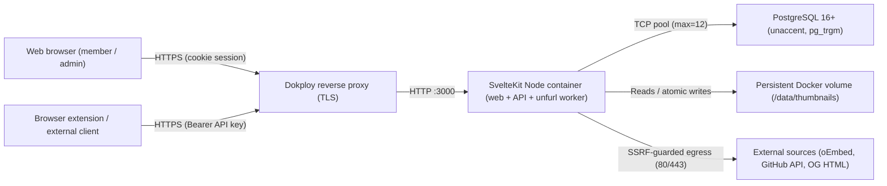
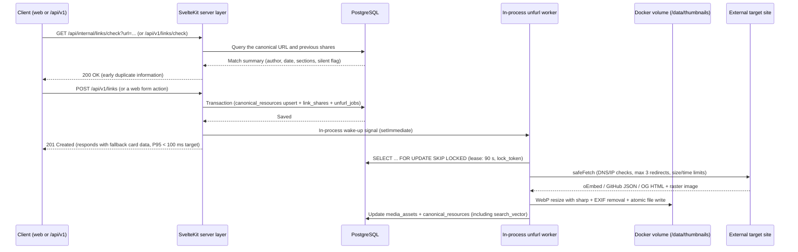

# Izgah Core Platform

*   **Author:** Gorkem Inanc Ozdemir
*   **Status:** Approved
*   **Date:** 2026-11-14

> **Open-source note (2026-11-25):** This document describes Izgah as it was first designed: a Turkish-only tool for one team, deployed on the author's server with Dokploy. [izgah-i18n-oss.md](./izgah-i18n-oss.md) made it an open-source, self-hosted project with an English base language, a full Turkish translation and runtime instance settings (`DEFAULT_LOCALE`, `APP_TIME_ZONE`, `INSTANCE_NAME`, `SOURCE_URL`); the deployment guides are in [docs/deploy/](../deploy/). Where the two differ, the later document wins.

--------------------------------------------------------------------------------

## Overview

Izgah is a Turkish-language (`tr-TR`) web platform where a closed team of 10–15 people shares, discusses and later searches the useful links they come across online (social media posts, videos, code repositories, articles and general web pages) in one place. The application runs as a single application container with a PostgreSQL database on the author's own server and a persistent Docker volume reserved for the local cover image cache, published through the Docker-based application deployment and management panel ([Dokploy](https://dokploy.com)) running on the author's server.

This design document defines the core system of Izgah: the data model, authentication and role management, link creation and the background preview (unfurl) service, the reverse-chronological feed, sections, silent admin resources, the shared like/comment/notification interactions, bilingual search, the admin panel, the `/api/v1/*` HTTP contract and personal API keys that the browser extensions will use, and the Docker/Dokploy release pipeline. The client packages of the browser extensions are outside the scope of this document and are covered by a separate design document.

#### Key Concepts

*   **Canonical resource (`Canonical Resource`):** The target web address, stripped of tracking parameters and deduplicated according to platform rules. The title, description, resized cover image, search index and the shared like and comment thread are kept on this single record.
*   **Link share (`Link Share`):** The event of a member sharing at a given moment, with their own note and an optional choice of sections. When the same resource is shared a second time, the discussion is not split; a new card with the current share note appears in the feed and links to the first share.
*   **Section (`Section`):** A category created and ordered by an admin (for example "Artificial Intelligence", "Interface Design"). A share can be attached to several sections or left without one.
*   **Silent resource (`Silent Resource`):** A reference link that an admin adds directly to one or more sections without posting it to the feed.
*   **Preview fetch (`Unfurl`):** The server reading the title, description and cover image of a shared link from the external source in the background, writing the resized image to the local persistent volume and updating the card.

## The Problem

Team members today share useful links mostly in a desktop WhatsApp group. This way of working leads to four problems:

1.  **Lost and unsearchable knowledge:** Links quickly scroll away among daily chat messages; there is no way to search the history by Turkish or English terms or by URL fragments.
2.  **No separation by topic:** Quick daily shares and lasting reference resources mix in the same chat stream; you cannot filter by topic, and you cannot keep reference links without showing them in the main stream.
3.  **Broken context for duplicate shares:** When the same link is shared again at a different time, the earlier share and its comments are not visible, and feedback gets fragmented.
4.  **Control over data and infrastructure:** Ready-made third-party SaaS tools keep team data on external servers, or do not meet the combined requirements of a closed team, a Turkish interface, silent admin curation and single-container operation on one's own server.

Izgah solves this by combining, in a single self-hosted application, a reverse-chronological feed written to the database without waiting for external network calls, admin-managed sections, a like/comment structure that converges on a single resource, an SSRF-guarded background preview service with a local image cache, and an HTTP contract with personal API keys for the extensions.

## Goals

*   **Closed-team access without SMTP, and account security:** Members set their own passwords through one-time invite and password reset links, valid for 24 hours and created by an admin, without an external e-mail service or OAuth provider; departing members are deactivated without deleting their past shares and comments; on a password reset or deactivation the user's open web sessions and personal API keys are invalidated at once; a server command-line recovery path (`reset-admin`) exists against a single-admin lockout.
*   **Fast link saving and a duplicate check:** A link creation request is written to the database and returns without waiting for external preview calls, with a `P95 < 100 ms` target; when a URL is entered, a pre-check shows the user who shared it before, when, and in which sections (silent records included).
*   **SSRF-guarded server-side previews and a local image cache:** oEmbed for YouTube and X, the GitHub REST API for GitHub repositories (with an optional access token and an Open Graph fallback), and Open Graph / Twitter Card tags for other pages are fetched in a background queue; SSRF protection against private network addresses, timeouts, redirect and size limits apply; only verified raster images are resized and stored on a persistent Docker volume (with a yearly budget target of ~0.5–1.5 GB, assuming ~15–30 links with images per day).
*   **Feed, sections and silent admin curation:** A reverse-chronological feed, assignment to multiple sections, an optional section choice for normal shares, an "Unassigned" filter for admins, and silent admin resources with a rule that they stay attached to at least one section; when a member shares a link that was added silently before, the record also appears in the feed.
*   **Shared interactions and bilingual search:** Shared likes on a single resource, a flat comment thread and a targeted notification badge that reports interactions only on resources the user shared or commented on (checked only on visible tabs, at least 60 seconds apart); search that matches Turkish, English and URL fragments, and a filter for 5 content types (`video`, `repo`, `social`, `article`, `web`).
*   **The extension API contract and personal API keys:** Versioned (`/api/v1/*`) endpoints for the link pre-check, link creation and listing sections, for browser extensions and external clients, protected by personal API keys that are created and revoked in the account settings and stored in the database only as a hash.
*   **Single-container releases and measurability:** Automatic build and release through Dokploy with the Dockerfile on pushes to the GitHub repository, health and readiness endpoints (`/healthz`, `/readyz`), backward-compatible database migrations, admin action logs, and tracking the first-month success criteria (the number of active sharing and searching members in rolling 7- and 30-day windows) through PostgreSQL without an external analytics tool.

## Non-Goals

*   **Client code of the browser extensions:** Developing, packaging and distributing the Chrome, Firefox and Safari extensions is outside the scope of this document; only the server API contract and authentication mechanism the extensions will consume are defined here.
*   **Freeform tags:** To avoid tag fragmentation and friction at share time, v1 has only admin-managed sections, a content type filter and text search.
*   **Read/unread tracking:** No per-member reading state or personal bookmark list is kept.
*   **External e-mail (SMTP) and social sign-in (OAuth):** Sending e-mail, verification mail or sign-in with Google is not part of v1 (the standard OAuth columns exist in the `accounts` table, left empty (`NULL`), only for compatibility with the Better Auth Drizzle schema).
*   **Headless browsers, paid scraping services and client metadata hints:** To protect the single container's memory limit and keep the API surface simple, no Playwright/Puppeteer runs on the server, no paid scraping API is used and no `og:*` fallback hint is accepted from the client; when a preview cannot be fetched from a site behind a sign-in wall (for example Instagram), a plain domain card is shown.
*   **AI-assisted summaries or automatic sectioning:** No external language model is called; the content type is determined by rules from the URL structure and can be changed by the author or an admin.
*   **Mobile share sheet (`iOS/Android Share Sheet`):** A native mobile app or an operating system share target is out of scope; the standard responsive web interface is used from mobile browsers.

*(Note, 2026-11-26: [izgah-roadmap.md](./izgah-roadmap.md) revisits the AI, read-later, mobile share, SMTP and OAuth non-goals above. AI enrichment and section suggestions are specified in [izgah-smart-capture.md](./izgah-smart-capture.md); freeform tags stay out of scope.)*

## Open Questions

There are no open architecture or scope questions. The authentication model, the extension API key boundary, the scope of server-side previews and the shared interaction layer were decided before the draft.

## Critical User Journeys (CUJs)

### CUJ 1: Joining Through an Invite Link and Creating a Personal API Key

*   **Given**: At least one active admin exists; the new team member has no account yet and no external e-mail server is configured.
*   **When**: The admin creates a new member record in the admin panel by entering the name (`name`), e-mail and role, copies the one-time invite link valid for 24 hours and passes it to the member; the member opens the link, optionally updates their display name (`name`), sets their own password, and then creates a new personal API key for the browser extension in the account settings.
*   **Then**: The member is redirected to the feed signed in, the invite link becomes invalid after its single use, and the created API key is shown in plain text on screen only once and stored in the database as a hash.

### CUJ 2: Sharing a Link From the Web Interface, the Early Duplicate Check and the Background Preview

*   **Given**: A signed-in member is on the feed screen and has copied the URL they want to share to the clipboard.
*   **When**: The member opens the share dialog and pastes the URL; the system computes the canonical address and shows the previous share information once the pre-check completes; the member writes an optional note, picks sections and submits the form.
*   **Then**: The share record is written to the database without waiting for an external network request and appears in the feed as a fallback domain/URL card without waiting either (with a dynamic reference to the first share if it was shared before); when the background worker writes the metadata and the resized cover image to the persistent volume, a short refresh on the visible tab updates the card with the cover image and metadata.

### CUJ 3: Sharing Through an External Client or Extension With a Personal API Key

*   **Given**: An active member has a valid personal API key.
*   **When**: The extension or an external HTTP client first queries the `/api/v1/sections` and `/api/v1/links/check?url=...` endpoints with the `Authorization: Bearer <api_key>` header, then sends a `POST /api/v1/links` request with the URL, a note and the selected section ids.
*   **Then**: The server verifies the API key, creates the record by applying the same canonicalisation and business rules as the web interface, adds the preview job to the background queue and returns the created share record with `201 Created`.

### CUJ 4: An Admin Adds a Silent Resource and a Member's Share Promotes It to the Feed

*   **Given**: The admin wants to add a reference link to a particular section without crowding the feed.
*   **When**: In the share form, the admin ticks "Ana akışta yayınlama (yalnızca seçili bölümlere sessiz ekle)" ("Don't post to the feed (add silently to the selected sections only)"), picks at least one section and saves the link; at a later date a normal member wants to share the same URL with their own note.
*   **Then**: At first the record does not appear in the feed; it is listed only in the selected section and in searches with a "Silent resource" label; when the member pastes the same URL, the early warning reports that the record exists silently in that section, and once the member completes the share, the new share card is published in the feed.

*(Note, 2026-11-20: the option label above is normative. The share and edit forms of the web interface (`ShareComposerDialog.svelte`, `ShareCard.svelte`) drifted from this text; the extension uses the correct text. The drift is aligned with this text in step `B4` of the [izgah-ui-v2.md](./izgah-ui-v2.md) implementation.)*

### CUJ 5: Shared Likes, Comments, the Notification Badge and Bilingual Search

*   **Given**: A link shared by one member is in the feed and has also been shared a second time, with a different note, by another member.
*   **When**: A third member finds the record by searching with a Turkish or English keyword or an `owner/repo` URL fragment, likes it and writes a comment; the browser tab of the member who shared it first is visible.
*   **Then**: The like count and comment thread update together on both share cards attached to the same canonical resource; the first sharer's notification badge goes up at the next visible-tab check, and clicking the notification (`like`, `comment`, `reshare`) opens the related `/resources/[id]` page.

### CUJ 6: Deactivating a Member and Revoking Access

*   **Given**: A member leaving the team has past shares and comments, an open web session and personal API keys.
*   **When**: The admin sets the member to inactive in the admin panel.
*   **Then**: The member's past shares and comments are kept in the team archive; their open web sessions and personal API keys are invalidated; every later web and `/api/v1/*` request is rejected with `401 Unauthorized`, and the action is written to the audit log (`audit_logs`).

## Technical Plan (Architecture)

### 1. System Architecture and Component Boundaries

The Izgah core runs as a single Node.js container (`SvelteKit` + `@sveltejs/adapter-node`) behind the Dokploy reverse proxy. The same process hosts server-side HTML rendering (SSR) and web form actions, the `/api/v1/*` JSON endpoints used by the extensions, local image serving (`/media/thumbnails/[assetKey]`) authenticated by a valid session cookie or a Bearer API key, and the concurrency-limited background preview (unfurl) worker. No external queue server (Redis and so on) is set up; queue state and locks run directly on the existing PostgreSQL instance.



#### Link Saving and Background Preview Flow



### 2. Technology Stack Evaluation

The proposed stack was chosen for the scale of a closed team of 10–15 people (an estimated ~1–5 QPS of reads and <0.1 QPS of writes) and the single-container constraint, with the following engineering trade-offs:

*   **SvelteKit (`@sveltejs/adapter-node`) + TypeScript:** Combines server-side first loads (SSR), progressive enhancement (`use:enhance` form actions) and JSON API routes in a single build output. It produces native HTML/CSS features (`<dialog>`, `popover`, `@container`, View Transitions) directly, without virtual DOM wrappers.
    *   *Operational risk and mitigation:* Behind a reverse proxy, if the `ORIGIN` environment variable (or `PROTOCOL_HEADER=x-forwarded-proto` / `HOST_HEADER=x-forwarded-host`) is not set, SvelteKit's CSRF check rejects form submissions with `403`; if `ADDRESS_HEADER=x-forwarded-for` and `XFF_DEPTH=1` are not set for the real client IP, the sign-in rate limit lumps the whole team under the proxy's IP. The container start-up check requires `ORIGIN`.
*   **Drizzle ORM + `drizzle-kit` + `postgres` (`postgres.js`):** Carries no extra binary engine at runtime (like the Prisma Rust engine), which keeps the container image and memory use small; supports PostgreSQL-specific `FOR UPDATE SKIP LOCKED`, GIN indexes and `tsvector` expressions directly at the SQL level.
    *   *Operational risk and mitigation:* Complex `CHECK` constraints, deferrable (`DEFERRABLE`) triggers and the `unaccent`/`pg_trgm` extension setup cannot be fully expressed with the pure TypeScript schema builder, so SQL migration steps are added to the `drizzle-kit generate` output and verified in integration tests on a local Docker PostgreSQL.
*   **Better Auth + a custom one-time token and API key layer:** Handles `scrypt` password hashing, `HttpOnly; SameSite=Lax; Secure` session cookies with `session.cookieCache` turned off, and role fields.
    *   *Operational risk and mitigation:* Better Auth's default invite and password reset flow assumes an external SMTP server and does not drop web sessions and API keys together through a single counter (`auth_version`). So [`src/hooks.server.ts`](../../src/hooks.server.ts) limits the `/api/auth/*` surface to three approved endpoints (`POST /api/auth/sign-in/email`, `POST /api/auth/sign-out`, a verified `GET /api/auth/get-session`) and checks `users.is_active = true` and the `auth_version` match directly in the database on every protected request; the 24-hour one-time invite/reset tokens (`invite_tokens`) and personal API keys (`api_keys`) are kept directly in the application schema as SHA-256 hashes.
*   **Image processing (`sharp`):** Resizes streamed raster images within a memory ceiling, strips EXIF data and produces WebP output.
    *   *Operational risk and mitigation:* To avoid native library incompatibilities and memory fragmentation on Alpine Linux (`musl`), the Docker image is built on `node:22-bookworm-slim`; the `sharp.cache(false)` and `sharp.concurrency(2)` limits are applied when the image storage module ([`src/lib/server/media/storage.ts`](../../src/lib/server/media/storage.ts)) loads.
*   **Package manager and verification tools (`pnpm`, `Vitest`, `Playwright`, `docker compose`):** `pnpm` gives reproducible installs through its lockfile; `Vitest` tests canonicalisation, SSRF validation, business rules and the `/api/v1/*` endpoints against a real PostgreSQL container; `Playwright` verifies the critical user journeys and native browser components end to end.
    *   *Operational risk and mitigation:* To keep integration tests from wiping the local development database and parallel test files from cleaning the same tables at once, tests run against a separate `TEST_DATABASE_URL` database with `fileParallelism: false`.

### 3. Data Model and Schema Invariants

The database runs with `UTF8` encoding; the `unaccent` and `pg_trgm` extensions are enabled in the first migration (once with an administrator role while preparing the database, if a restricted application role is used). Except for composite-key join tables and the content-hashed `media_assets`, every single-column primary key is `text` (`crypto.randomUUID()`), compatible with Better Auth. In the single application container the PostgreSQL connection pool is limited to `max = 12`.

| Table | Primary key / unique constraints | Main columns and responsibility | Critical invariants and indexes |
| :--- | :--- | :--- | :--- |
| `users` | `id` (`text` PK), `email` (unique, lower case) | `name`, `email_verified` (`bool`, default `false`), `image` (`text`, nullable), `role` (`member` \| `admin`), `is_active`, `disabled_at`, `auth_version` (`int`, default `1`), `created_at`, `updated_at` | Users are never deleted (`ON DELETE RESTRICT`); on a password reset, change or deactivation `auth_version` increases atomically by `+1`. `email_verified` and `image` exist for Better Auth schema compatibility. |
| `sessions` | `id` (`text` PK), `token` (unique) | `user_id` (FK), `expires_at`, `user_auth_version`, `ip_address`, `user_agent`, `created_at`, `updated_at` | When `users.is_active = false` or `user_auth_version != users.auth_version`, the session is rejected from the next request on. |
| `accounts` | `id` (`text` PK), `(provider_id, account_id)` | `user_id` (FK), `provider_id` (`'credential'`), `password` (`scrypt` hash), `access_token`, `refresh_token`, `id_token`, `access_token_expires_at`, `refresh_token_expires_at`, `scope`, `created_at`, `updated_at` | The Better Auth `scrypt` hash is updated in this table on invite acceptance and password changes; OAuth is out of scope, so the token and scope columns stay `NULL` for schema compatibility. |
| `verifications` | `id` (`text` PK) | `identifier`, `value`, `expires_at`, `created_at`, `updated_at` | Exists as the core verification table of the Better Auth schema contract. |
| `invite_tokens` | `id` (`text` PK), `token_hash` (unique SHA-256) | `user_id` (FK), `purpose` (`invite` \| `password_reset`), `created_by_id` (FK, may be `NULL` for the first setup and the CLI `reset-admin`), `expires_at` (+24 hours), `consumed_at`, `revoked_at`, `created_at` | No plain-text token is stored; when a new token is created for the same `(user_id, purpose)` pair, earlier open tokens are revoked. |
| `api_keys` | `id` (`text` PK), `key_hash` (unique SHA-256) | `user_id` (FK), `name`, `key_prefix` (the first 12 characters of `izk_...`; the raw key is `izk_` + 30 bytes of `base64url`, 44 characters in total), `auth_version_at_creation`, `last_used_at`, `revoked_at`, `created_at` | `revoked_at IS NULL`, `users.is_active = true` and `auth_version_at_creation = users.auth_version` must all hold. |
| `media_assets` | `asset_key` (`text` PK, a 64-hex SHA-256) | `mime_type` (`'image/webp'`), `byte_size`, `width`, `height`, `ref_count` (`int >= 0`), `orphaned_at` (`timestamptz`, nullable), `created_at` | No file path is stored; the disk location is derived by the rule `MEDIA_STORAGE_DIR/<first-2-hex>/<asset_key>.webp` (`orphaned_at = now()` is written when `ref_count = 0`). |
| `canonical_resources` | `id` (`text` PK), `canonical_url` (`<= 2048` chars, unique B-tree) | `canonicalizer_version` (`int`, default `1`), `domain`, `content_type` (`video` \| `repo` \| `social` \| `article` \| `web`), `content_type_locked` (`bool`, default `false`), `unfurl_status` (`queued` \| `running` \| `ready` \| `failed`), `title`, `description`, `site_name`, `provider_meta` (`jsonb`: `{ stars?, language?, authorName? }`), `thumbnail_asset_key` (FK), `like_count`, `comment_count`, `search_vector` (`tsvector`), `created_at`, `updated_at` | The `canonical_resources_search_vector_update()` trigger produces 5 weighted components over `unaccent`: `'simple'` title (`A`), `'simple'` `domain + canonical_url + regexp_split url_tokens` (`B`), `'turkish'` title (`B`), `'turkish'` description/site name (`C`) and `'simple'` description/site name (`C`); there are also `pg_trgm` GIN indexes on `canonical_url` and `title`. |
| `link_shares` | `id` (`text` PK) | `resource_id` (FK), `author_id` (FK), `raw_url`, `note` (`<= 1000` chars), `note_search_vector` (`tsvector`), `is_feed_visible` (`bool`), `source_channel` (`web` \| `api`), `deleted_at`, `created_at`, `updated_at` | A partial index `(is_feed_visible, created_at DESC, id DESC) WHERE deleted_at IS NULL` for the feed cursor; `(resource_id, created_at ASC)` for per-resource history; for note search, a GIN index on `note_search_vector`, a `'simple'` + `'turkish'` combination over `unaccent`, kept up to date by a trigger on insert, edit and delete. |
| `sections` | `id` (`text` PK), `slug` (unique), `name` (unique) | `description`, `sort_order` (`int`), `created_by_id` (FK), `created_at`, `updated_at` | The section menu is listed in `sort_order ASC, name ASC` order; when a section with normal shares is deleted, the `link_share_sections` links go with `ON DELETE CASCADE`. |
| `link_share_sections` | `(share_id, section_id)` (composite PK) | The many-to-many relation between shares and sections | A `(section_id, share_id)` index for section feeds. |
| `unfurl_jobs` | `id` (`text` PK), `resource_id` (unique FK) | `target_url`, `status` (`queued` \| `running` \| `completed` \| `dead`), `attempts` (at most `3` attempts in total; `30 s` and `2 min` back-off after failures, `dead` on the `3rd` failure), `next_run_at`, `locked_until` (`90 s`), `lock_token` (`text`), `last_error_code`, `last_error_message`, `created_at`, `updated_at` | Partial indexes on `(status, next_run_at)` for claiming from the queue and on `(status, locked_until)` for recovering expired jobs. |
| `resource_likes` | `(resource_id, user_id)` (composite PK) | `created_at` | Adding or removing updates `canonical_resources.like_count` in the same transaction. |
| `resource_comments` | `id` (`text` PK) | `resource_id` (FK), `author_id` (FK), `body` (1–2000 chars), `deleted_at`, `created_at`, `updated_at` | The comment thread is read in `(resource_id, created_at ASC)` order; on a soft delete `comment_count` decreases by `1` in the same transaction. |
| `notifications` | `id` (`text` PK) | `recipient_user_id`, `actor_user_id`, `resource_id`, `comment_id`, `kind` (`like` \| `comment` \| `reshare`), `read_at`, `created_at` | `(recipient_user_id, created_at DESC) WHERE read_at IS NULL` for the badge query; a partial `UNIQUE (recipient_user_id, actor_user_id, resource_id) WHERE kind = 'like'` index against repeated likes; silent admin records produce no `reshare` notification. |
| `audit_logs` | `id` (`text` PK) | `actor_user_id` (FK `ON DELETE RESTRICT`, may be `NULL` for the CLI and bootstrap), `action`, `target_type`, `target_id`, `metadata`, `request_id`, `created_at` | Destructive admin actions, the first setup, role changes, invites and resets, queue restarts, API key and user password/CLI actions are recorded as an immutable log with a fixed set of actions, under the `audit_logs_immutable_trigger` (`BEFORE UPDATE OR DELETE`) trigger and the `audit_logs_action_known_check` constraint. |
| `search_logs` | `id` (`text` PK) | `user_id` (`NOT NULL` FK `ON DELETE RESTRICT`), `section_id` (FK, `ON DELETE SET NULL`), `result_count`, `created_at` | Does not record the raw query text or empty searches; used to measure active searching members over rolling 7/30 days and the zero-result rate. |

#### Business Rules for Silent Resources and Duplicate Shares

1.  **Silent resources need a section:** Every `link_shares` record with `is_feed_visible = false` and `deleted_at IS NULL` must have at least one `link_share_sections` row. This invariant is enforced both in the service layer and by a PostgreSQL `DEFERRABLE INITIALLY DEFERRED` constraint trigger that runs on `link_shares` (`AFTER INSERT OR UPDATE OF is_feed_visible, deleted_at`) and `link_share_sections` (`AFTER UPDATE OR DELETE`) events. When a section is deleted and it holds a silent record attached only to that section, the operation stops with `409 Conflict`; the admin first moves the records to another section or opens them to the feed. When a section attached only to normal shares is deleted, the `link_share_sections` records are removed with `ON DELETE CASCADE` and the shares are not deleted.
2.  **An unbroken first-share reference and the deleted resource rule:** For active `link_shares` records attached to the same `canonical_resources` record, the card component queries the oldest share (later cards link to the first share with `"/resources/<id>#share-<first_share_id>"`; the first share's own card shows no reference label). If the first share is soft-deleted (`deleted_at IS NOT NULL`) and at least one active share remains, later cards show "The original post was deleted"; if every `link_shares` record of a resource is soft-deleted, the resource is hidden in the feed, search and the duplicate check (`EXISTS (... deleted_at IS NULL)`), and when the same URL is shared again later, the preview can be requeued if needed and a new explicit type lock applied. The same member can reshare the same URL with a different note.
3.  **A silent record becomes visible through a member's share:** When a normal member shares a URL that an admin had added only silently (`is_feed_visible = false`), the member's new `link_shares` record is created with `is_feed_visible = true`, so the resource appears in the feed; the `/sections/[slug]` page lists every active `link_shares` card attached to that section.

### 4. Sign-In, Roles and Revoking Access

*   **Roles:** `member` (reading the feed, sharing links, editing or deleting the `content_type`/sections/note of their own share or their own comment, liking and commenting, managing their own API keys and password) and `admin` (in addition to `member` rights: adding silent resources, editing the content type or sections of any share or deleting it, managing sections, inviting, resetting and deactivating members, viewing the queue and audit logs). Deactivating the last active `admin` account or changing its role to `member` is rejected with `409 Conflict`. The `/admin/*` routes are protected by a two-layer `403` check in both [`src/hooks.server.ts`](../../src/hooks.server.ts) and `requireAdmin(locals)`.
*   **First setup and recovery:** When the container starts with no active `admin` in the database (under `pg_advisory_xact_lock(74829105)`) and `ADMIN_BOOTSTRAP_EMAIL` is set, the first admin record is created with the default name `'Yönetici'` ("Admin") (if an existing member is promoted, `auth_version` increases and open `api_keys` records are revoked) and a one-time setup link is written once to the structured start-up log. If `ADMIN_BOOTSTRAP_EMAIL` is not set, the first admin of an empty database is created through the server CLI command. If every admin password is forgotten, running `node build/cli.js reset-admin --email <email>` on the server produces a new 24-hour reset link (in CLI mode, if `ORIGIN` is not set, it prints the relative path `/auth/reset-password?token=...` without failing) and records it in `audit_logs`. In local development, `pnpm dev`, `pnpm db:migrate` and the CLI read the `.env` file with Node 22's native `process.loadEnvFile('.env')`.
*   **One-time link flow:** Passwords are `10–128` characters and display names (`name`) `2–120` characters. Invite (`/auth/accept-invite?token=...`, with the `env.ORIGIN || url.origin` origin) and password reset (`/auth/reset-password?token=...`) links created in the admin panel contain a 256-bit cryptographically random token; only the SHA-256 hash is stored in the database, the `?token=` screens return `Referrer-Policy: no-referrer` and `Cache-Control: no-store`, and the token is consumed atomically in one query (`WHERE consumed_at IS NULL AND revoked_at IS NULL AND expires_at > now() RETURNING *`) (if the automatic sign-in after accepting an invite fails with a transient error, `consumed_at` is rolled back so the one-time token is not burned for good).
*   **Atomic access revocation (`auth_version`) and sign-out:** On the `/api/auth/*` surface, the sign-up endpoints (`/api/auth/sign-up*`) and unapproved account mutations (`/api/auth/change-password`, `/api/auth/update-user`, `/api/auth/list-sessions`, `/api/auth/revoke-sessions`) are closed with `403`; every protected endpoint, including `GET /api/auth/get-session`, goes through the `is_active` + `auth_version` check. When an admin resets a password or sets `is_active = false`, `users.auth_version` increases in the same database transaction and the user's open `api_keys` records get `revoked_at = now()`; so from the next request on, both browser cookie sessions and extension API keys are rejected with `401`. When a member changes their own password on `/settings` by confirming the current one (`changeUserPassword`), `auth_version` increases by `+1` and open `api_keys`, open `password_reset` tokens and other browser sessions are dropped, while the browser session that made the change is kept by updating it to the new `auth_version`. A `POST /logout` request sends the `Clear-Site-Data: "cookies", "storage", "cache"` header to clear the browser's session cache.

### 5. URL Canonicalisation, Type Classification and the Preview (Unfurl) Service

#### URL Normalisation and Canonicalisation

*   Only the `http:` and `https:` schemes are accepted and an input URL can be at most `2048` characters (`422` beyond that); URLs with user information (`user:pass@`) are rejected. To avoid the `İ`/`ı` bug caused by the Turkish locale, host and scheme conversions run locale-independently with ASCII/Punycode rules.
*   When text + URL strings copied from sources such as WhatsApp are pasted, the first valid `http(s)://` address is parsed and the remaining text, if not empty, is suggested as the note.
*   Global tracking parameters (`utm_*`, `fbclid`, `gclid`, `igshid`, `mc_cid`, `mc_eid`, `ref_src`, `ref_url`), `si` only on `youtube.com`/`youtu.be`/`open.spotify.com`, and `s` and `t` only on `x.com`/`twitter.com` are removed from both `raw_url` and `canonical_url`.
*   Canonicalisation removes default ports (`:80`, `:443`) and a single trailing `/` outside the root, and keeps the `www.` subdomain on general domains. On `raw_url` the YouTube seconds (`?t=120`) and in-page anchors (`#section`) are kept; on `canonical_url` the `#` anchor is removed, `youtu.be/<id>`, `youtube.com/shorts/<id>` and `youtube.com/watch?v=<id>` (including `m.youtube.com`) become the standard `https://www.youtube.com/watch?v=<id>` with `?t=`/`?start=` removed, the `twitter.com` / `www.twitter.com` / `mobile.twitter.com` / `www.x.com` / `mobile.x.com` domains become `x.com`, the `x.com/*/status/<id>/photo/*` and `/video/*` suffixes are reduced to the main post address, `www.github.com` becomes `github.com` and a trailing `.git` on `github.com/{owner}/{repo}.git` is removed, and the remaining query parameters are sorted by key.
*   Known shorteners (`t.co`, `bit.ly`, `lnkd.in`, `tinyurl.com`) are resolved at pre-check and save time, with at most 3 redirects and a `1.5 s` budget, through a `ShortUrlResolver` interface injected into the share service (wired to `safeFetch` in `M4`); on a timeout, an error, or in unit contexts without an external network resolver yet, the short URL is saved in its canonicalised form and `canonical_url` is not changed after the `POST` (the background worker follows redirects only to fetch the title and image).

#### Five Rule-Based Content Types

*   `video`: `youtube.com/watch`, `youtube.com/shorts`, `youtu.be`, `vimeo.com`, `instagram.com/reel/*`
*   `repo`: `github.com/{owner}/{repo}` and `gitlab.com/{owner}/{repo}` (two-segment repository roots only; not `/issues`, `/pull` or `/releases` paths)
*   `social`: `x.com/*/status/*`, `instagram.com/p/*`, `bsky.app/profile/*/post/*`, `linkedin.com/posts/*`
*   `article`: the `medium.com` (including `*.medium.com`), `substack.com` (including `*.substack.com`), `dev.to` and `hashnode.dev` (including `*.hashnode.dev`) domains, the `/blog/`, `/post/`, `/posts/`, `/article/`, `/articles/`, `/news/`, `/writing/` path segments, or pages that return `og:type = article` after the preview (updated when `content_type_locked = false`)
*   `web`: documentation, tools, discussion pages and general web addresses outside the above (the default)

#### SSRF-Guarded Fetching (`safeFetch`) and Limits

*   **Network protection:** [`src/lib/server/unfurl/safe-fetch.ts`](../../src/lib/server/unfurl/safe-fetch.ts) (`safeFetch` and the typed helpers `safeFetchStream`, `safeFetchBytes`, `safeFetchText`, `safeFetchDiscardBody`) allows only ports `80` and `443`, and ignores the `HTTP_PROXY` / `HTTPS_PROXY` proxy environment variables. The original `https://hostname` address, TLS SNI (`servername`) and standard certificate validation are kept; to prevent DNS rebinding, the results of `dns.lookup(hostname, { all: true })` are checked against 16 private and reserved IPv4 and 15 IPv6 blocks (`0.0.0.0/8`, `10.0.0.0/8`, `100.64.0.0/10`, `127.0.0.0/8`, `169.254.0.0/16`, `172.16.0.0/12`, `192.0.0.0/24`, `192.0.2.0/24`, `192.88.99.0/24`, `192.168.0.0/16`, `198.18.0.0/15`, `198.51.100.0/24`, `203.0.113.0/24`, `224.0.0.0/4`, `240.0.0.0/4`, `255.255.255.255/32`, `::/128`, `::1/128`, `::/96`, `::ffff:0:0/96`, `::ffff:0:0:0/96`, `64:ff9b::/96`, `64:ff9b:1::/48`, `100::/64`, `2001::/32`, `2001:db8::/32`, `2002::/16`, `fc00::/7`, `fec0::/10`, `fe80::/10`, `ff00::/8`), and the connection goes to the verified IP address through `undici.Agent({ connect: { autoSelectFamily: false, lookup: pinnedLookup } })`.
*   **Redirect, time and size limits:** Requests are sent with the `User-Agent: IzgahUnfurl/1.0` header and automatic redirects turned off (`redirect: 'manual'`). At most **3 redirect** steps are allowed; each `Location` header is resolved with `new URL(location, currentUrl)` and goes through the scheme (`http`/`https`), port (`80`/`443`), `user:pass@` ban and DNS/IP checks again. The connection timeout is `4 s` and the total timeout `8 s`; a text/HTML/JSON stream is cut when it passes `2 MB` and an image download stream when it passes `8 MB` (in the streaming `<head>` scan, `allowEarlyStopExceedingContentLength` reads real bytes and the closing tag instead of the `Content-Length` header of large HTML bodies, and ends the stream when `</head>` closes). Sign-in wall redirects (`isLoginWallRedirect`: when the final path is `/accounts/login`, `/login`, `/signin`, LinkedIn `/authwall` and `/uas/login` or X `/i/flow/login`; matched as whole path segments) fall back to a plain domain card without further fetch attempts.
*   **Platform metadata adapter order:**
    1.  *YouTube:* `https://www.youtube.com/oembed?url=...&format=json` (`title`, `author_name` -> `provider_meta.authorName`, `thumbnail_url`).
    2.  *X:* `https://publish.twitter.com/oembed?url=...&omit_script=true&dnt=true` (every HTML tag in the `<blockquote>` content is stripped to plain text; the author is written to `provider_meta.authorName`).
    3.  *GitHub repository:* When `GITHUB_TOKEN` is set, `https://api.github.com/repos/{owner}/{repo}` (`User-Agent` required) is called with `Bearer`; without a token the API call is skipped (or it falls back on a `403/429` rate limit) to the page's Open Graph tags; from the API response the star count (`stars`), main language (`language`) and repository owner (`authorName`) are stored in `provider_meta`; the cover image comes from the repository page's `og:image` (`opengraph.githubassets.com`) tag.
    4.  *General web:* A streaming HTML parser (with `TextDecoder` conversion for `utf-8`, `windows-1254` and `iso-8859-9` based on `Content-Type` or `<meta charset>`) reads Open Graph (`og:title`, `og:description`, `og:image`, `og:site_name`, `og:type`) and Twitter Card (`twitter:title`, `twitter:description`, `twitter:image`) tags, or otherwise `<title>` and `<meta name="description">`; it resolves relative `og:image` addresses against the page URL and truncates to `title <= 300` and `description <= 600` characters.
*   **Worker concurrency and the circuit breaker:** The in-process worker runs at most `3` jobs at once; the lease is `90 s` (guarded against takeover by `lock_token`) and failed jobs are tried at most `3` times in total (exponential back-off of `30 s` and `2 min` after the `1st` and `2nd` failures, `dead` + `unfurl_status = 'failed'` on the `3rd`). An in-memory, per-host circuit breaker tracking at most `CIRCUIT_BREAKER_MAX_HOSTS = 5_000` hosts (`api.github.com` and `github.com` count separately; when the final host after redirects differs, the check and record use the final host) falls back to a plain domain card on the first `401/403` response, treats `429` rate limit responses as transient and retries, and after `5` consecutive `401/403/429` responses short-circuits the host for `15` minutes, moving later jobs straight to `completed` + `unfurl_status = 'ready'` (the fallback domain card) without waiting.
*   **Image caching and disk protection:** The file signature (magic bytes) of the downloaded bytes is checked and only `JPEG`, `PNG`, `WebP` and `GIF` are accepted (`SVG` is rejected). If `free bytes < MEDIA_MIN_FREE_BYTES OR free ratio < MEDIA_MIN_FREE_RATIO` on the `MEDIA_STORAGE_DIR` volume (`resolveMediaStorageDir` reads the dynamic `process.env.MEDIA_STORAGE_DIR` in test mode), the image write is skipped. Valid images are converted with `sharp` (`limitInputPixels: 40_000_000`, `animated: false`, `.rotate()`, at most `1200x630` with `fit: 'inside'`, `withoutEnlargement: true`, WebP `quality: 80`), EXIF data is removed, they are written atomically to disk under their SHA-256 hash (if the lease is lost during the database write (`fencedOut`), or no active share remains, the untracked `.webp` file is deleted at once) and served through `/media/thumbnails/[assetKey]` (`^[0-9a-f]{64}$`) to a valid session cookie or Bearer API key (`401` otherwise) with the `Cache-Control: private, max-age=86400, immutable`, `X-Content-Type-Options: nosniff` and `Content-Security-Policy: default-src 'none'` headers. When every share of a resource is deleted or its cover image changes, `ref_count` decreases; at `0`, `orphaned_at = now()` is written and orphaned files older than 24 hours are deleted in the hourly maintenance check. When a resource whose shares were all deleted is shared again, the preview is requeued through `shouldRequeueUnfurl` if needed.

### 6. Feed, Sections, Search, Interactions and the Admin Panel

> **UI v2 note (2026-11-20):** [izgah-ui-v2.md](./izgah-ui-v2.md) (approved) extends the interface rules of this section in these ways: an inline share form is added to the feed and section pages (web sharing is not only through the dialog), a 60-second `GET /api/internal/feed/updates` poll on visible tabs is added to the feed view, and a new `/sections` index page arrives. The server rules, the notification poll, search and the admin panel's behaviour do not change. Detailed table: `izgah-ui-v2.md` §15.

*   **Feed and sections:** The feed (`/`) loads `is_feed_visible = true AND deleted_at IS NULL` records 25 cards per page with a `base64url` cursor. Section pages (`/sections/[slug]`) list the active shares attached to that section (silent ones carry a "Silent resource" badge). In the "Unassigned" triage view (`/admin/unassigned`), an admin can filter active shares not assigned to any section and file them in bulk. The early duplicate check in the web share dialog uses the `GET /api/internal/links/check` endpoint behind the cookie session and an `Origin` check; while a card with `unfurl_status IN ('queued', 'running')` is on screen and the tab is visible, the client runs a light refresh every `3 s`, at most `5` times, to update the card.
*   **Bilingual and URL-fragment search:** PostgreSQL evaluates together the resource's weighted `search_vector` (`'simple'` title/domain/URL/url_tokens and `unaccent` + `'turkish'` title/description/site name with `'simple'` + `unaccent` description/site name), the share's `note_search_vector` (a `'simple'` + `'turkish'` combination over `unaccent`) and `pg_trgm` (`%` and `word_similarity` with `ILIKE` + `unaccent` for URL fragments such as `owner/repo` and Turkish character folding); the search service runs the user's query through `unaccent` with both `'simple'` and `'turkish'` `websearch_to_tsquery`, deduplicates resources with multiple shares in the results and creates no `search_logs` record for empty queries. The search bar defaults to the "All of Izgah" scope; when the "This section" scope is chosen inside a section, the search carries the section filter as `/search?q=...&section=<id>`, and the `/search` screen reuses the shared [`FeedFilterBar.svelte`](../../src/lib/components/feed/FeedFilterBar.svelte) component (keeping `q`/`section`/`sort`).
*   **Likes, comments and the notification badge:** Likes and flat comments attach to the `canonical_resources` record (a comment is deleted by its author or an `admin`, `comment_count` decreases by `1` and the deleted comment is hidden in the thread). When a new like, comment or normal reshare happens (silent admin records produce no `reshare` notification), a notification record goes to active members who shared or commented on the resource before (except the actor). The client queries the `/api/internal/notifications` endpoint only while `document.visibilityState === 'visible'`, `every 60 seconds` (and on `visibilitychange`, if at least `15 s` have passed since the last request); clicking a notification opens the related `/resources/[id]` page. The internal API endpoints (`/api/internal/*`) use the structured logger and a JSON error envelope with a `requestId`.
*   **Admin panel (`/admin/*`):** The member list, creating new invite and password reset links, changing roles and deactivating accounts; adding, renaming, ordering and deleting sections; assigning unassigned shares (`/admin/unassigned`); a summary of dead jobs (`getUnfurlQueueSummary`) and resetting (`attempts = 0`) and requeueing failed (`dead`) preview jobs one by one or in bulk (`retryAllDeadUnfurlJobs`); the `audit_logs` list and a panel of success metrics over rolling `7` and `30` days (the number of active sharing and searching members, consistent with active users, the channel mix `web` vs `api`, and the zero-result search rate; all soft-deleted resources are hidden from the statistics and the dead job list).

### 7. The Extension HTTP API Contract (`/api/v1/*`) and API Keys

Browser extensions and external tools authenticate only with the `Authorization: Bearer izk_<40_characters>` header (`izk_` + 30 random bytes of `base64url`, 44 characters in total); cookie-based authentication is not accepted on the `/api/v1/*` endpoints (which removes the cookie-based CSRF vector there). Rate limits apply per verified `api_keys.id`. For browser extensions (`chrome-extension://`, `moz-extension://`, `safari-web-extension://`), `OPTIONS` preflight and JSON responses return the `Access-Control-Allow-Origin: *`, `Access-Control-Allow-Methods: GET, POST, OPTIONS`, `Access-Control-Allow-Headers: Authorization, Content-Type, X-Client-Name, X-Client-Version` and `Access-Control-Expose-Headers: X-Request-Id` headers; clients send the optional `X-Client-Name` and `X-Client-Version` headers.

| Method and endpoint | Rate limit | Request parameters / body | Success response and behaviour |
| :--- | :--- | :--- | :--- |
| `GET /api/v1/me` | 60 / min | None | `200 OK` — `{ user: { id, name, email, role } }`. Verifies the key and the `admin` role (to show the silent share option) during extension setup. |
| `GET /api/v1/sections` | 60 / min | None | `200 OK` — `{ sections: [{ id, slug, name, description, sortOrder }] }`. Returns the ordered sections. |
| `GET /api/v1/links/check` | 60 / min | `?url=<encoded_url>` | `200 OK` — `{ exists, canonicalUrl, rawUrl, suggestedContentType, resource?: { id, title, likeCount, commentCount }, sharesSummary?: { totalCount, firstShare: { authorName, createdAt, isFeedVisible, sectionNames } } }`. |
| `POST /api/v1/links` | 30 / min | `{ url: string, note?: string \| null, sectionIds?: string[], contentType?: ContentType, isFeedVisible?: boolean }` (`.strict()`) | `201 Created` — `{ share: { id, resourceId, canonicalUrl, rawUrl, isFeedVisible, createdAt }, unfurlStatus: 'queued' \| 'running' \| 'ready' \| 'failed', duplicate: boolean }`. Returns `403` if the `member` role sends `isFeedVisible: false`, and `422` if `sectionIds` is empty for a silent record. |

#### Standard Error Format (`400`, `401`, `403`, `404`, `405`, `409`, `422`, `429`, `500`)

Every error response under `/api/v1/*`, including unknown paths (`404`) and unsupported HTTP methods (`405`), returns the standard JSON envelope below (together with the `CORS` headers):

```json
{
  "error": {
    "code": "VALIDATION_ERROR",
    "message": "Silent resources must be attached to at least one section.",
    "requestId": "req_01j...",
    "details": {
      "sectionIds": ["Select at least one section."]
    }
  }
}
```

Personal API keys are created on the `/settings/api-keys` screen of the web interface (at most 5 active keys per member); the raw key is shown only once, in the creation response; `last_used_at` is updated on use (at most once every 5 minutes, to reduce write load); keys can be revoked through a confirmation dialog.

### 8. Front-End Architecture and Native Web Platform Features (`modern-web-guidance`)

> **UI v2 note (2026-11-20):** [izgah-ui-v2.md](./izgah-ui-v2.md) (approved) replaces the following rules of this section with the ones defined there: the top navigation bar and the mobile drawer controlled by `ResizeObserver` below `960px` (item 3) → a persistent left rail / icon rail / mobile bottom tab bar; the link-centred card with an image column (item 1) → a people-first post and a link attachment that contains the image; light theme only → the Signal light/dark tokens and the `izgah_theme` cookie; the `nth-child`-based `content-visibility` selector (item 5) → an overall-order class; `h1` focusing (item 4) → `preventScroll: true` and a `popstate` exception. `<dialog>`, the popover + anchor positioning fallbacks, View Transitions, `content-visibility` (except the first 5 items), the no-JS query parameter fallbacks, the `1200 / 630` image ratio and natural source order are kept. The same changes apply to the step texts of `M5 #25–#27`. Detailed table: `izgah-ui-v2.md` §15.

No heavy UI or positioning libraries or unconditional polyfill packages are used. The target browser policy (the last two major versions of Chrome, Firefox and Safari) and the current web platform standards guide package required in [AGENTS.md](../../AGENTS.md) (`modern-web-guidance` — the tags in parentheses name the related guide rules) are applied with the following architectural principles:

1.  **The card component (`<article>`, container queries and `:has()` — Baseline Widely Available):**
    *   Every feed item uses a layout that responds to its container width (`card`, `size-aware-styling`) and a conditional grid that opens a side column only on cards with a cover image (`card`, `content-based-styling`, with an `@supports not selector(:has(*))` fallback for browsers without `:has()`); cards without an image, or that fall back to the plain domain mode, stay single-column without reserving an empty image column. For browsers without JavaScript, the basic create/edit/delete flows work inline through the `?compose=1`, `?edit=`, `?delete=`, `?editComment=` and `?deleteComment=` query parameters.
    *   Cover images keep a fixed `1200 / 630` aspect ratio; the title's external link, the like button, the comment link and the section tags stay independent controls in natural source order, without being rearranged with CSS `order`.
2.  **The share form, copying and destructive confirmations (native `<dialog>` — `dialog`, `light-dismiss-a-dialog`, `copy-button`):**
    *   The share dialog and the confirmations for deleting, deactivating, revoking keys and editing sections open with the native `showModal()`; no duplicate ARIA roles that would break the built-in semantics and no hand-made focus trap are added, and in close and destructive confirmations the initial focus goes to the safe continue/cancel button ("Keep editing" or "Cancel"), with the warning text attached to the focused button through `aria-describedby`.
    *   The background scroll lock comes from containment rules on the modal top layer without making the page layout jump; if the form data has changed, a guard on the `cancel` event protects against accidental closing, and read-only dialogs (including `issued-link-dialog`) support closing by an outside click through `closedby="any"` with a `!('closedBy' in HTMLDialogElement.prototype)` fallback. The copy buttons for one-time links and the `request_id` in [`src/routes/+error.svelte`](../../src/routes/+error.svelte) work through Invoker Commands (`command="--copy"`) + `CommandEvent`/the Clipboard API + a ` ` repeat announcement for screen readers (the exact CSS/DOM split is in the scope of `M5 #25`).
3.  **Action boxes and filter panels (`[popover="auto"]` + CSS Anchor Positioning — `viewport-aware-dropdowns`):**
    *   Card overflow actions, filter pickers, the mobile navigation drawer (`popover="auto"` controlled by `ResizeObserver` below `960px`) and the notification summary open in the top layer with `popovertarget` + `popover="auto"`; these button groups are not full application menus with arrow-key navigation, so they get no `role="menu"` or `role="menuitem"`.
    *   CSS Anchor Positioning is applied only as a progressive enhancement, behind feature detection (`@supports (position-area: block-end)`), through a CSS custom property (`--popover-anchor: --anchor-${id}`); in browsers without support, references specific to the component instance provide a bottom/top alignment that does not overflow the screen, and in every browser open panels close automatically when the window scrolls (`scroll`).
4.  **Page transitions and dynamic ordering (the View Transitions API — `same-document-transitions`, progressive enhancement):**
    *   Transitions between feed/search cards and the resource detail view (`/resources/[id]`, with a one-to-one `active-resource-card` match) and the admin section ordering (DOM node preservation through `Element.prototype.moveBefore` + `startViewTransition`) are wrapped in `document.startViewTransition` when available, respecting the reduced motion preference (`prefers-reduced-motion`).
    *   To avoid name clashes, `active-resource-card` is assigned only during the card <-> resource detail transition; on every `pathname` change (without breaking focus on query-parameter filter or search refreshes) focus moves to the new page heading (`<h1>`).
5.  **Long feed performance (`content-visibility: auto` — `defer-rendering-heavy-content`, progressive enhancement):**
    *   The first 5 cards are excluded so the above-the-fold paint is not delayed; for the 6th and later feed items, rendering is deferred for off-screen items with a scroll height estimate.

### 9. Docker Image, Dokploy Releases, Observability and Backups

*   **Container and Dokploy structure:** The multi-stage [`Dockerfile`](../../Dockerfile) (`node:22-bookworm-slim`, `pnpm@12.18.0`, `NODE_ENV=production`) runs `pnpm install --frozen-lockfile` and `pnpm build` in the build stage (the server output produces `build/cli.js` and `build/migrate.js` next to `build/index.js`); the runtime stage copies only the production dependencies, the `build/` output and the `drizzle/` migration directory, sets `node:node` ownership on `/data/thumbnails`, runs as the non-root `node` user and defines a Node `fetch`-based `/healthz` health check ([`docker-compose.prod.yml`](../../docker-compose.prod.yml) supports the `POSTGRES_USER`, `POSTGRES_PASSWORD`, `POSTGRES_DB` and `APP_PORT` variables for local production verification). Every push to the GitHub main branch (`main`) builds and publishes a new image through a Dokploy webhook.
*   **Database migrations and rollback safety:** Every schema change follows the **expand-and-contract** rule; a new version's (`N`) migration does not drop or rename, in the same release, columns that the previous version's (`N-1`) container still reads. The container start-up script applies migrations on a single connection under `pg_advisory_lock` through `node build/migrate.js`. Single-`Dockerfile` apps on Dokploy have no built-in pre-deploy hook that runs on the host, so right before releases that contain a new `drizzle/` schema migration are pushed to `main`, the operator runs [`scripts/pre-deploy-backup.sh`](../../scripts/pre-deploy-backup.sh) by hand on the host; routine backups are handled by [`scripts/offbox-backup.sh`](../../scripts/offbox-backup.sh), run by a cron/systemd timer on the same host.
*   **Health endpoints and structured logging:** `/healthz` confirms the process is up (`200 OK`); `/readyz` checks the PostgreSQL connection, that the last local migration record is applied in the `__drizzle_migrations` table and that the `MEDIA_STORAGE_DIR` volume is writable. Application and backup logs are written to `stdout`/`stderr` as single-line JSON (`timestamp`, `level`, `request_id`, `user_id`, `channel`, `client_version`, `msg`); error screens show the user a `request_id` they can copy with one click.
*   **Backups:** A daily scheduled [`scripts/offbox-backup.sh`](../../scripts/offbox-backup.sh) job on the host sends the `pg_dump -Fc` output and the `/data/thumbnails` volume one after the other, in the same maintenance window, to an off-box S3-compatible backup target (optionally through `BACKUP_S3_ENDPOINT_URL`), keeping the backup set consistent. If the PostgreSQL service is managed through Dokploy, Dokploy's built-in scheduled S3 database backup can be turned on as an extra layer; it does not cover the `/data/thumbnails` volume, so it does not replace the `offbox-backup.sh` job.

## Alternatives Considered

### Alternative A: Ready-Made Self-Hosted Bookmark Tools (Linkding, Shiori, Karakeep) or External SaaS (Slack, Discord, Raindrop.io)

*   **Pros**: Quick setup without writing an application from scratch; saving browser bookmarks and basic search work without extra development.
*   **Cons**: Linkding and Shiori are designed around a personal bookmark archive; they do not meet the requirements of an X-like team timeline, keeping a shared comment/like thread while the same link returns to the feed with different members' notes, letting an admin add silent resources to sections without posting them to the feed, and a full `tr-TR` interface. External SaaS tools keep the data on external servers or lose the links in chat noise.
*   **Reason for Rejection**: Rejected by author: the existing tools do not support the model of a team feed + silent admin curation + a single discussion on the canonical resource, and keeping the data on one's own PostgreSQL/Dokploy server was a hard constraint.

### Alternative B: A Next.js (App Router) + Prisma ORM + Redis/BullMQ Queue Stack

*   **Pros**: A wide ecosystem, plenty of example projects and widely used background job queue tools.
*   **Cons**: The React virtual DOM layer adds wrappers and hydration complexity when working with the native `<dialog>`, `popover` and View Transitions APIs; Prisma carries a heavy binary query engine at runtime and makes it hard to express `FOR UPDATE SKIP LOCKED`, `tsvector` + `unaccent` + `pg_trgm` and `DEFERRABLE` constraint triggers directly; Redis plus a separate worker container doubles the container count and the maintenance surface for a write load below 0.1 per second.
*   **Reason for Rejection**: Rejected by author: in line with the single application container goal and the native web standards priority, SvelteKit (`adapter-node`) + Drizzle ORM + an in-process PostgreSQL queue was chosen for a smaller memory footprint and direct SQL control.

### Alternative C: Google OAuth + an E-mail Allow-List, or an E-mail Flow Based on External SMTP

*   **Pros**: Google OAuth removes the burden of storing and resetting passwords; SMTP automates standard invite and password reset e-mails.
*   **Cons**: With Google OAuth only, team members without a Google account cannot get in, and there is no local back door for OAuth configuration or access errors. An external SMTP server needs a third-party service dependency, domain deliverability settings (SPF/DKIM) and extra secret management. Having the admin assign temporary passwords directly means the admin knows the passwords and they stay visible in message history.
*   **Reason for Rejection**: Rejected by author: to work with any e-mail address without an external provider and to make sure only the member knows their password, Better Auth password sign-in + one-time invite/reset links valid for 24 hours + the CLI `reset-admin` recovery command were chosen.

### Alternative D: A Cookie-Only `/share` Web Screen (an Extension Model Without API Keys)

*   **Pros**: No long-lived key is stored on the client, and the share form is written once, only in the web app.
*   **Cons**: Every share would have to open a separate browser window or tab away from the user's current tab; it blocks sharing in place from an extension popup and blocks external clients that carry no cookies (CLIs, automation, shortcut tools).
*   **Reason for Rejection**: Rejected by author: instead of the `/share`-only approach considered at the idea stage, personal API keys stored as SHA-256 hashes and revocable through `auth_version`, plus the `/api/v1/*` JSON contract, were chosen so that extensions and external clients can act directly without opening a new window.

### Alternative E: Carrying an `og:*` Hint From the Client Tab, Running a Headless Browser or Hotlinking Images

*   **Pros**: A client tab hint or a headless browser (Playwright/Puppeteer) can extract more images from social networks behind sign-in walls; hotlinking uses no disk space; synchronous fetching removes the need for a background queue.
*   **Cons**: Running a headless browser inside the single container adds `~300–600 MB` of RAM pressure within a `512 MB–1 GB` container memory budget, risking out-of-memory failures. Accepting `clientHints` from the client widens the untrusted input surface and produces inconsistent cards between links pasted into the web form and links sent from the extension. Hotlinking breaks cards when external CDN addresses break and leaks the reader's IP/referrer to external sites. Synchronous fetching holds the share request for seconds on slow sites.
*   **Reason for Rejection**: Rejected by author: to protect saving speed, container stability and the API surface, only server-side asynchronous fetching (oEmbed, the GitHub REST API + OG fallback, OG/Twitter Card) and a resized WebP cache on a persistent Docker volume were chosen.

### Alternative F: A Single `links` Table for Duplicate Shares, or Rejecting the Second Share Entirely

*   **Pros**: A single table simplifies the schema; rejecting the second share prevents duplicate rows.
*   **Cons**: Rejecting the second share keeps members who follow the chronological feed from seeing that the link has come up again in a current context, and loses the second person's note and section choice. Opening a new row in a single table fragments likes, comments, search results and image references; also, counting YouTube `?t=` second differences as separate URLs breaks duplicate detection of the same video.
*   **Reason for Rejection**: Rejected by author: to keep chronological share events while deduplicating discussion and metadata, the `canonical_resources` + `link_shares` split and a canonicaliser that keeps the YouTube/X time parameter in `raw_url` and strips it from `canonical_url` were chosen.

### Alternative G: Freeform Tags, Required Sections, a Read Marker or a First Version Without Interactions

*   **Pros**: Freeform tags and read state offer flexible personal classification; leaving likes, comments and the notification badge out of the first version reduces the number of tables.
*   **Cons**: Freeform tags quickly fragment into synonyms (`ai`, `yapay-zeka`, `llm`); requiring a section at share time adds friction to quick sharing; read tracking adds state complexity that does not help the core problem; leaving out likes, comments and the notification badge would send the team back to WhatsApp to discuss links.
*   **Reason for Rejection**: Rejected by author: to keep sharing friction low and collect feedback inside the platform, optional sections (with an "Unassigned" filter for admins and a required section for silent resources) and shared likes, comments and a targeted notification badge were accepted; freeform tags and read state were left out of scope.

## Risks & Mitigations

| Risk | Impact | Mitigation |
| :--- | :--- | :--- |
| Instagram/X data centre IP blocks and rate limits | Social network previews cannot be fetched | The per-host circuit breaker short-circuits for 15 minutes; saving is not blocked and a plain domain card is used. |
| Wrong client IP detection behind the reverse proxy | The sign-in rate limit locks out the whole team or is bypassed | The real client IP is extracted by fixing `ADDRESS_HEADER=x-forwarded-for` and `XFF_DEPTH=1`. |
| A full disk on the persistent volume (`/data/thumbnails`) | `/readyz` can fail with container write errors | Image writes stop when `MEDIA_MIN_FREE_BYTES` (`512 MB`) or `MEDIA_MIN_FREE_RATIO` (`15%`) is crossed; shares continue with plain cards. |
| The one-time admin link in the first-setup log | Anyone with log access could read the link during the first setup | The link is created only once, when there is no active admin, expires in 24 hours and is used up after a single use. |
| An `N -> N-1` version rollback in a single container | A new migration could break the previous image's queries | Data loss is prevented by the expand-and-contract migration rule, the daily scheduled `offbox-backup.sh` and the `pre-deploy-backup.sh` the operator runs by hand before releases with schema migrations. |

--------------------------------------------------------------------------------

## Non-Functional Requirements

*   **Security and privacy:**
    *   Apart from the public sign-in/invite and health endpoints (`/login`, `/auth/*`, `/healthz`, `/readyz`), no content or cached image (including `/media/thumbnails/[assetKey]`) on the closed platform can be read without a valid session cookie or API key.
    *   Every external HTTP request goes through the `safeFetch` layer, which rejects the full private/reserved IPv4 and IPv6 ranges after DNS resolution and connects to the verified IP with the original TLS SNI; only raster file signatures are accepted, `SVG` files are rejected against stored XSS, HTML tags in metadata fields are stripped to plain text and EXIF data is removed from images.
    *   Invite/reset tokens (`?token=` pages carry `Referrer-Policy: no-referrer` + `Cache-Control: no-store`) and personal API keys are stored in the database only as SHA-256 hashes; on an admin password reset or account deactivation, the `auth_version` increase invalidates every session and key.
    *   Three buckets apply together on the `/login` and `/api/auth/sign-in/email` endpoints: `IP + account` (`10 requests / 15 min`), `IP` (all e-mails combined, `30 requests / 15 min`) and account (all IPs combined, `50 requests / 15 min` against distributed brute force; only the `IP` bucket when the e-mail is empty). Rate limits apply per `IP + token` (`10 requests / 15 min`) and `IP` (all tokens combined, `30 requests / 15 min`) on the `/auth/*` (`GET` and `POST`) endpoints, per user on password changes (`10 / 15 min`), per session (`session.id`, `60 / min`) on `/search` and per key (`api_keys.id`, `60 / min` reads, `30 / min` writes) on `/api/v1/*`; `.env` files are never committed, only the [`.env.example`](../../.env.example) template is kept.
*   **Performance, latency and storage footprint:**
    *   Saving a link (`POST /api/v1/links` and the web share action) does not wait for external network calls; the local database write completes with a `P95 < 100 ms` target.
    *   Feed queries run with a composite B-tree cursor, without `OFFSET`. In open tabs, notification polling happens only on visible tabs, at most `once every 60 seconds`.
    *   Thanks to `1200x630` WebP (`q=80`) resizing with `sharp`, and assuming `~15–30` links with images per day, the target is an average of `80–150 KB/image` and a yearly storage budget of `~0.5–1.5 GB`; if free space on the persistent volume falls below `MEDIA_MIN_FREE_BYTES` (`512 MB`) or `MEDIA_MIN_FREE_RATIO` (`15%`), image writes stop to prevent failures from a full disk. There are no external language model (LLM) calls and no token costs.
*   **Release, migration and rollback safety:**
    *   Schema migrations follow the expand-and-contract principle; after version `N` is released, rolling back to the `N-1` container image through Dokploy leaves a database schema that still works with the previous version.
    *   Right before releases with a new `drizzle/` schema migration are pushed to `main`, the operator runs `pre-deploy-backup.sh` on the host to take an immediate `pg_dump -Fc` backup; the daily `offbox-backup.sh` job in the server's cron backs up both the PostgreSQL dump and the `/data/thumbnails` volume off the server, one after the other, in the same maintenance window.

--------------------------------------------------------------------------------

### Additional Resources

*   [AGENTS.md](../../AGENTS.md) — Project rules, the language standard (English code, a localised interface), browser support and privacy principles.
*   [SITEMAP.md](./SITEMAP.md) — The index of design documents and the application sitemap.

### Future Improvements

*   **Browser extension design and implementation:** Developing the Chrome, Firefox and Safari extensions on the `/api/v1/*` contract of this document, in a separate design document.
*   **Archive export and import:** Exporting the team archive in a standard bookmark HTML/JSON format and bulk-importing past link lists.
*   **An optional `/share` bookmarklet fallback:** A light web share window working with the cookie session, for locked-down devices where installing the extension is not allowed.

--------------------------------------------------------------------------------

## Detailed Implementation Plan

The implementation plan is split into **8 independently verifiable milestones (`M1`–`M8`)**, each completable in a single development session and, in line with the `AGENTS.md` definition of done, ending in a working intermediate state that passes `pnpm check`, `pnpm lint`, `pnpm test` and `pnpm build` (plus `pnpm test:e2e` in `M5`–`M8` and `pnpm test:docker` in `M8`). The file list below (plus the migration and snapshot files that `drizzle-kit generate` produces under `drizzle/` and `drizzle/meta/`) is the exact boundary of files to create or update across the repository; no extra package or side file outside the list is added.

**Fixed dependency boundary ([`package.json`](../../package.json)):**

*   **Runtime (`dependencies`):** `better-auth@^1.2.0`, `drizzle-orm@^0.45.2`, `htmlparser2@^10.0.0`, `postgres@^3.4.0`, `sharp@^0.33.0`, `undici@^7.0.0`, `zod@^3.24.0`
*   **Development (`devDependencies`):** `@eslint/js@^9.0.0`, `@playwright/test@^1.50.0`, `@sveltejs/adapter-node@^5.0.0`, `@sveltejs/kit@^2.0.0`, `@sveltejs/vite-plugin-svelte@^5.0.0`, `@types/node@^22.0.0`, `drizzle-kit@^0.31.4`, `esbuild@^0.25.0`, `eslint@^9.0.0`, `eslint-plugin-svelte@^2.46.0`, `prettier@^3.4.0`, `prettier-plugin-svelte@^3.3.0`, `svelte@^5.0.0`, `svelte-check@^4.1.0`, `tsx@^4.19.0`, `typescript@^5.7.0`, `typescript-eslint@^8.0.0`, `vite@^6.0.0`, `vitest@^3.0.0`

**Fixed environment variable contract ([`.env.example`](../../.env.example)):**

*   `DATABASE_URL` (the required PostgreSQL connection string), `TEST_DATABASE_URL` (the connection string of the `izgah_test` database reserved for local and CI tests), `DATABASE_POOL_MAX` (default `12`), `BETTER_AUTH_SECRET` (required, at least 32 characters), `ORIGIN` (a full URL required for the application server in production; set together with `NODE_ENV=production` in the container), `HOST` (default `0.0.0.0`), `PORT` (default `3000`), `ADDRESS_HEADER` (the SvelteKit `adapter-node` client IP header, default `x-forwarded-for`), `XFF_DEPTH` (the Traefik/Dokploy reverse proxy depth, default `1`), `MEDIA_STORAGE_DIR` (`/data/thumbnails` in production, `./.local-data/thumbnails` locally), `MEDIA_MIN_FREE_BYTES` (default `536870912`), `MEDIA_MIN_FREE_RATIO` (default `0.15`), `ADMIN_BOOTSTRAP_EMAIL` (an optional first admin e-mail), `GITHUB_TOKEN` (an optional GitHub API token), `UNFURL_CONCURRENCY` (default `3`), `LOG_LEVEL` (default `info`).

---

### Milestone M1: Project Skeleton, Local PostgreSQL, the Full Schema and the Migration Pipeline

**Goal:** Set up the SvelteKit (`adapter-node`) + TypeScript + Drizzle ORM foundation, start the local `docker compose` PostgreSQL 16 environment, create every core table, index and trigger in a single reproducible initial migration, and verify the `/healthz` and `/readyz` endpoints.

#### 1. [`package.json`](../../package.json), [`pnpm-workspace.yaml`](../../pnpm-workspace.yaml) and [`pnpm-lock.yaml`](../../pnpm-lock.yaml) (Create)

*   **Type / Scope**: Package and script configuration (`pnpm`)
*   **Proposed Changes**: Defines the dependencies fixed above, the build script approvals in [`pnpm-workspace.yaml`](../../pnpm-workspace.yaml) `allowBuilds` (`esbuild: true`, `sharp: true`) and the standard scripts (`dev`, `build` — after `vite build`, bundling [`src/lib/server/db/migrate.ts`](../../src/lib/server/db/migrate.ts) `-> build/migrate.js` and, from `M2 #11` on, [`src/cli.ts`](../../src/cli.ts) `-> build/cli.js` with `esbuild`, `preview`, `check`, `lint`, `format`, `test`, `test:e2e`, `test:docker`, `db:generate`, `db:migrate`, `cli`); sets up one verification flow for every milestone.

#### 2. [`.gitignore`](../../.gitignore) (Modify) and [`.env.example`](../../.env.example) (Create)

*   **Type / Scope**: Environment and privacy configuration
*   **Proposed Changes**: Adds `.svelte-kit/`, `dist/`, `build/`, `out/`, `.output/`, `.wxt/` (a local output path reserved for the browser extensions to come), `coverage/`, `*.tsbuildinfo`, `.local-data/`, `playwright-report/`, `test-results/`, `.DS_Store`, `.env`, `.env.*` and `.env*` (except ) to [`.gitignore`](../../.gitignore); documents every environment variable with a description and placeholder example values in [`.env.example`](../../.env.example) (no secrets).

#### 3. [`tsconfig.json`](../../tsconfig.json), `svelte.config.js`, [`vite.config.ts`](../../vite.config.ts), [`vitest.config.ts`](../../vitest.config.ts), [`playwright.config.ts`](../../playwright.config.ts), [`eslint.config.js`](../../eslint.config.js), [`.prettierrc`](../../.prettierrc) (Create)

*   **Type / Scope**: Build, static analysis and test configuration
*   **Proposed Changes**: Defines `strict: true` TypeScript settings, the `@sveltejs/adapter-node` output (`build/`), the CSRF rule `trustedOrigins: []` (strict CSRF that accepts only its own origin), a Vitest integration environment with `fileParallelism: false` because of the shared PostgreSQL test database, and a Playwright configuration with `workers: 1` for the shared `izgah_test` database that, in the default `test:e2e` run (starting a local test `webServer` process with `PLAYWRIGHT_E2E=1` while `PLAYWRIGHT_DOCKER_SMOKE !== '1'`), excludes [`tests/e2e/m8-docker-smoke.spec.ts`](../../tests/e2e/m8-docker-smoke.spec.ts) (run separately with `test:docker`). [`vite.config.ts`](../../vite.config.ts) sets `ssr: { external: ['better-auth'] }` so that `better-auth`, because of its optional `svelte` peer, is not bundled into the SSR package where it would clash with the root `zod@^3.24.0`.

#### 4. [`docker-compose.yml`](../../docker-compose.yml) (Create)

*   **Type / Scope**: Local development infrastructure
*   **Proposed Changes**: Defines a `postgres:16-bookworm` service for local development and integration tests (port `5432`, a persistent `pgdata` volume, a `pg_isready` health check, and creating the `izgah_test` database reserved for `TEST_DATABASE_URL` next to the development database in the start-up step).

#### 5. [`drizzle.config.ts`](../../drizzle.config.ts), [`src/lib/server/db/client.ts`](../../src/lib/server/db/client.ts), [`src/lib/server/db/schema.ts`](../../src/lib/server/db/schema.ts), [`src/lib/server/db/migrate.ts`](../../src/lib/server/db/migrate.ts) (Create)

*   **Type / Scope**: The database connection and the Drizzle schema definition
*   **Proposed Changes**: Sets up the `postgres.js` pool (`max: env.DATABASE_POOL_MAX`) (including a `closeDb()` shutdown hook); defines the `users`, `sessions`, `accounts`, `verifications`, `invite_tokens`, `api_keys`, `media_assets` (`orphaned_at`), `canonical_resources` (the `unfurl_status` enum), `link_shares` (`note_search_vector`), `sections`, `link_share_sections`, `unfurl_jobs` (`lock_token`, the `(status, locked_until)` index), `resource_likes`, `resource_comments`, `notifications` (the `WHERE kind = 'like'` partial unique index), `audit_logs` (`actor_user_id` may be `NULL`, `ON DELETE RESTRICT`) and `search_logs` (`user_id` `NOT NULL`, `ON DELETE RESTRICT`) tables, all with `text` primary keys, with every Section 3 column, foreign key (`users` references `ON DELETE RESTRICT`, other dependent relations `ON DELETE CASCADE`/`SET NULL` as in Section 3) and index; [`src/lib/server/db/migrate.ts`](../../src/lib/server/db/migrate.ts) exports a `runMigrations()` function that runs on a single-connection (`max: 1`) pool under the `pg_advisory_lock(74829104)` lock, and Node 22 `.env` loading (`process.loadEnvFile('.env')`) in the CLI entry.

#### 6. [`drizzle/0000_initial_core.sql`](../../drizzle/0000_initial_core.sql), [`drizzle/meta/_journal.json`](../../drizzle/meta/_journal.json) and [`drizzle/meta/0000_snapshot.json`](../../drizzle/meta/0000_snapshot.json) (Create)

*   **Type / Scope**: SQL database migration
*   **Proposed Changes**: Creates the `CREATE EXTENSION IF NOT EXISTS unaccent;` and `CREATE EXTENSION IF NOT EXISTS pg_trgm;` statements (in a way that suits the application database role's ability to install extensions, or a pre-installation check), every table and partial unique index, the update functions and triggers for `canonical_resources.search_vector` (5 components over `unaccent`: `'simple'` title `'A'`, `'simple'` `domain + canonical_url + url_tokens` `'B'`, `'turkish'` title `'B'`, `'turkish'` + `'simple'` description/site name `'C'`) and `link_shares.note_search_vector` (a `'simple'` + `'turkish'` combination over `unaccent`), the `DEFERRABLE INITIALLY DEFERRED` constraint triggers on `link_shares` (`AFTER INSERT OR UPDATE OF is_feed_visible, deleted_at`) and `link_share_sections` (`AFTER UPDATE OR DELETE`) that guarantee at least one section row for `is_feed_visible = false AND deleted_at IS NULL` records, and the `audit_logs_immutable_trigger` (`BEFORE UPDATE OR DELETE`) that blocks updates and deletes of `audit_logs` rows, plus the `audit_logs_action_known_check` constraint that enforces the fixed set of actions.

#### 7. [`src/lib/server/env.ts`](../../src/lib/server/env.ts) and [`src/lib/server/logger.ts`](../../src/lib/server/logger.ts) (Create)

*   **Type / Scope**: Configuration validation and structured logging
*   **Proposed Changes**: [`src/lib/server/env.ts`](../../src/lib/server/env.ts), under the `!building` condition from `$app/environment`, loads the `.env` file if present at non-test runtime (`process.loadEnvFile('.env')`) and validates every environment variable (including `NODE_ENV`) with `zod` (`ORIGIN` is required in production outside the CLI mode `IZGAH_CLI_MODE=1`; on missing or invalid values it writes only the failing field names to `stderr`, without leaking secret values, and stops the process with exit code `1`; the `sharp` configuration is left to the [`src/lib/server/media/storage.ts`](../../src/lib/server/media/storage.ts) module in M4). [`src/lib/server/logger.ts`](../../src/lib/server/logger.ts) provides a single-line JSON logger to `stdout`/`stderr` with the `request_id`, `user_id`, `channel` and `client_version` fields.

#### 8. [`src/app.html`](../../src/app.html), [`src/app.d.ts`](../../src/app.d.ts), [`src/routes/+layout.svelte`](../../src/routes/+layout.svelte), [`src/routes/+error.svelte`](../../src/routes/+error.svelte), [`src/routes/healthz/+server.ts`](../../src/routes/healthz/+server.ts), [`src/routes/readyz/+server.ts`](../../src/routes/readyz/+server.ts) (Create)

*   **Type / Scope**: The basic application shell and health endpoints
*   **Proposed Changes**: Sets the language of [`src/app.html`](../../src/app.html) to `lang="tr"`; defines the `App.Locals` types (`requestId`, `user`, `session`, `authChannel`, `apiKeyId`) in [`src/app.d.ts`](../../src/app.d.ts); sets up a basic [`src/routes/+layout.svelte`](../../src/routes/+layout.svelte) and a [`src/routes/+error.svelte`](../../src/routes/+error.svelte) that offers a copyable `request_id` (`command="--copy"`) in a Turkish error view; `/healthz` ([`src/routes/healthz/+server.ts`](../../src/routes/healthz/+server.ts)) checks process liveness, and `/readyz` ([`src/routes/readyz/+server.ts`](../../src/routes/readyz/+server.ts)) checks `SELECT 1`, that the last record in the `drizzle.__drizzle_migrations` table matches the bundled [`drizzle/meta/_journal.json`](../../drizzle/meta/_journal.json), and write/delete access to `MEDIA_STORAGE_DIR`.

#### 9. [`tests/setup/db.ts`](../../tests/setup/db.ts) and [`tests/integration/m1-schema-and-health.test.ts`](../../tests/integration/m1-schema-and-health.test.ts) (Create)

*   **Type / Scope**: M1 integration tests
*   **Proposed Changes**: Runs migrations only on `TEST_DATABASE_URL` (`izgah_test`) (with a guard against non-test database names); verifies the `unaccent` and `pg_trgm` extensions, that the `DEFERRABLE` trigger rejects a silent record without a section at the end of the transaction for both `link_shares` insert/update and `link_share_sections` update/delete, the `audit_logs` immutability trigger, the `search_vector` + `note_search_vector` triggers, and the `/healthz` + `/readyz` responses.

---

### Milestone M2: Authentication, Roles, One-Time Links and Personal API Keys

**Goal:** Make Better Auth password sessions, 24-hour one-time invite/password reset links, instant session + API key revocation through `auth_version`, the `/settings/api-keys` screen and the `reset-admin` CLI recovery tool work.

#### 10. [`src/lib/server/auth/better-auth.ts`](../../src/lib/server/auth/better-auth.ts), [`src/lib/server/auth/tokens.ts`](../../src/lib/server/auth/tokens.ts), [`src/lib/server/auth/api-keys.ts`](../../src/lib/server/auth/api-keys.ts), [`src/lib/server/auth/rate-limit.ts`](../../src/lib/server/auth/rate-limit.ts) (Create) and [`vite.config.ts`](../../vite.config.ts) (Modify)

*   **Type / Scope**: Authentication and key services
*   **Proposed Changes**:
    *   [`src/lib/server/auth/better-auth.ts`](../../src/lib/server/auth/better-auth.ts): Sets up the Drizzle adapter with plural/snake table mappings (`users`, `sessions`, `accounts`, `verifications`) and `additionalFields` (`role`, `isActive`, `authVersion`, `userAuthVersion`); sets `disableSignUp: true` for `emailAndPassword` and turns `cookieCache` off (`enabled: false`); checks `is_active` and writes `user_auth_version` at session creation in the `databaseHooks.session.create.before` hook; exports Better Auth `scrypt` password hashing through `svelteKitHandler` and the `changeUserPassword` helper (including revoking open `password_reset` tokens and `api_keys`).
    *   [`src/lib/server/auth/tokens.ts`](../../src/lib/server/auth/tokens.ts): Provides the `createInviteToken(userId, purpose, actorId)` and `consumeInviteToken(rawToken, purpose, newPassword, displayName?)` (a `2–120` character display name limit) functions; creates a 256-bit random token, stores its SHA-256 hash and writes `revoked_at = NOW()` to earlier open tokens (`consumed_at IS NULL AND revoked_at IS NULL`) of the same `(user_id, purpose)`; consumes atomically with the single SQL statement `UPDATE invite_tokens SET consumed_at = NOW() WHERE token_hash = ... AND purpose = ... AND consumed_at IS NULL AND revoked_at IS NULL AND expires_at > NOW() RETURNING *`; writes the password to the `accounts` (`credential`) table with Better Auth `scrypt`, increases `users.auth_version` by `+1` and starts a new browser session automatically on invite acceptance (rolling back `consumed_at` if starting the session fails).
    *   [`src/lib/server/auth/api-keys.ts`](../../src/lib/server/auth/api-keys.ts): Provides `createApiKey(userId, name)` (at most 5 active keys per member, a raw token of `izk_` + 30 bytes of `base64url`, a SHA-256 hash), `verifyApiKey(bearerToken)` (`is_active`, `revoked_at IS NULL`, `auth_version_at_creation = users.auth_version`, updating `last_used_at` at 5-minute intervals and returning `api_keys.id`) and `revokeApiKey(id, userId)`.
    *   [`src/lib/server/auth/rate-limit.ts`](../../src/lib/server/auth/rate-limit.ts): With separate in-memory sliding window stores per category, each holding at most `10,000` keys (when the sign-in, token and password stores are full they evict no live entry and reject the new key; in the sign-in and token stores the e-mail/token counters live inside the client prefix's entry, so each prefix takes one slot and a few hundred prefixes cannot fill the store and lock everyone out; the account counter is in a separate store keyed by the e-mail hash, and when that store is full no new account counter is opened but the request is not rejected; IPv6 addresses are reduced to their `/64` prefix), applies the limits for `/login` and `/api/auth/sign-in/email` (`IP+account` `10`, `IP` `30`, account `50` / `15 min`), `/auth/*` (`GET` and `POST`; `IP+token` `10`, `IP` `30` / `15 min`), password changes (`10 / 15 min` per user), `/search` (`60 / min`, `session.id`), API reads (`60 / min`, `api_keys.id`) and API writes (`30 / min`, `api_keys.id`), and an `extractClientIp` fallback that honours `env.ADDRESS_HEADER` + `env.XFF_DEPTH`.
    *   [`vite.config.ts`](../../vite.config.ts): Keeps the server-side `better-auth` package external in the Vite SSR bundle (`ssr: { external: ['better-auth'] }`), which avoids a clash between a `better-auth` sub-dependency and the root `zod` version.

#### 11. [`src/lib/server/auth/bootstrap.ts`](../../src/lib/server/auth/bootstrap.ts), [`src/lib/server/audit.ts`](../../src/lib/server/audit.ts), [`src/cli.ts`](../../src/cli.ts) (Create)

*   **Type / Scope**: First admin setup, the audit log and the recovery CLI tool
*   **Proposed Changes**: Under `pg_advisory_xact_lock(74829105)`, when there is no active admin and `ADMIN_BOOTSTRAP_EMAIL` is set, [`src/lib/server/auth/bootstrap.ts`](../../src/lib/server/auth/bootstrap.ts) creates the first admin user with the default name `'Yönetici'` ("Admin") (with an `auth_version` increase + revoking open `api_keys` if an existing member is promoted) and the setup link (a relative `/auth/accept-invite?token=...` path without `ORIGIN`); when it is not set, it logs a warning pointing the operator to the CLI command. [`src/lib/server/audit.ts`](../../src/lib/server/audit.ts) provides the `recordAuditLog(...)` helper, which enforces the fixed `KNOWN_AUDIT_ACTIONS` set. [`src/cli.ts`](../../src/cli.ts) (`IZGAH_CLI_MODE=1`, a `2–120` character name limit) prints a new 24-hour link (a full URL with `ORIGIN`, otherwise a relative path) to the terminal with the `create-admin --email <email> --name <name>` and `reset-admin --email <email>` commands, and creates an `audit_logs` record.

#### 12. [`src/hooks.server.ts`](../../src/hooks.server.ts), [`src/routes/api/auth/[...all]/+server.ts`](../../src/routes/api/auth/[...all]/+server.ts), [`src/routes/logout/+server.ts`](../../src/routes/logout/+server.ts) (Create)

*   **Type / Scope**: Request middleware, the authorisation gate and the sign-out endpoint
*   **Proposed Changes**: Starts the `bootstrap.ts` check and the shutdown hooks (`sveltekit:shutdown` / `SIGTERM` / `SIGINT` + `closeDb()`) with `init(): ServerInit` (guarded by `!building` and `globalThis`; enabled in E2E through `PLAYWRIGHT_E2E=1`) and keeps a structured error log tied to the `request_id` through `handleError`; adds an `X-Request-Id` header to every request; under `/api/auth/*`, allows only `POST /api/auth/sign-in/email`, `POST /api/auth/sign-out` and a verified (`is_active` + `auth_version`) `GET /api/auth/get-session` and closes the rest with `403`; on `/api/v1/*` routes accepts only Bearer (ignoring cookies) and applies the CORS headers, including `OPTIONS` preflight, and the `404`/`405` JSON error envelope; on `/api/internal/*` routes accepts only the session cookie with an `Origin`/`Sec-Fetch-Site` check; for `/media/thumbnails/*` verifies the session cookie or a Bearer key and returns `401` instead of a redirect for unauthorised requests; requires `role === 'admin'` (`403`) on every HTTP method under `/admin/*` (including `POST` actions); accepts only relative paths starting with a single `/` in the `/login?next=...` parameter (open redirect protection); `/logout` ends the session with `POST` and returns the `Clear-Site-Data: "cookies", "storage", "cache"` header.

#### 13. [`src/routes/login/+page.svelte`](../../src/routes/login/+page.svelte), [`src/routes/login/+page.server.ts`](../../src/routes/login/+page.server.ts), [`src/routes/auth/accept-invite/+page.svelte`](../../src/routes/auth/accept-invite/+page.svelte), [`src/routes/auth/accept-invite/+page.server.ts`](../../src/routes/auth/accept-invite/+page.server.ts), [`src/routes/auth/reset-password/+page.svelte`](../../src/routes/auth/reset-password/+page.svelte), [`src/routes/auth/reset-password/+page.server.ts`](../../src/routes/auth/reset-password/+page.server.ts) (Create)

*   **Type / Scope**: Sign-in, invite acceptance and password screens (`tr-TR`)
*   **Proposed Changes**: Provides the password sign-in form (with a rate limit and a generic error message), the 24-hour invite acceptance screen (including `2–120` character name editing and a `POST` rate limit with `fail(429)`) and the password reset form (with the `10–128` character password rule); adds the `Referrer-Policy: no-referrer` and `Cache-Control: no-store` headers to token pages; shows an HTTP `410 Gone` status screen in Turkish for invalid or expired tokens.

#### 14. [`src/routes/(app)/settings/+page.svelte`](../../src/routes/(app)/settings/+page.svelte), [`src/routes/(app)/settings/+page.server.ts`](../../src/routes/(app)/settings/+page.server.ts), [`src/routes/(app)/settings/api-keys/+page.svelte`](../../src/routes/(app)/settings/api-keys/+page.svelte), [`src/routes/(app)/settings/api-keys/+page.server.ts`](../../src/routes/(app)/settings/api-keys/+page.server.ts) (Create)

*   **Type / Scope**: Account settings and personal API key management
*   **Proposed Changes**: Lets a member update their password (`10–128` characters) by confirming the current one (increasing `users.auth_version` and revoking other sessions, open `password_reset` tokens and `izk_` keys while keeping the active browser session with the new `auth_version`), create personal API keys (showing the raw `izk_` key in a one-time copy box) and revoke them through a native `<dialog>` confirmation.

#### 15. [`tests/integration/m2-auth-and-api-keys.test.ts`](../../tests/integration/m2-auth-and-api-keys.test.ts) (Create)

*   **Type / Scope**: M2 unit and integration tests
*   **Proposed Changes**: Verifies atomic token consumption, a `410 Gone` rejection on second use, the `10–128` password limits, the `/api/auth/get-session` `401` + `/api/auth/change-password` `403` gates, that a password change keeps the active session while another session and the `izk_` keys get `401` at once, account deactivation, the `/admin/*` `POST` `403` and the rejection of `?next=` open redirects, the 5-key limit, the `IP+account` and memory-bounded rate limits (`429`), and the `create-admin` / `reset-admin` CLI flow (including a relative URL when `ORIGIN` is empty).

---

### Milestone M3: URL Canonicalisation, Share Domain Logic and the `/api/v1/*` Contract

**Goal:** Complete the URL parsing and canonicalisation rules, the 5-type content classification, the duplicate pre-check, the services for creating, editing and soft-deleting shares, and every `/api/v1/*` JSON endpoint the extensions will use.

#### 16. [`src/lib/links/parse-url.ts`](../../src/lib/links/parse-url.ts), [`src/lib/server/links/canonicalize.ts`](../../src/lib/server/links/canonicalize.ts) and [`src/lib/server/links/classify.ts`](../../src/lib/server/links/classify.ts) (Create)

*   **Type / Scope**: URL parsing, normalisation and type classification modules
*   **Proposed Changes**:
    *   [`src/lib/links/parse-url.ts`](../../src/lib/links/parse-url.ts): Defines the `extractFirstUrlFromText(input)` function shared by client and server, and the `2048` character length limit.
    *   [`src/lib/server/links/canonicalize.ts`](../../src/lib/server/links/canonicalize.ts): Provides the `canonicalizeUrl(inputUrl)` function; applies the `2048` character limit, converts hosts to ASCII/Punycode independently of the Turkish locale, normalises default ports (`:80`, `:443`), platform domains (every YouTube path -> `www.youtube.com`, X/Twitter -> `x.com`, GitHub -> `github.com`) while keeping the `www.` prefix on general domains, and a trailing `/` outside the root; removes general tracking parameters while deleting `?si=` only on `youtube.com`/`youtu.be`/`open.spotify.com`; keeps `?t=` and the `#` anchor on `rawUrl` while applying the YouTube/X (including the `/photo/*` suffix)/GitHub rules on `canonicalUrl`; rejects schemes other than `http`/`https` and `user:pass@` addresses.
    *   [`src/lib/server/links/classify.ts`](../../src/lib/server/links/classify.ts): With `classifyContentType(url, ogType?)`, applies the domain, path segment and `og:type === 'article'` rules defined in Technical Plan Section 5 as a single source and returns one of the `video`, `repo`, `social`, `article`, `web` types.

#### 17. [`src/lib/server/links/service.ts`](../../src/lib/server/links/service.ts) and [`src/lib/server/sections/service.ts`](../../src/lib/server/sections/service.ts) (Create)

*   **Type / Scope**: Core domain services (the layer shared by web and API)
*   **Proposed Changes**:
    *   [`src/lib/server/sections/service.ts`](../../src/lib/server/sections/service.ts): Provides queries that list the active sections in order and check that a section exists.
    *   [`src/lib/server/links/service.ts`](../../src/lib/server/links/service.ts): Uses an injectable `ShortUrlResolver` interface (`(url: URL) => Promise<URL>`; the M3 default is a plain resolver that returns the input URL without an external network call, wired to `safeFetch` in M4). It provides `checkDuplicateLink(url)` (a hook that pre-resolves only known short URL domains through `ShortUrlResolver` with a `1.5 s` budget and carries on with the original URL intact on a timeout, an error or without a network resolver; an `EXISTS` filter that looks only at active `deleted_at IS NULL` shares; a first-share summary that returns the oldest active share as `firstShare` for `/api/v1/links/check`, an `originalShareDeleted: true` reference flag in the service layer when the all-time first share is deleted, and the silent record information), `createLinkShare(input)` (following short URL redirects on the server side too through `ShortUrlResolver` within `1.5 s` and keeping the original URL without blocking the save on an error or timeout; managing `content_type_locked` — on a new resource, or a resource whose earlier shares were all deleted, an explicit `contentType` sets the lock; on an active duplicate it keeps the existing type if locked, and if unlocked applies the explicit `contentType` and locks it; inserting or finding `canonical_resources`, writing `link_shares` and `link_share_sections` in a transaction; the silent record permission and section checks; an `unfurl_jobs` queue record through `shouldRequeueUnfurl` when needed), `updateLinkShare(...)` (always updates `content_type` on a type change and sets `content_type_locked = true`) and `softDeleteLinkShare(...)`.

#### 18. [`src/lib/server/api/response.ts`](../../src/lib/server/api/response.ts), [`src/routes/api/v1/me/+server.ts`](../../src/routes/api/v1/me/+server.ts), [`src/routes/api/v1/sections/+server.ts`](../../src/routes/api/v1/sections/+server.ts), [`src/routes/api/v1/links/check/+server.ts`](../../src/routes/api/v1/links/check/+server.ts), [`src/routes/api/v1/links/+server.ts`](../../src/routes/api/v1/links/+server.ts) (Create)

*   **Type / Scope**: The extension HTTP API endpoints (`/api/v1/*`)
*   **Proposed Changes**: Implements the standard JSON error envelope (`{ error: { code, message, requestId, details } }`, including `404` for unknown routes and `405` for unsupported methods), the CORS response headers (`Access-Control-Allow-Origin`, exposing `X-Request-Id`), `zod` `.strict()` request schemas (including `note?: string | null`), passive log enrichment from the `X-Client-Version` header (without rejecting requests that lack it) and the four API endpoints defined in Technical Plan Section 7, on top of the shared domain services.

#### 19. [`tests/unit/canonicalize-and-classify.test.ts`](../../tests/unit/canonicalize-and-classify.test.ts) and [`tests/integration/m3-api-v1-links.test.ts`](../../tests/integration/m3-api-v1-links.test.ts) (Create)

*   **Type / Scope**: M3 unit and API integration tests
*   **Proposed Changes**: Verifies the `2048` character limit, domains and paths with Turkish `İ`/`ı`, cleaning default ports and a trailing `/` outside the root while keeping `www.` on general domains, platform host normalisation (every YouTube path, channels and playlists included), the domain scope of `?si=`, YouTube `?t=120` / `youtu.be` / `shorts`, `twitter.com` -> `x.com` and `/photo/*` cleaning, `github.com/owner/repo` vs `github.com/owner/repo/issues/1` and the `article` pattern distinctions of Technical Plan Section 5, extracting a URL from WhatsApp text, resolving short URL redirects within `1.5 s` with an injected fake `ShortUrlResolver` and the timeout/error fallback, keeping `content_type_locked`, duplicate detection only on active (`deleted_at IS NULL`) shares, the `/api/v1/*` cookie rejection, CORS preflight and the `404`/`405` JSON error envelope, `403` for a `member` silent share, `422` for a silent share without a section, and that `/api/v1/links/check` returns the oldest active share when the first share is deleted, plus the integrity of the `originalShareDeleted` reference.

---

### Milestone M4: The SSRF-Guarded Preview (Unfurl) Worker and the Persistent Image Cache

**Goal:** Bring in the `safeFetch` network layer, the oEmbed / GitHub REST API / Open Graph adapters, `sharp` WebP resizing and content-hashed disk storage, the `/media/thumbnails/[assetKey]` serving endpoint and the in-process `FOR UPDATE SKIP LOCKED` queue worker.

#### 20. [`src/lib/server/unfurl/safe-fetch.ts`](../../src/lib/server/unfurl/safe-fetch.ts) and [`src/lib/server/unfurl/circuit-breaker.ts`](../../src/lib/server/unfurl/circuit-breaker.ts) (Create)

*   **Type / Scope**: An SSRF-guarded HTTP client and a per-host circuit breaker
*   **Proposed Changes**: `safeFetch(url, options)` (including the `safeFetchStream`, `safeFetchBytes`, `safeFetchText` and `safeFetchDiscardBody` helpers) allows only the `http`/`https` schemes and ports `80`/`443`, ignores the `HTTP_PROXY`/`HTTPS_PROXY` environment proxies and runs `dns.lookup(..., { all: true })`, with an optional injectable `lookup` for tests, rejecting the **16 IPv4 and 15 IPv6 CIDR** block list defined in Technical Plan Section 5 (including the IPv4-mapped IPv6 range `::ffff:0:0/96`) from a single source table; it connects to the verified IP through a custom `undici.Agent` (`connect: { autoSelectFamily: false, lookup: pinnedLookup }`) without breaking the TLS SNI match, sends `User-Agent: IzgahUnfurl/1.0`, resolves at most 3 redirects with `new URL(location, currentUrl)` while renewing the target URL and DNS checks at every step, and applies a `4 s` connect / `8 s` total timeout and the stream size limits (`2 MB` for text — with `allowEarlyStopExceedingContentLength` in the streaming `<head>` scan — and `8 MB` for images). [`src/lib/server/unfurl/circuit-breaker.ts`](../../src/lib/server/unfurl/circuit-breaker.ts), with an in-memory circuit breaker tracking at most `CIRCUIT_BREAKER_MAX_HOSTS = 5_000` hosts (tracking `api.github.com` and `github.com` separately), short-circuits a host for 15 minutes after 5 consecutive `401/403/429` responses; the GitHub API and the YouTube/X oEmbed providers are tracked under `provider:*` keys separate from the pages members share, item-specific oEmbed `401/403` responses are not counted, and open provider entries are not evicted for capacity.

#### 21. [`src/lib/server/unfurl/adapters/types.ts`](../../src/lib/server/unfurl/adapters/types.ts), [`src/lib/server/unfurl/adapters/youtube.ts`](../../src/lib/server/unfurl/adapters/youtube.ts), [`src/lib/server/unfurl/adapters/x.ts`](../../src/lib/server/unfurl/adapters/x.ts), [`src/lib/server/unfurl/adapters/github.ts`](../../src/lib/server/unfurl/adapters/github.ts), [`src/lib/server/unfurl/adapters/html-meta.ts`](../../src/lib/server/unfurl/adapters/html-meta.ts), [`src/lib/server/unfurl/adapters/index.ts`](../../src/lib/server/unfurl/adapters/index.ts) (Create)

*   **Type / Scope**: Platform metadata adapters
*   **Proposed Changes**: Behind a shared `UnfurlMetadata` and `providerMeta` contract, implements YouTube oEmbed, X oEmbed (stripping the HTML tags from the `<blockquote>` and extracting plain text), the GitHub REST API (the API + `providerMeta` including `authorName` when `GITHUB_TOKEN` is set; a direct HTML Open Graph fallback and `og:image` fetch without a token or on a rate limit) and an `htmlparser2`-based streaming `<head>` Open Graph / Twitter Card parser (cutting the stream when `</head>` is seen, decoding the `Content-Type` / `<meta charset>` character set with `TextDecoder`, dropping out early on sign-in wall redirects with `isLoginWallRedirect` and making relative `og:image` addresses absolute with `new URL(...)`; checking and updating the final host's circuit breaker when redirects land on a different host); in every adapter output, `title` is limited to at most `300` and `description` to at most `600` characters.

#### 22. [`src/lib/server/media/storage.ts`](../../src/lib/server/media/storage.ts) and [`src/routes/media/thumbnails/[assetKey]/+server.ts`](../../src/routes/media/thumbnails/[assetKey]/+server.ts) (Create)

*   **Type / Scope**: Raster validation, `sharp` resizing, disk protection and media serving
*   **Proposed Changes**: [`src/lib/server/media/storage.ts`](../../src/lib/server/media/storage.ts) applies the `sharp.cache(false)` and `sharp.concurrency(2)` limits when the module loads; validates the file signature from the first bytes (`JPEG`, `PNG`, `WebP`, `GIF`) (rejecting `SVG` and HTML), checks the condition `free bytes < MEDIA_MIN_FREE_BYTES OR free ratio < MEDIA_MIN_FREE_RATIO` with `fs.statfs` on the `resolveMediaStorageDir` volume (which reads the dynamic `process.env.MEDIA_STORAGE_DIR` in test mode), performs the `sharp` conversion (`limitInputPixels: 40_000_000`, `animated: false`, `.rotate()`, at most `1200x630`, WebP `quality: 80`, EXIF removed), deduplicates with reference counting in the `media_assets` table under the SHA-256 `asset_key` (`orphaned_at = now()` while `ref_count = 0`) and writes to the path `env.MEDIA_STORAGE_DIR/<first-2-hex>/<asset_key>.webp` with an atomic temporary file + `rename`; it also provides `cleanupOrphanMediaAssets()`, which removes files whose `orphaned_at` is more than 24 hours old. The media route ([`src/routes/media/thumbnails/[assetKey]/+server.ts`](../../src/routes/media/thumbnails/[assetKey]/+server.ts)) validates the `^[0-9a-f]{64}$` format and the session/key identity, returns `401` to unauthorised requests, and serves the file with the `Cache-Control: private, max-age=86400, immutable`, `X-Content-Type-Options: nosniff` and `Content-Security-Policy: default-src 'none'` headers.

#### 23. [`src/lib/server/unfurl/worker.ts`](../../src/lib/server/unfurl/worker.ts) (Create), [`src/lib/server/links/service.ts`](../../src/lib/server/links/service.ts) (Modify), [`src/hooks.server.ts`](../../src/hooks.server.ts) (Modify)

*   **Type / Scope**: The in-process background queue worker
*   **Proposed Changes**: [`src/lib/server/unfurl/worker.ts`](../../src/lib/server/unfurl/worker.ts) runs at most `UNFURL_CONCURRENCY` (`3`) jobs at once with `FOR UPDATE SKIP LOCKED`, a `90 s` `locked_until` lease and a unique `lock_token` guard; it increments `attempts` on claim and, with a `30 s` and `2 min` back-off after the `1st` and `2nd` failures, moves failed jobs to `dead` (and the resource to `unfurl_status = 'failed'`) after 3 attempts in total; it deletes the untracked `.webp` file if the lease is lost during the database transaction (`fencedOut`) or no active share remains, updates `canonical_resources` + `search_vector` on completion, polls every `15 s` when there is no new job, and runs `cleanupOrphanMediaAssets()` in the hourly maintenance check. [`src/lib/server/links/service.ts`](../../src/lib/server/links/service.ts) wakes the in-process worker when a share is created and wires the `ShortUrlResolver` interface to a real redirect resolver based on `safeFetch` (`maxRedirects: 3`, a `1.5 s` total budget); [`src/hooks.server.ts`](../../src/hooks.server.ts) starts both the `ShortUrlResolver` wiring and the worker inside an `init()` guarded by `!building` + `globalThis`, and on the `sveltekit:shutdown` / `SIGTERM` / `SIGINT` signals waits at most `10 s` for active jobs to finish before shutting down with `closeDb()`.

#### 24. [`tests/unit/safe-fetch-and-adapters.test.ts`](../../tests/unit/safe-fetch-and-adapters.test.ts) and [`tests/integration/m4-unfurl-worker-and-media.test.ts`](../../tests/integration/m4-unfurl-worker-and-media.test.ts) (Create)

*   **Type / Scope**: M4 security and worker tests
*   **Proposed Changes**: With injected `lookup` fakes and local HTTP servers, a table-driven (`it.each`) test checks at least one boundary IP address for each of the **16 IPv4 and 15 IPv6 CIDR** blocks of Technical Plan Section 5 (including `::ffff:0:0/96`); it also verifies that relative and absolute redirect chains from a public IP to a private IP are blocked, `ShortUrlResolver` resolution wired to `safeFetch`, the `2 MB` / `8 MB` (`MAX_IMAGE_BYTES`) size cut-offs, the direct HTML Open Graph fallback without `GITHUB_TOKEN`, `TextDecoder` charset and relative `og:image` resolution, the `SVG` rejection, `limitInputPixels` + EXIF + EXIF orientation (`.rotate()`) handling, `ref_count` and `orphaned_at` management for the same image, that the record completes with the image skipped under the low-disk `OR` condition, that an unauthenticated `/media/thumbnails/*` request returns `401`, and that expired `90 s` leases are recovered through `lock_token`.

---

### Milestone M5: The Web Interface — Feed, Sections, the Share `<dialog>` and Native Platform Features

**Goal:** Build the Turkish (`tr-TR`) feed, section pages and the share create/edit/delete flows, together with the `<article>` card, `<dialog>`, `[popover="auto"]`, View Transitions and `content-visibility` features that follow the `modern-web-guidance` rules.

#### 25. [`src/app.css`](../../src/app.css), [`src/lib/components/ui/Dialog.svelte`](../../src/lib/components/ui/Dialog.svelte), [`src/lib/components/ui/PopoverPanel.svelte`](../../src/lib/components/ui/PopoverPanel.svelte) (Create), [`src/routes/+layout.svelte`](../../src/routes/+layout.svelte), [`src/routes/(app)/settings/+page.svelte`](../../src/routes/(app)/settings/+page.svelte), [`src/routes/(app)/settings/api-keys/+page.svelte`](../../src/routes/(app)/settings/api-keys/+page.svelte) (Modify)

*   **Type / Scope**: Design variables and native platform UI primitives (Svelte 5 runes)
*   **Proposed Changes**:
    *   [`src/app.css`](../../src/app.css): Contains the colour and typography variables, the rule `content-visibility: auto; contain-intrinsic-size: auto none auto 220px` for `.feed-list > li:nth-child(n + 6)`, `container-type: inline-size` on the card wrapper and the two-column grid rules for `.share-card:has(> .card-thumbnail)` (including the `@supports not selector(:has(*))` fallback), `overscroll-behavior: contain` on `dialog:modal` and `dialog::backdrop`, `[popover]` positioning inside `@supports (position-area: block-end)` using `anchor-name` / `position-anchor` / `position-try-fallbacks: flip-block, flip-inline, flip-block flip-inline` (through `--popover-anchor`), and the View Transitions resets under `@media (prefers-reduced-motion: reduce)`.
    *   [`src/lib/components/ui/Dialog.svelte`](../../src/lib/components/ui/Dialog.svelte): With the `$props()`, `$state()` and `$derived()` runes, implements `showModal()`, `aria-labelledby`, resetting `dialog.returnValue = ''` on close, a two-step inline close warning through the `cancel` event for forms with unsaved changes (giving focus to the safe "Keep editing" button and attaching the warning text through `aria-describedby`), and an outside-click coordinate fallback for `closedby="any"` when `!('closedBy' in HTMLDialogElement.prototype)` (it adds no `role="dialog"`). The [`src/routes/(app)/settings/+page.svelte`](../../src/routes/(app)/settings/+page.svelte) and [`src/routes/(app)/settings/api-keys/+page.svelte`](../../src/routes/(app)/settings/api-keys/+page.svelte) pages added in M2 are adapted to the shared `(app)` shell and the API key revoke confirmation moves to the shared [`src/lib/components/ui/Dialog.svelte`](../../src/lib/components/ui/Dialog.svelte) component; the root [`src/routes/+layout.svelte`](../../src/routes/+layout.svelte) wires the global styles and the skip-link shell.
    *   [`src/lib/components/ui/PopoverPanel.svelte`](../../src/lib/components/ui/PopoverPanel.svelte): Provides a unique `--popover-anchor: --anchor-${id}` CSS variable per instance, a `popovertarget` + `popover="auto"` trigger/panel pair (without `role="menu"`), a fallback for `@supports not (position-area: block-end)` environments that aligns to the viewport edges based on the trigger's coordinates on the `toggle` event, and automatic closing on `scroll` in every browser.

#### 26. `src/lib/components/feed/ShareCard.svelte`, [`src/lib/components/feed/ShareComposerDialog.svelte`](../../src/lib/components/feed/ShareComposerDialog.svelte), [`src/lib/components/feed/FeedFilterBar.svelte`](../../src/lib/components/feed/FeedFilterBar.svelte) (Create)

*   **Type / Scope**: Feed card, share dialog and filter bar components (Svelte 5 runes)
*   **Proposed Changes**:
    *   `src/lib/components/feed/ShareCard.svelte`: Provides the `<article id="share-{id}" class="share-card">` root inside a `container-type: inline-size` wrapper, the `.share-card:has(> .card-thumbnail)` layout with and without an image, a fallback area that shows no broken icon when the image fails to load, a clickable reference to the first share (`/resources/<id>#share-<first_share_id>`) (including the "The original post was deleted" state), the "Silent resource" badge, `PopoverPanel` overflow actions, an edit `<dialog>` that updates the note, sections, content type and (for admins only) the silent state, and a soft-delete confirmation `<dialog>` (plus the no-JS `?edit=` / `?delete=` modes).
    *   [`src/lib/components/feed/ShareComposerDialog.svelte`](../../src/lib/components/feed/ShareComposerDialog.svelte): When a URL is pasted, parses text + URL with `extractFirstUrlFromText` from [`src/lib/links/parse-url.ts`](../../src/lib/links/parse-url.ts) and runs the early duplicate check through a `300 ms` debounced `GET /api/internal/links/check` request (showing the previous sharer, date, sections and silent state); contains multiple section selection, the content type choice and, for `admin` only, the silent add option (`isFeedVisible = false`).
    *   [`src/lib/components/feed/FeedFilterBar.svelte`](../../src/lib/components/feed/FeedFilterBar.svelte): Provides the content type filter links (`All`, `Video`, `Repo`, `Social`, `Article`, `Web` — `video | repo | social | article | web`), an active filter indicator and a clear link in a keyboard-accessible way (keeping the section, search query and sort parameters through `preserveParams`).

#### 27. [`src/routes/(app)/+layout.svelte`](../../src/routes/(app)/+layout.svelte), [`src/routes/(app)/+layout.server.ts`](../../src/routes/(app)/+layout.server.ts), [`src/routes/(app)/+page.svelte`](../../src/routes/(app)/+page.svelte), [`src/routes/(app)/+page.server.ts`](../../src/routes/(app)/+page.server.ts), [`src/routes/(app)/sections/[slug]/+page.svelte`](../../src/routes/(app)/sections/[slug]/+page.svelte), [`src/routes/(app)/sections/[slug]/+page.server.ts`](../../src/routes/(app)/sections/[slug]/+page.server.ts), [`src/routes/api/internal/links/check/+server.ts`](../../src/routes/api/internal/links/check/+server.ts) (Create)

*   **Type / Scope**: The app frame, the feed, section routes and the internal duplicate check endpoint
*   **Proposed Changes**: Sets up the top navigation bar and, in the `< 960px` mobile view, a sections drawer that is a `popover="auto"` controlled by `ResizeObserver`; in SvelteKit's `onNavigate`, runs the page transition with `'startViewTransition' in document` only on card <-> resource detail (`/resources/[id]`) transitions and while `prefers-reduced-motion: reduce` is off, and at the end of the transition moves focus to the page `<h1>` heading (`tabindex="-1"`) on every `from?.url.pathname !== to?.url.pathname` change (not stealing focus on search or filter parameter changes). On the feed (including the no-JS `?compose=1` mode) and section feeds, it runs "Load more" pagination with a `base64url`-encoded `(created_at, id)` cursor, the content type filter, the share create/edit/delete form actions, an `invalidate('app:feed')` refresh every `3 s`, at most `5` times, while a card with `unfurl_status IN ('queued', 'running')` exists on a visible tab, and the `GET /api/internal/links/check` endpoint behind the cookie session + `Origin` check (with a `401` rejection for unauthorised requests, structured logging and a `requestId` error envelope).

#### 28. [`tests/e2e/m5-feed-and-native-ui.spec.ts`](../../tests/e2e/m5-feed-and-native-ui.spec.ts) (Create) and [`playwright.config.ts`](../../playwright.config.ts) (Modify)

*   **Type / Scope**: M5 Playwright end-to-end tests
*   **Proposed Changes**: In a real browser, verifies the CUJ 1 (accepting an invite link and the personal API key create/revoke `<dialog>` flow on `/settings/api-keys`), CUJ 2 (creating a web share, the early duplicate warning and the preview card update) and CUJ 4 (an admin adding a silent resource, section visibility and promotion to the feed through a member's share) journeys, the `<dialog>` behaviour with `Esc` and the unsaved-changes warning (with focus staying on the "Keep editing" button), the `@container`/`:has()` layout of cards with and without images, keyboard and scroll closing of the `[popover="auto"]` action box, cursor-based "Load more" pagination and focus management on `pathname` changes.

---

### Milestone M6: Shared Likes, a Flat Comment Thread, Bilingual Search and the Targeted Notification Badge

**Goal:** Complete the canonical resource detail and discussion page, the shared like/comment actions, the notification badge that respects tab visibility, and search that supports Turkish, English and URL fragments.

#### 29. [`src/lib/server/interactions/service.ts`](../../src/lib/server/interactions/service.ts), [`src/lib/server/search/service.ts`](../../src/lib/server/search/service.ts) (Create) and [`src/lib/server/links/service.ts`](../../src/lib/server/links/service.ts) (Modify)

*   **Type / Scope**: Interaction, notification and search services
*   **Proposed Changes**:
    *   [`src/lib/server/interactions/service.ts`](../../src/lib/server/interactions/service.ts): Provides `toggleResourceLike`, `addResourceComment`, `updateResourceComment`, `softDeleteResourceComment` (only with the comment author's or an `admin`'s rights, decreasing `canonical_resources.comment_count` by `1` in a single transaction), `listUnreadNotifications` and `markNotificationsRead`; writes deduplicated notifications only to active members who shared or commented on the resource (except the actor); produces no `reshare` notification for silent resource (`isFeedVisible === false`) shares.
    *   [`src/lib/server/links/service.ts`](../../src/lib/server/links/service.ts): Updated to trigger a `reshare` notification through [`src/lib/server/interactions/service.ts`](../../src/lib/server/interactions/service.ts) on a normal (non-silent) duplicate share.
    *   [`src/lib/server/search/service.ts`](../../src/lib/server/search/service.ts): Runs the query through `unaccent` with both `'simple'` and `'turkish'` `websearch_to_tsquery` against both `canonical_resources.search_vector` and `link_shares.note_search_vector`, plus `pg_trgm` (`%` and `word_similarity` + direct `ILIKE` / `unaccent`); deduplicates the results on `canonical_resource_id`; applies the `sectionId` and `contentType` filters; writes no `search_logs` record for an empty query, and otherwise records only the result count, never the raw query.

#### 30. [`src/lib/components/notifications/NotificationBell.svelte`](../../src/lib/components/notifications/NotificationBell.svelte) and [`src/routes/api/internal/notifications/+server.ts`](../../src/routes/api/internal/notifications/+server.ts) (Create)

*   **Type / Scope**: A visibility-aware notification badge and its internal endpoint
*   **Proposed Changes**: [`src/routes/api/internal/notifications/+server.ts`](../../src/routes/api/internal/notifications/+server.ts) accepts only the session cookie (ignores Bearer keys, returns `401` instead of a redirect without a session, uses the structured logger and a JSON error envelope with a `requestId`); implements the `{ unreadCount, notifications }` schema on `GET` (with Turkish patterns such as "<Name> liked the link you shared", "<Name> commented on a resource you follow", "<Name> reshared a link you shared before") and the `{ notificationIds?, markAll? }` -> `{ updatedCount, unreadCount }` contract on `POST`. [`src/lib/components/notifications/NotificationBell.svelte`](../../src/lib/components/notifications/NotificationBell.svelte) queries only while `document.visibilityState === 'visible'`, every `60 s`, and on `visibilitychange` if at least `15 s` have passed since the last request; it lists notifications inside a `PopoverPanel` and triggers marking them read.

#### 31. [`src/routes/(app)/resources/[id]/+page.svelte`](../../src/routes/(app)/resources/[id]/+page.svelte), [`src/routes/(app)/resources/[id]/+page.server.ts`](../../src/routes/(app)/resources/[id]/+page.server.ts), [`src/routes/(app)/search/+page.svelte`](../../src/routes/(app)/search/+page.svelte), [`src/routes/(app)/search/+page.server.ts`](../../src/routes/(app)/search/+page.server.ts) (Create), `src/lib/components/feed/ShareCard.svelte`, [`src/routes/(app)/+page.server.ts`](../../src/routes/(app)/+page.server.ts), [`src/routes/(app)/sections/[slug]/+page.server.ts`](../../src/routes/(app)/sections/[slug]/+page.server.ts), [`src/routes/(app)/+layout.svelte`](../../src/routes/(app)/+layout.svelte) (Modify)

*   **Type / Scope**: The resource discussion page, the search screen and feed interaction links
*   **Proposed Changes**: On the `/resources/[id]` page, shows the active share history attached to the canonical resource with the `active-resource-card` transition target, the shared like button and the flat comment thread (add/edit/delete plus the no-JS `?editComment=` / `?deleteComment=` modes); `src/lib/components/feed/ShareCard.svelte`, [`src/routes/(app)/+page.server.ts`](../../src/routes/(app)/+page.server.ts) and [`src/routes/(app)/sections/[slug]/+page.server.ts`](../../src/routes/(app)/sections/[slug]/+page.server.ts) wire the card's like button, the first-share `#share-<id>` link and the discussion link to the shared interaction layer; the `/search` page shows search results with the "All of Izgah" / "This section" scope picker and the shared `FeedFilterBar` component; [`src/routes/(app)/+layout.svelte`](../../src/routes/(app)/+layout.svelte) wires into the top bar a search box with the "This section" option, which goes to `/search?q=...&section=<id>` when inside a section, and the `NotificationBell` component.

#### 32. [`tests/integration/m6-search-and-interactions.test.ts`](../../tests/integration/m6-search-and-interactions.test.ts) and [`tests/e2e/m6-discussion-and-search.spec.ts`](../../tests/e2e/m6-discussion-and-search.spec.ts) (Create)

*   **Type / Scope**: M6 integration and E2E tests
*   **Proposed Changes**: Verifies that likes and comments appear together on both cards when the same URL is shared twice, the author/`admin` check and the `comment_count` decrease on comment deletion, that no `reshare` notification is created for a silent share, that searches with Turkish inflected words + English terms + the share note (`note_search_vector`) + `owner/repo` fragments return a single card, that `search_logs` is skipped for an empty query, the "This section" `/search?q=...&section=<id>` redirect, the `401` cookie isolation of `/api/internal/notifications`, and the background tab + `15 s` `visibilitychange` constraint.

---

### Milestone M7: The Admin Panel, Audit Logs and First-Month Usage Telemetry

**Goal:** Complete the admin screens (members, invites and resets, sections, unassigned resources, failed preview jobs, audit logs and the first-month success metrics).

#### 33. [`src/lib/server/admin/service.ts`](../../src/lib/server/admin/service.ts) (Create)

*   **Type / Scope**: The admin management and telemetry query service
*   **Proposed Changes**:
    *   **Members:** Provides creating members (`409` on a duplicate e-mail), renewing invites, creating password reset links (`409` for an inactive member), changing roles and deactivating accounts (a `409` block on the last active admin) (with the `env.ORIGIN || url.origin` base URL and `422` on validation errors).
    *   **Sections and unassigned shares:** Manages sections with `slug` generation that converts Turkish characters (`ç, ğ, ı, İ, ö, ş, ü` -> `c, g, i, i, o, s, u`) and `sort_order` updates; returns `409` on section deletion if a silent record is attached only to that section (otherwise the links are cleaned up through `ON DELETE CASCADE` on `link_share_sections`) and offers a bulk move / open-to-feed flow; for `/admin/unassigned`, loads active (`deleted_at IS NULL`) shares without a section and assigns them to a section in bulk.
    *   **Preview jobs, audit and telemetry:** Provides the `getUnfurlQueueSummary()` summary for resources whose shares are not all soft-deleted, resets `dead` `unfurl_jobs` records one by one or in bulk (`retryAllDeadUnfurlJobs`) to `status = 'queued'`, `attempts = 0` with clean lock fields and wakes the in-process worker; records every write through [`src/lib/server/audit.ts`](../../src/lib/server/audit.ts) against the fixed `KNOWN_AUDIT_ACTIONS` set (cursor listing, `50` per page); computes, consistently with active members, the number of active sharing and searching members in rolling `7` and `30` day windows, the `web` vs `api` channel mix and the zero-result search rate (all soft-deleted resources are hidden from the total resource and dead job counts).

#### 34. [`src/routes/(app)/+layout.svelte`](../../src/routes/(app)/+layout.svelte) (Modify), [`src/routes/(app)/admin/+layout.server.ts`](../../src/routes/(app)/admin/+layout.server.ts), [`src/routes/(app)/admin/+layout.svelte`](../../src/routes/(app)/admin/+layout.svelte), [`src/routes/(app)/admin/users/+page.server.ts`](../../src/routes/(app)/admin/users/+page.server.ts), [`src/routes/(app)/admin/users/+page.svelte`](../../src/routes/(app)/admin/users/+page.svelte), [`src/routes/(app)/admin/sections/+page.server.ts`](../../src/routes/(app)/admin/sections/+page.server.ts), [`src/routes/(app)/admin/sections/+page.svelte`](../../src/routes/(app)/admin/sections/+page.svelte), [`src/routes/(app)/admin/unassigned/+page.server.ts`](../../src/routes/(app)/admin/unassigned/+page.server.ts), [`src/routes/(app)/admin/unassigned/+page.svelte`](../../src/routes/(app)/admin/unassigned/+page.svelte), [`src/routes/(app)/admin/jobs/+page.server.ts`](../../src/routes/(app)/admin/jobs/+page.server.ts), [`src/routes/(app)/admin/jobs/+page.svelte`](../../src/routes/(app)/admin/jobs/+page.svelte), [`src/routes/(app)/admin/audit/+page.server.ts`](../../src/routes/(app)/admin/audit/+page.server.ts), [`src/routes/(app)/admin/audit/+page.svelte`](../../src/routes/(app)/admin/audit/+page.svelte), [`src/routes/(app)/admin/metrics/+page.server.ts`](../../src/routes/(app)/admin/metrics/+page.server.ts), [`src/routes/(app)/admin/metrics/+page.svelte`](../../src/routes/(app)/admin/metrics/+page.svelte) (Create)

*   **Type / Scope**: Admin panel routes and interfaces (`tr-TR`)
*   **Proposed Changes**: [`src/routes/(app)/+layout.svelte`](../../src/routes/(app)/+layout.svelte) shows the "Admin" navigation link only to `role === 'admin'` users; [`src/routes/(app)/admin/+layout.server.ts`](../../src/routes/(app)/admin/+layout.server.ts) applies the `requireAdmin(locals)` check on every page load (`403`, defence in depth together with [`src/hooks.server.ts`](../../src/hooks.server.ts)); shows invite and reset links in a one-time copy dialog with `closedby="any"` and `command="--copy"`; offers `sort_order` up/down buttons in the section list with the `startViewTransition` + `Element.prototype.moveBefore` progressive enhancement and a section edit dialog guarded by `dirty` / `guardUnsaved`; gives `autofocus` to the safe "Cancel" button in the deactivation and section deletion `<dialog>` confirmations and runs a move-to-target-section flow on a silent resource conflict.

#### 35. [`tests/integration/m7-admin-invariants.test.ts`](../../tests/integration/m7-admin-invariants.test.ts) and [`tests/e2e/m7-admin-panel.spec.ts`](../../tests/e2e/m7-admin-panel.spec.ts) (Create)

*   **Type / Scope**: M7 authorisation, invariant and E2E tests
*   **Proposed Changes**: With the CUJ 6 admin management flow, verifies the `403` rejection of `/admin/*` GET/POST for the `member` role, the `409` blocks for a duplicate e-mail / resetting an inactive member / operations on the last active admin, `slug` generation with Turkish characters, the `ON DELETE CASCADE` behaviour when deleting a section without silent records and that a single-section silent resource can be deleted after it is moved, bulk sectioning on `/admin/unassigned`, requeueing `dead` jobs + waking the worker, the cursor-based `audit_logs` list at `50` per page, the rolling `7`/`30` day metrics and the `autofocus` on "Cancel" in the confirmation box.

---

### Milestone M8: The Production Docker Image, Dokploy Releases, Migration Safety and Off-Box Backups

**Goal:** Make the system ready for release by completing the multi-stage production [`Dockerfile`](../../Dockerfile) image, a safe container start-up migration script, the `pg_dump` script run by hand before releases with schema migrations, the daily off-box backup script and the Dokploy operations guide.

#### 36. [`Dockerfile`](../../Dockerfile), [`.dockerignore`](../../.dockerignore), [`docker-compose.prod.yml`](../../docker-compose.prod.yml) (Create)

*   **Type / Scope**: Container build and release configuration
*   **Proposed Changes**: Defines a multi-stage [`Dockerfile`](../../Dockerfile) on `node:22-bookworm-slim` (`pnpm@12.18.0`, `NODE_ENV=production`) (`pnpm install --frozen-lockfile` -> `pnpm build` -> `pnpm prune --prod` with [`package.json`](../../package.json), [`pnpm-workspace.yaml`](../../pnpm-workspace.yaml) and [`pnpm-lock.yaml`](../../pnpm-lock.yaml)); copies `build/` (`build/index.js`, `build/cli.js`, `build/migrate.js`), `drizzle/`, `package.json` and the production `node_modules` into the runtime stage; runs as `USER node` after `chown -R node:node /data/thumbnails`; sets the defaults `ADDRESS_HEADER=x-forwarded-for` and `XFF_DEPTH=1` for Traefik/Dokploy IP forwarding; adds `EXPOSE 3000` and a Node `fetch`-based `/healthz` `HEALTHCHECK` that depends on no external tool (`node -e "fetch('http://127.0.0.1:'+(process.env.PORT||3000)+'/healthz').then(r=>process.exit(r.ok?0:1)).catch(()=>process.exit(1))"`). Adds `node_modules`, `.git`, `.env*`, `tests`, `.local-data`, documents and the host backup scripts to [`.dockerignore`](../../.dockerignore); [`docker-compose.prod.yml`](../../docker-compose.prod.yml) (with `POSTGRES_USER`, `POSTGRES_PASSWORD`, `POSTGRES_DB` and `APP_PORT` support) provides a stack that verifies the combination of the production container, PostgreSQL and the persistent volume locally.

#### 37. [`scripts/docker-entrypoint.sh`](../../scripts/docker-entrypoint.sh), [`scripts/pre-deploy-backup.sh`](../../scripts/pre-deploy-backup.sh), [`scripts/offbox-backup.sh`](../../scripts/offbox-backup.sh) (Create)

*   **Type / Scope**: Migration start-up and server-side backup scripts
*   **Proposed Changes**:
    *   [`scripts/docker-entrypoint.sh`](../../scripts/docker-entrypoint.sh): Checks the environment variables and write access to `/data/thumbnails`, applies the `drizzle/` migrations under `pg_advisory_lock(74829104)` with `node build/migrate.js`, and passes `SIGTERM` signals directly to the Node process with `exec node build/index.js`.
    *   [`scripts/pre-deploy-backup.sh`](../../scripts/pre-deploy-backup.sh): Because single-`Dockerfile` apps on Dokploy have no built-in pre-deploy script hook that runs on the host, the operator runs it by hand on the server host right before pushing releases with a new `drizzle/` schema migration to `main`; it takes an immediate timestamped `pg_dump -Fc` backup and produces JSON log lines consistent with Section 9 (server environment variables: `DATABASE_URL`, `BACKUP_DIR`).
    *   [`scripts/offbox-backup.sh`](../../scripts/offbox-backup.sh): Runs daily on the server host through cron/systemd; sends the `pg_dump -Fc` dump and the persistent `MEDIA_STORAGE_DIR` (`/data/thumbnails`) volume to the configured remote S3-compatible backup target and removes old backups past their retention period (server environment variables: `DATABASE_URL`, `MEDIA_STORAGE_DIR`, `BACKUP_DIR`, `BACKUP_S3_URI`, the optional `BACKUP_S3_ENDPOINT_URL`, `BACKUP_RETENTION_DAYS`; if PostgreSQL is managed by Dokploy, Dokploy's built-in scheduled S3 database backup can be turned on as an extra layer, but it does not cover the `/data/thumbnails` volume, so this script is required).

#### 38. [`README.md`](../../README.md) (Create) and [`docs/designs/SITEMAP.md`](./SITEMAP.md) (Modify)

*   **Type / Scope**: Operations documentation and the sitemap
*   **Proposed Changes**: [`README.md`](../../README.md) contains the local setup, the steps for defining the Dokploy project and persistent volume, the environment variable table, the checklist for running [`scripts/pre-deploy-backup.sh`](../../scripts/pre-deploy-backup.sh) on the host before releases with a new schema migration, the daily [`scripts/offbox-backup.sh`](../../scripts/offbox-backup.sh) cron/systemd setup, the `N -> N-1` rollback procedure, the `node build/cli.js create-admin` / `reset-admin` recovery commands and the restore-from-backup steps. [`docs/designs/SITEMAP.md`](./SITEMAP.md) lists the [`docs/designs/izgah-core.md`](./izgah-core.md) design record and every application, internal, media, health and `/api/v1/*` route with links.

#### 39. [`tests/e2e/m8-docker-smoke.spec.ts`](../../tests/e2e/m8-docker-smoke.spec.ts) (Create)

*   **Type / Scope**: Container smoke and recovery verification
*   **Proposed Changes**: On a container started from the production [`Dockerfile`](../../Dockerfile) image, verifies the `/healthz` and `/readyz` endpoints, the first admin bootstrap, sharing a link + writing an image to the `/data/thumbnails` volume, and that after a container restart the image on the persistent volume is kept and a preview job with an expired lease (`90 s` `locked_until`) is taken over and completed.

---

### Verification Plan

The verification commands below run in order according to each milestone's scope, and a step does not count as done until every required check of that stage passes with a zero exit code ([`AGENTS.md`](../../AGENTS.md)):

*   **At every milestone (`M1`–`M8`) — type check**: `pnpm check` (`svelte-check --tsconfig` [`./tsconfig.json`](../../tsconfig.json) and `tsc --noEmit` — `0` errors and `0` warnings).
*   **At every milestone (`M1`–`M8`) — static analysis and formatting (lint)**: `pnpm lint` (`eslint .` and `prettier --check .` — `0` rule violations).
*   **At every milestone (`M1`–`M8`) — unit and real PostgreSQL integration tests**: `pnpm test` (`vitest run` — with [`vitest.config.ts`](../../vitest.config.ts) and [`tests/unit/canonicalize-and-classify.test.ts`](../../tests/unit/canonicalize-and-classify.test.ts), [`tests/unit/safe-fetch-and-adapters.test.ts`](../../tests/unit/safe-fetch-and-adapters.test.ts), [`tests/integration/m1-schema-and-health.test.ts`](../../tests/integration/m1-schema-and-health.test.ts), [`tests/integration/m2-auth-and-api-keys.test.ts`](../../tests/integration/m2-auth-and-api-keys.test.ts), [`tests/integration/m3-api-v1-links.test.ts`](../../tests/integration/m3-api-v1-links.test.ts), [`tests/integration/m4-unfurl-worker-and-media.test.ts`](../../tests/integration/m4-unfurl-worker-and-media.test.ts), [`tests/integration/m6-search-and-interactions.test.ts`](../../tests/integration/m6-search-and-interactions.test.ts), [`tests/integration/m7-admin-invariants.test.ts`](../../tests/integration/m7-admin-invariants.test.ts): canonicalisation, SSRF IP and redirect blocking, `auth_version` revocation, the silent resource `DEFERRABLE` constraints, `SKIP LOCKED` + `lock_token` worker recovery, the `sharp` `limitInputPixels`/EXIF/SVG checks and the CUJ 3 `/api/v1/*` extension contract tests).
*   **At every milestone (`M1`–`M8`) — production build**: `pnpm build` (`vite build` + bundling `build/migrate.js` and, in `M2`–`M8`, `build/cli.js` — zero errors).
*   **At the interface milestones (`M5`–`M8`) — end-to-end browser tests (E2E)**: `pnpm test:e2e` (`playwright test` with [`tests/e2e/m5-feed-and-native-ui.spec.ts`](../../tests/e2e/m5-feed-and-native-ui.spec.ts), [`tests/e2e/m6-discussion-and-search.spec.ts`](../../tests/e2e/m6-discussion-and-search.spec.ts), [`tests/e2e/m7-admin-panel.spec.ts`](../../tests/e2e/m7-admin-panel.spec.ts), excluding [`tests/e2e/m8-docker-smoke.spec.ts`](../../tests/e2e/m8-docker-smoke.spec.ts) — the web interface's critical user journeys CUJ 1, 2, 4, 5 and 6, `<dialog>`, `[popover="auto"]`, `@container`/`:has()` and keyboard focus management in the Chromium, Firefox and WebKit engines; the pure HTTP API flow CUJ 3 is verified under `pnpm test`).
*   **At the release milestone (`M8`) — container smoke verification**: `pnpm test:docker` (`docker build -t izgah-core:test .` + [`tests/e2e/m8-docker-smoke.spec.ts`](../../tests/e2e/m8-docker-smoke.spec.ts) — `/healthz` `200 OK`, `/readyz` `200 OK`, and persistent image/queue verification after a restart).
