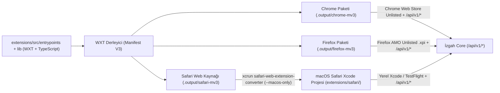
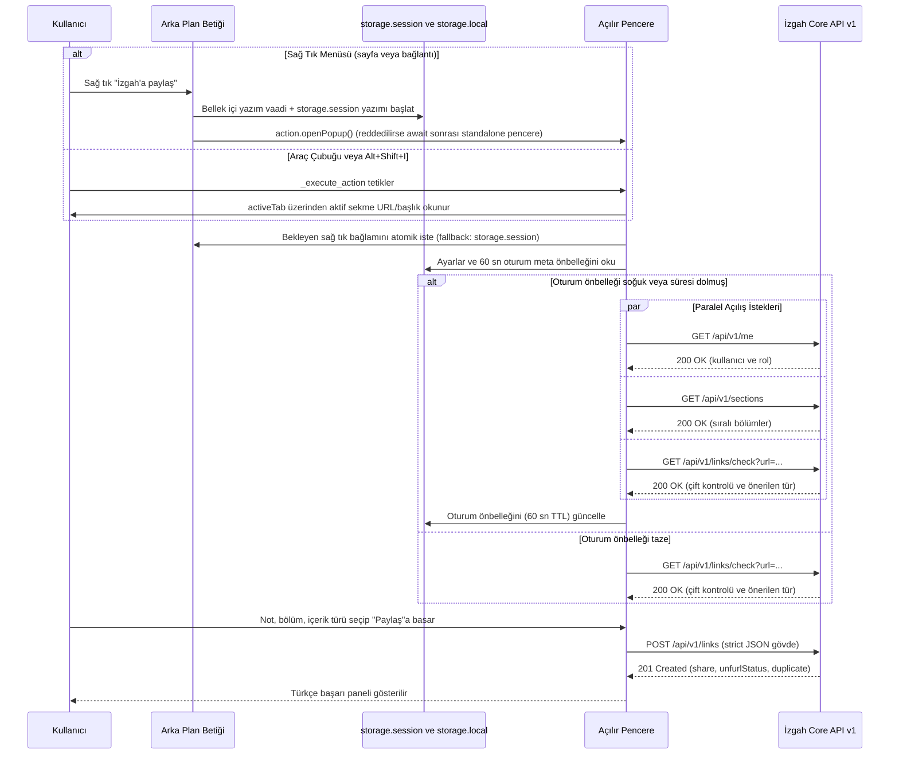

# İzgah Tarayıcı Eklentileri (Chrome, Firefox, Safari)

*   **Author:** Gorkem Inanc Ozdemir
*   **Status:** Approved
*   **Date:** 2026-11-19

--------------------------------------------------------------------------------

## Overview

Bu tasarım dokümanı, İzgah kapalı ekip link paylaşım platformunun masaüstü Chrome, Firefox ve Safari tarayıcı eklentilerini tanımlar. Eklentiler 10–15 kişilik ekip üyelerinin gezinme sırasında karşılaştığı bağlantıları tarayıcı sekmesinden ayrılmadan İzgah'a aktarmasını sağlar ve [izgah-core.md](./izgah-core.md) §7'de sabitlenen `/api/v1/*` HTTP sözleşmesini kullanır.

Kod tabanı, kök [package.json](../../package.json) bağımlılık sınırına dokunmadan `extensions/` alt dizininde kendi `package.json` dosyasıyla yalıtılmış bir paket olarak kurulur. Tek bir `WXT + TypeScript` (Manifest V3) kaynağından Chrome ve Firefox paketleri üretilir; macOS Safari paketi ise Apple'ın `xcrun safari-web-extension-converter` aracıyla oluşturulan Xcode projesinden derlenir.

### Temel Kavramlar

*   **Açılır Paylaşım Penceresi (`Action Popup`):** Araç çubuğu düğmesi, klavye kısayolu (`Alt+Shift+I`) veya sağ tık menüsü tetiklendiğinde açılan; aktif sekmenin URL'si ile başlığını (veya sağ tıklanan bağlantının URL'sini), `/api/v1/links/check` çift paylaşım sonucunu, not, konu bölümü, içerik türü alanlarını ve rolü `admin` olan kullanıcılar için sessiz ekleme seçeneğini sunan eklenti arayüzüdür.
*   **Bağlam Menüsü Girişi (`Context Menu Trigger`):** Tarayıcı sağ tık menüsünde hem sayfa (`page`) hem bağlantı (`link`) bağlamlarında görünen `"İzgah'a paylaş"` öğesidir. Sayfa bağlamında aktif sekme URL'si ve başlığı, bağlantı bağlamında ise tıklanan hedefin `linkUrl` adresi paylaşım penceresine aktarılır.
*   **Kişisel API Anahtarı Kimliği (`Bearer API Key`):** Üyelerin web uygulamasındaki `/settings/api-keys` ekranından ürettiği `izk_...` ön ekli kişisel anahtardır. Yalnızca eklentinin yerel deposunda (`storage.local`) tutulur ve her API isteğinde `Authorization: Bearer izk_...`, `X-Client-Name` ve `X-Client-Version` başlıklarıyla gönderilir.
*   **Derleme Kök İzni ve CORS Geri Dönüşü (`Scoped Host Permission + CORS Fallback`):** Eklenti manifesti `host_permissions` içinde yalnızca derleme sırasında belirlenen İzgah kök adresi (`origin`) için portsuz eşleşme kalıbı ister. Ayarlar sayfasında geliştirme veya farklı bir İzgah sunucu adresi girildiğinde eklenti ek tarayıcı izni istemez; [src/hooks.server.ts](../../src/hooks.server.ts) tarafından `/api/v1/*` uçlarında döndürülen `Access-Control-Allow-Origin: *` CORS başlıkları üzerinden istek gönderir.

## The Problem

İzgah çekirdek web uygulaması tarayıcıdan bağlantı paylaşımı, arama ve tartışma gereksinimlerini karşılar; ancak günlük masaüstü tarayıcı kullanımında şu dört sorun sürmektedir:

1.  **Sekme Değiştirme ve Kopyala-Yapıştır Sürtünmesi:** Bir makaleyi, videoyu veya sayfa içindeki bir `<a href>` bağlantısını paylaşmak için URL'yi kopyalamak, İzgah sekmesine geçmek, paylaşım penceresini açmak ve bağlantıyı yapıştırmak gerekir. Bir bağlantıyı ziyaret etmeden doğrudan bulunduğu sayfadan paylaşmak ek sekme açma maliyeti doğurur.
2.  **Bulunulan Sekmede Çift Paylaşım ve Sessiz Kaynak Bağlamının Görülmemesi:** Kullanıcı İzgah sekmesine geçip formu açana kadar, baktığı URL'nin daha önce ekipten biri tarafından paylaşılıp paylaşılmadığını veya admin tarafından yalnızca belirli bir bölüme sessizce eklenip eklenmediğini göremez.
3.  **Üç Masaüstü Tarayıcıda Tek Kod Tabanı ve Kök Paket İzolasyonu:** Ekip üyeleri Chrome, Firefox ve Safari kullanmaktadır. Üç tarayıcı için ayrı istemci kodu sürdürmek bakım yükünü artırır; öte yandan eklenti derleme bağımlılıklarını kök [package.json](../../package.json) içine almak [izgah-core.md](./izgah-core.md) kapsamındaki sabit bağımlılık sınırını ihlal eder ve Dokploy konteyner derlemesine eklenti derleme araçlarını taşır.
4.  **Aşırı İzin Yüzeyi ve İnceleme Riski:** Tüm siteler için `<all_urls>` veya içerik betiği (`content_scripts`) isteyen eklentiler sayfa içeriğine erişim hakkı alır, `tabs` izni ise açık tüm sekmelerin URL ve başlık üst verilerini okuyabilir; bu izinler geniş tarayıcı uyarıları çıkarır ve ek mağaza inceleme adımlarına yol açabilir.

Bu tasarım `extensions/` altında yalıtılmış tek bir `WXT + TypeScript` MV3 kod tabanı kurar. Yalnızca `activeTab`, `contextMenus`, `storage` ve derleme zamanı İzgah kök adresi izniyle çalışan paylaşım penceresi üzerinden `/api/v1/*` uçlarını doğrudan tüketerek bu dört sorunu giderir.

## Goals

*   **Kök Paketten Yalıtılmış Çoklu Tarayıcı Derlemesi:** Kök [package.json](../../package.json) dosyasına bağımlılık eklemeden `extensions/` altında kendi `package.json` ve kilit dosyasına sahip `WXT + TypeScript` (Manifest V3) paketi kurmak; Chrome, Firefox ve `xcrun safari-web-extension-converter` ile üretilen macOS Safari projesi için her üç tarayıcının son iki ana sürümünü desteklemek.
*   **Açılır Pencerede Çift Kontrolü ve Rol Duyarlı Paylaşım:** Araç çubuğu açılır penceresinde aktif sekmenin URL'sini ve başlığını (sağ tık bağlantısında `linkUrl`) göstermek; `GET /api/v1/me`, `GET /api/v1/sections` (oturum önbelleği soğukken) ve `GET /api/v1/links/check?url=...` çağrılarıyla mevcut kaydın kimin tarafından, ne zaman ve (sessiz kaynaksa) hangi bölümlerde paylaşıldığını bildirmek; not (`<= 1000` karakter), çoklu bölüm seçimi, 5 içerik türü (`video`, `repo`, `social`, `article`, `web` veya otomatik algılama) ve yalnızca `admin` rolü için en az bir bölüm seçimi zorunlu `"Ana akışta yayınlama (yalnızca seçili bölümlere sessiz ekle)"` seçeneğiyle `POST /api/v1/links` paylaşımını tamamlamak.
*   **Sağ Tık Menüsü ve Klavye Kısayolu Girişleri:** Sayfada (`page`) ve bağlantı üzerinde (`link`) `"İzgah'a paylaş"` bağlam menüsü öğelerini ve `Alt+Shift+I` klavye kısayolunu aynı paylaşım akışına bağlamak; araç çubuğu olmayan pencere gibi `action.openPopup()` çağrısının reddedildiği durumlarda aynı paylaşım arayüzünü açan küçük eklenti penceresi yedeği sunmak.
*   **Yerel Ayarlar, Bağlantı Testi ve Türkçe Hata Yönetimi:** Eklenti ayarlar sayfasında İzgah sunucu kökü (`origin`) ile `/settings/api-keys` üzerinden üretilen `izk_` anahtarını yalnızca yerel eklenti deposuna (`storage.local`) kaydetmek ve `GET /api/v1/me` çağrısıyla `"Bağlantıyı test et"` doğrulaması sunmak; her istekte `Authorization: Bearer izk_...`, `X-Client-Name` ve `X-Client-Version` başlıklarını iletmek; `400`, `401`, `403`, `404`, `405`, `409`, `422`, `429` ve `5xx` HTTP hatalarını Türkçe açıklamalar ve sunucu `requestId` değeriyle, ağ/CORS/zaman aşımı hatalarını ise Türkçe bağlantı uyarısıyla göstermek.
*   **En Dar İzin Sınırı (`Minimum Privilege`):** Manifest izinlerini yalnızca `activeTab`, `contextMenus`, `storage` ve derleme anında verilen İzgah kök adresi `host_permissions` kalıbıyla sınırlamak; Ayarlar ekranında özel veya yerel sunucu adresi girildiğinde `/api/v1/*` CORS başlıklarıyla çalışmak; sayfa DOM içeriğini veya çerezlerini okumamak.

## Non-Goals

*   **Sayfa İçeriği veya DOM Okuma:** Web sayfalarına içerik betiği (`content_scripts`) enjekte etmek, `scripting` izni istemek, `og:*` meta etiketlerini veya seçili metni sekmeden kazımak kapsam dışıdır.
*   **Çerez Tabanlı Oturum veya `/share` Web Ekranı:** Web tarayıcı oturum çerezlerini paylaşmak ya da eklenti içinden `/share` web sayfasına yönlendirmek kapsam dışıdır; kimlik doğrulama yalnızca kişisel API anahtarı (`Bearer izk_...`) ile yürütülür.
*   **Mobil Tarayıcı Eklentileri:** iOS Safari ve Android Firefox/Chromium sürümleri kapsam dışıdır.
*   **Eklenti İçi Akış, Arama, Etkileşim veya Anahtar Yönetimi:** Ana akış listeleme, iki dilli arama, beğeni/yorum gönderme, bildirim rozeti yoklaması ve `/settings/api-keys` anahtar üretimi/iptali web uygulamasında kalır; eklenti içinde sunulmaz.
*   **Arka Plan Geçmişi veya Yer İmi İzleme:** Ziyaret edilen sayfaları arka planda otomatik göndermek, tarayıcı geçmişini okumak veya yer imlerini toplu içe aktarmak kapsam dışıdır.
*   **Çekirdek Sunucu Sözleşmesi Değişikliği:** [izgah-core.md](./izgah-core.md) §7'de tanımlanan `/api/v1/*` uçlarına ve sunucu koduna dokunulmaz (mevcut yanıt sözleşmesinde yer almayan isteğe bağlı alanlar için istemcide kullanılmayan dallar eklenmez); ileride değerlendirilebilecek isteğe bağlı sunucu ekleri Teknik Plan bölümünde ayrı `"Core değişiklik önerisi"` başlığında listelenir.

## Open Questions

Açık mimari veya kapsam sorusu bulunmamaktadır. Derleme zamanı İzgah kök adresi için portsuz `host_permissions` kalıbı, Ayarlar sayfasında farklı bir sunucu adresi kullanıldığında `/api/v1/*` CORS başlıklarına geri dönüş modeli ve `E1`–`E4` süresince çekirdek sunucunun değiştirilmemesi kararları kesinleştirilmiştir.

## Critical User Journeys (CUJs)

### CUJ 1: Ayarlar Sayfasında Kurulum ve Bağlantı Testi (`/api/v1/me`)

*   **Given**: Kullanıcı tarayıcı eklentisini kurmuştur; İzgah web uygulamasındaki `/settings/api-keys` sayfasından yeni bir `izk_...` kişisel API anahtarı üretmiştir.
*   **When**: Kullanıcı eklentinin ayarlar sayfasını açar, İzgah sunucu kök adresini (`origin` — varsayılan adres veya özel/yerel adres) ve kişisel API anahtarını girer, ardından `"Bağlantıyı test et"` düğmesine tıklar.
*   **Then**: Eklenti `Authorization: Bearer izk_...`, `X-Client-Name` ve `X-Client-Version` başlıklarıyla `GET <sunucu>/api/v1/me` isteği atar; `200 OK` yanıtındaki kullanıcı adı, e-posta ve rol (`member` veya `admin`) bilgisini ekranda gösterir. Ayarlar kaydedildiğinde anahtar ve sadeleştirilmiş kullanıcı profili (`id`, `name`, `email`, `role`) yalnızca eklentinin `storage.local` alanına yazılır ve oturum meta önbelleği sıfırlanır (üretim dışı bir adres girilmişse ek izin istemeden `/api/v1/*` CORS üzerinden çalışır).

### CUJ 2: Araç Çubuğu Düğmesi veya Klavye Kısayolu (`Alt+Shift+I`) ile Paylaşım ve Erken Çift Kontrolü

*   **Given**: Kullanıcı geçerli bir API anahtarını kaydetmiştir ve paylaşmak istediği bir `https://...` sekmesi üzerindedir.
*   **When**: Kullanıcı araç çubuğundaki İzgah düğmesine tıklar veya `Alt+Shift+I` klavye kısayoluna basar; açılan pencerede sekmenin URL'sini ve salt okunur başlığını görür, isterse not yazar, konu bölümlerini ve içerik türünü seçer, ardından `"Paylaş"` düğmesine basar.
*   **Then**: Oturum meta önbelleği (`storage.session`, `60 sn` TTL) soğuksa `GET /api/v1/me`, `GET /api/v1/sections` ve `GET /api/v1/links/check?url=...` çağrıları paralel çalıştırılır (önbellek taze ise yalnızca `/api/v1/links/check?url=...` çağrılır). Bağlantı daha önce paylaşılmışsa ilk paylaşımcının adı ve tarihi (`"Bu link daha önce <ad> tarafından <tarih> paylaşıldı"`), varsa seçili bölümler ve toplam paylaşım sayısı uyarısı gösterilir; paylaşılmamışsa sunucudan gelen `suggestedContentType` otomatik algılama seçeneğinde öneri olarak gösterilir (kullanıcı elle tür seçmedikçe `contentType` alanı gönderilmeyerek sunucu önizleme işçisinin tür iyileştirmesi korunur). `"Paylaş"` sonrasında `POST /api/v1/links` isteği `201 Created` döner ve form gizlenerek Türkçe onay paneli (`"Bağlantı İzgah'a paylaşıldı"`, `"Yeni paylaşım"` ve `"Kapat"` düğmeleri) gösterilir.

### CUJ 3: Admin Tarafından Sessiz Kaynak Ekleme ve Üye Tarafından Çift Kontrolünde Görülmesi

*   **Given**: Admin rolündeki kullanıcı eklenti ayarlarında `role = "admin"` olarak doğrulanmıştır; sistemde en az bir konu bölümü tanımlıdır.
*   **When**: Admin bir sekmede açılır pencereyi başlatır, `"Ana akışta yayınlama (yalnızca seçili bölümlere sessiz ekle)"` onay kutusunu işaretler; bölüm seçmeden göndermeyi denerse istemci doğrulamasını görür, ardından en az bir bölüm seçerek `"Paylaş"` düğmesine basar. Daha sonra `member` rolündeki başka bir üye aynı URL için eklentiyi açar.
*   **Then**: Admin paylaşımında `isFeedVisible: false` ve seçili `sectionIds` ile `POST /api/v1/links` `201 Created` döner; `member` rolündeki kullanıcıda sessiz ekleme onay kutusu hiç gösterilmez. İkinci üye aynı URL için eklentiyi açtığında `GET /api/v1/links/check` yanıtındaki `firstShare.isFeedVisible === false` ve `sectionNames` bilgisi okunarak bağlantının hangi bölümlerde sessiz kaynak olarak kayıtlı olduğu ve yeniden paylaşıldığında ana akışa da ekleneceği gösterilir.

### CUJ 4: Sayfada ve Bağlantı Üzerinde Sağ Tık Menüsü (`"İzgah'a paylaş"`) ile Paylaşım

*   **Given**: Eklenti kurulu ve yapılandırılmış durumdadır; kullanıcı bir web sayfasının boş alanında veya sayfa içindeki bir `<a href="https://...">` bağlantısı üzerinde sağ tık menüsünü açar.
*   **When**: Kullanıcı `"İzgah'a paylaş"` bağlam menüsü öğesine tıklar.
*   **Then**: Arka plan betiği bağlam verisini (`linkUrl` varsa tıklanan bağlantıyı, yoksa aktif sekmenin `tab.url` ve `tab.title` bilgisini) geçici tüketim kaydı olarak yazar ve kullanıcı etkileşimi içinde açılır paylaşım penceresini (`action.openPopup()`, reddedildiğinde yazım tamamlandıktan sonra yedek bağımsız pencereyi) başlatır. Pencere bağlantı bağlamında `info.linkUrl` değerini URL alanına koyar (sayfa DOM'u okunmadığı için başlık boş kalır) ve `/api/v1/links/check` kontrolünü otomatik çalıştırır; sayfa bağlamında ise sekme URL'si ve başlığıyla aynı paylaşım formunu sunar.

### CUJ 5: Kimlik, Yetki, Doğrulama ve Hız Sınırı Hatalarının (`401`, `403`, `422`, `429`) Türkçe Gösterimi

*   **Given**: Kullanıcının API anahtarı iptal edilmiş/parolası sıfırlanmış (`401`), sunucuda yetkisi değişmiş (`403`), geçersiz şema/uzun not gibi bir girdi hatası oluşmuş (`422`) veya hız sınırına (`429`) ulaşılmıştır.
*   **When**: Eklenti açılır penceresi veya ayarlar ekranı `/api/v1/*` uçlarından hata zarfı (`{ error: { code, message, requestId, details } }`) alır.
*   **Then**: Sunucudan dönen tüm HTTP hata yanıtlarında (ağ/zaman aşımı hataları hariç) destek için kopyalanabilir `requestId` bilgisi görünür:
    *   `401`: Anahtarın geçersiz veya iptal edilmiş olduğu Türkçe açıklanır ve doğrudan Ayarlar ekranını açan düğme sunulur.
    *   `403`: İşlem için yetki bulunmadığı (örneğin üyenin sessiz paylaşım yetkisine sahip olmadığı) Türkçe bildirilir; oturum meta önbelleği silinip rol `/api/v1/me` ile yenilenir.
    *   `422`: Sunucu `error.details` alan hataları (`url`, `note`, `sectionIds`, `contentType`, `isFeedVisible`) ilgili form alanlarının altında, `_root` veya bilinmeyen anahtarlar ise genel hata kutusunda Türkçe gösterilir.
    *   `429`: İstek hız sınırının aşıldığı ve biraz beklenip yeniden denenmesi gerektiği Türkçe anlatılır (`Retry-After` başlığı okunabiliyorsa bekleme süresi saniye cinsinden yazılır).

## Technical Plan (Architecture)

### 1. Paket İzolasyonu, Çoklu Tarayıcı Derlemesi ve Dağıtım Mimarisi

Eklenti kod tabanı, kök [package.json](../../package.json) bağımlılık sınırına ve Dokploy sunucu konteyner derlemesine dokunmamak için `extensions/` dizini altında yalıtılmış bir `WXT + TypeScript` paketi olarak yapılandırılır:

*   **Bağımsız Paket ve Kilit Sınırı:** `extensions/` paketi (`"izgah-extensions"`, Node `>=22.0.0`) yalnızca `WXT` ve ek çerçevesiz `TypeScript` araç zincirini tanımlar; [AGENTS.md](../../AGENTS.md) içindeki yerel web platformu ilkesi gereği ek arayüz çerçevesi çalışma zamanı bağımlılığı (`Svelte`, `React` vb.) eklenmez. Dizin içindeki kendi çalışma alanı yapılandırması, `extensions/` altında çalıştırılan `pnpm install` komutunun kök [pnpm-workspace.yaml](../../pnpm-workspace.yaml) ve kök [pnpm-lock.yaml](../../pnpm-lock.yaml) dosyalarına tırmanmasını engeller.
*   **Kök Depo Sınır Hijyeni:** Kök [package.json](../../package.json) değiştirilmeden yalnızca kök yapılandırma sınırları güncellenir: kök [eslint.config.js](../../eslint.config.js) kök `eslint .` taramasından eklenti dizinini çıkarır, kök `.prettierignore` eklenti çıktıları ile kilit/doküman dosyalarını kök Prettier denetiminin dışında tutar, kök [.dockerignore](../../.dockerignore) Dokploy konteyner bağlamından eklentiyi dışlar ve kök [.gitignore](../../.gitignore) üretilen Safari Xcode, WXT ve Playwright çıktılarını yoksayar.
*   **Tek Kaynaktan Üç Tarayıcı Derlemesi ve Safari Dönüşümü:** WXT derleyicisi aynı kaynaktan Chrome MV3, Firefox MV3 ve Safari web kaynağı çıktısı üretir. macOS üzerinde çalışan Safari derleme betiği önce web paketini üretip doğrular, ardından Apple Xcode dönüştürücü aracını denetler: tam Xcode kuruluysa `extensions/safari/` Xcode projesini oluşturur; kurulu değilse eksik Xcode tanı çıktısı yazar ve yalnızca zorunlu bayrak verildiğinde sıfır dışı hata koduyla çıkar.
*   **Seçilen Dağıtım ve İmzalama Mimarisi:** 10–15 kişilik kapalı ekip için (a) **Chrome Web Store `Unlisted`** (\$5 tek seferlik kayıt ücretiyle yalnız paylaşım bağlantısına sahip ekip üyelerine otomatik imzalı dağıtım), (b) **Firefox AMO İmzalı Kendin Dağıt (`Unlisted` `.xpi`)** (\$0 ile Mozilla imzalı `.xpi` üretimi; v1'de `.xpi` elle güncellenir) ve (c) **macOS Safari Varsayılan \$0 Yerel Xcode Derlemesi** (`Develop` menüsünden `Allow Unsigned Extensions` ile yerel imzasız çalışma; Apple Developer hesabı sağlandığında kod değişikliği olmadan \$99/yıl `TestFlight` veya noter onaylı `Developer ID` dağıtımına yükseltilebilir) kanalları seçilmiştir.

### 2. Manifest V3 Sözleşmesi ve En Dar İzin Modeli

Eklenti yapılandırması tüm tarayıcı hedeflerinde açıkça `manifestVersion: 3` üretir. Manifest yalnızca aşağıdaki alanları talep eder; `content_scripts`, `scripting`, `tabs`, `cookies` ve `<all_urls>` dışlanır:

| Manifest Alanı | Değer / Yapılandırma | Teknik Rol ve Sınır |
| :--- | :--- | :--- |
| `permissions` | `["activeTab", "contextMenus", "storage"]` | Yalnızca kullanıcı etkileşiminde aktif sekmenin URL/başlık bilgisini okur; sağ tık menüsü ve yerel ayar/oturum deposunu yönetir. |
| `host_permissions` | Portsuz köken kalıbı `["<protokol>//<konak>/api/v1/*"]` (`WXT_IZGAH_ORIGIN` kaynağından türetilir; yerel geliştirme varsayılanı `http://localhost/api/v1/*`) | Firefox MV3 eşleşme kalıpları port içermediğinden porttan arındırılmış tek İzgah kökünü kapsar. Ayarlar sayfasında farklı bir İzgah adresi girildiğinde ek izin istenmeden `/api/v1/*` CORS başlıklarıyla çalışır. |
| `optional_host_permissions` | Tanımsız (kullanılmaz) | Çalışma zamanı izin diyaloğu açmadan üretim kökü izni artı özel adreslerde CORS geri dönüşü kullanıldığı için dinamik host izni talep edilmez. |
| `action` ve `icons` | Giriş noktalarından üretilen açılır pencere (`popup.html`), Türkçe başlık (`"İzgah'a paylaş"`) ve `16`/`32`/`48`/`128` PNG simge eşlemesi | Üç tarayıcı mağazası ve eklenti yöneticisi simge doğrulamalarını karşılar (`options_ui.open_in_tab: true` giriş noktası meta etiketiyle Chrome ve Firefox hedeflerinde üretilir; WXT Safari MV3 hedefinde desteklenmeyen `open_in_tab` alanını düşürerek `{ page: "options.html" }` yazar). |
| `commands._execute_action` | `Alt+Shift+I` (`default` ve `mac`) | Chrome, Firefox ve Safari'de geçici `activeTab` yetkisini tetikleyerek doğrudan açılır paylaşım penceresini açar. |
| `background` | Chrome/Safari `service_worker`, Firefox MV3 `background.scripts` | Yalnızca kurulum, sağ tık menüsü tıklamaları ve bağlam devri el sıkışması mesajlarını dinler; arka plan zamanlayıcısı veya gönderim kuyruğu tutmaz. |
| `browser_specific_settings.gecko` | Yalnızca Firefox hedefinde `{ id: WXT_GECKO_ID, strict_min_version: "128.0", data_collection_permissions: { required: ["none"] } }` | Firefox MV3 `storage` API'si ve AMO Kasım 2025 zorunlu veri toplama beyanı gerekliliğini karşılar; Chrome ve Safari manifestlerine yazılmaz. |
| `content_security_policy.extension_pages` | `"script-src 'self'; object-src 'none'"` | Satır içi betik ve `eval` çalıştırmasını engeller; yalnızca paketlenmiş modüller yüklenir. |

### 3. Tetikleme Akışları: Araç Çubuğu, Klavye Kısayolu ve Sağ Tık Menüsü

Üç giriş yolu tek bir açılır paylaşım ekranına yakınsar:

#### Giriş Tetikleyicileri

1.  **Araç Çubuğu Düğmesi:** Tarayıcı doğrudan paylaşım penceresini açar ve aktif sekme için geçici `activeTab` erişimi verir; sekme URL'si ve başlığı aktif sekmeden okunur.
2.  **Klavye Kısayolu (`Alt+Shift+I`):** `_execute_action` komutu aracılığıyla tarayıcı tarafından araç çubuğu düğmesiyle aynı `activeTab` bağlamında paylaşım penceresi açılır.
3.  **Sağ Tık Bağlam Menüsü (`"İzgah'a paylaş"`):**
    *   Arka plan betiği kurulumda menü öğesini `page` ve `link` bağlamları için kaydeder; tüm olay dinleyicileri arka plan betiğinin en üst seviyesinde senkron olarak tanımlanır.
    *   Tıklandığında `linkUrl` varsa bağlam `'link'` (URL = tıklanan bağlantı, başlık = `null`, çünkü sayfa DOM'u okunmaz), yoksa `'page'` (URL ve başlık = aktif sekme bilgisi) olarak hazırlanır.
    *   **Kullanıcı Etkileşimi Koruma ve Deterministik Devir Kuralı:** `await` sonrasında kullanıcı aktivasyonunun düşmesini önlemek için arka plan betiği bağlamı modül belleğinde + `storage.session` yazım vaadiyle birlikte tutup aynı olay dönüşünde senkron olarak `action.openPopup()` çağrısını (özellik denetimi ve `try/catch` korumasıyla) başlatır. Araç çubuğu olmayan pencere gibi `openPopup()` reddinde kullanıcı aktivasyonu kısıtı kalmadığından yazım vaadinin tamamlanması beklendikten sonra yedek bağımsız pencere (`?mode=standalone`) açılır.

#### Açılır Pencere Başlatma, Şema Denetimi ve Çift Kontrolü

1.  Açılır pencere açılışta önce arka plan betiğinden tek kullanımlık mesaj el sıkışmasıyla (arka plan yanıt vermezse doğrudan `storage.session` yedeğiyle) bekleyen sağ tık bağlamını atomik olarak tüketir. Bekleyen geçerli bağlam yoksa: normal açılışta aktif sekmenin URL/başlığı okunur; `?mode=standalone` yedek kipinde ise asla pencerenin kendi eklenti sekmesi sorgulanmaz, boş düzenlenebilir URL alanı ve bağlam süresinin dolduğuna dair Türkçe uyarı gösterilir.
2.  `"activeTab"` kısıtlı tarayıcı sayfalarında (`chrome://`, `about:`, mağaza sayfaları veya dosya erişimsiz `file://`) sekme adresi `undefined`/boş dönerse ya da adres `http:`/`https:` dışında bir şemaya sahipse ön kontrol çağrısı atlanır ve kullanıcıya Türkçe yönlendirme gösterilerek URL alanı düzenlenebilir bırakılır.
3.  `serverOrigin` veya `apiKey` ayarlanmamışsa form yerine doğrudan `"Ayarları aç"` kartı sunulur.
4.  Ayarlar tam ise arayüz önce `storage.local` içindeki önbellek rolüne göre ilk çizimini yapar. Ardından `storage.session` meta önbelleği (`60 sn` TTL) taze ise yalnızca `GET /api/v1/links/check` çalıştırılır; önbellek soğuk veya süresi dolmuşsa `GET /api/v1/me`, `GET /api/v1/sections` ve `GET /api/v1/links/check` istekleri paralel olarak gönderilir. Anahtar `401` dönerse yerel önbellek profili ve oturum önbelleği temizlenip Ayarlar yönlendirmesi açılır; rol `member` değerine düşmüşse sessiz ekleme seçeneği gizlenip işareti temizlenir; bölüm listesi alınamazsa bölüm alanında yeniden deneme denetimi gösterilirken normal paylaşım açık kalır.
5.  **Çift Paylaşım, İçerik Türü ve Admin Sessiz Ekleme Kuralları:** `exists === true` yanıtında `firstShare` yazar adı, Türkçe biçimli tarih, toplam paylaşım sayısı ve `firstShare.isFeedVisible === false` durumunda bağlantının hangi bölümlerde sessiz kaynak olarak kayıtlı olduğu ile normal paylaşımda ana akışa ekleneceği bildirilir. İçerik türü seçimi varsayılan olarak `"Otomatik algıla"` konumunda kalır ve kullanıcı elle değiştirmedikçe `POST` gövdesine `contentType` eklenmeyerek sunucu önizleme işçisinin tür iyileştirmesi (`contentTypeLocked = false`) korunur. Yalnızca `role === 'admin'` durumunda gösterilen sessiz ekleme kutusu işaretli ise gönderim öncesinde en az bir konu bölümü seçimi doğrulanır.

### 4. Yerel Depolama Mimarisi (`storage.local` ve `storage.session`)

Eklenti tüm kalıcı veriyi yalnızca yerel makinede kalan `browser.storage.local` alanında, geçici oturum verilerini ise yalnızca tarayıcı oturumu süresince yaşayan `browser.storage.session` alanında tutar. API anahtarı (`izk_...`) bulut eşitlemesi yapan `browser.storage.sync` alanına, web `localStorage` deposuna veya konsol günlüklerine asla yazılmaz:

*   **Kalıcı Ayar Deposu (`storage.local`):** Yapılandırılan sunucu kökü (`serverOrigin`), kişisel `apiKey` ve sadeleştirilmiş kullanıcı profili (`id`, `name`, `email`, `role`) tutulur. Ayarlar kaydedilmeden önce köken normalleştirme adımı tüm yol/sorgu/parça bölümlerini kırpar; uzak sunucularda yalnızca `https:` şemasına, yerel geliştirme/test konaklarında ise `http:` şemasına izin verir ve kimlik bilgisi içeren URL'leri reddeder.
*   **Geçici Bağlam Devri (`storage.session`):** Sağ tık menüsünden aktarılan tek kullanımlık paylaşım bağlamı (`10 sn` geçerlilik penceresi) açılışta tüketilip silinir. `storage.session` API'si bulunmayan ortamlarda sahte bellek içi yedeğe düşülmez; açık hata fırlatılır.
*   **Okuma Kotası Meta Önbelleği (`storage.session`):** Sık açılışlarda İzgah çekirdeğinin `apiKeyId` başına dakikada `60` okuma hız sınırını korumak için son doğrulanmış `{ serverOrigin, user, sections }` verisi `60 sn` TTL ile oturum deposunda tutulur. Ayar kaydı/silinmesi, `401`, `403` veya silinen bölümden kaynaklı `422` (`sectionIds`) hatasında önbellek anında temizlenir.

### 5. HTTP İstemcisi ve Türkçe Hata Eşleme Sözleşmesi (`/api/v1/*`)

İstek katmanı [izgah-core.md](./izgah-core.md) §7 ve [src/hooks.server.ts](../../src/hooks.server.ts) sözleşmesine uyar:

*   **Zorunlu Başlıklar ve İstek Bayrakları:** Her `/api/v1/*` isteğinde `Authorization: Bearer <apiKey>`, `X-Client-Name`, `X-Client-Version` ve `Accept: application/json` (`POST` için ek `Content-Type: application/json`) başlıkları gönderilir. Tüm çağrılar çerez taşımamak için `credentials: 'omit'` ve sınırlı istek zaman aşımıyla çalışır; elle URL düzenlemelerinde önceki çift kontrolü isteği iptal edilir ve istemci iptal sinyali ağ hatası olarak gösterilmez.
*   **Katı Gönderim Gövdesi (`POST /api/v1/links`):** [src/routes/api/v1/links/+server.ts](../../src/routes/api/v1/links/+server.ts) `.strict()` Zod şeması gereği gövde yalnızca geçerli alanlarla kurulur: zorunlu `url`, boş değilse `note`, seçilmişse `sectionIds`, kullanıcı otomatik algılamayı değiştirmişse `contentType` ve kullanıcı `admin` + sessiz kutu işaretli ise `isFeedVisible: false`.
*   **Hata Zarfı Okuma ve Kullanıcı Taslağını Koruma:** İstemci katmanı `{ error: { code, message, requestId, details? } }` zarfını ve yanıt `X-Request-Id` başlığını (ters vekilden gelen JSON olmayan `5xx` yanıtları dahil) çözümler. Paylaşım başarısız olduğunda form alanlarındaki not ve bölüm seçimleri korunur.

| Durum / Hata Sınıfı | Çıkarılan Sunucu Bilgisi | Kullanıcıya Gösterilen Türkçe Anlatım ve Arayüz Davranışı |
| :--- | :--- | :--- |
| `400 BAD_REQUEST` | `error.message`, `requestId` | `"İstek biçimi sunucu tarafından kabul edilmedi. Girdileri kontrol edip yeniden deneyin."` mesajı ve `requestId` gösterilir. |
| `401 UNAUTHORIZED` | `error.code`, `requestId` | `"API anahtarınız geçersiz, eksik veya iptal edilmiş. Lütfen /settings/api-keys sayfasından yeni bir anahtar oluşturup eklenti ayarlarını güncelleyin."` uyarısı ile `"Ayarları aç"` düğmesi sunulur; önbellek profil (`cachedUser`) ve oturum meta önbelleği temizlenir (`serverOrigin` korunur). |
| `403 FORBIDDEN` | `error.message`, `requestId` | `"Bu işlem için yetkiniz bulunmuyor (örneğin sessiz kaynak yalnızca admin rolü tarafından eklenebilir)."` mesajı gösterilir, oturum önbelleği silinir ve rolü güncellemek için arka planda `GET /api/v1/me` çağrılır. |
| `404 NOT_FOUND` / `405 METHOD_NOT_ALLOWED` | `error.message`, `requestId` | İstenen API uç noktasının sunucu adresinde bulunmadığı veya HTTP yönteminin desteklenmediği Türkçe açıklanır ve Ayarlar adresi kontrolü önerilir. |
| `409 CONFLICT` | `error.message`, `requestId` | Sunucunun döndürdüğü Türkçe çakışma açıklaması ve kopyalanabilir `requestId` gösterilir. |
| `422 VALIDATION_ERROR` | `error.message`, `error.details`, `requestId` | Sunucudan gelen `url`, `note`, `sectionIds`, `contentType` ve `isFeedVisible` hataları ilgili form alanının altına, `_root` veya tanınmayan anahtarlar ise genel hata kutusuna Türkçe olarak bağlanır. |
| `429 RATE_LIMITED` | `Retry-After` (okunabiliyorsa), `requestId` | `"Çok fazla istek gönderildi (hız sınırına ulaşıldı)."` mesajı gösterilir; üretim kökü gibi `host_permissions` kapsamında `Retry-After` okunabiliyorsa `"Lütfen <N> saniye bekleyip yeniden deneyin."`, özel adres CORS kısıtında okunamıyorsa `"Lütfen kısa süre bekleyip yeniden deneyin."` uyarısı verilir. |
| `5xx` Sunucu Hatası (JSON ve JSON olmayan) | `error.message` (varsa), `requestId` (`X-Request-Id` başlığı dahil) | `"İzgah sunucusunda beklenmeyen bir hata oluştu. Sorun sürerse bu takip kodunu yöneticinizle paylaşın."` uyarısı ve tek tıkla kopyalanabilen `requestId` sunulur. |
| Ağ / CORS / Zaman Aşımı (debounced `AbortError` hariç) | `TypeError` veya `TimeoutError` | `"İzgah sunucusuna bağlanılamadı. İnternet bağlantınızı ve Ayarlardaki sunucu adresini kontrol edin."` mesajı gösterilir (`requestId` yoktur); form taslağı korunur. |

### 6. Ön Yüz Mimarisi ve Yerel Web Standartları (`modern-web-guidance`)

Açılır paylaşım penceresi (`popup.html`) ve ayarlar sayfası (`options.html`) harici CSS/JS bileşen kütüphanesi olmadan doğrudan HTML/CSS/TypeScript ile yazılır; proje genelinde [AGENTS.md](../../AGENTS.md) tarafından zorunlu tutulan modern web platformu ve erişilebilirlik rehber dizinine (`modern-web-guidance`) uyar:

1.  **Tek Katmanlı Açık ve Koyu Tema Uyumu (`dark-mode`):** Belgeler sistem temasını izler; renk belirteçleri üç hedef tarayıcının son iki sürümü tarafından tam desteklenen tek bir `@media (prefers-color-scheme: dark)` katmanıyla kurulur.
2.  **Form Semantiği ve Marka Bütünlüğü (`forms`, `brand-consistent-forms`):** Girişler anlamsal `<form>`, üstte etiketli `<label for>` ve `<fieldset><legend>` yapısıyla kurulur; uzun bölüm listeleri kaydırılabilir tutulur. API anahtarı alanı parola yöneticisi eşitlemesini engellemek ve görünürlüğü kontrol etmek üzere `type="password"` + `autocomplete="off"` nitelikleriyle ve erişilebilir `"Göster"` / `"Gizle"` düğmesiyle sunulur; tüm denetimler dokunma/tıklama ergonomisi ve kontrast kurallarını karşılar.
3.  **Etkileşim Sonrası Doğrulama ve Erişilebilir Hata Duyurusu (`validate-input-after-interaction`, `accessible-error-announcement`):** Girişler sayfa açılışında erken hata vurgusu göstermez; yalnızca alan terk edildiğinde veya form gönderildiğinde geçersizse `aria-invalid` ve `aria-describedby` atanır. Tek bir kibar canlı bölge odak değişiminde sessiz kalıp gönderimde ilk hatalı denetime odak taşır.
4.  **IME Güvenli Kısayol Gönderimi (`ime-safe-enter-submit`) ve Takip Kodu Kopyalama (`copy-button`):** Not alanından `Cmd/Ctrl+Enter` ile gönderimde aktif IME birleştirme oturumları yok sayılır. Hata kutularındaki `requestId` kopyalama düğmeleri yerel Invoker Commands (`command="--copy"` + hedef `<code id>` öğesine bağlı `commandfor`) ve desteklemeyen tarayıcılar için tıklama yedeği kullanır; pano yazımı reddedildiğinde kullanıcıya elle kopyalama uyarısı gösterilir.

### 7. Core Değişiklik Önerisi (İsteğe Bağlı, Geriye Dönük Uyumlu)

Eklenti [Detailed Implementation Plan](#detailed-implementation-plan) (`E1`–`E4`) kilometre taşları için İzgah çekirdek sunucusunda **hiçbir değişiklik yapmaz**; [src/routes/api/v1/links/check/+server.ts](../../src/routes/api/v1/links/check/+server.ts) ucu mevcut entegrasyon testleri ([tests/integration/m3-api-v1-links.test.ts](../../tests/integration/m3-api-v1-links.test.ts)) gereği `originalShareDeleted` alanını dışarı vermediğinden eklenti koduna da kullanılmayan bir `originalShareDeleted` dalı eklenmemiştir. İleride değerlendirilmek üzere geriye dönük uyumlu iki iyileştirme önerisi aşağıda kayıt altına alınmıştır:

1.  **[src/routes/api/v1/links/check/+server.ts](../../src/routes/api/v1/links/check/+server.ts) — `originalShareDeleted` Alanının Döndürülmesi:** [src/lib/server/links/service.ts](../../src/lib/server/links/service.ts) içindeki `checkDuplicateLink()` fonksiyonu bir kaynağın ilk paylaşımı yumuşak silinmiş ancak başka aktif paylaşımları varsa `originalShareDeleted: true` değerini üretir ve [src/routes/api/internal/links/check/+server.ts](../../src/routes/api/internal/links/check/+server.ts) ucu bu alanı döndürür. İleride `/api/v1/links/check` yanıtına `originalShareDeleted: result.originalShareDeleted` eklenirse, eklentide de web arayüzündeki `"Orijinal gönderi silindi · Toplam <N> aktif paylaşım"` metniyle tam eşitlik sağlanabilir.
2.  **[src/hooks.server.ts](../../src/hooks.server.ts) ve [src/lib/server/api/response.ts](../../src/lib/server/api/response.ts) — CORS Yanıtlarında `Retry-After` Başlığının Açılması:** Üretim kökü `host_permissions` kapsamında olduğu için eklenti üretimde `Retry-After` başlığını doğrudan okuyabilir; ancak Ayarlar ekranında `host_permissions` kapsamı dışında kalan özel bir İzgah adresi kullanıldığında tarayıcı CORS kuralı `Access-Control-Expose-Headers: X-Request-Id` dışında kalan `Retry-After` başlığını gizler. Her iki dosyadaki başlığın `'X-Request-Id, Retry-After'` olarak güncellenmesi özel/yerel sunucu adreslerinde de kesin bekleme süresinin gösterilmesini sağlar.

## Alternatives Considered

### Dağıtım Kanalları ve Maliyet Karşılaştırması

10–15 kişilik kapalı ekip için Chrome, Firefox ve Safari dağıtım seçenekleri imza zorunluluğu, geliştirici ücreti, tarayıcı yeniden başlatma kalıcılığı ve güncelleme akışı bakımından aşağıda karşılaştırılmıştır:

| Tarayıcı ve Dağıtım Yöntemi | Doğrudan Maliyet | İmza ve Kurulum | Güncelleme ve Tarayıcı Yeniden Başlatma | Kapalı Ekip İçin Durum |
| :--- | :--- | :--- | :--- | :--- |
| **Chrome Web Store `Unlisted`** | **\$5 (tek seferlik)** geliştirici kayıt ücreti | Google imzalı `.crx`; yalnız paylaşım bağlantısı olan ekip kurar, genel aramada görünmez | Otomatik mağaza güncellemesi; açılışta uyarı çıkarmaz | **Seçilen yöntem** |
| Chrome Web Store `Public` | \$5 (tek seferlik) | Google imzalı; herkese açık mağaza listesi | Otomatik güncelleme; kapalı ekip aracına dış kullanıcı yüklemeleri gelir | Reddedildi (Alt. A) |
| Chrome Paketlenmemiş (`Load Unpacked`) | \$0 | İmzasız `.zip` açılıp geliştirici kipiyle yüklenir | Elle `.zip` yenileme gerekir; Chrome her açılışta geliştirici modu uyarısı verir | Reddedildi (Alt. A) |
| **Firefox AMO İmzalı Kendin Dağıt (`Unlisted` `.xpi`)** | **\$0** | Mozilla AMO imzası üretir; genel dizinde listelenmez, ekip imzalı `.xpi` dosyasını kurar | v1'de `.xpi` elle güncellenir; ileride `update_url` JSON ile otomatik güncelleme eklenebilir | **Seçilen yöntem** |
| Firefox AMO `Listed` | \$0 | Mozilla imzalı; herkese açık AMO sayfası | Otomatik güncelleme; kapalı ekip aracına halka açık vitrin açar | Reddedildi (Alt. A) |
| Firefox İmzasız (`about:debugging` / Dev Edition) | \$0 | İmzasız | Kararlı Firefox imzalamaya zorlar; `about:debugging` tarayıcı kapanınca eklentiyi kaldırır | Reddedildi (Alt. A) |
| **Safari İmzasız Yerel Xcode Derlemesi** | **\$0** | Geliştirici makinesinde Xcode ile yerelde imzasız `.app` derlenir; `Develop` menüsünden `Allow Unsigned Extensions` açılır | Ücretsizdir; ancak macOS Safari güvenliği nedeniyle tarayıcı tamamen kapatılıp açıldığında imzasız eklenti onayını sıfırlar (elle yeniden açılır) | **Varsayılan \$0 yerel seçenek** |
| **Safari `TestFlight` veya Noter Onaylı `Developer ID`** | **\$99 / yıl** Apple Developer Program | Xcode Cloud veya Apple sertifikasıyla imzalı `.app` / TestFlight daveti (kapalı ekip için dış kullanıcıya kapalı kalır) | Son kullanıcıda Xcode gerekmez; Safari kapatılıp açılsa bile eklenti etkin kalır | **Apple Developer hesabı varsa desteklenen kalıcı seçenek** |
| Safari Genel Mac App Store | \$99 / yıl | Apple mağaza incelemesi; herkese açık listeleme | Kapalı ekip girişine sahip şirket içi araçların genel App Store incelemesinden reddedilme riski yüksektir | Reddedildi (Alt. B) |

### Alternative A: Genel Mağaza Listelemeleri (`Public`) veya Chrome/Firefox İmzasız Geliştirici Dağıtımı

*   **Pros**: Genel mağaza listelemeleri doğrudan arama sonucuyla kurulum sağlar; Chrome paketlenmemiş yükleme ve Firefox `about:debugging` ise sıfır hesap/imza adımıyla hızlı yerel deneme sunar.
*   **Cons**: İzgah yalnızca 10–15 kişilik kapalı ekip tarafından kullanılan bir araçtır; `Public` mağaza listeleri dış kullanıcıların kurup bağlantı şikayeti veya düşük puan bırakmasına yol açar. Öte yandan Chrome'da `Load Unpacked` kullanımı her tarayıcı açılışında geliştirici modu uyarı penceresi üretir; kararlı Firefox sürümlerinde ise imzasız `.xpi` yüklenemez ve `about:debugging` tarayıcı oturumu kapanınca silinir.
*   **Reason for Rejection**: Rejected by author: Ekip dışı görünürlüğü kapalı tutarken tarayıcı imzalama zorunluluğunu ve Chrome otomatik güncellemelerini koruyan Chrome Web Store `Unlisted` (\$5 tek seferlik) ile Firefox AMO İmzalı Kendin Dağıt (\$0 `.xpi`) seçildi.

### Alternative B: Safari İçin Yalnızca Ücretli Apple Developer Sertifikası Zorunluluğu (\$99/yıl), Genel Mac App Store veya Yer İmi Aracı (`Bookmarklet`)

*   **Pros**: Yalnızca `TestFlight` / `Developer ID` zorunlu tutulursa Safari açılış sıfırlaması yaşanmaz; `Bookmarklet` yaklaşımı ise Xcode veya Apple hesabı olmadan tarayıcı yer imi çubuğuna tek bağlantı sürüklenerek çalışır.
*   **Cons**: `Bookmarklet` sağ tıklanan bağlantı (`"İzgah'a paylaş"`) ve küresel klavye kısayolu (`Alt+Shift+I`) gereksinimlerini karşılamaz, bulunulan sayfanın `Content-Security-Policy` kurallarına takılır ve açılır pencere içinde çift paylaşım/bölüm formu sunamaz. Tersine, derleme hattını yalnızca ücretli Apple Developer Program sertifikasına (\$99/yıl) kilitlemek, Apple hesabı olmayan geliştirme/deneme ortamlarında Safari derlemesini engeller; genel Mac App Store ise kapalı ekip uygulamalarını inceleme dışı bırakma riski taşır.
*   **Reason for Rejection**: Rejected by author: `Bookmarklet` ve genel Mac App Store reddedildi; Safari dönüştürme betiği varsayılan olarak \$0 imzasız geliştirici modunda çalışan Xcode projesini üretecek, aynı proje `DEVELOPMENT_TEAM` sağlandığında ek kod değişikliği olmadan \$99/yıl `TestFlight` veya noter onaylı `Developer ID` dağıtımına da uygun kalacak şekilde tasarlandı.

### Alternative C: API Anahtarsız Çerez Oturumu, `/share` Web Ekranı ve İstemci `og:*` İpucu (ilk beyin fırtınası taslağı)

*   **Pros**: İstemci tarafında kişisel API anahtarı saklanmaz ve paylaşım formu web uygulaması dışında ikinci bir arayüzde yinelenmez.
*   **Cons**: Araç çubuğu düğmesine basıldığında aktif sekme içinde küçük bir açılır pencere yerine yeni sekme veya pencere açılmasını zorunlu kılar; kullanıcının bağlamını bölerek her paylaşımda tam web sayfası yüklemesi bekler. [izgah-core.md](./izgah-core.md) `Alternative D` ve `Alternative E` kararlarında bu model reddedilip `izk_...` API anahtarları ve `/api/v1/*` JSON uçları sabitlenmiştir.
*   **Reason for Rejection**: Rejected by author: Onaylı [izgah-core.md](./izgah-core.md) §7 sözleşmesiyle uyum için sekme değiştirmeden açılır pencerede çift paylaşım kontrolü, admin sessiz ekleme ve sağ tık bağlantı paylaşımı sunan `Bearer izk_...` tabanlı eklenti modeli seçildi.

### Alternative D: Geniş İzinler (`<all_urls>`, `tabs`, `content_scripts`), `optional_host_permissions` veya Sıfır `host_permissions` (`[]`, Saf CORS)

*   **Pros**: `<all_urls>` / `tabs` / `content_scripts` sekmeler arası izleme ve DOM'dan başlık/meta etiketi okumayı sağlar; `optional_host_permissions` özel sunucu adresleri için çalışma zamanı izni ister; sıfır `host_permissions` (`[]`) ise tek paketin tüm ortamlarda hiç alan adı izni istemeden saf CORS üzerinden çalışmasını sağlar.
*   **Cons**: `<all_urls>` ve `content_scripts` gezilen her sayfanın içeriğine erişim isteyerek ağır mağaza incelemelerine yol açar. `optional_host_permissions` ise gereksiz çalışma zamanı izin diyaloğu ekler. Saf CORS (`host_permissions: []`) modelinde ise eklentinin gönderdiği `Authorization`, `X-Client-Name` ve `X-Client-Version` başlıkları nedeniyle üretim sunucusuna yapılan her istek öncesinde ek `OPTIONS` öndenetim gidiş-dönüşü oluşur; çekirdek CORS yanıtında `Retry-After` başlığı dışarı açılmadığından `429` bekleme süresi okunamaz ve Safari `host_permissions` kapsamı dışında çapraz kök ağ kısıtlarına daha hassastır.
*   **Reason for Rejection**: Rejected by author: Üretim İzgah kökünde `OPTIONS` öndenetimi olmadan düşük gecikmeli istek atabilmek, `429 Retry-After` süresini okuyabilmek ve Safari uyumluluğunu korumak için `activeTab`, `contextMenus`, `storage` ile birlikte derleme zamanı portsuz İzgah kök adresi `host_permissions` izni; özel veya yerel sunucu adresleri için ise `/api/v1/*` CORS geri dönüşü seçildi.

### Alternative E: Eklenti Ön Yüzünde Svelte/React Çerçevesi veya Üç Tarayıcı İçin Ayrı Kod Tabanları

*   **Pros**: Svelte 5 (`@wxt-dev/module-svelte`) çekirdek web uygulamasıyla aynı şablon sözdizimini paylaşır; tarayıcıya özel üç ayrı depo ise derleme aracı uyarlamasına ihtiyaç duymaz.
*   **Cons**: Üç ayrı kod tabanı yazmak API istemcisi, Türkçe hata eşlemesi, doğrulama mantığı ve sağ tık akışını üçe katlar. Eklenti ise yalnızca 2 ekrandan (`popup.html` ve `options.html`) ibarettir; bileşen çerçevesi çalışma zamanı eklemek derleme boyutunu büyütür ve [AGENTS.md](../../AGENTS.md) içindeki ağır JS kütüphaneleri yerine yerel web API'lerini tercih etme ilkesinden sapar.
*   **Reason for Rejection**: Rejected by author: Tek kod tabanı ve yerel web standartlarına uyum için ek arayüz çalışma zamanı bağımlılığı olmayan `WXT + TypeScript` (Manifest V3) seçildi.

## Risks & Mitigations

| Risk | Etki | Önlem / Azaltma |
| :--- | :--- | :--- |
| `contextMenus.onClicked` içinde `action.openPopup()` reddi, `storage.session` yazım yarışı veya `?mode=standalone` öz-sorgusu | Sağ tık açılışında bağlantı yerine sekme URL'si veya uzantı URL'si okunabilir | Arka plan betiği bağlamı modül belleği + yazım vaadiyle tutup açılışta `runtime.sendMessage` ile atomik devreder; reddedilen yolda yazım vaadi beklendikten sonra `?mode=standalone` açılır ve bu kipte asla `currentWindow` sekmesi sorgulanmaz. |
| Üretim derlemesinde `WXT_IZGAH_ORIGIN` unutulması veya Firefox MV3'te portlu `host_permissions` kalıbı | Paket yanlışlıkla `localhost` izniyle üretilebilir ya da Firefox manifesti reddeder | `manifest` üreticisi `host_permissions` içindeki portu ayıklar (`http://localhost/api/v1/*`); `verify-manifests.mjs --require-https-origin` sürüm paketlerinde `https://` üretim kökü doğrulaması yapar. |
| Üretim paketi (`https://...`) içinden Ayarlar üzerinden `http://localhost` hedeflenirken Chrome PNA/LNA veya Safari kısıtı | Yerel sunucuya giden CORS öndenetimi tarayıcı yerel ağ korumasına takılabilir | Yerel geliştirme/test için `WXT_IZGAH_ORIGIN` tanımlamadan derlenen geliştirme paketi (`pnpm --dir extensions dev`) doğrudan yerel kök iznine sahiptir; dokümanda bu ayrım belirtilir. |
| `storage.local` içinde şifrelenmemiş `apiKey` saklanması ve tarayıcı parola yöneticisi eşitlemesi | İmzalı kullanıcı profili senkronizasyonu veya parola yöneticisi uzun ömürlü `izk_...` anahtarını buluta kopyalayabilir | `apiKey` yalnızca buluta eşitlenmeyen `storage.local` deposunda kalır; giriş alanında `autocomplete="off"` + parola yöneticisi yoksayma nitelikleri tanımlanır ve anahtar `/settings/api-keys` üzerinden tek tıkla iptal edilebilir. |
| [src/lib/server/auth/rate-limit.ts](../../src/lib/server/auth/rate-limit.ts) `apiKeyId` başına `60 / dk` okuma kotasının hızlı açılışlarda aşılması | Açılır pencere art arda açıldığında `429 RATE_LIMITED` alabilir | Oturum meta önbelleği (`storage.session`, `60 sn` TTL) taze iken `/me` ve `/sections` çağrılarını atlayarak açılış yükünü 3'ten 1'e indirir; URL düzenlemeleri `debounce` + `AbortController` ile sınırlandırılır. |
| İdempotency anahtarı olmayan `POST /api/v1/links` çağrısında ağ zaman aşımı sonrası kullanıcının yeniden göndermesi | İlk istek sunucuda kaydedilip yanıt koptuysa ikinci gönderimde aynı kaynak için mükerrer paylaşım satırı oluşabilir | Gönderim sırasında düğme kilitlenir; zaman aşımı sonrası taslak korunurken yeniden gönderim öncesi veya sonrasında `/links/check` durumu kullanıcıya açıkça yansıtılır. |
| Araç çubuğu açılır penceresinin dışına tıklandığında tarayıcının pencereyi kapatıp form notunu sıfırlaması | Başka sekmeden metin kopyalanırken yazılan not kaybolur | Sağ tık yedeği `?mode=standalone` penceresi dışında tarayıcı davranışıdır; ek karmaşıklık eklememek için v1 kapsamı dışında tutulup `Future Improvements` altında geçici taslak kurtarma olarak planlanır. |
| Safari imzasız geliştirici modunda (\$0) tarayıcı tamamen kapatılınca eklentinin kapanması | Kullanıcı `Cmd+Q` sonrası geliştirici menüsünden izni açana kadar düğmeyi göremez | Kurulum belgesinde `Allow Unsigned Extensions` adımı açıklanır; ekip kalıcılık istediğinde aynı Xcode projesi Apple Developer (\$99/yıl) ile `TestFlight` veya noter onaylı `.app` olarak dağıtılır. |
| `Alt+Shift+I` kısayolunun işletim sistemi veya macOS klavye düzeniyle (`Option+Shift+I`) çakışması | Kısayol bazı makinelerde tetiklenmez veya metin alanına karakter yazabilir | `_execute_action` üzerinden yalnızca standart `suggested_key` atanır; çakışma halinde tarayıcının eklenti kısayol ayarlarından yeniden atanabileceği dokümante edilir. |
| Kişisel API anahtarının iptal edilmesi veya üyenin pasifleştirilmesi (`401`) ile eksik tam Xcode | Paylaşım çağrıları `401` alır veya `safari-web-extension-converter` 72 hata koduyla sonlanır | `401` yanıtında önbellek profil ve oturum önbelleği temizlenip `"Ayarları aç"` sunulur; Safari betiği önce `.output/safari-mv3` çıktısını derleyip tam Xcode eksikliğinde açık kurulum tanısı verir. |

--------------------------------------------------------------------------------

## Non-Functional Requirements

*   **Güvenlik ve Gizlilik:**
    *   Kişisel API anahtarı (`izk_...`) yalnızca `browser.storage.local` alanında saklanır; bulut eşitlemeli `browser.storage.sync`, web `localStorage`, URL sorgu dizgisi veya konsol/telemetri günlüklerine yazılmaz.
    *   Uzak İzgah adresleri için yalnızca `https:` şeması kabul edilir; `http:` yalnızca yerel geliştirme konaklarıyla (`localhost`, `127.0.0.1`, `[::1]`) sınırlandırılır. Tüm istekler çerez taşımamak için `credentials: 'omit'` kullanır.
    *   Manifest düzeyinde `content_scripts`, `scripting`, `tabs` ve `<all_urls>` bulunmaz; sayfa DOM içeriği asla okunmaz, `script-src 'self'; object-src 'none'` CSP uygulanır ve sunucudan dönen başlık, bölüm adı, yazar adı ve hata iletileri `innerHTML` yerine `textContent` ile DOM'a yazılır.
*   **Başarım, Gecikme ve Paket Ayak İzi:**
    *   Harici arayüz çerçevesi eklenmeden sıkıştırılmamış JS/CSS çıktısının `< 30 KB`, PNG simgeler dahil toplam paket boyutunun `< 150 KB` sınırında tutulması hedeflenir.
    *   Açılır pencere başlangıçta ağ yanıtlarını beklemeden yerel önbellekteki kullanıcı rolüyle ilk arayüz çizimini (`< 50 ms` hedefiyle) gerçekleştirip oturum önbelleği durumuna göre `/api/v1/links/check` (ve soğukken `/api/v1/me` ile `/api/v1/sections`) çağrılarını başlatır.
    *   Arka plan betiği olay güdümlüdür (`runtime.onInstalled`, `contextMenus.onClicked`, `runtime.onMessage`); arka planda bildirim yoklaması, zamanlayıcı döngüsü (`setInterval`) veya harici telemetri/LLM çağrısı yapılmaz.
*   **Sürümleme, Yayın ve Geri Alma Güvenliği:**
    *   Başarılı (`200`/`201`) `/api/v1/*` işlemlerinde ve işlenmeyen `500` sunucu hatalarında `X-Client-Name` ile `X-Client-Version` başlıkları sunucu JSON günlüklerine yazılır; farklı tarayıcı mağazalarının farklı onay süreleri nedeniyle eski ve yeni eklenti sürümleri aynı `/api/v1/*` sözleşmesi üzerinde geriye dönük uyumlu çalışır.
    *   Hatalı bir eklenti sürümünde önceki kararlı kodun artırılmış `manifest.version` numarasıyla yeniden paketlenip Chrome Web Store / AMO'ya gönderilmesi (veya önceki `TestFlight` / `Developer ID` paketinin dağıtılması) sunucu veritabanında göç ya da kesinti olmadan geri dönüş sağlar.

--------------------------------------------------------------------------------

## Additional Resources

*   [izgah-core.md](./izgah-core.md) — İzgah çekirdek platformu tasarımı; özellikle §4 roller/yetkiler, CUJ 3 ve §7 sabit `/api/v1/*` HTTP sözleşmesi.
*   [AGENTS.md](../../AGENTS.md) — Proje kuralları (`tr-TR` arayüz / İngilizce kod, `modern-web-guidance` standartları, tarayıcı desteği ve gizlilik sınırları).
*   [SITEMAP.md](./SITEMAP.md) — Tasarım dokümanları ve uygulama rotaları dizini.

## Future Improvements

*   **Paylaşım Sonrası Kaynak Sayfasına Hızlı Geçiş:** `201 Created` yanıtındaki `share.resourceId` kullanılarak onay kutusunda `"Kaydı İzgah'ta aç"` (`/resources/<resourceId>`) bağlantısı sunulması.
*   **Firefox Kendi Sunucusundan Otomatik Güncelleme (`update_url`):** İmzalı `.xpi` sürüm artışlarını ekip üyelerine tek tıkla dağıtmak için İzgah üzerinde statik Firefox güncelleme manifesti barındırılması.
*   **Geçici Taslak Kurtarma (`storage.session`):** Araç çubuğu dışına yanlışlıkla tıklandığında kapanan açılır penceredeki yarım kalmış notun kısa süre (`<= 2 dk`) sekme URL'sine bağlı olarak geri yüklenmesi.

--------------------------------------------------------------------------------

## Detailed Implementation Plan

Uygulama planı, her biri tek bir geliştirme oturumunda tamamlanabilen ve [AGENTS.md](../../AGENTS.md) tamamlanma ölçütlerine uygun olarak sonunda hem eklenti doğrulamalarından (`pnpm --dir extensions check`, `pnpm --dir extensions lint`, `pnpm --dir extensions test`, `pnpm --dir extensions build`, `pnpm --dir extensions build:firefox`) hem de kök depo regresyon/sınır kapılarından (`git diff HEAD --exit-code package.json pnpm-lock.yaml`, `pnpm check`, `pnpm lint`, `pnpm test`, `pnpm build` — artı `E4` paketleme/E2E kapıları) geçerek çalışan bir ara durum bırakan **bağımsız olarak doğrulanabilen 4 kilometre taşına (`E1`–`E4`)** bölünmüştür. Bu liste (artı Git tarafından yok sayılan derleme ve test çıktıları `extensions/.wxt/`, `extensions/.output/`, `extensions/safari/`, `extensions/playwright-report/` ve `extensions/test-results/`) oluşturulacak veya güncellenecek dosyaların tam sınırıdır; kök [package.json](../../package.json) ve [pnpm-lock.yaml](../../pnpm-lock.yaml) dosyalarına dokunulmaz.

**Sabit Bağımlılık Sınırı ([extensions/package.json](../../extensions/package.json)):**

*   **Çalışma Zamanı (`dependencies`):** Boş (`{}` — eklenti arayüzünde arayüz çerçevesi çalışma zamanı bulunmaz; tarayıcı API soyutlaması `wxt/browser` derleme zamanında paketlenir).
*   **Geliştirme (`devDependencies`):** `@eslint/js@^9.0.0`, `@playwright/test@^1.50.0`, `@types/node@^22.0.0`, `eslint@^9.0.0`, `jsdom@^26.0.0`, `prettier@^3.4.0`, `typescript@^5.7.0`, `typescript-eslint@^8.0.0`, `vitest@^3.0.0`, `wxt@^0.21.5`.

**Sabit Ortam Değişkenleri Sözleşmesi ([extensions/.env.example](../../extensions/.env.example)):**

*   `WXT_IZGAH_ORIGIN` (derleme zamanında portsuz kalıp halinde manifest `host_permissions` içine ve Ayarlar ekranı varsayılan adres önerisine yazılan İzgah kök adresi (`origin`); boş/tanımsız bırakıldığında yerel geliştirme varsayılanı `http://localhost:3000`, `host_permissions` kalıbı ise `http://localhost/api/v1/*` olur), `WXT_GECKO_ID` (Firefox MV3 `browser_specific_settings.gecko.id`, varsayılan `extension@izgah.local`), `SAFARI_BUNDLE_ID` (`xcrun safari-web-extension-converter` macOS kapsayıcı uygulama paket kimliği, varsayılan `local.izgah.extension`), `DEVELOPMENT_TEAM` (isteğe bağlı Apple Developer ekip kimliği; verildiğinde `TestFlight` / `Developer ID` imzalı derleme komutunda kullanılır, yorumlu/boş bırakıldığında \$0 yerel imzasız geliştirici derlemesi üretilir).

---

### Milestone E1: Kök Depo İzolasyonu, WXT MV3 İskeleti, PNG Simge Varlıkları ve Depolama/API İstemcisi

**Hedef:** Kök [package.json](../../package.json) sınırına dokunmadan `extensions/` paketini izole etmek, üç tarayıcı için Manifest V3 yapılandırması ile simge varlıklarını kurmak, depolama/URL yardımcıları ile `/api/v1/*` HTTP istemcisi ve Türkçe hata eşleyicisini yazıp birim testleriyle doğrulamak.

#### 1. [eslint.config.js](../../eslint.config.js) (Modify), [.prettierignore](../../.prettierignore) (Create), [.dockerignore](../../.dockerignore) (Modify), [.gitignore](../../.gitignore) (Modify)

*   **Type / Scope**: Kök Depo Sınır İzolasyonu (Kök [package.json](../../package.json) Değiştirilmez)
*   **Proposed Changes**:
    *   [eslint.config.js](../../eslint.config.js): Üst düzey `ignores` dizisine `'extensions/**'` ekler; kök `eslint .` taraması eklenti veya WXT dosyalarını taramaz.
    *   [.prettierignore](../../.prettierignore): `extensions/` satırını tanımlar; kök `prettier --check .` (ve böylece kök `pnpm lint`) eklentinin kendi `pnpm-lock.yaml`, `README.md` ve üretilen çıktılarını denetlemez.
    *   [.dockerignore](../../.dockerignore): `extensions` ve `.wxt` satırlarını ekler; Dokploy sunucu `docker build` bağlamı eklenti bağımlılıklarını ve macOS Xcode dosyalarını taşımaz.
    *   [.gitignore](../../.gitignore): Mevcut `.output/` ve `.wxt/` girdilerine ek olarak üretilen Xcode kapsayıcı projesi ve E2E test çıktıları için `extensions/safari/`, `DerivedData/`, `xcuserdata/`, `extensions/playwright-report/` ve `extensions/test-results/` kurallarını ekler (`.env*` ve `node_modules/` kuralları halihazırda kök `.gitignore` içinde geçerlidir).

#### 2. [extensions/package.json](../../extensions/package.json), [extensions/pnpm-workspace.yaml](../../extensions/pnpm-workspace.yaml), [extensions/pnpm-lock.yaml](../../extensions/pnpm-lock.yaml) ve [extensions/.env.example](../../extensions/.env.example) (Create)

*   **Type / Scope**: İzole Eklenti Paketi ve Ortam Şablonu
*   **Proposed Changes**:
    *   [extensions/package.json](../../extensions/package.json): `name: "izgah-extensions"`, `version: "0.1.0"`, `private: true`, `type: "module"`, `engines: { "node": ">=22.0.0" }` ve yalnızca Sabit Bağımlılık Sınırı'nda listelenen `devDependencies` girdilerini tanımlar. `scripts` sözleşmesi: `postinstall` (`wxt prepare`), `dev` (`wxt -b chrome`), `dev:firefox` (`wxt -b firefox`), `build` (`wxt build -b chrome`), `build:firefox` (`wxt build -b firefox`), `build:safari` (`node ./scripts/build-safari.mjs`), `build:all` (`pnpm build && pnpm build:firefox && pnpm build:safari`), `zip` (`wxt zip -b chrome`), `zip:firefox` (`wxt zip -b firefox`), `verify:manifests` (`node ./scripts/verify-manifests.mjs`), `check` (`wxt prepare && tsc --noEmit`), `lint` (`eslint --max-warnings 0 . && prettier --check .`), `format` (`prettier --write .`), `test` (`vitest run`) ve `test:e2e` (`pnpm build && playwright test`).
    *   [extensions/pnpm-workspace.yaml](../../extensions/pnpm-workspace.yaml): `packages: ['.']` ve `allowBuilds: { esbuild: true }` tanımıyla `pnpm --dir extensions install` komutunun kök [pnpm-workspace.yaml](../../pnpm-workspace.yaml) ve kök [pnpm-lock.yaml](../../pnpm-lock.yaml) dosyalarına yükselmesini engeller.
    *   [extensions/pnpm-lock.yaml](../../extensions/pnpm-lock.yaml): `pnpm --dir extensions install` ile üretilen izole eklenti kilit dosyası.
    *   [extensions/.env.example](../../extensions/.env.example): `WXT_IZGAH_ORIGIN=https://izgah.example.com`, `WXT_GECKO_ID=extension@izgah.local`, `SAFARI_BUNDLE_ID=local.izgah.extension` ve başında `#` ile yorum satırı yapılmış isteğe bağlı `# DEVELOPMENT_TEAM=` örneğini içerir (gizli anahtar alanı içermez).

#### 3. [extensions/wxt.config.ts](../../extensions/wxt.config.ts), [extensions/src/env.d.ts](../../extensions/src/env.d.ts), [extensions/tsconfig.json](../../extensions/tsconfig.json), [extensions/vitest.config.ts](../../extensions/vitest.config.ts), [extensions/eslint.config.js](../../extensions/eslint.config.js), [extensions/.prettierrc](../../extensions/.prettierrc) ve [extensions/.prettierignore](../../extensions/.prettierignore) (Create)

*   **Type / Scope**: WXT Manifest V3, TypeScript, Test ve Linter Yapılandırması
*   **Proposed Changes**:
    *   [extensions/wxt.config.ts](../../extensions/wxt.config.ts): `srcDir: 'src'`, `publicDir: 'public'`, `imports: false` (otomatik sihirli global yok; tüm modüller açık `import { browser } from 'wxt/browser'` kullanır) ve tüm hedefler için `manifestVersion: 3` tanımlar. WXT `.env` yükleme sırası nedeniyle ortam değişkenlerini modül tepe seviyesinde değil, `manifest: ({ browser, mode }) => ...` ve `vite: ({ mode }) => ...` fabrika fonksiyonları içinde `loadEnv(mode, process.cwd(), 'WXT_')` kullanarak çözer. `resolveBuildOrigin(rawOrigin)` yardımcısı: değer boş/tanımsızsa `http://localhost:3000` döndürür; dolu fakat geçersiz URL ise veya `localhost`/`127.0.0.1`/`[::1]` dışında `http:` şeması taşıyorsa derlemeyi sıfır dışı hata ile durdurur. Üretilen `manifest` sözleşmesi (`version` alanı `extensions/package.json`'dan alınır): Türkçe ad/açıklama (`"İzgah"`, `"İnternette bulduğunuz yararlı bağlantıları İzgah ekibiyle paylaşın."`), `permissions: ['activeTab', 'contextMenus', 'storage']`, porttan arındırılmış `host_permissions: ['${originUrl.protocol}//${originUrl.hostname}/api/v1/*']` (`optional_host_permissions` yok), açık simge eşlemesi (`const ICONS = { 16: 'icons/icon-16.png', 32: 'icons/icon-32.png', 48: 'icons/icon-48.png', 128: 'icons/icon-128.png' }`) ile `icons: ICONS` ve `action: { default_title: "İzgah'a paylaş", default_icon: ICONS }` (WXT `UserManifest` tipiyle çakışmaması için `action.default_popup` ve `options_ui` buraya yazılmaz; `entrypoints/` taraması ve `<meta name="manifest.open_in_tab" content="true" />` ile üretilir), `commands._execute_action: { suggested_key: { default: 'Alt+Shift+I', mac: 'Alt+Shift+I' }, description: "İzgah paylaşım penceresini aç" }`, yalnızca `browser === 'firefox'` koşulunda yayılan `browser_specific_settings: { gecko: { id: resolveGeckoId(env.WXT_GECKO_ID), strict_min_version: '128.0', data_collection_permissions: { required: ['none'] } } }`, ve `content_security_policy: { extension_pages: "script-src 'self'; object-src 'none'" }`. Vite `define` üzerinden `__IZGAH_DEFAULT_ORIGIN__: JSON.stringify(buildOrigin)` sabitini verir ve `zip: { excludeSources: ['safari/**', 'coverage/**', 'playwright-report/**', 'test-results/**', '.env*'] }` ayarını uygular (WXT varsayılan `includeSources: ['**/*']` kalıbı korunarak `src/**`, `public/**`, `scripts/**`, `package.json`, `pnpm-lock.yaml`, `pnpm-workspace.yaml`, `tsconfig.json`, `wxt.config.ts` ve `README.md` dosyalarının tamamı Firefox AMO kaynak arşivine dahil edilir).
    *   [extensions/src/env.d.ts](../../extensions/src/env.d.ts): `declare const __IZGAH_DEFAULT_ORIGIN__: string;` küresel sabit bildirimini sağlar (`tsc --noEmit` için zorunlu).
    *   [extensions/tsconfig.json](../../extensions/tsconfig.json): `.wxt/tsconfig.json` dosyasını genişletir, `strict: true`, `noUncheckedIndexedAccess: true`, `isolatedModules: true` ve `skipLibCheck: true` uygular.
    *   [extensions/vitest.config.ts](../../extensions/vitest.config.ts): `WxtVitest()` (`wxt/testing/vitest-plugin`) eklentisini kullanır, `tests/unit/**/*.test.ts` dosyalarını `environment: 'jsdom'` altında çalıştırır ve `__IZGAH_DEFAULT_ORIGIN__` (`'https://izgah.example.com'` veya `http://localhost:3000`) test tanımını sağlar.
    *   [extensions/eslint.config.js](../../extensions/eslint.config.js): Eklenti içi TypeScript kuralları (`**/*.ts` için `'no-undef': 'off'`), `scripts/**/*.mjs` Node betikleri için `process`, `console`, `URL` ve `Buffer` globalleri ile `.output/**`, `.wxt/**`, `safari/**`, `node_modules/**`, `coverage/**`, `playwright-report/**` ve `test-results/**` dışlamalarını tanımlar.
    *   [extensions/.prettierrc](../../extensions/.prettierrc): Kök `.prettierrc` biçimlendirme kurallarını (`useTabs: true`, `singleQuote: true`, `trailingComma: "none"`, `printWidth: 100`) `prettier-plugin-svelte` olmadan tanımlar (`plugins` dizisi içermez).
    *   [extensions/.prettierignore](../../extensions/.prettierignore): `pnpm-lock.yaml`, `.output/`, `.wxt/`, `safari/`, `coverage/`, `playwright-report/` ve `test-results/` dosyalarını dışlar.

#### 4. [extensions/public/icons/icon-16.png](../../extensions/public/icons/icon-16.png), [extensions/public/icons/icon-32.png](../../extensions/public/icons/icon-32.png), [extensions/public/icons/icon-48.png](../../extensions/public/icons/icon-48.png) ve [extensions/public/icons/icon-128.png](../../extensions/public/icons/icon-128.png) (Create)

*   **Type / Scope**: Sabit RGBA PNG Simge Dosyaları
*   **Proposed Changes**:
    *   `extensions/public/icons/`: Üç tarayıcı manifestinin beklediği `16x16`, `32x32`, `48x48` ve `128x128` piksel boyutlarında geçerli RGBA PNG simge dosyaları oluşturulup statik varlık olarak depoya eklenir ve WXT `publicDir` kopyalamasıyla derleme çıktılarına (`icons/icon-*.png`) taşınır.

#### 5. [extensions/src/lib/types.ts](../../extensions/src/lib/types.ts), [extensions/src/lib/url.ts](../../extensions/src/lib/url.ts), [extensions/src/lib/storage.ts](../../extensions/src/lib/storage.ts), [extensions/src/lib/errors.ts](../../extensions/src/lib/errors.ts) ve [extensions/src/lib/api-client.ts](../../extensions/src/lib/api-client.ts) (Create)

*   **Type / Scope**: Çekirdek Veri Sözleşmeleri, Depolama, URL Doğrulama, Türkçe Hata Eşleme ve HTTP İstemcisi
*   **Proposed Changes**:
    *   [extensions/src/lib/types.ts](../../extensions/src/lib/types.ts): `DEFAULT_IZGAH_ORIGIN: string = __IZGAH_DEFAULT_ORIGIN__`, `BrowserTarget` (`'chrome' | 'firefox' | 'safari'`), `UserRole` (`'admin' | 'member'`), `ContentType` (`'video' | 'repo' | 'social' | 'article' | 'web'`), [ShareComposerDialog.svelte](../../src/lib/components/feed/ShareComposerDialog.svelte) ile aynı `CONTENT_TYPE_LABELS` (`{ video: 'Video', repo: 'Repo', social: 'Sosyal', article: 'Makale', web: 'Web' }`), `CachedUserProfile` (`{ id, name, email, role }`), `ExtensionSettings` (`{ serverOrigin, apiKey, cachedUser }`), `SessionMetaCache` (`{ serverOrigin, user: CachedUserProfile, sections: SectionItem[], cachedAt: number }`), `PendingShareContext` (`{ url, title: string | null, source: 'page' | 'link', createdAt: number }`), `/api/v1/*` istek ve yanıt arayüzleri (`MeResponse: { user: CachedUserProfile }`, `SectionItem`, `SectionsResponse: { sections: SectionItem[] }`, `LinkCheckResponse: { exists: boolean; canonicalUrl: string; rawUrl: string; suggestedContentType: ContentType; resource?: { id: string; title: string | null; likeCount: number; commentCount: number }; sharesSummary?: { totalCount: number; firstShare: { authorName: string; createdAt: string; isFeedVisible: boolean; sectionNames: string[] } | null } }`, `CreateLinkInput: { url: string; note?: string; sectionIds?: string[]; contentType?: ContentType; isFeedVisible?: boolean }`, `CreateLinkResponse: { share: { id: string; resourceId: string; canonicalUrl: string; rawUrl: string; isFeedVisible: boolean; createdAt: string }; unfurlStatus: string; duplicate: boolean }`, `ApiErrorEnvelope`), `MappedApiError` (`{ status: number | null; code: string; userMessage: string; requestId: string | null; fieldErrors: Record<string, string[]>; retryAfterSeconds: number | null; isAuthError: boolean; isNetworkError: boolean }`) ve sabitleri (`SESSION_META_TTL_MS = 60_000`, `PENDING_SHARE_TTL_MS = 10_000`, `REQUEST_TIMEOUT_MS = 10_000`, `MAX_URL_LENGTH = 2048`, `MAX_NOTE_LENGTH = 1000`) tanımlar.
    *   [extensions/src/lib/url.ts](../../extensions/src/lib/url.ts):
        *   `normalizeServerOrigin(rawInput: string): UrlResult` (`{ ok: true; value: string } | { ok: false; message: string }`): Baş/son boşlukları kırpar, yol/sorgu/parça bilgilerini temizleyerek saf `url.origin` döndürür; uzak konaklarda yalnızca `https:` kabul eder, `http:` şemasına yalnızca `localhost`, `127.0.0.1` ve `[::1]` konaklarında izin verir; kullanıcı/parola (`username`/`password`) veya boş girdi içeriyorsa Türkçe hata mesajı döndürür.
        *   `validateShareableUrl(rawUrl: string | undefined | null): UrlResult`: `undefined` veya boş sekme adresinde `"Aktif sekmenin adresi tarayıcı kısıtlaması nedeniyle okunamadı; geçerli bir http:// veya https:// adresi yapıştırabilirsiniz."`, `http:`/`https:` dışı şemalarda Türkçe şema uyarısı, `> 2048` karakter veya `user:pass@` durumunda Türkçe doğrulama hatası döndürür (geçerli ise kırpılmış URL ile `{ ok: true; value }` döner).
    *   [extensions/src/lib/storage.ts](../../extensions/src/lib/storage.ts):
        *   `SETTINGS_STORAGE_KEY = 'izgah_settings_v1'` (`browser.storage.local`) için `loadSettings()`, `saveSettings()`, `updateCachedUser()`, `clearSettings()` ve `hasConfiguredSettings()`.
        *   `SESSION_META_STORAGE_KEY = 'izgah_session_meta_v1'` (`browser.storage.session`, `60_000 ms` TTL) için `readSessionMetaCache(serverOrigin)`, `writeSessionMetaCache()` ve `clearSessionMetaCache()`.
        *   `PENDING_SHARE_STORAGE_KEY = 'izgah_pending_share_v1'` (`browser.storage.session`) için `writePendingShareContext()` (çağıran bağlamda beklenmeden ateşlenebilen Promise döndürür) ve `consumePendingShareContext()` (okur ve hemen `remove` eder; `Date.now() - createdAt > 10_000` kayıtları `null` döndürür). `browser.storage?.session` tanımsız olan ortamlarda sahte bellek içi `Map` yedeği kullanmaz; açık `Error` fırlatır.
    *   [extensions/src/lib/errors.ts](../../extensions/src/lib/errors.ts): `IzgahApiError` sınıfını (`readonly mapped: MappedApiError`), `parseApiErrorEnvelope()` ve `mapApiErrorToTurkish()` işlevlerini tanımlar. `400`, `401`, `403`, `404`, `405`, `409`, `422` (`url`, `note`, `sectionIds`, `contentType`, `isFeedVisible` alan eşlemeli `fieldErrors`; `_root` veya tanınmayan anahtarlar genel banner mesajına eklenir), `429` (`Retry-After` okunabiliyorsa saniye bazlı metin, okunamıyorsa genel bekleme metni), JSON ve JSON olmayan `5xx` (`X-Request-Id` başlığından takip kodu okunur) ile ağ/`TimeoutError` hatalarını Teknik Plan §5 tablosuna göre eşler; çağıranın `AbortController` iptalinden gelen `AbortError` (`name === 'AbortError'`) ayrıştırılarak ağ hatasına çevrilmeden yeniden fırlatılır.
    *   [extensions/src/lib/api-client.ts](../../extensions/src/lib/api-client.ts): `buildClientHeaders()` (`Authorization: Bearer <apiKey>`, `X-Client-Name: izgah-<chrome|firefox|safari>-extension`, `X-Client-Version: <manifest.version>`, `Accept: application/json`) ve `createIzgahApiClient({ serverOrigin, apiKey, browserTarget, clientVersion, fetchImpl })` (`getMe`, `getSections`, `checkLink`, `createLink`). Tüm çağrılar `credentials: 'omit'` kullanır; `REQUEST_TIMEOUT_MS = 10_000` zaman aşımı ile dış `AbortSignal` birleşimi `jsdom` uyumu için manuel `AbortController` + `setTimeout` sarmalayıcısıyla kurulur (`TimeoutError` / `AbortError` ayrımını korur). Hata yanıtları ve ağ hataları `IzgahApiError` fırlatır (dış `signal` iptalinde ham `AbortError` geçer). `createLink()` gövdesi `.strict()` şemaya uygun olarak yalnızca geçerli alanları içerir: `note.trim() === ''` ise `note`, `sectionIds` boşsa `sectionIds`, otomatik modda `contentType` atlanır; `isFeedVisible: false` yalnızca admin sessiz ekleme işaretliyken gönderilir.

#### 6. [extensions/src/entrypoints/background.ts](../../extensions/src/entrypoints/background.ts), [extensions/src/entrypoints/popup/index.html](../../extensions/src/entrypoints/popup/index.html), [extensions/src/entrypoints/popup/main.ts](../../extensions/src/entrypoints/popup/main.ts), [extensions/src/entrypoints/options/index.html](../../extensions/src/entrypoints/options/index.html), [extensions/src/entrypoints/options/main.ts](../../extensions/src/entrypoints/options/main.ts) ve [extensions/tests/unit/url-storage-and-api.test.ts](../../extensions/tests/unit/url-storage-and-api.test.ts) (Create)

*   **Type / Scope**: E1 Minimal WXT Giriş Noktaları ve Çekirdek Birim Testleri
*   **Proposed Changes**:
    *   `extensions/src/entrypoints/background.ts`, `extensions/src/entrypoints/popup/index.html`, `extensions/src/entrypoints/popup/main.ts`, `extensions/src/entrypoints/options/index.html` (`<head>` içinde `<meta name="manifest.open_in_tab" content="true" />`), `extensions/src/entrypoints/options/main.ts`: `E1` sonunda `wxt build -b chrome` ve `wxt build -b firefox` derlemelerinin hata vermeden tamamlanabilmesi için minimal geçerli `defineBackground` ve HTML/TS kabuklarını oluşturur (`E2` ve `E3` adımlarında arayüz ve olay mantığıyla doldurulur).
    *   [extensions/tests/unit/url-storage-and-api.test.ts](../../extensions/tests/unit/url-storage-and-api.test.ts): `fakeBrowser.reset()` ile `normalizeServerOrigin` (`https`, yerel `http`, yol kırpma, uzak `http` reddi, `user:pass@` reddi), `validateShareableUrl` (`undefined`/boş, `2048` sınırı, `chrome://`/`file://` reddi), `storage.local` + `storage.session` (`10_000 ms` bağlam TTL tüketimi + `60_000 ms` oturum meta önbelleği + `storage.session` yokluğunda `Error` fırlatma), `createIzgahApiClient` zorunlu başlıkları (`Authorization`, `X-Client-Name`, `X-Client-Version`), `credentials: 'omit'`, `createLink` otomatik modda `contentType` atlanması ile `isFeedVisible: false` gönderimi, caller `AbortError` geçişi ve `400`/`401`/`403`/`404`/`405`/`409`/`422` (`_root` dahil)/`429`/JSON olmayan `502`/ağ hatalarının Türkçe çıktıları için Vitest birim testleri.

---

### Milestone E2: Ayarlar Sayfası (`options`), `/api/v1/me` Bağlantı Testi ve Erişilebilir Form İlkelleri

**Hedef:** Ortak açık/koyu tema belirteçleri, etkileşim sonrası doğrulama/duyuru ve `requestId` kopyalama yardımcılarını oluşturup Ayarlar sayfasında (`CUJ 1`) İzgah adresi + API anahtarı yapılandırmasını, `"Bağlantıyı test et"` akışını ve `storage.local` kaydını tamamlamak.

#### 7. [extensions/src/styles/tokens.css](../../extensions/src/styles/tokens.css), [extensions/src/lib/dom-a11y.ts](../../extensions/src/lib/dom-a11y.ts) ve [extensions/src/lib/copy-request-id.ts](../../extensions/src/lib/copy-request-id.ts) (Create)

*   **Type / Scope**: Ortak Tasarım Belirteçleri ve Modern Web Erişilebilirlik Yardımcıları (`modern-web-guidance`)
*   **Proposed Changes**:
    *   [extensions/src/styles/tokens.css](../../extensions/src/styles/tokens.css): `:root { color-scheme: light dark; }`, tek katmanlı `@media (prefers-color-scheme: dark)` renk belirteçleri, üstte etiketli form düzeni, `:is(:user-invalid, .user-invalid-fallback)` ve `[aria-invalid="true"]` hata stilleri, `.visually-hidden` (`clip-path: inset(50%)`), en az `44px` tıklama yüksekliği ve `font-size: max(1rem, 1em)` denetim kuralları, `accent-color` onay kutusu kontrastı ve `@media (prefers-reduced-motion: reduce)` geçiş koruması.
    *   [extensions/src/lib/dom-a11y.ts](../../extensions/src/lib/dom-a11y.ts): Tek canlı bölge yöneticisi (`announcePolite()`, odak değişiminde sessiz bırakma, gönderimde ilk hatalı denetime odak taşıma), `blur` / `submit` sonrası `.user-invalid-fallback` + `aria-invalid` + `aria-describedby` bağlama yardımcıları, `setTextErrorBanner()` (`innerHTML` kullanmadan yalnız `textContent` ile işleyen hata + `<code id>` takip kodu bileşeni) ve `isImeSafeSubmitShortcut(event, tracker)` (`isComposing || keyCode === 229` + Safari `compositionend` sonrası `50 ms` korumalı `Cmd/Ctrl+Enter` denetimi).
    *   [extensions/src/lib/copy-request-id.ts](../../extensions/src/lib/copy-request-id.ts): Hata kutularındaki `requestId` kopyalama düğmesi için kapsayıcıda `{ capture: true }` (`addEventListener('command', ..., true)`, `event.command === '--copy'` ve `commandfor` hedef `<code id>` metnini okuma, `event.stopImmediatePropagation()`) Invoker Commands dinleyicisi, desteklemeyen tarayıcılar için `!('CommandEvent' in window)` `click` yedeği, `navigator.clipboard.writeText` reddi (`NotAllowedError`) için `try/catch` ve `"Kopyalanamadı — takip kodunu elle seçip kopyalayın"` uyarısı, `display: none` yerine `opacity` tabanlı `"Kopyalandı"` rozeti ve ardışık kopyalamalarda `\u00A0` değişimli canlı duyuru.

#### 8. [extensions/src/entrypoints/options/index.html](../../extensions/src/entrypoints/options/index.html), [extensions/src/entrypoints/options/main.ts](../../extensions/src/entrypoints/options/main.ts) (Modify) ve [extensions/src/entrypoints/options/options.css](../../extensions/src/entrypoints/options/options.css) (Create)

*   **Type / Scope**: Türkçe Ayarlar Sayfası (`options.html` — CUJ 1)
*   **Proposed Changes**:
    *   [extensions/src/entrypoints/options/index.html](../../extensions/src/entrypoints/options/index.html) & [extensions/src/entrypoints/options/options.css](../../extensions/src/entrypoints/options/options.css): `<html lang="tr">`, `<meta name="color-scheme" content="light dark">`, `<meta name="manifest.open_in_tab" content="true" />` ve anlamsal `<main>` + `<form>` yapısı. İki giriş alanı ve üç eylem düğmesi: (1) İzgah sunucu adresi (`type="url"`, `autocorrect="off" autocapitalize="none" spellcheck="false"`, statik `placeholder="https://izgah.example.com"`), (2) Kişisel API anahtarı (`type="password"`, `autocomplete="off" data-1p-ignore="true" data-lpignore="true"`, `izk_...` kılavuz metni + dinamik `/settings/api-keys` bağlantısı, yanında `type="button"` ve `aria-pressed="false"` nitelikli `"Göster"`/`"Gizle"` düğmesi), (3) Üç eylem düğmesi (`"Bağlantıyı test et"` `type="button"`, `"Kaydet"` `type="submit"`, `"Kayıtlı anahtarı sil"` `type="button"`), durum özeti kartı, hata kutusu (`<code id="options-request-id">` + `<button type="button" command="--copy" commandfor="options-request-id">`) ve tek `.visually-hidden` canlı bölge.
    *   [extensions/src/entrypoints/options/main.ts](../../extensions/src/entrypoints/options/main.ts): Açılışta `serverOriginInput.placeholder = DEFAULT_IZGAH_ORIGIN` atar ve `loadSettings()` ile mevcut `serverOrigin` (`settings === null` iken `DEFAULT_IZGAH_ORIGIN` ile ön-doldurulur), ham `settings?.apiKey ?? ''` değeri (`type="password"` girdisine) ve varsa `cachedUser` bilgisini doldurur (`normalizedOrigin !== DEFAULT_IZGAH_ORIGIN` ise `/api/v1/*` CORS başlıkları üzerinden ek izin istemeden çalıştığını bilgilendirir). `/settings/api-keys` bağlantısı güncel geçerli köke (geçersizse `DEFAULT_IZGAH_ORIGIN`) göre dinamik güncellenir. İstemci anahtar doğrulaması `trimmed.startsWith('izk_') && trimmed.length > 4` kontrolünü uygular. `"Bağlantıyı test et"` yalnızca girdi doğrulaması + `GET /api/v1/me` çağrısı yapar, doğrulanmış kullanıcı adını, e-postasını ve `"Yönetici"`/`"Üye"` rolünü ekranda gösterir ama `storage.local` deposunu değiştirmez. `"Kaydet"` adresi `normalizeServerOrigin()` ile normalleştirir, `GET /api/v1/me` doğrulamasını geçerse `ExtensionSettings` + `cachedUser` kaydını `storage.local` içine yazar ve `clearSessionMetaCache()` çağırır; `"Kayıtlı anahtarı sil"` hem `clearSettings()` hem `clearSessionMetaCache()` çalıştırır. HTTP `400`/`401`/`403`/`404`/`405`/`409`/`422`/`429`/`5xx` yanıtları Türkçe açıklama ve kopyalanabilir `requestId` ile, ağ/zaman aşımı hataları ise Türkçe bağlantı uyarısıyla (`requestId` olmadan) sunulur.

#### 9. [extensions/tests/unit/options-ui.test.ts](../../extensions/tests/unit/options-ui.test.ts) (Create)

*   **Type / Scope**: Ayarlar Sayfası Birim / Bileşen Testleri (`jsdom`)
*   **Proposed Changes**: `options/main.ts` denetleyicisini `fakeBrowser.reset()` + `browser.storage.local` / `storage.session` ve enjekte edilen `fetch` yanıtlarıyla test ederek `CUJ 1` akışlarını doğrular: başlangıçta hata kenarlığı gösterilmemesi (`aria-invalid="false"`) ve `DEFAULT_IZGAH_ORIGIN` ön-doldurma, `autocomplete="off"` + `"Göster"/"Gizle"` düğmesinin `aria-pressed` ve `input.type` geçişi, `"Bağlantıyı test et"` çağrısının depoyu değiştirmeden ad/e-posta/rol göstermesi, `"Kaydet"` işleminin tam yolu `url.origin` biçimine indirgeyip `storage.local` içine kaydetmesi ve oturum önbelleğini sıfırlaması, anahtar silme, HTTP `401`/`404`/`429` hatalarının Türkçe + kopyalanabilir `requestId` ile, ağ hatasının ise `requestId` olmadan işlenmesi.

---

### Milestone E3: Açılır Paylaşım Penceresi (`popup`), Sağ Tık Menüsü (`contextMenus`), `Alt+Shift+I` ve Admin Sessiz Kaynak Akışı

**Hedef:** Arka plan betiğinde `"İzgah'a paylaş"` sağ tık menüsünü ve deterministik açılış yedeğini tamamlamak; açılır pencerede çift paylaşım kontrolünü, not/bölüm/tür formunu, admin sessiz ekleme akışını ve tüm CUJ hatalarını (`CUJ 2`, `CUJ 3`, `CUJ 4`, `CUJ 5`) çalışır hale getirmek.

#### 10. [extensions/src/entrypoints/background.ts](../../extensions/src/entrypoints/background.ts) (Modify)

*   **Type / Scope**: Arka Plan Olay Dinleyicileri, Sağ Tık Menüsü ve Bağlam El Sıkışması (`CUJ 4`)
*   **Proposed Changes**:
    *   En üst seviyede senkron `browser.runtime.onInstalled.addListener(async () => ...)` içinde `await browser.contextMenus.removeAll()` sonrasında `id: 'share-to-izgah'`, `title: "İzgah'a paylaş"`, `contexts: ['page', 'link']` menü öğesini oluşturur.
    *   Modül içinde son bekleyen bağlamı (`latestPendingShare`) ve yazım vaadini (`inFlightPendingWrite`) tutar; en üst seviyede `browser.runtime.onMessage.addListener(...)` içinde `{ type: 'consumePendingShare' }` mesajını dinleyerek `await inFlightPendingWrite` tamamlandığında kaydı atomik olarak döndürüp hem modül belleğinden hem `storage.session` üzerinden siler (`10_000 ms` aşımında `null` döner).
    *   En üst seviyede `browser.contextMenus.onClicked.addListener((info, tab) => ...)` içinde önce `if (info.menuItemId !== 'share-to-izgah') return;` korumasını uygular; `info.linkUrl` varsa `{ url: info.linkUrl, title: null, source: 'link', createdAt: Date.now() }`, yoksa `{ url: tab?.url ?? info.pageUrl ?? '', title: tab?.title ?? null, source: 'page', createdAt: Date.now() }` bağlamını hazırlayıp `writePendingShareContext()` yazımını beklemeden `inFlightPendingWrite` vaadine atar (işlenmemiş söz reddine karşı `.catch(() => {})` bağlar) ve **aynı olay dönüşünde** `typeof browser.action?.openPopup === 'function'` + `try/catch` korumasıyla `browser.action.openPopup()` çağırır. `openPopup()` senkron veya Promise ile reddedilirse artık etkileşim kısıtı kalmadığı için `await inFlightPendingWrite` sonrasında `browser.windows.create({ url: '${browser.runtime.getURL('/popup.html')}?mode=standalone', type: 'popup', width: 420, height: 620 })` yedeğini açar.

#### 11. [extensions/src/entrypoints/popup/index.html](../../extensions/src/entrypoints/popup/index.html), [extensions/src/entrypoints/popup/main.ts](../../extensions/src/entrypoints/popup/main.ts) (Modify) ve [extensions/src/entrypoints/popup/popup.css](../../extensions/src/entrypoints/popup/popup.css) (Create)

*   **Type / Scope**: Türkçe Açılır Paylaşım Penceresi (`popup.html` — CUJ 2, CUJ 3, CUJ 4, CUJ 5)
*   **Proposed Changes**:
    *   [extensions/src/entrypoints/popup/index.html](../../extensions/src/entrypoints/popup/index.html) & [extensions/src/entrypoints/popup/popup.css](../../extensions/src/entrypoints/popup/popup.css): `<html lang="tr">`, `<meta name="color-scheme" content="light dark">`, araç çubuğunda `380px` sabit genişlik (`?mode=standalone` bağımsız pencere kipinde akışkan genişlik). Durum panelleri: (a) yapılandırılmamış kurulum kartı (`"Ayarları aç"` düğmesi `runtime.openOptionsPage()`), (b) ana paylaşım `<form>` düzeni (kullanıcı/rol ve ayara git başlık satırı, URL giriş alanı + sağ tık kaynağı rozeti + salt okunur başlık önizlemesi [aktif sekme `title` değeri veya `/links/check` yanıtındaki `resource.title` varsa gösterilir, sağ tık `link` bağlamında gizlenir], `/api/v1/links/check` durum uyarısı bölgesi, `<= 1000` karakter sayaçlı `<textarea>` not alanı, `max-height: 160px; overflow-y: auto` kaydırılabilir `<fieldset><legend>Konu Bölümleri</legend></fieldset>` çoklu onay kutusu ızgarası, `<select>` içerik türü seçimi (`""` `"Otomatik algıla"` + `CONTENT_TYPE_LABELS` karşılığı 5 tür: `Video`, `Repo`, `Sosyal`, `Makale`, `Web`), yalnızca `admin` rolü için görünür `"Ana akışta yayınlama (yalnızca seçili bölümlere sessiz ekle)"` onay kutusu, genel hata kutusu (`<code id="popup-request-id">` + `<button type="button" command="--copy" commandfor="popup-request-id">`), `"Paylaş"` gönder düğmesi, onay paneli (`"Bağlantı İzgah'a paylaşıldı"`, `"Yeni paylaşım"` ve `"Kapat"` düğmeleri) ve tek `.visually-hidden` canlı bölge).
    *   [extensions/src/entrypoints/popup/main.ts](../../extensions/src/entrypoints/popup/main.ts):
        *   Açılışta `loadSettings()` çalıştırır ve bekleyen sağ tık bağlamı için önce `browser.runtime.sendMessage({ type: 'consumePendingShare' })` (hizmet işçisi yanıt vermezse `consumePendingShareContext()` `storage.session` yedeği) okur. Geçerli bağlam (`<= 10_000 ms`) yoksa: `?mode=standalone` kipinde asla `tabs.query({ active: true, currentWindow: true })` çalıştırmaz, boş düzenlenebilir URL alanı ve Türkçe bağlam uyarısı gösterir; normal kipte `browser.tabs.query({ active: true, currentWindow: true })` ile aktif sekme URL/başlığını okur. Ayar yoksa kurulum kartını gösterir.
        *   Ayar varsa ağ yanıtlarını beklemeden önbellekteki `cachedUser?.role === 'admin'` bilgisine göre sessiz ekleme alanını ilk çizimde gösterir. Ardından `readSessionMetaCache(settings.serverOrigin)` taze (`<= 60_000 ms`) ise `/me` ve `/sections` çağrılarını atlayıp yalnızca geçerli URL için `checkLink()` çalıştırır; önbellek soğuksa `Promise.allSettled` ile `getMe()`, `getSections()` ve `validateShareableUrl()` geçen URL için `checkLink()` isteklerini paralel başlatır. Başarılı `getMe()` + `getSections()` yanıtları `writeSessionMetaCache()` (ve `updateCachedUser()`) içine kaydedilir. `401` geldiğinde `updateCachedUser(null)` + `clearSessionMetaCache()` çalıştırılıp Ayarlar yönlendirmesi gösterilir; rol `member` değerine düştüyse sessiz onay kutusu gizlenip `checked = false` sıfırlanır; `getSections()` başarısız olursa `<fieldset>` içinde Türkçe uyarı ve `"Bölümleri yeniden yükle"` düğmesi gösterilir (normal paylaşım açık kalır, en az 1 bölüm gerektiren sessiz ekleme bölüm listesi yüklenene kadar engellenir).
        *   URL alanı elle değiştirildiğinde `300 ms` debounce + `AbortController` ile yeni `checkLink()` isteği çalıştırılır (önceki isteğin iptalinden gelen `AbortError` sessizce yok sayılır); `undefined`/boş veya `http:`/`https:` dışı URL'lerde `/links/check` atlanarak Türkçe doğrulama uyarısı gösterilir.
        *   `/links/check` yanıtında `exists === true` ise `"Bu link daha önce <authorName> tarafından <Intl.DateTimeFormat('tr-TR', { dateStyle: 'medium' })> paylaşıldı"` uyarısı, `totalCount > 1` ise toplam sayı, `firstShare.isFeedVisible === false` ise kayıtlı olduğu bölüm adları (`sectionNames`) ve normal paylaşım yapılırsa ana akışa ekleneceği bilgisi gösterilir. `exists === false` ve `suggestedContentType` varsa otomatik seçenek etiketi `"Otomatik algıla (Önerilen: <Tür>)"` olarak güncellenir, ancak kullanıcı listeyi elle değiştirmediği sürece `POST /api/v1/links` gövdesinde `contentType` gönderilmez.
        *   `role === 'admin'` ve sessiz kutu işaretliyken `<legend>` metni zorunluluğu belirtir (`"(en az bir bölüm zorunlu)"`); bölüm seçilmeden gönderilirse ağ çağrısı yapılmadan ilgili alanda hata gösterilir ve odak taşınır. Not alanından `Cmd/Ctrl+Enter` IME korumalı gönderim tetikler (`note.trim() === ''` ise alan gövdeden atlanır). Başarısız `POST /api/v1/links` çağrısında form alanları korunur, `403` veya `422` (`sectionIds`) durumunda oturum meta önbelleği sıfırlanır ve `400`/`401`/`403`/`404`/`405`/`409`/`422`/`429`/`5xx`/ağ hataları Türkçe anlatımla sunulur. `201 Created` sonrasında form sıfırlanıp gizlenir, onay paneli (`"Bağlantı İzgah'a paylaşıldı"`, paylaşım özeti, `"Yeni paylaşım"` ve `"Kapat"` düğmeleri) gösterilir ve otomatik `window.close()` zamanlayıcısı kullanılmadan odak onay başlığına/`"Kapat"` düğmesine taşınır.

#### 12. [extensions/tests/unit/background-and-popup.test.ts](../../extensions/tests/unit/background-and-popup.test.ts) (Create)

*   **Type / Scope**: Arka Plan ve Açılır Pencere Birim / Bileşen Testleri
*   **Proposed Changes**: `fakeBrowser.reset()` üzerinde `browser.contextMenus`, `browser.action.openPopup`, `browser.windows.create`, `browser.tabs.query` ve `browser.runtime.openOptionsPage` için `vi.fn()` sarmalayıcıları kurularak `jsdom` ile `CUJ 2`, `CUJ 3`, `CUJ 4` ve `CUJ 5` senaryolarını doğrular: `runtime.onInstalled` (`await removeAll()` + tekil `"İzgah'a paylaş"` kaydı), `contextMenus.onClicked` işleyicisinin `menuItemId` koruması + `storage.session.set` beklenmeden eşzamanlı `action.openPopup()` ve `consumePendingShare` mesaj el sıkışması, `openPopup()` reddinde `await writePromise` sonrası `windows.create` `standalone` penceresi açılması, `standalone` kipinde bağlam yokken `tabs.query` yapılmaması, `'link'` vs `'page'` bağlam devri ve `10_000 ms` süre aşımı, `undefined`/`chrome://` sekme uyarısı, `60 sn` oturum meta önbelleği açıkken `/me` ve `/sections` çağrılarının atlanması (`401`/`403`/`422` ile geçersiz kılınması), çift paylaşım ve sessiz kaynak bölüm adı metni, `suggestedContentType` varken `contentType` alanının atlanması ve elle seçimde kilitlenmesi, `admin` sessiz eklemede `0` bölüm reddinin ağ çağrısı yapmaması, `member` rolünde/düşüşünde sessiz kutunun gizlenip sıfırlanması, `401`/`403`/`422`/`429` hatalarında form taslağının korunması, `201 Created` onay paneli ve IME birleştirme sırasında `Cmd/Ctrl+Enter` bastırması.

---

### Milestone E4: Çoklu Tarayıcı Paketleme Hattı, Safari Xcode Dönüştürücü Betiği, E2E Testleri ve Dokümantasyon

**Hedef:** Chrome, Firefox ve Safari derleme çıktılarını otomatik manifest denetimi ve Apple Xcode dönüştürücüsüyle paketlemek, Chromium uzantı E2E testlerini eklemek, mağaza/dağıtım kılavuzları ile site haritasını tamamlamak.

#### 13. [extensions/scripts/verify-manifests.mjs](../../extensions/scripts/verify-manifests.mjs) ve [extensions/scripts/build-safari.mjs](../../extensions/scripts/build-safari.mjs) (Create)

*   **Type / Scope**: Manifest V3 Güvenlik/Varlık Denetimi ve Safari Xcode Dönüştürücüsü
*   **Proposed Changes**:
    *   [extensions/scripts/verify-manifests.mjs](../../extensions/scripts/verify-manifests.mjs): Derlenmiş `.output/chrome-mv3/manifest.json`, `.output/firefox-mv3/manifest.json` ve (varsa) `.output/safari-mv3/manifest.json` dosyalarını okur; her birinde `manifest_version === 3`, `permissions` kümesinin yalnızca `["activeTab", "contextMenus", "storage"]` olması, `content_scripts`/`scripting`/`tabs`/`cookies`/`<all_urls>`/`optional_host_permissions` bulunmaması, `host_permissions` dizisinin yalnızca tek portsuz İzgah `/api/v1/*` kök kalıbı içermesi (`--require-https-origin` bayrağıyla sürüm paketlerinde `https://` zorunluluğu), `action.default_popup === 'popup.html'`, Chrome ve Firefox hedeflerinde `options_ui?.page === 'options.html' && options_ui?.open_in_tab === true`, Safari hedefinde ise `options_ui?.page === 'options.html'` (WXT Safari MV3 derlemesinde `open_in_tab` alanını düşürür), Chrome/Safari'de `background.service_worker` ve Firefox'ta `background.scripts` varlığı, `commands._execute_action` `Alt+Shift+I` tanımı, yalnızca Firefox hedefinde `browser_specific_settings.gecko.id` + `data_collection_permissions.required` (`['none']`) bulunup Chrome ve Safari manifestlerinde `browser_specific_settings` bulunmaması, `content_security_policy.extension_pages` ve bildirilmiş `16`/`32`/`48`/`128` PNG dosyalarının gerçek PNG başlık genişlik/yüksekliğini doğrulayan kontrolleri yürütür; sapmada sıfır dışı çıkış verir.
    *   [extensions/scripts/build-safari.mjs](../../extensions/scripts/build-safari.mjs): Betik başında `if (fs.existsSync('.env')) process.loadEnvFile('.env')` çalıştırır (`process.env` alt sürece aktarılır; `SAFARI_BUNDLE_ID` boşsa `'local.izgah.extension'` varsayılanını kullanır). Önce `wxt build -b safari` çalıştırıp `.output/safari-mv3/manifest.json` çıktısını üretir ve doğrular. Ardından `xcrun --find safari-web-extension-converter` (ve `Xcode.app` diske kurulu ancak etkin geliştirici dizini `CommandLineTools` ise `DEVELOPER_DIR=/Applications/Xcode.app/Contents/Developer`) kontrolü yapar. Araç bulunduğunda `xcrun safari-web-extension-converter .output/safari-mv3 --project-location ./safari --app-name "Izgah" --bundle-identifier <SAFARI_BUNDLE_ID> --swift --macos-only --no-open --no-prompt --force` çalıştırır ve `DEVELOPMENT_TEAM` ortam değişkeni verilmişse imzalı derleme için kullanılacak `xcodebuild -project ./safari/Izgah/Izgah.xcodeproj -scheme "Izgah (macOS)" -configuration Release DEVELOPMENT_TEAM=<id>` komutunu raporlar. Araç bulunamadığında: `--require-xcode` bayrağı verilmişse sıfır dışı hata ile çıkar; verilmemişse `.output/safari-mv3` paketini doğrulanmış bırakıp tam Xcode kurulum gereksinimini açıklayan tanı çıktısı yazar.

#### 14. [extensions/playwright.config.ts](../../extensions/playwright.config.ts) ve [extensions/tests/e2e/extension-popup-and-options.spec.ts](../../extensions/tests/e2e/extension-popup-and-options.spec.ts) (Create)

*   **Type / Scope**: Gerçek MV3 Tarayıcı Uçtan Uca Testleri (Chromium)
*   **Proposed Changes**:
    *   [extensions/playwright.config.ts](../../extensions/playwright.config.ts): `testDir: './tests/e2e'`, `workers: 1` (sıralı kalıcı bağlam yürütmesi) ve zaman aşımı ayarlarını tanımlayan Playwright yapılandırması.
    *   [extensions/tests/e2e/extension-popup-and-options.spec.ts](../../extensions/tests/e2e/extension-popup-and-options.spec.ts): Test fikstürü içinde her senaryo için geçici `userDataDir` oluşturup `chromium.launchPersistentContext(tmpDir, { channel: 'chromium', headless: true, args: [...] })` ile `extensions/.output/chrome-mv3` derlenmiş uzantısını yükler; `context.serviceWorkers()` / `waitForEvent('serviceworker')` üzerinden `extensionId` çıkarır; başsız Chromium'da pano kopyalaması için `context.grantPermissions(['clipboard-read', 'clipboard-write'])` verir (Chromium CDP `chrome-extension://` opak kökeni için `origin` parametresini reddeder); harici veritabanına gerek kalmadan süreç içi çift yığınlı (`127.0.0.1` özel CORS kökeni ve `localhost` `host_permissions` kökeni) rastgele portlu `node:http` sahte `/api/v1/*` sunucusu (`OPTIONS` CORS öndenetim, `Access-Control-Expose-Headers: X-Request-Id` ve `429 Retry-After` senaryoları dahil) başlatır ve gerçek derlenmiş uzantı sayfaları (`chrome-extension://<id>/options.html` ve `popup.html`) üzerinden şu akışları doğrular: Ayarlar sayfasında `"Bağlantıyı test et"` ve `"Kaydet"` sırasında `Authorization: Bearer izk_...`, `X-Client-Name: izgah-chrome-extension`, `X-Client-Version` başlıklarının gitmesi; arka plan `serviceWorker.evaluate` üzerinden sağ tık bağlamı (`izgah_pending_share_v1`) enjekte edilerek açılan `popup.html` ekranında çift paylaşım / sessiz kaynak uyarısı; `admin` rolüyle bölüm seçilmeden sessiz paylaşım hatası ve geçerli seçimle `201 Created` onay paneli; `401`, `422`, `429` yanıtlarında Türkçe hata metni ve `command="--copy"` `requestId` kopyalama düğmesi.

#### 15. [extensions/README.md](../../extensions/README.md) (Create), [README.md](../../README.md) ve [SITEMAP.md](./SITEMAP.md) (Modify)

*   **Type / Scope**: Geliştirici Kurulumu, Dağıtım Kılavuzları, Mağaza İzin Gerekçeleri ve Site Haritası Kaydı
*   **Proposed Changes**:
    *   [extensions/README.md](../../extensions/README.md): Türkçe geliştirme (`pnpm --dir extensions exec playwright install chromium` E2E önkoşulu dahil), `WXT_IZGAH_ORIGIN` üretim derlemesi (`--require-https-origin` doğrulamasıyla), Chrome Web Store ve Firefox AMO inceleme formları için `activeTab`, `contextMenus`, `storage` ve portsuz `host_permissions` izin gerekçeleriyle veri toplama beyanı (`remote code: false`, API anahtarının yalnız yerel kalması) ve üç dağıtım kanalı kılavuzu: (1) Chrome Web Store `Unlisted` (\$5 tek seferlik) yükleme adımları, (2) Firefox AMO kendin dağıt (`Unlisted` imzalı `.xpi`, \$0) gönderim/kurulum adımları, (3) Safari macOS (\$0 `Allow Unsigned Extensions` geliştirici modu ve yeniden başlatma notu vs \$99 / yıl Apple Developer `TestFlight` / `Developer ID` noter onaylı paket adımları) + `Alt+Shift+I` çakışma halinde kısayol değiştirme yönergesi.
    *   [README.md](../../README.md): Kök belgede eklenti alt paketini ve [extensions/README.md](../../extensions/README.md) bağlantısını özetleyen kısa bir bölüm ekler (kök `prettier --check .` ile biçimli).
    *   [SITEMAP.md](./SITEMAP.md): Yeni `extensions/` giriş noktalarını (manifest hedefleri, `build-safari.mjs`, `verify-manifests.mjs`, `extensions/README.md`) günceller.

---

### Verification Plan

*   **Her Kilometre Taşında (`E1`–`E4`) — Eklenti Tip ve Statik Analiz Kontrolü**: `pnpm --dir extensions check` (`wxt prepare && tsc --noEmit`) ve `pnpm --dir extensions lint` (`eslint --max-warnings 0 . && prettier --check .` — sıfır hata ve sıfır uyarı).
*   **Her Kilometre Taşında (`E1`–`E4`) — Eklenti Birim ve Bileşen Testleri**: `pnpm --dir extensions test` (`vitest run` — `E1`'den itibaren URL/depolama/API istemcisi, `E2`'de Ayarlar UI, `E3`'te arka plan/açılır pencere testleri).
*   **Her Kilometre Taşında (`E1`–`E4`) — Çoklu Tarayıcı Derleme Kontrolü**: `pnpm --dir extensions build` (`wxt build -b chrome`) ve `pnpm --dir extensions build:firefox` (`wxt build -b firefox` — her ikisinde de `.output/*-mv3/manifest.json` üretimi).
*   **Her Kilometre Taşında (`E1`–`E4`) — Kök Depo Regresyon ve Sınır Doğrulaması**: `git diff HEAD --exit-code package.json pnpm-lock.yaml` (kök bağımlılık sınırının sahnelenmiş ve sahnelenmemiş değişiklikler dahil değişmediğinin kanıtı) ile kök `pnpm check`, `pnpm lint`, `pnpm test` ve `pnpm build` çalıştırmaları.
*   **Paketleme Kilometre Taşında (`E4`) — Manifest Denetimi, Arşivler, Safari Xcode Dönüştürücüsü ve E2E**:
    *   `pnpm --dir extensions build:safari` ve tam Xcode kurulu macOS makinelerinde `pnpm --dir extensions build:safari -- --require-xcode` (`extensions/safari/` Xcode projesinin üretimi).
    *   `pnpm --dir extensions verify:manifests` (üretilen Chrome, Firefox ve varsa Safari MV3 manifestlerinin izin, portsuz `host_permissions`, `action`/`options_ui`/`background` giriş noktaları, CSP, `gecko.id` + `data_collection_permissions`, `Alt+Shift+I` ve PNG piksel boyutu doğrulaması; sürüm paketlerinde `-- --require-https-origin`).
    *   `pnpm --dir extensions zip` ve `pnpm --dir extensions zip:firefox` (Chrome Web Store ve Firefox AMO gönderimine hazır imzasız Chrome `.zip` ve Firefox paket + kaynak arşivi).
    *   İlk kurulumda `pnpm --dir extensions exec playwright install chromium`, ardından `pnpm --dir extensions test:e2e` (`pnpm build && playwright test` — derlenmiş `.output/chrome-mv3` üzerinde Playwright Chromium E2E doğrulaması).

--------------------------------------------------------------------------------

<!-- Provenance: Indicates initial structural drafting via EGM. -->

*Drafted with EGM (Elephant-Goldfish Method)*
