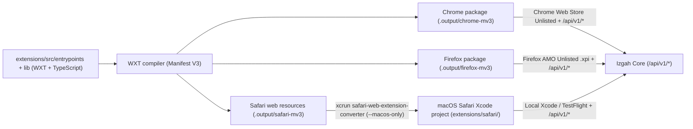
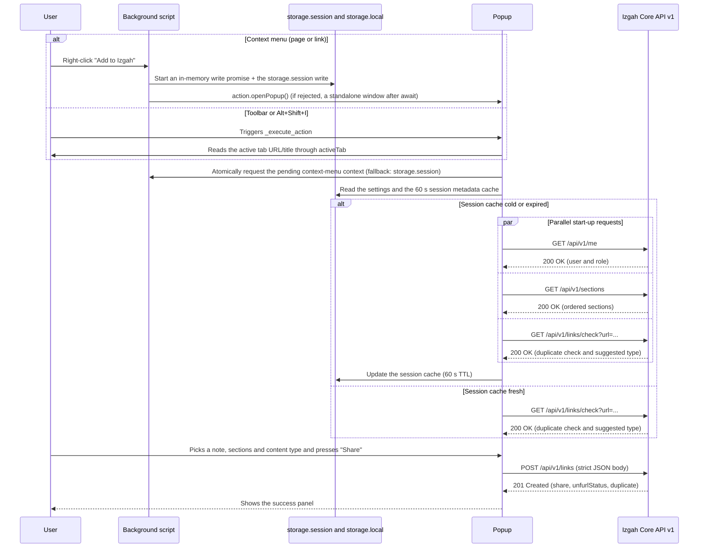

# Izgah Browser Extensions (Chrome, Firefox, Safari)

*   **Author:** Gorkem Inanc Ozdemir
*   **Status:** Approved
*   **Date:** 2026-11-19

> **Open-source note (2026-11-25):** [izgah-i18n-oss.md](./izgah-i18n-oss.md) §7 localised the extension (English and Turkish, through `public/_locales/`) and added a **store build** with no built-in address and no host permission, so one published extension serves every Izgah instance; see [extensions/README.md](../../extensions/README.md). The Turkish-only messages and the single-team distribution plan below are the original design.

--------------------------------------------------------------------------------

## Overview

This design document defines the desktop Chrome, Firefox and Safari browser extensions of Izgah, the closed-team link sharing platform. The extensions let the 10–15 members of a team send the links they come across while browsing to Izgah without leaving the browser tab, using the `/api/v1/*` HTTP contract fixed in [izgah-core.md](./izgah-core.md) §7.

The code base lives in the `extensions/` subdirectory as an isolated package with its own `package.json`, without touching the dependency boundary of the root [package.json](../../package.json). Chrome and Firefox packages are built from a single `WXT + TypeScript` (Manifest V3) source; the macOS Safari package is built from an Xcode project generated by Apple's `xcrun safari-web-extension-converter`.

### Key Concepts

*   **Action popup:** The extension interface that opens from the toolbar button, the keyboard shortcut (`Alt+Shift+I`) or the context menu; it shows the active tab's URL and title (or the URL of the right-clicked link), the `/api/v1/links/check` duplicate result, the note, section and content type fields and, for users with the `admin` role, the silent add option.
*   **Context menu trigger:** The `"İzgah'a paylaş"` ("Add to Izgah") item in the browser's right-click menu, in both the `page` and `link` contexts. In the page context the active tab's URL and title are passed to the share popup; in the link context the `linkUrl` of the clicked target.
*   **Personal API key (`Bearer API Key`):** The personal key with the `izk_...` prefix that members create on the `/settings/api-keys` screen of the web app. It is kept only in the extension's local storage (`storage.local`) and sent on every API request with the `Authorization: Bearer izk_...`, `X-Client-Name` and `X-Client-Version` headers.
*   **Scoped host permission and CORS fallback:** The extension manifest requests, in `host_permissions`, a port-less match pattern only for the Izgah origin chosen at build time. When a development or different Izgah server address is entered on the options page, the extension asks for no extra browser permission; it sends requests through the `Access-Control-Allow-Origin: *` CORS headers that [src/hooks.server.ts](../../src/hooks.server.ts) returns on the `/api/v1/*` endpoints.

## The Problem

The core Izgah web app covers sharing, searching and discussing links from the browser, but four problems remain in everyday desktop browsing:

1.  **Tab switching and copy-paste friction:** Sharing an article, a video or an `<a href>` link inside a page means copying the URL, switching to the Izgah tab, opening the share dialog and pasting the link. Sharing a link straight from the page it appears on, without visiting it, costs an extra tab.
2.  **Duplicates and silent resource context are invisible in the current tab:** Until the user switches to the Izgah tab and opens the form, they cannot see whether someone on the team has already shared the URL they are looking at, or whether an admin has silently added it to a particular section.
3.  **One code base for three desktop browsers, isolated from the root package:** Team members use Chrome, Firefox and Safari. Maintaining separate client code for three browsers raises the maintenance load; on the other hand, putting the extension's build dependencies into the root [package.json](../../package.json) would break the fixed dependency boundary of [izgah-core.md](./izgah-core.md) and carry extension build tools into the server container build.
4.  **Excessive permissions and review risk:** Extensions that ask for `<all_urls>` or content scripts (`content_scripts`) gain access to page content, and the `tabs` permission can read the URL and title metadata of every open tab; these permissions trigger broad browser warnings and can lead to extra store review steps.

This design sets up a single isolated `WXT + TypeScript` MV3 code base under `extensions/`. It solves the four problems with a share popup that consumes the `/api/v1/*` endpoints directly and runs only with `activeTab`, `contextMenus`, `storage` and a permission for the build-time Izgah origin.

## Goals

*   **A multi-browser build isolated from the root package:** Set up a `WXT + TypeScript` (Manifest V3) package with its own `package.json` and lockfile under `extensions/`, without adding dependencies to the root [package.json](../../package.json); support the last two major versions of Chrome, Firefox and the macOS Safari project generated with `xcrun safari-web-extension-converter`.
*   **Duplicate check and role-aware sharing in the popup:** Show the active tab's URL and title (`linkUrl` for a right-clicked link) in the toolbar popup; report through `GET /api/v1/me`, `GET /api/v1/sections` (when the session cache is cold) and `GET /api/v1/links/check?url=...` who shared an existing record, when, and (for a silent resource) in which sections; complete the share with `POST /api/v1/links`, with a note (`<= 1000` characters), multiple sections, 5 content types (`video`, `repo`, `social`, `article`, `web` or automatic detection) and, for the `admin` role only, the option `"Ana akışta yayınlama (yalnızca seçili bölümlere sessiz ekle)"` ("Don't post to the feed (add silently to the selected sections only)"), which requires at least one section.
*   **Context menu and keyboard shortcut triggers:** Connect the `"İzgah'a paylaş"` context menu items on a page (`page`) and on a link (`link`) and the `Alt+Shift+I` keyboard shortcut to the same share flow; where `action.openPopup()` is rejected, such as in a window without a toolbar, offer a small extension window fallback that opens the same share interface.
*   **Local settings, a connection test and Turkish error handling:** On the extension's options page, save the Izgah server origin (`origin`) and the `izk_` key created on `/settings/api-keys` only to local extension storage (`storage.local`) and offer a `"Bağlantıyı test et"` ("Test connection") check through `GET /api/v1/me`; send the `Authorization: Bearer izk_...`, `X-Client-Name` and `X-Client-Version` headers on every request; show `400`, `401`, `403`, `404`, `405`, `409`, `422`, `429` and `5xx` HTTP errors with Turkish explanations and the server's `requestId`, and network, CORS and timeout errors with a Turkish connection warning.
*   **Minimum privilege:** Limit the manifest permissions to `activeTab`, `contextMenus`, `storage` and a `host_permissions` pattern for the Izgah origin given at build time; work through the `/api/v1/*` CORS headers when a custom or local server address is entered on the options screen; never read page DOM content or cookies.

## Non-Goals

*   **Reading page content or the DOM:** Injecting content scripts (`content_scripts`) into web pages, requesting the `scripting` permission, or scraping `og:*` meta tags or the selected text from the tab is out of scope.
*   **Cookie-based sessions or a `/share` web screen:** Sharing the web browser's session cookies or redirecting from the extension to a `/share` web page is out of scope; authentication uses only the personal API key (`Bearer izk_...`).
*   **Mobile browser extensions:** iOS Safari and Android Firefox/Chromium versions are out of scope.
*   **Feed, search, interactions or key management inside the extension:** Listing the feed, bilingual search, liking and commenting, polling for the notification badge and creating or revoking keys on `/settings/api-keys` stay in the web app; they are not offered in the extension.
*   **Background history or bookmark tracking:** Automatically sending visited pages in the background, reading browser history or bulk-importing bookmarks is out of scope.
*   **Changes to the core server contract:** The `/api/v1/*` endpoints defined in [izgah-core.md](./izgah-core.md) §7 and the server code are not touched (no unused client branches are added for optional fields that are not in the existing response contract); optional server additions that may be considered later are listed under a separate "Core change proposal" heading in the Technical Plan.

## Open Questions

There are no open architecture or scope questions. The decisions on the port-less `host_permissions` pattern for the build-time Izgah origin, the fallback to the `/api/v1/*` CORS headers when a different server address is used on the options page, and leaving the core server unchanged during `E1`–`E4` are final.

## Critical User Journeys (CUJs)

### CUJ 1: Setup and Connection Test on the Options Page (`/api/v1/me`)

*   **Given**: The user has installed the browser extension and created a new `izk_...` personal API key on the `/settings/api-keys` page of the Izgah web app.
*   **When**: The user opens the extension's options page, enters the Izgah server origin (`origin` — the default address or a custom or local one) and the personal API key, then clicks `"Bağlantıyı test et"` ("Test connection").
*   **Then**: The extension sends `GET <server>/api/v1/me` with the `Authorization: Bearer izk_...`, `X-Client-Name` and `X-Client-Version` headers and shows the user name, e-mail and role (`member` or `admin`) from the `200 OK` response. When the settings are saved, the key and a reduced user profile (`id`, `name`, `email`, `role`) are written only to the extension's `storage.local`, and the session metadata cache is reset (for a non-production address it works through `/api/v1/*` CORS without asking for extra permission).

### CUJ 2: Sharing With the Toolbar Button or the Keyboard Shortcut (`Alt+Shift+I`) and the Early Duplicate Check

*   **Given**: The user has saved a valid API key and is on an `https://...` tab they want to share.
*   **When**: The user clicks the Izgah button in the toolbar or presses `Alt+Shift+I`; in the popup they see the tab's URL and read-only title, optionally write a note, pick sections and the content type, then press `"Paylaş"` ("Share").
*   **Then**: If the session metadata cache (`storage.session`, `60 s` TTL) is cold, `GET /api/v1/me`, `GET /api/v1/sections` and `GET /api/v1/links/check?url=...` run in parallel (when the cache is fresh, only `/api/v1/links/check?url=...` is called). If the link was shared before, the first sharer's name and date (`"Bu link daha önce <name> tarafından <date> paylaşıldı"`, "This link was already shared by <name> on <date>"), the selected sections if any, and a total share count warning are shown; if not, the server's `suggestedContentType` is shown as a suggestion in the automatic detection option (the `contentType` field is not sent unless the user picks a type by hand, which keeps the server preview worker's type refinement). After `"Paylaş"`, `POST /api/v1/links` returns `201 Created`, the form hides and a Turkish confirmation panel appears (`"Bağlantı İzgah'a paylaşıldı"` ("Link added to Izgah"), with `"Yeni paylaşım"` ("New share") and `"Kapat"` ("Close") buttons).

### CUJ 3: An Admin Adds a Silent Resource and a Member Sees It in the Duplicate Check

*   **Given**: The admin user is verified as `role = "admin"` in the extension settings; at least one section exists.
*   **When**: The admin opens the popup on a tab and ticks the `"Ana akışta yayınlama (yalnızca seçili bölümlere sessiz ekle)"` checkbox; trying to submit without a section shows the client-side validation; they pick at least one section and press `"Paylaş"`. Later, another user with the `member` role opens the extension for the same URL.
*   **Then**: For the admin's share, `POST /api/v1/links` with `isFeedVisible: false` and the selected `sectionIds` returns `201 Created`; a user with the `member` role never sees the silent add checkbox. When the second member opens the extension for the same URL, `firstShare.isFeedVisible === false` and `sectionNames` from the `GET /api/v1/links/check` response show in which sections the link is stored as a silent resource, and that sharing it again will also add it to the feed.

### CUJ 4: Sharing Through the Context Menu (`"İzgah'a paylaş"`) on a Page and on a Link

*   **Given**: The extension is installed and configured; the user opens the context menu on an empty area of a web page or on an `<a href="https://...">` link inside the page.
*   **When**: The user clicks the `"İzgah'a paylaş"` context menu item.
*   **Then**: The background script writes the context data (the clicked link if `linkUrl` is present, otherwise the active tab's `tab.url` and `tab.title`) as a one-time consumption record and, within the user gesture, opens the share popup (`action.openPopup()`; when that is rejected, the standalone fallback window after the write completes). In the link context the popup puts `info.linkUrl` into the URL field (the title stays empty because the page DOM is not read) and runs the `/api/v1/links/check` check automatically; in the page context it offers the same share form with the tab's URL and title.

### CUJ 5: Showing Authentication, Permission, Validation and Rate Limit Errors (`401`, `403`, `422`, `429`) in Turkish

*   **Given**: The user's API key has been revoked or their password reset (`401`), their permissions on the server have changed (`403`), an input error such as an invalid scheme or an over-long note occurred (`422`), or the rate limit was reached (`429`).
*   **When**: The extension popup or options screen receives an error envelope (`{ error: { code, message, requestId, details } }`) from the `/api/v1/*` endpoints.
*   **Then**: Every HTTP error response from the server (but not network or timeout errors) shows a copyable `requestId` for support:
    *   `401`: Explains in Turkish that the key is invalid or revoked and offers a button that opens the options screen directly.
    *   `403`: Reports in Turkish that the user has no permission for the action (for example, a member without silent sharing rights); the session metadata cache is cleared and the role refreshed through `/api/v1/me`.
    *   `422`: The server's `error.details` field errors (`url`, `note`, `sectionIds`, `contentType`, `isFeedVisible`) appear in Turkish under the related form fields, and `_root` or unknown keys in the general error box.
    *   `429`: Explains in Turkish that the request rate limit was exceeded and that the user should wait a little and retry (if the `Retry-After` header is readable, the wait is given in seconds).

## Technical Plan (Architecture)

### 1. Package Isolation, Multi-Browser Build and Distribution Architecture

To leave the dependency boundary of the root [package.json](../../package.json) and the server container build untouched, the extension code base is set up as an isolated `WXT + TypeScript` package under the `extensions/` directory:

*   **An independent package and lockfile boundary:** The `extensions/` package (`"izgah-extensions"`, Node `>=22.0.0`) defines only `WXT` and a framework-free `TypeScript` toolchain; following the native web platform rule in [AGENTS.md](../../AGENTS.md), no UI framework runtime dependency (`Svelte`, `React` and so on) is added. Its own workspace configuration in the directory stops `pnpm install` run under `extensions/` from climbing up to the root [pnpm-workspace.yaml](../../pnpm-workspace.yaml) and the root [pnpm-lock.yaml](../../pnpm-lock.yaml).
*   **Root repository boundary hygiene:** The root [package.json](../../package.json) stays unchanged and only the root configuration boundaries are updated: the root [eslint.config.js](../../eslint.config.js) excludes the extension directory from the root `eslint .` scan, the root `.prettierignore` keeps extension output and lock/document files out of the root Prettier check, the root [.dockerignore](../../.dockerignore) keeps the extension out of the container build context, and the root [.gitignore](../../.gitignore) ignores the generated Safari Xcode, WXT and Playwright output.
*   **Three browser builds from one source and the Safari conversion:** The WXT compiler produces Chrome MV3, Firefox MV3 and Safari web resource output from the same source. The Safari build script, running on macOS, first builds and verifies the web package, then checks for Apple's Xcode converter: with a full Xcode install it creates the `extensions/safari/` Xcode project; without one it prints a missing-Xcode diagnostic and exits with a non-zero code only when the required flag is given.
*   **Chosen distribution and signing architecture:** For a closed team of 10–15 people, the chosen channels were (a) **Chrome Web Store `Unlisted`** (automatic signed distribution to team members who have the share link, for a one-time \$5 registration fee), (b) **Firefox AMO signed self-distribution (`Unlisted` `.xpi`)** (a Mozilla-signed `.xpi` for \$0; in v1 the `.xpi` is updated by hand) and (c) **a default \$0 local Xcode build for macOS Safari** (running unsigned locally through `Allow Unsigned Extensions` in the `Develop` menu; once an Apple Developer account is available it can move to \$99/year `TestFlight` or notarised `Developer ID` distribution without code changes).

### 2. The Manifest V3 Contract and the Minimum Permission Model

The extension configuration explicitly produces `manifestVersion: 3` for every browser target. The manifest requests only the fields below; `content_scripts`, `scripting`, `tabs`, `cookies` and `<all_urls>` are excluded:

| Manifest field | Value / configuration | Technical role and limit |
| :--- | :--- | :--- |
| `permissions` | `["activeTab", "contextMenus", "storage"]` | Reads the active tab's URL and title only on a user gesture; manages the context menu and the local settings and session storage. |
| `host_permissions` | A port-less origin pattern `["<scheme>//<host>/api/v1/*"]` (derived from `WXT_IZGAH_ORIGIN`; the local development default is `http://localhost/api/v1/*`) | Covers the single Izgah origin with the port stripped, because Firefox MV3 match patterns contain no port. When a different Izgah address is entered on the options page, it works through the `/api/v1/*` CORS headers without asking for an extra permission. |
| `optional_host_permissions` | Undefined (not used) | No dynamic host permission is requested, since the production origin permission plus the CORS fallback for custom addresses works without a runtime permission dialog. |
| `action` and `icons` | A popup generated from the entry points (`popup.html`), a Turkish title (`"İzgah'a paylaş"`) and a `16`/`32`/`48`/`128` PNG icon map | Meets the icon checks of the three browser stores and extension managers (`options_ui.open_in_tab: true` is produced for the Chrome and Firefox targets through the entry point's meta tag; on the Safari MV3 target WXT drops the unsupported `open_in_tab` field and writes `{ page: "options.html" }`). |
| `commands._execute_action` | `Alt+Shift+I` (`default` and `mac`) | Opens the share popup directly in Chrome, Firefox and Safari by triggering the temporary `activeTab` grant. |
| `background` | Chrome/Safari `service_worker`, Firefox MV3 `background.scripts` | Listens only for installation, context menu clicks and the context hand-over handshake messages; keeps no background timer or send queue. |
| `browser_specific_settings.gecko` | On the Firefox target only, `{ id: WXT_GECKO_ID, strict_min_version: "128.0", data_collection_permissions: { required: ["none"] } }` | Meets the Firefox MV3 `storage` API and the November 2025 AMO requirement for a data collection declaration; not written into the Chrome and Safari manifests. |
| `content_security_policy.extension_pages` | `"script-src 'self'; object-src 'none'"` | Blocks inline scripts and `eval`; only packaged modules load. |

### 3. Trigger Flows: Toolbar, Keyboard Shortcut and Context Menu

The three entry paths converge on one share popup:

#### Entry Triggers

1.  **Toolbar button:** The browser opens the share popup directly and grants temporary `activeTab` access to the active tab; the tab's URL and title are read from the active tab.
2.  **Keyboard shortcut (`Alt+Shift+I`):** Through the `_execute_action` command, the browser opens the share popup in the same `activeTab` context as the toolbar button.
3.  **Context menu (`"İzgah'a paylaş"`):**
    *   The background script registers the menu item for the `page` and `link` contexts on installation; every event listener is defined synchronously at the top level of the background script.
    *   On click, if `linkUrl` is present the context is prepared as `'link'` (URL = the clicked link, title = `null`, because the page DOM is not read), otherwise as `'page'` (URL and title = the active tab's).
    *   **Preserving the user gesture and a deterministic hand-over:** To keep the user activation from expiring after an `await`, the background script holds the context in module memory together with a `storage.session` write promise and calls `action.openPopup()` synchronously in the same event turn (behind a feature check and `try/catch`). When `openPopup()` is rejected, such as in a window without a toolbar, the user activation constraint no longer applies, so it waits for the write promise to finish and then opens the standalone fallback window (`?mode=standalone`).

#### Popup Start-Up, Scheme Check and Duplicate Check

1.  On opening, the popup first atomically consumes the pending context-menu context through a one-time message handshake with the background script (falling back directly to `storage.session` if the background script does not answer). Without a valid pending context: on a normal opening it reads the active tab's URL and title; in the `?mode=standalone` fallback it never queries the window's own extension tab, and shows an empty editable URL field with a Turkish warning that the context expired.
2.  On browser pages where `"activeTab"` is restricted (`chrome://`, `about:`, store pages, or `file://` without file access), if the tab address comes back `undefined`/empty or has a scheme other than `http:`/`https:`, the pre-check call is skipped, a Turkish hint is shown and the URL field stays editable.
3.  If `serverOrigin` or `apiKey` is not set, an `"Ayarları aç"` ("Open settings") card is shown instead of the form.
4.  With complete settings, the interface first renders from the cached role in `storage.local`. Then, if the `storage.session` metadata cache (`60 s` TTL) is fresh, only `GET /api/v1/links/check` runs; if it is cold or expired, `GET /api/v1/me`, `GET /api/v1/sections` and `GET /api/v1/links/check` are sent in parallel. If the key returns `401`, the cached local profile and the session cache are cleared and the settings prompt opens; if the role has dropped to `member`, the silent add option hides and its tick is cleared; if the section list cannot be loaded, the section field shows a retry control while normal sharing stays available.
5.  **Duplicate, content type and admin silent add rules:** On an `exists === true` response, the `firstShare` author name, the date formatted in Turkish, the total share count and, when `firstShare.isFeedVisible === false`, the sections in which the link is stored as a silent resource and the fact that a normal share will add it to the feed, are reported. The content type choice stays on `"Otomatik algıla"` ("Detect automatically") by default, and `contentType` is not added to the `POST` body unless the user changes it by hand, which keeps the server preview worker's type refinement (`contentTypeLocked = false`). When the silent add box, shown only for `role === 'admin'`, is ticked, at least one section must be selected before submitting.

### 4. Local Storage Architecture (`storage.local` and `storage.session`)

The extension keeps all persistent data only in `browser.storage.local`, which stays on the local machine, and temporary session data only in `browser.storage.session`, which lives for the browser session. The API key (`izk_...`) is never written to the cloud-synced `browser.storage.sync`, to web `localStorage` or to console logs:

*   **Persistent settings (`storage.local`):** The configured server origin (`serverOrigin`), the personal `apiKey` and a reduced user profile (`id`, `name`, `email`, `role`). Before settings are saved, origin normalisation strips every path, query and fragment part; it allows only the `https:` scheme for remote servers and `http:` for local development/test hosts, and rejects URLs that contain credentials.
*   **Temporary context hand-over (`storage.session`):** The one-time share context passed from the context menu (a `10 s` validity window) is consumed and deleted on opening. In environments without the `storage.session` API there is no fake in-memory fallback; an explicit error is thrown.
*   **Read quota metadata cache (`storage.session`):** To stay within the Izgah core's read rate limit of `60` per minute per `apiKeyId` on frequent openings, the last verified `{ serverOrigin, user, sections }` is kept in session storage with a `60 s` TTL. The cache is cleared immediately when settings are saved or removed, and on `401`, `403` or a `422` (`sectionIds`) caused by a deleted section.

### 5. HTTP Client and Error Mapping Contract (`/api/v1/*`)

The request layer follows the contract of [izgah-core.md](./izgah-core.md) §7 and [src/hooks.server.ts](../../src/hooks.server.ts):

*   **Required headers and request flags:** Every `/api/v1/*` request sends the `Authorization: Bearer <apiKey>`, `X-Client-Name`, `X-Client-Version` and `Accept: application/json` headers (plus `Content-Type: application/json` for `POST`). Every call runs with `credentials: 'omit'`, so no cookies are carried, and a bounded request timeout; when the URL is edited by hand the previous duplicate check request is aborted, and the client's abort signal is not shown as a network error.
*   **Strict request body (`POST /api/v1/links`):** Because of the `.strict()` Zod schema in [src/routes/api/v1/links/+server.ts](../../src/routes/api/v1/links/+server.ts), the body is built only from valid fields: the required `url`, `note` if not empty, `sectionIds` if selected, `contentType` if the user changed the automatic detection, and `isFeedVisible: false` if the user is an `admin` and the silent box is ticked.
*   **Reading the error envelope and keeping the user's draft:** The client layer parses the `{ error: { code, message, requestId, details? } }` envelope and the `X-Request-Id` response header (including non-JSON `5xx` responses from a reverse proxy). When a share fails, the note and section choices in the form are kept.

The messages below are given in English; the shipped wording, in English and Turkish, lives in `extensions/public/_locales/`.

| Status / error class | Server information extracted | Message and behaviour shown to the user |
| :--- | :--- | :--- |
| `400 BAD_REQUEST` | `error.message`, `requestId` | `"The server did not accept the request format. Check your input and try again."` with the `requestId`. |
| `401 UNAUTHORIZED` | `error.code`, `requestId` | `"Your API key is invalid, missing or revoked. Create a new key on /settings/api-keys and update the extension settings."` with an `"Open settings"` button; the cached profile (`cachedUser`) and the session metadata cache are cleared (`serverOrigin` is kept). |
| `403 FORBIDDEN` | `error.message`, `requestId` | `"You don't have permission for this action (for example, only admins can add silent resources)."`; the session cache is cleared and `GET /api/v1/me` is called in the background to refresh the role. |
| `404 NOT_FOUND` / `405 METHOD_NOT_ALLOWED` | `error.message`, `requestId` | Explains that the requested API endpoint does not exist at the server address or that the HTTP method is not supported, and suggests checking the address in the settings. |
| `409 CONFLICT` | `error.message`, `requestId` | The server's conflict message and a copyable `requestId`. |
| `422 VALIDATION_ERROR` | `error.message`, `error.details`, `requestId` | The `url`, `note`, `sectionIds`, `contentType` and `isFeedVisible` errors from the server attach under the related form field, and `_root` or unknown keys to the general error box. |
| `429 RATE_LIMITED` | `Retry-After` (if readable), `requestId` | `"Too many requests (rate limit reached)."`; if `Retry-After` is readable, as it is for the production origin within `host_permissions`, `"Wait <N> seconds and try again."`, otherwise, under the CORS restriction of a custom address, `"Wait a moment and try again."`. |
| `5xx` server error (JSON and non-JSON) | `error.message` (if any), `requestId` (including the `X-Request-Id` header) | `"Something went wrong on the Izgah server. If it keeps happening, share this tracking code with your admin."` with a one-click copyable `requestId`. |
| Network / CORS / timeout (except a debounced `AbortError`) | `TypeError` or `TimeoutError` | `"Couldn't reach the Izgah server. Check your internet connection and the server address in the settings."` (no `requestId`); the form draft is kept. |

### 6. Front-End Architecture and Native Web Standards (`modern-web-guidance`)

The share popup (`popup.html`) and the options page (`options.html`) are written in plain HTML/CSS/TypeScript without an external CSS/JS component library; they follow the modern web platform and accessibility guide index (`modern-web-guidance`) that [AGENTS.md](../../AGENTS.md) requires across the project:

1.  **A single-layer light and dark theme (`dark-mode`):** The documents follow the system theme; the colour tokens are set up in one `@media (prefers-color-scheme: dark)` layer, fully supported by the last two versions of the three target browsers.
2.  **Form semantics and brand consistency (`forms`, `brand-consistent-forms`):** Inputs use a semantic `<form>`, `<label for>` labels above the fields and `<fieldset><legend>`; long section lists stay scrollable. The API key field uses `type="password"` + `autocomplete="off"`, to keep password managers from syncing it and to control visibility, with an accessible `"Show"` / `"Hide"` button; every control meets the touch/click ergonomics and contrast rules.
3.  **Validation after interaction and accessible error announcements (`validate-input-after-interaction`, `accessible-error-announcement`):** Inputs show no early error highlighting when the page opens; `aria-invalid` and `aria-describedby` are set only when a field is left or the form is submitted while invalid. A single polite live region stays silent on focus changes and moves focus to the first invalid control on submit.
4.  **IME-safe shortcut submit (`ime-safe-enter-submit`) and copying the tracking code (`copy-button`):** Submitting from the note field with `Cmd/Ctrl+Enter` ignores active IME composition sessions. The `requestId` copy buttons in error boxes use native Invoker Commands (`command="--copy"` + `commandfor` pointing at the target `<code id>`) with a click fallback for browsers without support; if the clipboard write is rejected, the user is told to copy by hand.

### 7. Core Change Proposal (Optional, Backward Compatible)

For the [Detailed Implementation Plan](#detailed-implementation-plan) milestones (`E1`–`E4`) the extension makes **no change** to the Izgah core server; since the [src/routes/api/v1/links/check/+server.ts](../../src/routes/api/v1/links/check/+server.ts) endpoint does not expose the `originalShareDeleted` field, as the existing integration tests ([tests/integration/m3-api-v1-links.test.ts](../../tests/integration/m3-api-v1-links.test.ts)) require, no unused `originalShareDeleted` branch was added to the extension code either. Two backward-compatible improvements are recorded below for later:

1.  **[src/routes/api/v1/links/check/+server.ts](../../src/routes/api/v1/links/check/+server.ts) — returning `originalShareDeleted`:** The `checkDuplicateLink()` function in [src/lib/server/links/service.ts](../../src/lib/server/links/service.ts) produces `originalShareDeleted: true` when a resource's first share is soft-deleted but it has other active shares, and the [src/routes/api/internal/links/check/+server.ts](../../src/routes/api/internal/links/check/+server.ts) endpoint returns the field. If `originalShareDeleted: result.originalShareDeleted` is later added to the `/api/v1/links/check` response, the extension can match the web interface's text "The original post was deleted · <N> active shares in total" exactly.
2.  **[src/hooks.server.ts](../../src/hooks.server.ts) and [src/lib/server/api/response.ts](../../src/lib/server/api/response.ts) — exposing `Retry-After` in CORS responses:** Because the production origin is within `host_permissions`, the extension can read the `Retry-After` header directly in production; but when a custom Izgah address outside `host_permissions` is used, the browser's CORS rules hide `Retry-After`, which is not in `Access-Control-Expose-Headers: X-Request-Id`. Changing the header in both files to `'X-Request-Id, Retry-After'` would show the exact wait time for custom and local server addresses too.

## Alternatives Considered

### Distribution Channels and Cost Comparison

For a closed team of 10–15 people, the Chrome, Firefox and Safari distribution options compare as follows on signing requirements, developer fees, persistence across browser restarts and update flow:

| Browser and distribution method | Direct cost | Signing and installation | Updates and browser restarts | Status for a closed team |
| :--- | :--- | :--- | :--- | :--- |
| **Chrome Web Store `Unlisted`** | **\$5 (one-time)** developer registration fee | A Google-signed `.crx`; only the team, with the share link, installs it; it does not appear in public search | Automatic store updates; no warning on start-up | **Chosen** |
| Chrome Web Store `Public` | \$5 (one-time) | Google-signed; a public store listing | Automatic updates; outside users install a closed-team tool | Rejected (Alt. A) |
| Chrome unpacked (`Load Unpacked`) | \$0 | An unsigned `.zip` unpacked and loaded in developer mode | Manual `.zip` refreshes; Chrome warns about developer mode on every start | Rejected (Alt. A) |
| **Firefox AMO signed self-distribution (`Unlisted` `.xpi`)** | **\$0** | Mozilla AMO signs it; not listed in the public directory; the team installs the signed `.xpi` | In v1 the `.xpi` is updated by hand; automatic updates through an `update_url` JSON can come later | **Chosen** |
| Firefox AMO `Listed` | \$0 | Mozilla-signed; a public AMO page | Automatic updates; a public storefront for a closed-team tool | Rejected (Alt. A) |
| Firefox unsigned (`about:debugging` / Dev Edition) | \$0 | Unsigned | Stable Firefox enforces signing; `about:debugging` removes the extension when the browser closes | Rejected (Alt. A) |
| **Safari unsigned local Xcode build** | **\$0** | An unsigned `.app` built locally with Xcode on the developer's machine; `Allow Unsigned Extensions` turned on in the `Develop` menu | Free, but because of macOS Safari security the unsigned extension approval resets when the browser is fully quit and reopened (it has to be turned on again) | **The default \$0 local option** |
| **Safari `TestFlight` or notarised `Developer ID`** | **\$99 / year** Apple Developer Program | An `.app` signed through Xcode Cloud or an Apple certificate / a TestFlight invite (stays closed to outside users) | No Xcode needed for end users; the extension stays enabled even after Safari restarts | **The supported persistent option when an Apple Developer account exists** |
| Safari public Mac App Store | \$99 / year | Apple store review; a public listing | Internal tools with a closed-team sign-in have a high risk of rejection in public App Store review | Rejected (Alt. B) |

### Alternative A: Public Store Listings or Unsigned Chrome/Firefox Developer Distribution

*   **Pros**: Public store listings allow installation straight from search; Chrome unpacked loading and Firefox `about:debugging` allow quick local trials with no account or signing step.
*   **Cons**: Izgah is a tool used only by a closed team of 10–15 people; `Public` store listings would let outside users install it and leave connection complaints or low ratings. Meanwhile `Load Unpacked` in Chrome shows a developer mode warning on every browser start, and stable Firefox cannot install an unsigned `.xpi`, while `about:debugging` is wiped when the browser session ends.
*   **Reason for Rejection**: Rejected by author: Chrome Web Store `Unlisted` (\$5 one-time) and Firefox AMO signed self-distribution (\$0 `.xpi`) were chosen, keeping visibility closed to outsiders while preserving browser signing requirements and Chrome automatic updates.

### Alternative B: Requiring a Paid Apple Developer Certificate for Safari (\$99/year), the Public Mac App Store or a Bookmarklet

*   **Pros**: If only `TestFlight` / `Developer ID` were allowed, the Safari restart reset would not happen; a bookmarklet works by dragging one link to the bookmarks bar, with no Xcode or Apple account.
*   **Cons**: A bookmarklet cannot meet the right-clicked link (`"İzgah'a paylaş"`) and global keyboard shortcut (`Alt+Shift+I`) requirements, is blocked by the current page's `Content-Security-Policy`, and cannot offer the duplicate/section form in a popup. Conversely, locking the build pipeline to a paid Apple Developer Program certificate (\$99/year) would block Safari builds in development and trial environments without an Apple account; the public Mac App Store risks keeping closed-team apps out of review.
*   **Reason for Rejection**: Rejected by author: the bookmarklet and the public Mac App Store were rejected; the Safari conversion script was designed to produce, by default, an Xcode project that runs in \$0 unsigned developer mode, while the same project stays ready for \$99/year `TestFlight` or notarised `Developer ID` distribution without code changes once `DEVELOPMENT_TEAM` is provided.

### Alternative C: A Cookie Session Without API Keys, a `/share` Web Screen and a Client `og:*` Hint (the first brainstorming draft)

*   **Pros**: No personal API key is stored on the client, and the share form is not duplicated in a second interface outside the web app.
*   **Cons**: Pressing the toolbar button would have to open a new tab or window instead of a small popup over the active tab, breaking the user's context and waiting for a full web page load on every share. [izgah-core.md](./izgah-core.md) rejected this model in its `Alternative D` and `Alternative E` decisions and fixed `izk_...` API keys and the `/api/v1/*` JSON endpoints.
*   **Reason for Rejection**: Rejected by author: to match the approved [izgah-core.md](./izgah-core.md) §7 contract, a `Bearer izk_...` extension model was chosen that offers the duplicate check, admin silent adds and right-click link sharing in a popup without switching tabs.

### Alternative D: Broad Permissions (`<all_urls>`, `tabs`, `content_scripts`), `optional_host_permissions` or No `host_permissions` at All (`[]`, Pure CORS)

*   **Pros**: `<all_urls>` / `tabs` / `content_scripts` allow tracking across tabs and reading titles and meta tags from the DOM; `optional_host_permissions` asks for runtime permission for custom server addresses; no `host_permissions` (`[]`) lets a single package work in every environment through pure CORS without asking for any domain permission.
*   **Cons**: `<all_urls>` and `content_scripts` ask for access to the content of every visited page and lead to heavy store reviews. `optional_host_permissions` adds an unnecessary runtime permission dialog. In the pure CORS model (`host_permissions: []`), the `Authorization`, `X-Client-Name` and `X-Client-Version` headers the extension sends cause an extra `OPTIONS` preflight round trip before every request to the production server; the `429` wait time cannot be read because the core CORS response does not expose `Retry-After`; and Safari is more sensitive to cross-origin network restrictions outside `host_permissions`.
*   **Reason for Rejection**: Rejected by author: to send low-latency requests to the production Izgah origin without an `OPTIONS` preflight, read the `429 Retry-After` time and keep Safari compatibility, the choice was `activeTab`, `contextMenus` and `storage` plus a build-time, port-less `host_permissions` entry for the Izgah origin, with the `/api/v1/*` CORS fallback for custom or local server addresses.

### Alternative E: A Svelte/React Framework in the Extension Front End, or Separate Code Bases for Three Browsers

*   **Pros**: Svelte 5 (`@wxt-dev/module-svelte`) shares the template syntax of the core web app; three browser-specific repositories need no build tool adaptation.
*   **Cons**: Three separate code bases triple the API client, the error mapping, the validation logic and the context-menu flow. The extension has only 2 screens (`popup.html` and `options.html`); adding a component framework runtime grows the build size and departs from the [AGENTS.md](../../AGENTS.md) rule of preferring native web APIs over heavy JS libraries.
*   **Reason for Rejection**: Rejected by author: `WXT + TypeScript` (Manifest V3) without an extra UI runtime dependency was chosen for a single code base and native web standards.

## Risks & Mitigations

| Risk | Impact | Mitigation |
| :--- | :--- | :--- |
| `action.openPopup()` rejected inside `contextMenus.onClicked`, a `storage.session` write race, or a `?mode=standalone` self-query | On a right-click open, the tab URL or the extension URL might be read instead of the link | The background script keeps the context in module memory with a write promise and hands it over atomically on opening through `runtime.sendMessage`; on the rejected path `?mode=standalone` opens only after the write promise settles, and that mode never queries the `currentWindow` tab. |
| `WXT_IZGAH_ORIGIN` forgotten in a production build, or a `host_permissions` pattern with a port in Firefox MV3 | The package could ship with a `localhost` permission by mistake, or Firefox could reject the manifest | The `manifest` generator strips the port from `host_permissions` (`http://localhost/api/v1/*`); `verify-manifests.mjs --require-https-origin` checks for an `https://` production origin in release packages. |
| Chrome PNA/LNA or Safari restrictions when a production package (`https://...`) targets `http://localhost` through the settings | The CORS preflight to the local server can be blocked by the browser's local network protection | The development package built without `WXT_IZGAH_ORIGIN` (`pnpm --dir extensions dev`) has the local origin permission directly for local development and testing; the documentation states this distinction. |
| An unencrypted `apiKey` in `storage.local` and password manager sync | Signed-in profile sync or a password manager could copy the long-lived `izk_...` key to the cloud | `apiKey` stays only in `storage.local`, which is not synced to the cloud; the input has `autocomplete="off"` plus password-manager-ignore attributes, and the key can be revoked with one click on `/settings/api-keys`. |
| The read quota of `60 / min` per `apiKeyId` in [src/lib/server/auth/rate-limit.ts](../../src/lib/server/auth/rate-limit.ts) exceeded by quick openings | The popup could get `429 RATE_LIMITED` when opened repeatedly | While the session metadata cache (`storage.session`, `60 s` TTL) is fresh, the `/me` and `/sections` calls are skipped, cutting the start-up load from 3 requests to 1; URL edits are limited with `debounce` + `AbortController`. |
| The user resubmits after a network timeout on a `POST /api/v1/links` call without an idempotency key | If the first request was saved on the server and the response was lost, a second submit could create a duplicate share row for the same resource | The button locks while submitting; after a timeout the draft is kept and the `/links/check` state is shown clearly before or after a resubmit. |
| The browser closes the toolbar popup and resets the note when the user clicks outside it | A note being written while copying text from another tab is lost | Outside the context-menu `?mode=standalone` window, this is browser behaviour; to avoid extra complexity it stays out of v1 and is planned as temporary draft recovery under `Future Improvements`. |
| The extension turns off when the browser is fully quit in Safari's unsigned developer mode (\$0) | After `Cmd+Q`, the user cannot see the button until they re-enable it in the developer menu | The setup guide explains the `Allow Unsigned Extensions` step; when the team wants persistence, the same Xcode project is distributed through an Apple Developer account (\$99/year) as `TestFlight` or a notarised `.app`. |
| The `Alt+Shift+I` shortcut conflicts with the operating system or the macOS keyboard layout (`Option+Shift+I`) | The shortcut does not fire on some machines or types a character into a text field | Only the standard `suggested_key` is assigned through `_execute_action`; the documentation explains that it can be reassigned in the browser's extension shortcut settings. |
| A revoked personal API key or a deactivated member (`401`), and a missing full Xcode | Share calls get `401`, or `safari-web-extension-converter` ends with error code 72 | On `401` the cached profile and session cache are cleared and `"Open settings"` is offered; the Safari script first builds the `.output/safari-mv3` output and gives a clear setup diagnostic when full Xcode is missing. |

--------------------------------------------------------------------------------

## Non-Functional Requirements

*   **Security and privacy:**
    *   The personal API key (`izk_...`) is stored only in `browser.storage.local`; it is never written to the cloud-synced `browser.storage.sync`, web `localStorage`, a URL query string or console/telemetry logs.
    *   Only the `https:` scheme is accepted for remote Izgah addresses; `http:` is limited to local development hosts (`localhost`, `127.0.0.1`, `[::1]`). Every request uses `credentials: 'omit'`, so no cookies are carried.
    *   The manifest has no `content_scripts`, `scripting`, `tabs` or `<all_urls>`; the page DOM is never read, the `script-src 'self'; object-src 'none'` CSP applies, and titles, section names, author names and error messages from the server are written to the DOM with `textContent`, never `innerHTML`.
*   **Performance, latency and package footprint:**
    *   No external UI framework is added. Size is defined the way the stores measure it: the store zip package (icons and font included, source maps excluded) `≤ 150 KB`, the gzip-compressed JS/CSS total `≤ 30 KB`. `scripts/verify-manifests.mjs` measures both on every build and fails when a limit is exceeded ([izgah-ui-v4.md](./izgah-ui-v4.md) §11).
    *   On start-up the popup renders its first interface from the cached user role (target `< 50 ms`) without waiting for network responses, then starts `/api/v1/links/check` (and, when cold, `/api/v1/me` and `/api/v1/sections`) depending on the session cache state.
    *   The background script is event-driven (`runtime.onInstalled`, `contextMenus.onClicked`, `runtime.onMessage`); there is no background notification polling, timer loop (`setInterval`) or external telemetry/LLM call.
*   **Versioning, releases and rollback safety:**
    *   On successful (`200`/`201`) `/api/v1/*` operations and on unhandled `500` server errors, the `X-Client-Name` and `X-Client-Version` headers are written to the server's JSON logs; because different browser stores have different approval times, old and new extension versions work backward-compatibly against the same `/api/v1/*` contract.
    *   For a faulty extension version, repackaging the previous stable code with an incremented `manifest.version` and submitting it to the Chrome Web Store / AMO (or distributing the previous `TestFlight` / `Developer ID` package) rolls back without a migration or outage on the server database.

--------------------------------------------------------------------------------

## Additional Resources

*   [izgah-core.md](./izgah-core.md) — The Izgah core platform design; especially §4 roles and permissions, CUJ 3 and the fixed `/api/v1/*` HTTP contract in §7.
*   [AGENTS.md](../../AGENTS.md) — Project rules (English code, a localised interface, `modern-web-guidance` standards, browser support and privacy boundaries).
*   [SITEMAP.md](./SITEMAP.md) — The index of design documents and application routes.

## Future Improvements

*   **A quick jump to the resource page after sharing:** Using `share.resourceId` from the `201 Created` response to offer an "Open in Izgah" link (`/resources/<resourceId>`) in the confirmation box.
*   **Self-hosted automatic Firefox updates (`update_url`):** Hosting a static Firefox update manifest on Izgah to distribute signed `.xpi` version bumps to team members with one click.
*   **Temporary draft recovery (`storage.session`):** Restoring, for a short time (`<= 2 min`) and tied to the tab URL, an unfinished note from a popup that closed after an accidental click outside the toolbar.

--------------------------------------------------------------------------------

## Detailed Implementation Plan

The implementation plan is split into **4 independently verifiable milestones (`E1`–`E4`)**, each completable in a single development session and, in line with the [AGENTS.md](../../AGENTS.md) definition of done, ending in a working intermediate state that passes both the extension checks (`pnpm --dir extensions check`, `pnpm --dir extensions lint`, `pnpm --dir extensions test`, `pnpm --dir extensions build`, `pnpm --dir extensions build:firefox`) and the root repository regression and boundary gates (`git diff HEAD --exit-code package.json pnpm-lock.yaml`, `pnpm check`, `pnpm lint`, `pnpm test`, `pnpm build` — plus the `E4` packaging and E2E gates). This list (plus the build and test output ignored by Git: `extensions/.wxt/`, `extensions/.output/`, `extensions/safari/`, `extensions/playwright-report/` and `extensions/test-results/`) is the exact boundary of files to create or update; the root [package.json](../../package.json) and [pnpm-lock.yaml](../../pnpm-lock.yaml) are not touched.

**Fixed dependency boundary ([extensions/package.json](../../extensions/package.json)):**

*   **Runtime (`dependencies`):** Empty (`{}` — the extension interface has no UI framework runtime; the browser API abstraction `wxt/browser` is bundled at build time).
*   **Development (`devDependencies`):** `@eslint/js@^9.0.0`, `@playwright/test@^1.50.0`, `@types/node@^22.0.0`, `eslint@^9.0.0`, `jsdom@^26.0.0`, `prettier@^3.4.0`, `typescript@^5.7.0`, `typescript-eslint@^8.0.0`, `vitest@^3.0.0`, `wxt@^0.21.5`.

**Fixed environment variable contract ([extensions/.env.example](../../extensions/.env.example)):**

*   `WXT_IZGAH_ORIGIN` (the Izgah origin written at build time into the manifest `host_permissions` as a port-less pattern and into the options screen's default address suggestion; when empty or undefined, the local development default is `http://localhost:3000` and the `host_permissions` pattern `http://localhost/api/v1/*`), `WXT_GECKO_ID` (Firefox MV3 `browser_specific_settings.gecko.id`, default `extension@izgah.local`), `SAFARI_BUNDLE_ID` (the bundle id of the macOS container app for `xcrun safari-web-extension-converter`, default `local.izgah.extension`), `DEVELOPMENT_TEAM` (an optional Apple Developer team id; when given it is used in the `TestFlight` / `Developer ID` signed build command, and when commented out or empty a \$0 local unsigned developer build is produced). *(The current defaults are listed in [extensions/README.md](../../extensions/README.md).)*

---

### Milestone E1: Root Repository Isolation, the WXT MV3 Skeleton, PNG Icon Assets and the Storage/API Client

**Goal:** Isolate the `extensions/` package without touching the root [package.json](../../package.json) boundary, set up the Manifest V3 configuration and icon assets for three browsers, and write the storage/URL helpers, the `/api/v1/*` HTTP client and the error mapper, verified by unit tests.

#### 1. [eslint.config.js](../../eslint.config.js) (Modify), [.prettierignore](../../.prettierignore) (Create), [.dockerignore](../../.dockerignore) (Modify), [.gitignore](../../.gitignore) (Modify)

*   **Type / Scope**: Root repository boundary isolation (the root [package.json](../../package.json) does not change)
*   **Proposed Changes**:
    *   [eslint.config.js](../../eslint.config.js): Adds `'extensions/**'` to the top-level `ignores` array; the root `eslint .` scan does not scan extension or WXT files.
    *   [.prettierignore](../../.prettierignore): Defines an `extensions/` line; the root `prettier --check .` (and so the root `pnpm lint`) does not check the extension's own `pnpm-lock.yaml`, `README.md` and generated output.
    *   [.dockerignore](../../.dockerignore): Adds `extensions` and `.wxt` lines; the server `docker build` context does not carry extension dependencies or macOS Xcode files.
    *   [.gitignore](../../.gitignore): In addition to the existing `.output/` and `.wxt/` entries, adds `extensions/safari/`, `DerivedData/`, `xcuserdata/`, `extensions/playwright-report/` and `extensions/test-results/` for the generated Xcode container project and E2E test output (the `.env*` and `node_modules/` rules already apply in the root `.gitignore`).

#### 2. [extensions/package.json](../../extensions/package.json), [extensions/pnpm-workspace.yaml](../../extensions/pnpm-workspace.yaml), [extensions/pnpm-lock.yaml](../../extensions/pnpm-lock.yaml) and [extensions/.env.example](../../extensions/.env.example) (Create)

*   **Type / Scope**: The isolated extension package and environment template
*   **Proposed Changes**:
    *   [extensions/package.json](../../extensions/package.json): Defines `name: "izgah-extensions"`, `version: "0.1.0"`, `private: true`, `type: "module"`, `engines: { "node": ">=22.0.0" }` and only the `devDependencies` listed in the fixed dependency boundary. The `scripts` contract: `postinstall` (`wxt prepare`), `dev` (`wxt -b chrome`), `dev:firefox` (`wxt -b firefox`), `build` (`wxt build -b chrome`), `build:firefox` (`wxt build -b firefox`), `build:safari` (`node ./scripts/build-safari.mjs`), `build:all` (`pnpm build && pnpm build:firefox && pnpm build:safari`), `zip` (`wxt zip -b chrome`), `zip:firefox` (`wxt zip -b firefox`), `verify:manifests` (`node ./scripts/verify-manifests.mjs`), `check` (`wxt prepare && tsc --noEmit`), `lint` (`eslint --max-warnings 0 . && prettier --check .`), `format` (`prettier --write .`), `test` (`vitest run`) and `test:e2e` (`pnpm build && playwright test`).
    *   [extensions/pnpm-workspace.yaml](../../extensions/pnpm-workspace.yaml): With `packages: ['.']` and `allowBuilds: { esbuild: true }`, stops `pnpm --dir extensions install` from climbing to the root [pnpm-workspace.yaml](../../pnpm-workspace.yaml) and the root [pnpm-lock.yaml](../../pnpm-lock.yaml).
    *   [extensions/pnpm-lock.yaml](../../extensions/pnpm-lock.yaml): The isolated extension lockfile produced by `pnpm --dir extensions install`.
    *   [extensions/.env.example](../../extensions/.env.example): Contains `WXT_IZGAH_ORIGIN=https://izgah.example.com`, `WXT_GECKO_ID=extension@izgah.local`, `SAFARI_BUNDLE_ID=local.izgah.extension` and an optional `# DEVELOPMENT_TEAM=` example commented out with `#` (no secret fields).

#### 3. [extensions/wxt.config.ts](../../extensions/wxt.config.ts), [extensions/src/env.d.ts](../../extensions/src/env.d.ts), [extensions/tsconfig.json](../../extensions/tsconfig.json), [extensions/vitest.config.ts](../../extensions/vitest.config.ts), [extensions/eslint.config.js](../../extensions/eslint.config.js), [extensions/.prettierrc](../../extensions/.prettierrc) and [extensions/.prettierignore](../../extensions/.prettierignore) (Create)

*   **Type / Scope**: WXT Manifest V3, TypeScript, test and linter configuration
*   **Proposed Changes**:
    *   [extensions/wxt.config.ts](../../extensions/wxt.config.ts): Defines `srcDir: 'src'`, `publicDir: 'public'`, `imports: false` (no automatic magic globals; every module uses an explicit `import { browser } from 'wxt/browser'`) and `manifestVersion: 3` for every target. Because of WXT's `.env` loading order, it resolves environment variables not at the module top level but inside the `manifest: ({ browser, mode }) => ...` and `vite: ({ mode }) => ...` factory functions with `loadEnv(mode, process.cwd(), 'WXT_')`. The `resolveBuildOrigin(rawOrigin)` helper returns `http://localhost:3000` when the value is empty or undefined; when it is set but an invalid URL, or uses `http:` on a host other than `localhost`/`127.0.0.1`/`[::1]`, it stops the build with a non-zero error. The generated `manifest` contract (`version` comes from `extensions/package.json`): a Turkish name and description (`"İzgah"`, `"İnternette bulduğunuz yararlı bağlantıları İzgah ekibiyle paylaşın."`, "Share the useful links you find online with your Izgah team"), `permissions: ['activeTab', 'contextMenus', 'storage']`, a port-stripped `host_permissions: ['${originUrl.protocol}//${originUrl.hostname}/api/v1/*']` (no `optional_host_permissions`), an explicit icon map (`const ICONS = { 16: 'icons/icon-16.png', 32: 'icons/icon-32.png', 48: 'icons/icon-48.png', 128: 'icons/icon-128.png' }`) with `icons: ICONS` and `action: { default_title: "İzgah'a paylaş", default_icon: ICONS }` (to avoid clashing with WXT's `UserManifest` type, `action.default_popup` and `options_ui` are not written here; they come from the `entrypoints/` scan and `<meta name="manifest.open_in_tab" content="true" />`), `commands._execute_action: { suggested_key: { default: 'Alt+Shift+I', mac: 'Alt+Shift+I' }, description: "İzgah paylaşım penceresini aç" }` ("Open the Izgah share popup"), `browser_specific_settings: { gecko: { id: resolveGeckoId(env.WXT_GECKO_ID), strict_min_version: '128.0', data_collection_permissions: { required: ['none'] } } }` spread only when `browser === 'firefox'`, and `content_security_policy: { extension_pages: "script-src 'self'; object-src 'none'" }`. It provides the constant `__IZGAH_DEFAULT_ORIGIN__: JSON.stringify(buildOrigin)` through Vite `define` and applies `zip: { excludeSources: ['safari/**', 'coverage/**', 'playwright-report/**', 'test-results/**', '.env*'] }` (keeping WXT's default `includeSources: ['**/*']`, so `src/**`, `public/**`, `scripts/**`, `package.json`, `pnpm-lock.yaml`, `pnpm-workspace.yaml`, `tsconfig.json`, `wxt.config.ts` and `README.md` are all included in the Firefox AMO source archive).
    *   [extensions/src/env.d.ts](../../extensions/src/env.d.ts): Provides the global constant declaration `declare const __IZGAH_DEFAULT_ORIGIN__: string;` (required by `tsc --noEmit`).
    *   [extensions/tsconfig.json](../../extensions/tsconfig.json): Extends `.wxt/tsconfig.json` and applies `strict: true`, `noUncheckedIndexedAccess: true`, `isolatedModules: true` and `skipLibCheck: true`.
    *   [extensions/vitest.config.ts](../../extensions/vitest.config.ts): Uses the `WxtVitest()` plugin (`wxt/testing/vitest-plugin`), runs `tests/unit/**/*.test.ts` under `environment: 'jsdom'` and provides a test definition of `__IZGAH_DEFAULT_ORIGIN__` (`'https://izgah.example.com'` or `http://localhost:3000`).
    *   [extensions/eslint.config.js](../../extensions/eslint.config.js): Defines the extension's TypeScript rules (`'no-undef': 'off'` for `**/*.ts`), the `process`, `console`, `URL` and `Buffer` globals for the `scripts/**/*.mjs` Node scripts, and ignores for `.output/**`, `.wxt/**`, `safari/**`, `node_modules/**`, `coverage/**`, `playwright-report/**` and `test-results/**`.
    *   [extensions/.prettierrc](../../extensions/.prettierrc): Defines the root `.prettierrc` formatting rules (`useTabs: true`, `singleQuote: true`, `trailingComma: "none"`, `printWidth: 100`) without `prettier-plugin-svelte` (no `plugins` array).
    *   [extensions/.prettierignore](../../extensions/.prettierignore): Ignores `pnpm-lock.yaml`, `.output/`, `.wxt/`, `safari/`, `coverage/`, `playwright-report/` and `test-results/`.

#### 4. [extensions/public/icons/icon-16.png](../../extensions/public/icons/icon-16.png), [extensions/public/icons/icon-32.png](../../extensions/public/icons/icon-32.png), [extensions/public/icons/icon-48.png](../../extensions/public/icons/icon-48.png) and [extensions/public/icons/icon-128.png](../../extensions/public/icons/icon-128.png) (Create)

*   **Type / Scope**: Static RGBA PNG icon files
*   **Proposed Changes**:
    *   `extensions/public/icons/`: Valid RGBA PNG icon files at the `16x16`, `32x32`, `48x48` and `128x128` pixel sizes that the three browser manifests expect are created, added to the repository as static assets and copied into the build output (`icons/icon-*.png`) by WXT's `publicDir` copy.

#### 5. [extensions/src/lib/types.ts](../../extensions/src/lib/types.ts), [extensions/src/lib/url.ts](../../extensions/src/lib/url.ts), [extensions/src/lib/storage.ts](../../extensions/src/lib/storage.ts), [extensions/src/lib/errors.ts](../../extensions/src/lib/errors.ts) and [extensions/src/lib/api-client.ts](../../extensions/src/lib/api-client.ts) (Create)

*   **Type / Scope**: Core data contracts, storage, URL validation, error mapping and the HTTP client
*   **Proposed Changes**:
    *   [extensions/src/lib/types.ts](../../extensions/src/lib/types.ts): Defines `DEFAULT_IZGAH_ORIGIN: string = __IZGAH_DEFAULT_ORIGIN__`, `BrowserTarget` (`'chrome' | 'firefox' | 'safari'`), `UserRole` (`'admin' | 'member'`), `ContentType` (`'video' | 'repo' | 'social' | 'article' | 'web'`), the same `CONTENT_TYPE_LABELS` as [ShareComposerDialog.svelte](../../src/lib/components/feed/ShareComposerDialog.svelte) (`{ video: 'Video', repo: 'Repo', social: 'Sosyal', article: 'Makale', web: 'Web' }`), `CachedUserProfile` (`{ id, name, email, role }`), `ExtensionSettings` (`{ serverOrigin, apiKey, cachedUser }`), `SessionMetaCache` (`{ serverOrigin, user: CachedUserProfile, sections: SectionItem[], cachedAt: number }`), `PendingShareContext` (`{ url, title: string | null, source: 'page' | 'link', createdAt: number }`), the `/api/v1/*` request and response interfaces (`MeResponse: { user: CachedUserProfile }`, `SectionItem`, `SectionsResponse: { sections: SectionItem[] }`, `LinkCheckResponse: { exists: boolean; canonicalUrl: string; rawUrl: string; suggestedContentType: ContentType; resource?: { id: string; title: string | null; likeCount: number; commentCount: number }; sharesSummary?: { totalCount: number; firstShare: { authorName: string; createdAt: string; isFeedVisible: boolean; sectionNames: string[] } | null } }`, `CreateLinkInput: { url: string; note?: string; sectionIds?: string[]; contentType?: ContentType; isFeedVisible?: boolean }`, `CreateLinkResponse: { share: { id: string; resourceId: string; canonicalUrl: string; rawUrl: string; isFeedVisible: boolean; createdAt: string }; unfurlStatus: string; duplicate: boolean }`, `ApiErrorEnvelope`), `MappedApiError` (`{ status: number | null; code: string; userMessage: string; requestId: string | null; fieldErrors: Record<string, string[]>; retryAfterSeconds: number | null; isAuthError: boolean; isNetworkError: boolean }`) and the constants (`SESSION_META_TTL_MS = 60_000`, `PENDING_SHARE_TTL_MS = 10_000`, `REQUEST_TIMEOUT_MS = 10_000`, `MAX_URL_LENGTH = 2048`, `MAX_NOTE_LENGTH = 1000`).
    *   [extensions/src/lib/url.ts](../../extensions/src/lib/url.ts):
        *   `normalizeServerOrigin(rawInput: string): UrlResult` (`{ ok: true; value: string } | { ok: false; message: string }`): Trims surrounding whitespace, strips path, query and fragment and returns the bare `url.origin`; accepts only `https:` on remote hosts and allows `http:` only on `localhost`, `127.0.0.1` and `[::1]`; returns an error message if the input contains a username/password or is empty.
        *   `validateShareableUrl(rawUrl: string | undefined | null): UrlResult`: For an `undefined` or empty tab address returns "The active tab's address could not be read because of a browser restriction; you can paste a valid http:// or https:// address", a scheme warning for schemes other than `http:`/`https:`, and a validation error for `> 2048` characters or `user:pass@` (returns `{ ok: true; value }` with the trimmed URL when valid).
    *   [extensions/src/lib/storage.ts](../../extensions/src/lib/storage.ts):
        *   `loadSettings()`, `saveSettings()`, `updateCachedUser()`, `clearSettings()` and `hasConfiguredSettings()` for `SETTINGS_STORAGE_KEY = 'izgah_settings_v1'` (`browser.storage.local`).
        *   `readSessionMetaCache(serverOrigin)`, `writeSessionMetaCache()` and `clearSessionMetaCache()` for `SESSION_META_STORAGE_KEY = 'izgah_session_meta_v1'` (`browser.storage.session`, `60_000 ms` TTL).
        *   `writePendingShareContext()` (returns a Promise the caller can fire without awaiting) and `consumePendingShareContext()` (reads and immediately calls `remove`; returns `null` for records with `Date.now() - createdAt > 10_000`) for `PENDING_SHARE_STORAGE_KEY = 'izgah_pending_share_v1'` (`browser.storage.session`). In environments where `browser.storage?.session` is undefined it uses no fake in-memory `Map` fallback; it throws an explicit `Error`.
    *   [extensions/src/lib/errors.ts](../../extensions/src/lib/errors.ts): Defines the `IzgahApiError` class (`readonly mapped: MappedApiError`) and the `parseApiErrorEnvelope()` and `mapApiErrorToTurkish()` functions. Maps `400`, `401`, `403`, `404`, `405`, `409`, `422` (`fieldErrors` mapped to `url`, `note`, `sectionIds`, `contentType` and `isFeedVisible`; `_root` or unknown keys are added to the general banner message), `429` (a text in seconds if `Retry-After` is readable, a general wait text otherwise), JSON and non-JSON `5xx` (the tracking code is read from the `X-Request-Id` header) and network/`TimeoutError` errors according to the Technical Plan §5 table; an `AbortError` (`name === 'AbortError'`) from the caller's `AbortController` is told apart and rethrown without being turned into a network error.
    *   [extensions/src/lib/api-client.ts](../../extensions/src/lib/api-client.ts): `buildClientHeaders()` (`Authorization: Bearer <apiKey>`, `X-Client-Name: izgah-<chrome|firefox|safari>-extension`, `X-Client-Version: <manifest.version>`, `Accept: application/json`) and `createIzgahApiClient({ serverOrigin, apiKey, browserTarget, clientVersion, fetchImpl })` (`getMe`, `getSections`, `checkLink`, `createLink`). Every call uses `credentials: 'omit'`; for `jsdom` compatibility, the combination of the `REQUEST_TIMEOUT_MS = 10_000` timeout with an outer `AbortSignal` is built with a manual `AbortController` + `setTimeout` wrapper (keeping the `TimeoutError` / `AbortError` distinction). Error responses and network errors throw `IzgahApiError` (a raw `AbortError` passes through when the outer `signal` aborts). The `createLink()` body contains only valid fields, matching the `.strict()` schema: `note` is skipped when `note.trim() === ''`, `sectionIds` when empty, `contentType` in automatic mode; `isFeedVisible: false` is sent only when the admin silent add is ticked.

#### 6. [extensions/src/entrypoints/background.ts](../../extensions/src/entrypoints/background.ts), [extensions/src/entrypoints/popup/index.html](../../extensions/src/entrypoints/popup/index.html), [extensions/src/entrypoints/popup/main.ts](../../extensions/src/entrypoints/popup/main.ts), [extensions/src/entrypoints/options/index.html](../../extensions/src/entrypoints/options/index.html), [extensions/src/entrypoints/options/main.ts](../../extensions/src/entrypoints/options/main.ts) and [extensions/tests/unit/url-storage-and-api.test.ts](../../extensions/tests/unit/url-storage-and-api.test.ts) (Create)

*   **Type / Scope**: Minimal E1 WXT entry points and core unit tests
*   **Proposed Changes**:
    *   `extensions/src/entrypoints/background.ts`, `extensions/src/entrypoints/popup/index.html`, `extensions/src/entrypoints/popup/main.ts`, `extensions/src/entrypoints/options/index.html` (with `<meta name="manifest.open_in_tab" content="true" />` in `<head>`), `extensions/src/entrypoints/options/main.ts`: Create a minimal valid `defineBackground` and HTML/TS shells so that the `wxt build -b chrome` and `wxt build -b firefox` builds complete without errors at the end of `E1` (filled with the interface and event logic in `E2` and `E3`).
    *   [extensions/tests/unit/url-storage-and-api.test.ts](../../extensions/tests/unit/url-storage-and-api.test.ts): Vitest unit tests with `fakeBrowser.reset()` for `normalizeServerOrigin` (`https`, local `http`, path stripping, rejecting remote `http`, rejecting `user:pass@`), `validateShareableUrl` (`undefined`/empty, the `2048` limit, rejecting `chrome://`/`file://`), `storage.local` + `storage.session` (consuming the context with its `10_000 ms` TTL, the `60_000 ms` session metadata cache, throwing an `Error` when `storage.session` is missing), the required `createIzgahApiClient` headers (`Authorization`, `X-Client-Name`, `X-Client-Version`), `credentials: 'omit'`, `createLink` skipping `contentType` in automatic mode and sending `isFeedVisible: false`, passing through a caller `AbortError`, and the outputs for `400`/`401`/`403`/`404`/`405`/`409`/`422` (including `_root`)/`429`/non-JSON `502`/network errors.

---

### Milestone E2: The Options Page (`options`), the `/api/v1/me` Connection Test and Accessible Form Primitives

**Goal:** Create the shared light/dark theme tokens, the validation-after-interaction and announcement helpers and the `requestId` copy helper, and complete the Izgah address + API key configuration, the "Test connection" flow and saving to `storage.local` on the options page (`CUJ 1`).

#### 7. [extensions/src/styles/tokens.css](../../extensions/src/styles/tokens.css), [extensions/src/lib/dom-a11y.ts](../../extensions/src/lib/dom-a11y.ts) and [extensions/src/lib/copy-request-id.ts](../../extensions/src/lib/copy-request-id.ts) (Create)

*   **Type / Scope**: Shared design tokens and modern web accessibility helpers (`modern-web-guidance`)
*   **Proposed Changes**:
    *   [extensions/src/styles/tokens.css](../../extensions/src/styles/tokens.css): `:root { color-scheme: light dark; }`, single-layer `@media (prefers-color-scheme: dark)` colour tokens, a form layout with labels on top, `:is(:user-invalid, .user-invalid-fallback)` and `[aria-invalid="true"]` error styles, `.visually-hidden` (`clip-path: inset(50%)`), rules for a click height of at least `44px` and `font-size: max(1rem, 1em)` on controls, `accent-color` checkbox contrast and a `@media (prefers-reduced-motion: reduce)` transition guard.
    *   [extensions/src/lib/dom-a11y.ts](../../extensions/src/lib/dom-a11y.ts): A single live region manager (`announcePolite()`, staying silent on focus changes, moving focus to the first invalid control on submit), helpers that bind `.user-invalid-fallback` + `aria-invalid` + `aria-describedby` after `blur` / `submit`, `setTextErrorBanner()` (an error + `<code id>` tracking code component that works only with `textContent`, never `innerHTML`) and `isImeSafeSubmitShortcut(event, tracker)` (a `Cmd/Ctrl+Enter` check guarded by `isComposing || keyCode === 229` plus a `50 ms` window after Safari's `compositionend`).
    *   [extensions/src/lib/copy-request-id.ts](../../extensions/src/lib/copy-request-id.ts): For the `requestId` copy button in error boxes, an Invoker Commands listener on the container with `{ capture: true }` (`addEventListener('command', ..., true)`, checking `event.command === '--copy'`, reading the text of the `<code id>` that `commandfor` targets, `event.stopImmediatePropagation()`), a `click` fallback for browsers where `!('CommandEvent' in window)`, a `try/catch` for a rejected `navigator.clipboard.writeText` (`NotAllowedError`) with the warning "Couldn't copy — select the tracking code and copy it by hand", an `opacity`-based "Copied" badge instead of `display: none`, and a live announcement that alternates a ` ` on repeated copies.

#### 8. [extensions/src/entrypoints/options/index.html](../../extensions/src/entrypoints/options/index.html), [extensions/src/entrypoints/options/main.ts](../../extensions/src/entrypoints/options/main.ts) (Modify) and [extensions/src/entrypoints/options/options.css](../../extensions/src/entrypoints/options/options.css) (Create)

*   **Type / Scope**: The Turkish options page (`options.html` — CUJ 1)
*   **Proposed Changes**:
    *   [extensions/src/entrypoints/options/index.html](../../extensions/src/entrypoints/options/index.html) & [extensions/src/entrypoints/options/options.css](../../extensions/src/entrypoints/options/options.css): `<html lang="tr">`, `<meta name="color-scheme" content="light dark">`, `<meta name="manifest.open_in_tab" content="true" />` and a semantic `<main>` + `<form>` structure. Two inputs and three action buttons: (1) the Izgah server address (`type="url"`, `autocorrect="off" autocapitalize="none" spellcheck="false"`, a static `placeholder="https://izgah.example.com"`), (2) the personal API key (`type="password"`, `autocomplete="off" data-1p-ignore="true" data-lpignore="true"`, an `izk_...` hint text with a dynamic `/settings/api-keys` link, and next to it a "Show"/"Hide" button with `type="button"` and `aria-pressed="false"`), (3) three action buttons ("Test connection" `type="button"`, "Save" `type="submit"`, "Remove saved key" `type="button"`), a status summary card, an error box (`<code id="options-request-id">` + `<button type="button" command="--copy" commandfor="options-request-id">`) and a single `.visually-hidden` live region.
    *   [extensions/src/entrypoints/options/main.ts](../../extensions/src/entrypoints/options/main.ts): On opening it sets `serverOriginInput.placeholder = DEFAULT_IZGAH_ORIGIN` and fills, through `loadSettings()`, the existing `serverOrigin` (prefilled with `DEFAULT_IZGAH_ORIGIN` when `settings === null`), the raw `settings?.apiKey ?? ''` (into the `type="password"` input) and `cachedUser` if any (when `normalizedOrigin !== DEFAULT_IZGAH_ORIGIN`, it explains that it works through the `/api/v1/*` CORS headers without asking for extra permission). The `/settings/api-keys` link updates dynamically to the current valid origin (or `DEFAULT_IZGAH_ORIGIN` when invalid). Client-side key validation checks `trimmed.startsWith('izk_') && trimmed.length > 4`. "Test connection" only validates the input and calls `GET /api/v1/me`, showing the verified user's name, e-mail and the "Admin"/"Member" role without changing `storage.local`. "Save" normalises the address with `normalizeServerOrigin()`, writes `ExtensionSettings` + `cachedUser` to `storage.local` if the `GET /api/v1/me` check passes, and calls `clearSessionMetaCache()`; "Remove saved key" runs both `clearSettings()` and `clearSessionMetaCache()`. HTTP `400`/`401`/`403`/`404`/`405`/`409`/`422`/`429`/`5xx` responses are shown with a Turkish explanation and a copyable `requestId`, and network or timeout errors with a Turkish connection warning (without a `requestId`).

#### 9. [extensions/tests/unit/options-ui.test.ts](../../extensions/tests/unit/options-ui.test.ts) (Create)

*   **Type / Scope**: Options page unit / component tests (`jsdom`)
*   **Proposed Changes**: Tests the `options/main.ts` controller with `fakeBrowser.reset()`, `browser.storage.local` / `storage.session` and injected `fetch` responses to verify the `CUJ 1` flows: no error border on start (`aria-invalid="false"`) and prefilling `DEFAULT_IZGAH_ORIGIN`, `autocomplete="off"` and the `aria-pressed` and `input.type` toggle of the "Show"/"Hide" button, "Test connection" showing name/e-mail/role without changing storage, "Save" reducing a full path to `url.origin`, saving it to `storage.local` and resetting the session cache, removing the key, and handling HTTP `401`/`404`/`429` errors with a copyable `requestId` and a network error without one.

---

### Milestone E3: The Share Popup (`popup`), the Context Menu (`contextMenus`), `Alt+Shift+I` and the Admin Silent Resource Flow

**Goal:** Complete the `"İzgah'a paylaş"` context menu and the deterministic opening fallback in the background script; make the duplicate check, the note/section/type form, the admin silent add flow and every CUJ error (`CUJ 2`, `CUJ 3`, `CUJ 4`, `CUJ 5`) work in the popup.

#### 10. [extensions/src/entrypoints/background.ts](../../extensions/src/entrypoints/background.ts) (Modify)

*   **Type / Scope**: Background event listeners, the context menu and the context handshake (`CUJ 4`)
*   **Proposed Changes**:
    *   In a synchronous top-level `browser.runtime.onInstalled.addListener(async () => ...)`, after `await browser.contextMenus.removeAll()`, creates the menu item `id: 'share-to-izgah'`, `title: "İzgah'a paylaş"`, `contexts: ['page', 'link']`.
    *   Keeps the latest pending context (`latestPendingShare`) and the write promise (`inFlightPendingWrite`) in the module; a top-level `browser.runtime.onMessage.addListener(...)` listens for the `{ type: 'consumePendingShare' }` message and, once `await inFlightPendingWrite` completes, returns the record atomically and deletes it from both module memory and `storage.session` (returns `null` after `10_000 ms`).
    *   In a top-level `browser.contextMenus.onClicked.addListener((info, tab) => ...)`, first applies the guard `if (info.menuItemId !== 'share-to-izgah') return;`; prepares `{ url: info.linkUrl, title: null, source: 'link', createdAt: Date.now() }` if `info.linkUrl` is present, otherwise `{ url: tab?.url ?? info.pageUrl ?? '', title: tab?.title ?? null, source: 'page', createdAt: Date.now() }`, assigns the `writePendingShareContext()` write to the `inFlightPendingWrite` promise without awaiting it (attaching `.catch(() => {})` against an unhandled rejection) and, **in the same event turn**, calls `browser.action.openPopup()` behind `typeof browser.action?.openPopup === 'function'` + `try/catch`. If `openPopup()` rejects synchronously or through its Promise, the gesture constraint no longer applies, so after `await inFlightPendingWrite` it opens the fallback `browser.windows.create({ url: '${browser.runtime.getURL('/popup.html')}?mode=standalone', type: 'popup', width: 420, height: 620 })`.

#### 11. [extensions/src/entrypoints/popup/index.html](../../extensions/src/entrypoints/popup/index.html), [extensions/src/entrypoints/popup/main.ts](../../extensions/src/entrypoints/popup/main.ts) (Modify) and [extensions/src/entrypoints/popup/popup.css](../../extensions/src/entrypoints/popup/popup.css) (Create)

*   **Type / Scope**: The Turkish share popup (`popup.html` — CUJ 2, CUJ 3, CUJ 4, CUJ 5)
*   **Proposed Changes**:
    *   [extensions/src/entrypoints/popup/index.html](../../extensions/src/entrypoints/popup/index.html) & [extensions/src/entrypoints/popup/popup.css](../../extensions/src/entrypoints/popup/popup.css): `<html lang="tr">`, `<meta name="color-scheme" content="light dark">`, a fixed `380px` width in the toolbar (a fluid width in the `?mode=standalone` window). State panels: (a) a setup card when not configured (an "Open settings" button calling `runtime.openOptionsPage()`), (b) the main share `<form>` layout (a header row with the user, role and a link to the settings, the URL input with a context-menu source badge and a read-only title preview [shown when the active tab's `title` or `resource.title` from the `/links/check` response exists, hidden in the context-menu `link` context], the `/api/v1/links/check` status area, a `<textarea>` note with a `<= 1000` character counter, a scrollable (`max-height: 160px; overflow-y: auto`) `<fieldset><legend>Sections</legend></fieldset>` grid of checkboxes, a `<select>` for the content type (`""` "Detect automatically" + the 5 types from `CONTENT_TYPE_LABELS`: `Video`, `Repo`, `Social`, `Article`, `Web`), the `"Ana akışta yayınlama (yalnızca seçili bölümlere sessiz ekle)"` checkbox visible only for the `admin` role, a general error box (`<code id="popup-request-id">` + `<button type="button" command="--copy" commandfor="popup-request-id">`), a `"Paylaş"` submit button, a confirmation panel ("Link added to Izgah", with "New share" and "Close" buttons) and a single `.visually-hidden` live region).
    *   [extensions/src/entrypoints/popup/main.ts](../../extensions/src/entrypoints/popup/main.ts):
        *   On opening it runs `loadSettings()` and, for a pending context-menu context, first tries `browser.runtime.sendMessage({ type: 'consumePendingShare' })` (with the `consumePendingShareContext()` `storage.session` fallback if the service worker does not answer). Without a valid context (`<= 10_000 ms`): in `?mode=standalone` it never runs `tabs.query({ active: true, currentWindow: true })` and shows an empty editable URL field with a Turkish context warning; in normal mode it reads the active tab's URL and title with `browser.tabs.query({ active: true, currentWindow: true })`. Without settings it shows the setup card.
        *   With settings, it shows the silent add field on the first render based on the cached `cachedUser?.role === 'admin'`, without waiting for network responses. Then, if `readSessionMetaCache(settings.serverOrigin)` is fresh (`<= 60_000 ms`), it skips the `/me` and `/sections` calls and runs only `checkLink()` for a valid URL; if the cache is cold, it starts `getMe()`, `getSections()` and `checkLink()` (for a URL that passes `validateShareableUrl()`) in parallel with `Promise.allSettled`. Successful `getMe()` + `getSections()` responses are saved through `writeSessionMetaCache()` (and `updateCachedUser()`). On `401` it runs `updateCachedUser(null)` + `clearSessionMetaCache()` and shows the settings prompt; if the role has dropped to `member` the silent checkbox hides and resets to `checked = false`; if `getSections()` fails, the `<fieldset>` shows a Turkish warning and a "Reload sections" button (normal sharing stays available; the silent add, which needs at least 1 section, is blocked until the section list loads).
        *   When the URL field is changed by hand, a new `checkLink()` request runs with a `300 ms` debounce + `AbortController` (an `AbortError` from cancelling the previous request is silently ignored); for `undefined`/empty URLs or schemes other than `http:`/`https:`, `/links/check` is skipped and a Turkish validation warning appears.
        *   On a `/links/check` response with `exists === true`, it shows "This link was already shared by <authorName> on <Intl.DateTimeFormat('tr-TR', { dateStyle: 'medium' })>", the total if `totalCount > 1`, and, if `firstShare.isFeedVisible === false`, the section names where it is stored (`sectionNames`) and that a normal share will add it to the feed. With `exists === false` and a `suggestedContentType`, the automatic option's label becomes "Detect automatically (suggested: <type>)", but `contentType` is not sent in the `POST /api/v1/links` body unless the user changes the list by hand.
        *   For `role === 'admin'` with the silent box ticked, the `<legend>` states the requirement ("(at least one section required)"); submitting without a section shows an error on that field and moves focus there without a network call. `Cmd/Ctrl+Enter` in the note field triggers an IME-safe submit (the field is skipped from the body when `note.trim() === ''`). On a failed `POST /api/v1/links` the form fields are kept, the session metadata cache is reset on `403` or `422` (`sectionIds`), and `400`/`401`/`403`/`404`/`405`/`409`/`422`/`429`/`5xx`/network errors are explained in Turkish. After `201 Created` the form resets and hides, the confirmation panel ("Link added to Izgah", a share summary, "New share" and "Close" buttons) appears, and focus moves to the confirmation heading / the "Close" button without an automatic `window.close()` timer.

#### 12. [extensions/tests/unit/background-and-popup.test.ts](../../extensions/tests/unit/background-and-popup.test.ts) (Create)

*   **Type / Scope**: Background and popup unit / component tests
*   **Proposed Changes**: Sets up `vi.fn()` wrappers for `browser.contextMenus`, `browser.action.openPopup`, `browser.windows.create`, `browser.tabs.query` and `browser.runtime.openOptionsPage` on top of `fakeBrowser.reset()` and verifies the `CUJ 2`, `CUJ 3`, `CUJ 4` and `CUJ 5` scenarios with `jsdom`: `runtime.onInstalled` (`await removeAll()` + a single `"İzgah'a paylaş"` registration), the `menuItemId` guard of the `contextMenus.onClicked` handler + a synchronous `action.openPopup()` without awaiting `storage.session.set` and the `consumePendingShare` message handshake, a `windows.create` `standalone` window opening after `await writePromise` when `openPopup()` is rejected, no `tabs.query` in `standalone` mode without a context, the `'link'` vs `'page'` context hand-over and the `10_000 ms` expiry, the `undefined`/`chrome://` tab warning, the `/me` and `/sections` calls skipped while the `60 s` session metadata cache is warm (and invalidated by `401`/`403`/`422`), the duplicate and silent resource section name text, `contentType` skipped while `suggestedContentType` is present and locked by a manual choice, rejecting an `admin` silent add with `0` sections without a network call, the silent box hidden and reset for the `member` role or on a downgrade, the form draft kept on `401`/`403`/`422`/`429` errors, the `201 Created` confirmation panel and suppressing `Cmd/Ctrl+Enter` during IME composition.

---

### Milestone E4: The Multi-Browser Packaging Pipeline, the Safari Xcode Converter Script, E2E Tests and Documentation

**Goal:** Package the Chrome, Firefox and Safari build output with automatic manifest checks and Apple's Xcode converter, add Chromium extension E2E tests, and complete the store/distribution guides and the sitemap.

#### 13. [extensions/scripts/verify-manifests.mjs](../../extensions/scripts/verify-manifests.mjs) and [extensions/scripts/build-safari.mjs](../../extensions/scripts/build-safari.mjs) (Create)

*   **Type / Scope**: Manifest V3 security/asset checks and the Safari Xcode converter
*   **Proposed Changes**:
    *   [extensions/scripts/verify-manifests.mjs](../../extensions/scripts/verify-manifests.mjs): Reads the built `.output/chrome-mv3/manifest.json`, `.output/firefox-mv3/manifest.json` and (if present) `.output/safari-mv3/manifest.json`; for each it checks that `manifest_version === 3`, that the `permissions` set is exactly `["activeTab", "contextMenus", "storage"]`, that there is no `content_scripts`/`scripting`/`tabs`/`cookies`/`<all_urls>`/`optional_host_permissions`, that the `host_permissions` array holds only the single port-less Izgah `/api/v1/*` origin pattern (with `https://` required in release packages through the `--require-https-origin` flag), `action.default_popup === 'popup.html'`, `options_ui?.page === 'options.html' && options_ui?.open_in_tab === true` on the Chrome and Firefox targets and `options_ui?.page === 'options.html'` on the Safari target (WXT drops `open_in_tab` in the Safari MV3 build), the presence of `background.service_worker` on Chrome/Safari and `background.scripts` on Firefox, the `commands._execute_action` `Alt+Shift+I` definition, `browser_specific_settings.gecko.id` + `data_collection_permissions.required` (`['none']`) only on the Firefox target and no `browser_specific_settings` in the Chrome and Safari manifests, `content_security_policy.extension_pages`, and the real PNG header width/height of the declared `16`/`32`/`48`/`128` PNG files; on any deviation it exits non-zero.
    *   [extensions/scripts/build-safari.mjs](../../extensions/scripts/build-safari.mjs): Runs `if (fs.existsSync('.env')) process.loadEnvFile('.env')` at the start (`process.env` is passed to the child process; when `SAFARI_BUNDLE_ID` is empty it uses the default `'local.izgah.extension'`). It first runs `wxt build -b safari` and produces and verifies the `.output/safari-mv3/manifest.json` output. It then checks `xcrun --find safari-web-extension-converter` (and `DEVELOPER_DIR=/Applications/Xcode.app/Contents/Developer` if `Xcode.app` is installed on disk but the active developer directory is `CommandLineTools`). When the tool is found it runs `xcrun safari-web-extension-converter .output/safari-mv3 --project-location ./safari --app-name "Izgah" --bundle-identifier <SAFARI_BUNDLE_ID> --swift --macos-only --no-open --no-prompt --force` and, if the `DEVELOPMENT_TEAM` environment variable is set, reports the `xcodebuild -project ./safari/Izgah/Izgah.xcodeproj -scheme "Izgah (macOS)" -configuration Release DEVELOPMENT_TEAM=<id>` command to use for a signed build. When the tool is not found: with the `--require-xcode` flag it exits with a non-zero error; without it, it leaves the `.output/safari-mv3` package verified and prints a diagnostic explaining the full Xcode requirement.

#### 14. [extensions/playwright.config.ts](../../extensions/playwright.config.ts) and [extensions/tests/e2e/extension-popup-and-options.spec.ts](../../extensions/tests/e2e/extension-popup-and-options.spec.ts) (Create)

*   **Type / Scope**: Real MV3 browser end-to-end tests (Chromium)
*   **Proposed Changes**:
    *   [extensions/playwright.config.ts](../../extensions/playwright.config.ts): A Playwright configuration with `testDir: './tests/e2e'`, `workers: 1` (sequential persistent context runs) and timeout settings.
    *   [extensions/tests/e2e/extension-popup-and-options.spec.ts](../../extensions/tests/e2e/extension-popup-and-options.spec.ts): In a test fixture, creates a temporary `userDataDir` for each scenario and loads the built `extensions/.output/chrome-mv3` extension with `chromium.launchPersistentContext(tmpDir, { channel: 'chromium', headless: true, args: [...] })`; extracts the `extensionId` through `context.serviceWorkers()` / `waitForEvent('serviceworker')`; grants `context.grantPermissions(['clipboard-read', 'clipboard-write'])` for clipboard copying in headless Chromium (Chromium CDP rejects the `origin` parameter for the opaque `chrome-extension://` origin); starts an in-process, dual-stack (`127.0.0.1` as the custom CORS origin and `localhost` as the `host_permissions` origin), random-port `node:http` fake `/api/v1/*` server with no external database (including `OPTIONS` CORS preflight, `Access-Control-Expose-Headers: X-Request-Id` and `429 Retry-After` scenarios) and verifies these flows through the real built extension pages (`chrome-extension://<id>/options.html` and `popup.html`): the `Authorization: Bearer izk_...`, `X-Client-Name: izgah-chrome-extension` and `X-Client-Version` headers sent during "Test connection" and "Save" on the options page; the duplicate / silent resource warning on the `popup.html` screen opened after injecting a context-menu context (`izgah_pending_share_v1`) through the background `serviceWorker.evaluate`; the silent share error without a section and the `201 Created` confirmation panel with a valid choice for the `admin` role; Turkish error text and the `command="--copy"` `requestId` copy button on `401`, `422` and `429` responses.

#### 15. [extensions/README.md](../../extensions/README.md) (Create), [README.md](../../README.md) and [SITEMAP.md](./SITEMAP.md) (Modify)

*   **Type / Scope**: Developer setup, distribution guides, store permission justifications and the sitemap entry
*   **Proposed Changes**:
    *   [extensions/README.md](../../extensions/README.md): Development (including the `pnpm --dir extensions exec playwright install chromium` E2E prerequisite), the `WXT_IZGAH_ORIGIN` production build (with the `--require-https-origin` check), the permission justifications for `activeTab`, `contextMenus`, `storage` and the port-less `host_permissions` plus the data collection statement (`remote code: false`, the API key stays local) for the Chrome Web Store and Firefox AMO review forms, and guides for the three distribution channels: (1) Chrome Web Store `Unlisted` (\$5 one-time) upload steps, (2) Firefox AMO self-distribution (`Unlisted` signed `.xpi`, \$0) submission and installation steps, (3) Safari on macOS (the \$0 `Allow Unsigned Extensions` developer mode and the restart note vs the \$99 / year Apple Developer `TestFlight` / notarised `Developer ID` package steps), plus instructions for changing the shortcut if `Alt+Shift+I` conflicts.
    *   [README.md](../../README.md): Adds a short section to the root document summarising the extension sub-package and linking to [extensions/README.md](../../extensions/README.md) (formatted with the root `prettier --check .`).
    *   [SITEMAP.md](./SITEMAP.md): Updates the new `extensions/` entry points (manifest targets, `build-safari.mjs`, `verify-manifests.mjs`, `extensions/README.md`).

---

### Verification Plan

*   **At every milestone (`E1`–`E4`) — extension type and static analysis checks**: `pnpm --dir extensions check` (`wxt prepare && tsc --noEmit`) and `pnpm --dir extensions lint` (`eslint --max-warnings 0 . && prettier --check .` — zero errors and zero warnings).
*   **At every milestone (`E1`–`E4`) — extension unit and component tests**: `pnpm --dir extensions test` (`vitest run` — the URL/storage/API client from `E1`, the options UI in `E2`, the background/popup tests in `E3`).
*   **At every milestone (`E1`–`E4`) — multi-browser build check**: `pnpm --dir extensions build` (`wxt build -b chrome`) and `pnpm --dir extensions build:firefox` (`wxt build -b firefox` — both produce `.output/*-mv3/manifest.json`).
*   **At every milestone (`E1`–`E4`) — root repository regression and boundary check**: `git diff HEAD --exit-code package.json pnpm-lock.yaml` (proof that the root dependency boundary did not change, staged or unstaged) and runs of the root `pnpm check`, `pnpm lint`, `pnpm test` and `pnpm build`.
*   **At the packaging milestone (`E4`) — manifest checks, archives, the Safari Xcode converter and E2E**:
    *   `pnpm --dir extensions build:safari` and, on macOS machines with full Xcode, `pnpm --dir extensions build:safari -- --require-xcode` (producing the `extensions/safari/` Xcode project).
    *   `pnpm --dir extensions verify:manifests` (checks the permissions, the port-less `host_permissions`, the `action`/`options_ui`/`background` entry points, the CSP, `gecko.id` + `data_collection_permissions`, `Alt+Shift+I` and the PNG pixel sizes of the generated Chrome, Firefox and, if present, Safari MV3 manifests; `-- --require-https-origin` for release packages).
    *   `pnpm --dir extensions zip` and `pnpm --dir extensions zip:firefox` (an unsigned Chrome `.zip` and the Firefox package + source archive, ready for Chrome Web Store and Firefox AMO submission).
    *   On first setup `pnpm --dir extensions exec playwright install chromium`, then `pnpm --dir extensions test:e2e` (`pnpm build && playwright test` — Playwright Chromium E2E verification on the built `.output/chrome-mv3`).
